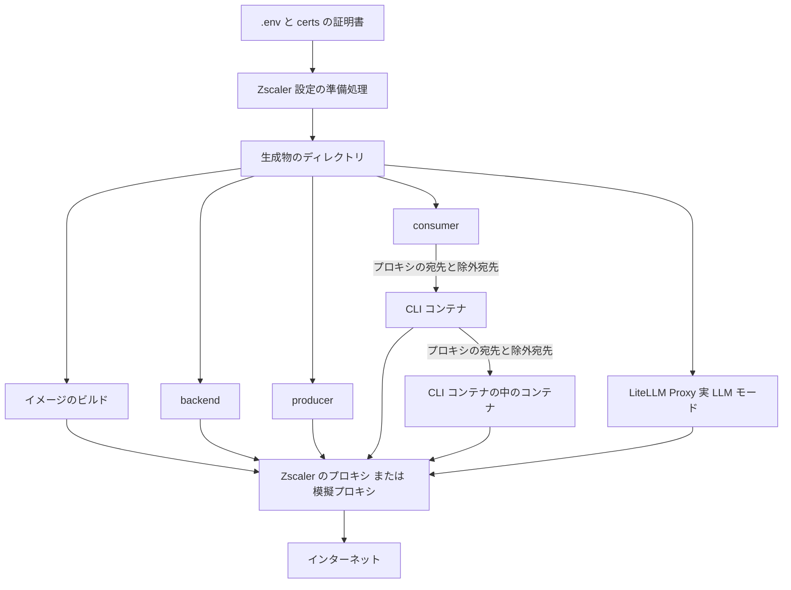
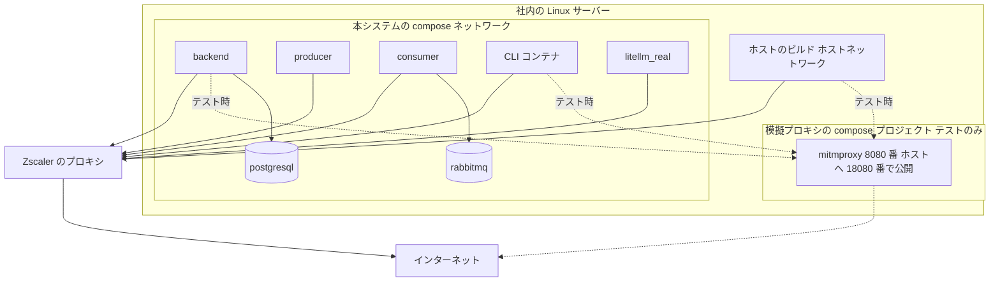
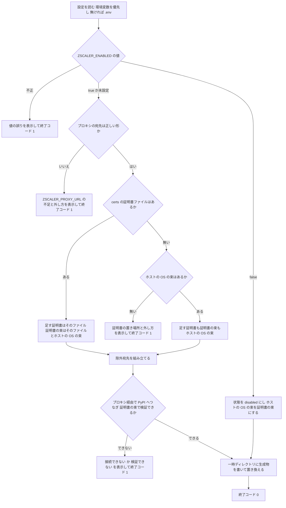
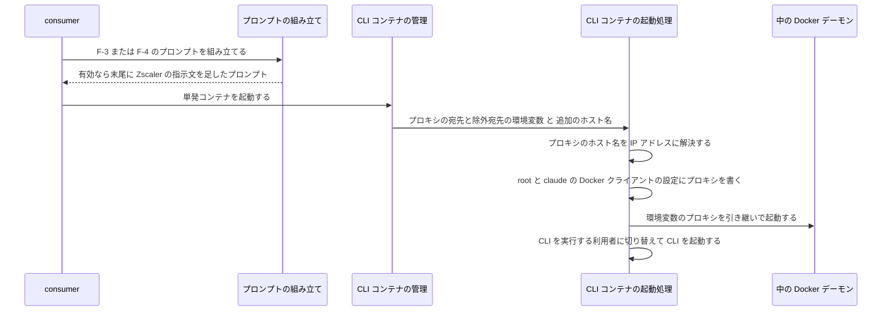
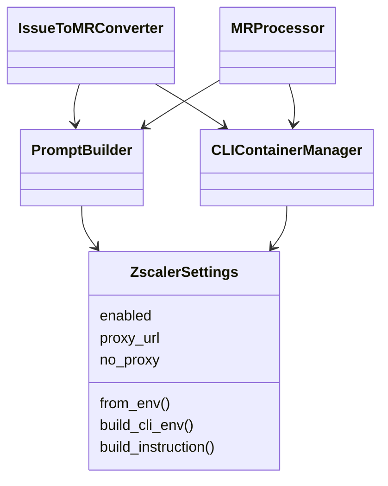

# Zscaler 環境対応 変更詳細設計書

**入力**: `.history/20261101-zscaler-support/change_requirements.md`
**既存設計**: `docs/detail_design.md`

---

## 1. 言語・フレームワーク・アーキテクチャの選定

### 1-1. 引き継ぐ技術

既存設計を引き継ぐ。backend・producer・consumer は Python 3.12（`python:3.12-slim`、Debian 13）、frontend は Vue 3（ビルド段は `node:20-alpine`、配信段は nginx）、DB は PostgreSQL 16、キューは RabbitMQ 3.13、実行形態は docker compose によるコンテナ。

### 1-2. 新たに選定した技術

判定日時: 2026-11-01。技術制約の要約: 配備先は社内の Linux サーバー（Docker Engine）で、Zscaler の明示型プロキシを経由して外へ出る（変更要件定義書 1-1）。CLI コンテナで Playwright の標準のブラウザを起動する必要がある。

| 判断軸 | 該当 | この案件で効く条件 |
|---|---|---|
| 既存資産との整合 | あり | Python のサービスは Debian 系。証明書の入れ方を 1 通りにしたい |
| 配備先 | あり | Playwright の標準のブラウザと Docker Engine の両方が公式に対応する Linux であること |
| 外部連携 | あり | Zscaler の振る舞い（明示型で受け、自前の認証局で署名し直す）を再現できること |
| チームの技術 | あり | 社内では Ubuntu が主流 |
| ライセンスとコスト | あり | OSS で無償 |
| 保守性 | あり | 保守されていて、サポート期限が十分に先 |
| 認証と認可の境界・画面の規模・データの規模 | なし | 今回の変更で変わらない |

**CLI コンテナの土台**

| 候補 | Playwright の対応 | Docker Engine の対応 | サポート期限 | 評価 | 出典 | 確認日 |
|---|---|---|---|---|---|---|
| Ubuntu 24.04 LTS | 対応 | 対応 | 2029-05-31 | 採用 | https://playwright.dev/docs/intro 、https://docs.docker.com/engine/install/ubuntu/ 、https://endoflife.date/ubuntu | 2026-11-01 |
| Debian 13（`node:24-trixie-slim`） | 対応 | 対応 | 2028-06-30 | 不採用（社内の主流ではない） | https://docs.docker.com/engine/install/debian/ 、https://endoflife.date/debian | 2026-11-01 |
| Playwright 公式イメージ | 対応 | 別途導入 | Ubuntu に従う | 不採用（ブラウザの版が固定され、イメージが大きい） | https://playwright.dev/docs/intro | 2026-11-01 |

**模擬プロキシ**

| 候補 | 版 | ライセンス | 評価 | 出典 | 確認日 |
|---|---|---|---|---|---|
| mitmproxy（公式イメージ `mitmproxy/mitmproxy`） | 12.3.1 | MIT | 採用 | https://hub.docker.com/r/mitmproxy/mitmproxy 、https://pypi.org/project/mitmproxy/ | 2026-11-01 |
| Squid（SSL の検査機能） | — | GPL | 不採用（証明書を作る補助の仕組みと細かい設定が要る） | — | 2026-11-01 |

**単体テスト・結合テスト**

| 候補 | 版 | ライセンス | 評価 | 出典 | 確認日 |
|---|---|---|---|---|---|
| pytest | 9.2.0 | MIT | 採用 | https://pypi.org/project/pytest/ | 2026-11-01 |
| unittest | Python 3.12 同梱 | PSF | 不採用（書く量が多い） | — | 2026-11-01 |

**最終選定結果**

| 対象 | 選定 | 選定理由 |
|---|---|---|
| CLI コンテナの土台 | Ubuntu 24.04 LTS。Node.js 24（NodeSource の apt）、Docker Engine 29.9.2（Docker 公式の apt）、Python 3.12（Ubuntu 標準）、uv（公式の取得スクリプト）。コンテナ内で Docker デーモンを動かす起動用スクリプトは moby の `docker-v29.9.2` タグの `hack/dind` をチェックサム付きで取り込む | Playwright の標準のブラウザと Docker Engine の両方が公式に対応し、社内の主流に合う。証明書は他のイメージと同じ `update-ca-certificates` で入れられる |
| 模擬プロキシ | mitmproxy 12.3.1 | 設定なしで明示型の受け付けと署名し直しを再現でき、認証局の証明書をファイルで取り出せる |
| テスト | pytest 9.2.0 | 単体テストとシェルのスクリプトの確認を同じ道具で書ける |

**ユーザー承認の記録**

| 対象 | 承認日 | 備考 |
|---|---|---|
| CLI コンテナの土台 | 2026-11-01 | ユーザーの選択（理由: 社内ではubuntsuが主流のため） |
| 模擬プロキシ | 2026-11-01 | 推奨どおり |
| テスト | 2026-11-01 | 推奨どおり |

---

## 2. システム構成

### 2-1. コンポーネント一覧（変更分）

| コンポーネント | 区分 | 役割 | 根拠となる要件 |
|---|---|---|---|
| Zscaler 設定の準備処理 | [追加] | `.env` の Zscaler 設定と証明書から、各部品が使う生成物（証明書の束、環境変数のファイル、ビルド用の値）を作り、必須チェックと使用前の接続確認を行う | 証明書の束の決定、除外宛先の組み立て、Zscaler 設定の必須チェック、使用前の接続確認 |
| compose の入口スクリプト | [追加] | 準備処理を行ってから docker compose を実行する | Zscaler 設定の必須チェック |
| イメージ内の証明書の導入処理 | [追加] | ビルドの最初に、生成物の証明書をイメージの OS の信頼先と利用者ごとのブラウザの信頼先に入れる | ビルド時の Zscaler 設定の適用、CLI コンテナのブラウザへの Zscaler 設定の適用 |
| CLI コンテナの共通の土台イメージ | [追加] | Ubuntu 24.04 に、中の Docker デーモン、Node.js、Python と uv、Playwright とブラウザの依存物、証明書の道具を入れる。Claude Code 用と opencode 用の土台になる | CLI コンテナでの Playwright の標準のブラウザの起動 |
| CLI コンテナ（Claude Code 用・opencode 用） | [削除] | 削除理由: 土台を Alpine の `docker:26-dind` から Ubuntu 24.04 の共通の土台イメージに変えるため | — |
| CLI コンテナ（Claude Code 用・opencode 用） | [追加] | 共通の土台イメージの上に、それぞれの CLI エージェントだけを入れる | CLI コンテナでの Playwright の標準のブラウザの起動 |
| consumer の Zscaler 設定 | [追加] | consumer の環境変数から Zscaler 設定を読み、CLI コンテナへ渡す環境変数と、CLI エージェントへの指示文を作る | CLI コンテナへの Zscaler 設定の受け渡し、CLI エージェントへの Zscaler の指示 |
| 模擬プロキシ | [追加] | テスト環境だけで、本システムとは別の compose プロジェクトとして起動する mitmproxy | 模擬プロキシ |
| 単体テスト用のサービス | [追加] | consumer のイメージにテストの道具を足したテスト用のコンテナ | テスト設計（第 8 章） |

### 2-2. 全体構成図（変更後）



### 2-3. コンポーネント間インターフェースとデータフロー（変更分）

| 送信元 | 送信先 | インターフェース | データ |
|---|---|---|---|
| 準備処理 | ビルド | docker compose の追加のビルドコンテキストと、ビルド引数 | 生成物のディレクトリ（証明書、状態の印、導入処理）、ビルド用のプロキシの宛先と除外宛先 |
| 準備処理 | 実行中の各部品 | docker compose の環境変数ファイル | Zscaler 設定の有効・無効、プロキシの宛先、除外宛先 |
| 準備処理 | LiteLLM Proxy・Playwright の実行コンテナ | 読み取り専用のファイルのマウント | 証明書の束 |
| consumer | CLI コンテナ | Docker API の環境変数と追加のホスト名 | プロキシの宛先、除外宛先、有効・無効。模擬プロキシのホスト名の解決先 |
| consumer | CLI エージェント | プロンプトのファイル | Zscaler の指示文 |
| CLI コンテナ | 中の Docker デーモンと中のコンテナ | 環境変数と Docker クライアントの設定ファイル | プロキシの宛先（中のコンテナ向けは IP アドレスに解決したもの）と除外宛先 |

### 2-4. ネットワーク構成図



本番では、ビルドも実行中の部品も同じ Zscaler のプロキシの宛先を使う。模擬プロキシを使うテストでは、ビルド（ホストネットワーク）は `http://127.0.0.1:18080`、実行中の部品と CLI コンテナは `http://host.docker.internal:18080` を使う。`host.docker.internal` は compose の追加のホスト名（ホストのゲートウェイ）で解決する。

---

## 3. データ設計

### 3-1. データモデル

DB の変更は無い。既存設計 `docs/detail_design.md` セクション 3 を参照。今回扱うファイルの構造を次のとおり設計する。

| DS-ID | 区分 | 対象 | 構造 | 対応要件ID |
|---|---|---|---|---|
| `DS-SC-ZSCALER-SETTINGS-ENV-DT-ZSCALER-SETTINGS-ENV` | [追加] | `.env` の Zscaler 設定 | `ZSCALER_ENABLED`（`true` か `false`。書いていない場合は `true`）、`ZSCALER_PROXY_URL`（`http://ホスト名:ポート`。有効なときは必須）、`ZSCALER_NO_PROXY_EXTRA`（カンマ区切り。空でよい）。値は、プロセスの環境変数にあればそれを、無ければ `.env` のものを使う | `RQ-DT-ZSCALER-SETTINGS-ENV`、`RQ-UI-ZSCALER-ENV-SETTINGS` |
| `DS-SC-ZSCALER-CERT-FILE-DT-ZSCALER-CERT-FILE` | [追加] | Zscaler の証明書ファイル | プロジェクト直下の `certs/zscaler-ca.pem`。PEM 形式で、証明書を 1 つ以上含む。`certs/` は git の管理外 | `RQ-DT-ZSCALER-CERT-FILE` |
| `DS-SC-ZSCALER-GENERATED-DIR-FT-RESOLVE-CERT-BUNDLE` | [追加] | 生成物のディレクトリ `.zscaler/`（git の管理外） | `state`（`enabled` か `disabled` の 1 行）、`extra-ca.pem`（イメージに足す証明書。有効なときだけ）、`ca-bundle.pem`（証明書の束。常に作る）、`install-ca.sh`（イメージ内の導入処理の写し）、`zscaler.env`（実行中の部品の環境変数: `ZSCALER_ENABLED`、`HTTP_PROXY`、`HTTPS_PROXY`、`NO_PROXY` と、それぞれの小文字版。無効なときプロキシと除外宛先は空）、`build.env`（ビルド用: `ZSCALER_BUILD_PROXY`、`ZSCALER_BUILD_NO_PROXY`） | `RQ-FT-RESOLVE-CERT-BUNDLE`、`RQ-FT-APPLY-ZSCALER-SETTINGS-BUILD`、`RQ-FT-APPLY-ZSCALER-SETTINGS-RUNTIME` |

### 3-2. トランザクションと排他制御

トランザクション・排他制御が要る操作は無い。生成物のディレクトリは、準備処理が一時ディレクトリに作ってから置き換えるので、途中で失敗しても前回の生成物は壊れない。

### 3-3. 状態遷移

状態遷移の変更は無い。既存設計 `docs/detail_design.md` セクション 3 を参照。

### 3-4. CRUD とデータの対応

| エンティティ | 変更 | 備考 |
|---|---|---|
| ユーザー | なし | — |
| CLIアダプタ設定 | なし | Zscaler 設定は CLI アダプタ設定に項目を足さずに、CLI コンテナの管理処理で全 CLI に同じように渡す |
| タスク | なし | — |
| system_settings | なし | Zscaler の指示文はテンプレートに保存せず、プロンプトを組み立てるときに足す |

---

## 4. アーキテクチャ設計

### 4-1. 外部設計

#### 4-1-1. CUI の一覧

| DS-ID | 区分 | 名前 | 使い方 | 対応要件ID |
|---|---|---|---|---|
| `DS-IF-ZSCALER-ENV-SETTINGS-UI-ZSCALER-ENV-SETTINGS` | [追加] | `.env` の Zscaler 設定 | 3-1 の Zscaler 設定の 3 項目を書く | `RQ-UI-ZSCALER-ENV-SETTINGS` |
| `DS-IF-ZSCALER-PREPARE-CMD-FT-REQUIRE-ZSCALER-SETTINGS` | [追加] | 準備処理のコマンド | `./scripts/zscaler_prepare.sh [--mock] [--project-dir DIR] [--host-bundle FILE]`。`--mock` は模擬プロキシの値を使う。`--project-dir` と `--host-bundle` はテストで置き場所を差し替えるためのもので、通常は使わない | `RQ-FT-REQUIRE-ZSCALER-SETTINGS`、`RQ-FT-VERIFY-ZSCALER-TRUST-BEFORE-USE` |
| `DS-IF-COMPOSE-WRAPPER-FT-REQUIRE-ZSCALER-SETTINGS` | [追加] | compose の入口スクリプト | `./scripts/compose.sh <docker compose の引数>`。準備処理を行ってから、ビルド用の値を環境に入れて `docker compose` を実行する（例: `./scripts/compose.sh up -d --build`） | `RQ-FT-REQUIRE-ZSCALER-SETTINGS` |
| `DS-IF-TEST-SETUP-ZSCALER-MOCK-UI-TEST-SETUP-ZSCALER-MOCK-OPTION` | [追加] | テスト環境セットアップの `--zscaler-mock` | `./scripts/test_setup.sh --zscaler-mock [--real] [--run-tests]` | `RQ-UI-TEST-SETUP-ZSCALER-MOCK-OPTION` |

#### 4-1-2. インターフェース仕様

| DS-ID | 入力とバリデーション | 出力 | エラー仕様 |
|---|---|---|---|
| `DS-IF-ZSCALER-ENV-SETTINGS-UI-ZSCALER-ENV-SETTINGS` | `ZSCALER_ENABLED` は `true`・`false`・未設定のいずれか。`ZSCALER_PROXY_URL` は `http://` で始まり、ホスト名とポート番号を持つ。`ZSCALER_NO_PROXY_EXTRA` はカンマ区切りで、前後の空白を取り除く（業務ルール「Zscaler 設定の必須チェック」） | 準備処理の生成物 | 不正な値は準備処理のエラーとして扱う（次行） |
| `DS-IF-ZSCALER-PREPARE-CMD-FT-REQUIRE-ZSCALER-SETTINGS` | 上の 3 項目、`certs/zscaler-ca.pem`、ホストの OS の証明書の束 | 生成物のディレクトリ。進捗を標準出力に出す。終了コードは成功 0、失敗 1 | ① `ZSCALER_ENABLED` が不正な値: 値と、使える値を表示。② 有効なのにプロキシの宛先が無い・形が不正: 項目名 `ZSCALER_PROXY_URL` と、`ZSCALER_ENABLED=false` で外せることを表示。③ 有効なのに証明書ファイルもホストの OS の束も無い: 証明書ファイルの置き場所と外し方を表示。④ 使用前の接続確認の失敗: 「プロキシに接続できない」（接続拒否・名前解決失敗・時間切れ）か「証明書を検証できない」（証明書の検証の失敗）を、宛先とあわせて表示。いずれも標準エラーに出し、生成物を書き換えずに終了コード 1 で終わる |
| `DS-IF-COMPOSE-WRAPPER-FT-REQUIRE-ZSCALER-SETTINGS` | docker compose の引数 | docker compose の出力と終了コード | 準備処理が失敗したら docker compose を実行せず、準備処理の終了コードで終わる |
| `DS-IF-TEST-SETUP-ZSCALER-MOCK-UI-TEST-SETUP-ZSCALER-MOCK-OPTION` | 既存の `--real`・`--run-tests` と組み合わせる | 既存のステップの進捗に加えて、模擬プロキシの起動と準備処理の結果を標準出力に出す。終了コードは成功 0、失敗 1 | 模擬プロキシが 60 秒以内に認証局の証明書を書き出さない、または準備処理が失敗したら、原因を標準エラーに出して終了コード 1 で終わる。`certs/` と `.env` には書き込まない |

#### 4-1-3. 外部システム連携

外部連携の追加は無い。既存の連携先（GitLab、LiteLLM Proxy、LLM の API）への通信が、プロキシの宛先を経由する。帳票・出力ファイルは無い。外部 DB 連携の変更は無い。

### 4-2. 内部設計

#### 4-2-1. 準備処理のフロー



模擬プロキシのとき（`--mock`）は、`.env` の `ZSCALER_ENABLED` と `ZSCALER_PROXY_URL` を使わず、有効として扱う。足す証明書は模擬プロキシの認証局の証明書（`zscaler-mock/.data/mitmproxy-ca-cert.pem`）、証明書の束はそれとホストの OS の束、ビルド用の宛先は `http://127.0.0.1:18080`、実行中の部品の宛先は `http://host.docker.internal:18080` にする。`ZSCALER_NO_PROXY_EXTRA` は `.env` のものを使う。

ホストの OS の束は、`/etc/ssl/certs/ca-certificates.crt`、`/etc/pki/tls/certs/ca-bundle.crt`、`/etc/ssl/cert.pem` の順に探し、最初に見つかったものを使う。

#### 4-2-2. ビルドの処理

各 Dockerfile は、外へ出る最初の処理の前に、生成物のディレクトリを追加のビルドコンテキスト `zscaler` として読み取り専用でマウントし、導入処理を実行する。

1. 状態が `disabled` なら何もしない。
2. 状態が `enabled` で、ビルド引数のプロキシの宛先が空なら、「Zscaler 設定が有効ですが、ビルドにプロキシの宛先が渡されていません。`./scripts/compose.sh` などのスクリプトからビルドしてください」と表示して失敗する。
3. `update-ca-certificates` がある土台（Debian・Ubuntu）では、足す証明書を `/usr/local/share/ca-certificates/zscaler.crt` に置いて `update-ca-certificates` を実行する。無い土台（frontend のビルド段の Alpine）では、足す証明書を `/etc/ssl/certs/ca-certificates.crt` の末尾に足す。
4. CLI コンテナの土台では、続けて CLI を実行する利用者（root と claude）ごとに、Chromium 系が読む証明書データベース（`~/.pki/nssdb` と `~/.local/share/pki/nssdb`）を作り、足す証明書を信頼する認証局として登録する。

各 Dockerfile は、Zscaler 設定の有効・無効によらず、次の環境変数を OS の証明書の束（`/etc/ssl/certs/ca-certificates.crt`）に向ける: `SSL_CERT_FILE`、`REQUESTS_CA_BUNDLE`、`PIP_CERT`、`NODE_EXTRA_CA_CERTS`。束は公開の認証局と（有効なときは）Zscaler の証明書を含むので、無効なときも動作は変わらない。

プロキシの宛先は、docker compose のビルド引数（`HTTP_PROXY`・`HTTPS_PROXY`・`NO_PROXY` と小文字版）で渡す。値は compose の入口スクリプトなどが `build.env` から環境に入れる。すべてのビルドはホストネットワークで行う（模擬プロキシのビルド用の宛先 `127.0.0.1` に届かせるため）。

#### 4-2-3. CLI コンテナの起動と受け渡しのフロー



- CLI コンテナの管理処理は、Zscaler 設定が有効なとき、CLI アダプタ設定から作った環境変数に、プロキシの宛先と除外宛先（大文字版と小文字版）と `ZSCALER_ENABLED=true` を足す。無効なときは `ZSCALER_ENABLED=false` だけを足す。どちらの場合も、追加のホスト名 `host.docker.internal`（ホストのゲートウェイ）を付ける。
- Playwright の Chromium 系と WebKit は、デスクトップ環境の無い Linux ではプロキシの環境変数に従うので、CLI コンテナの環境変数のプロキシの宛先と除外宛先をそのまま使う。ブラウザごとのプロキシの設定は足さない。
- 中のコンテナは、CLI コンテナの名前解決を使えないので、Docker クライアントの設定に書くプロキシの宛先は、CLI コンテナの中で IP アドレスに解決したものにする。中の Docker デーモン自身は CLI コンテナの名前解決を使えるので、ホスト名のまま引き継ぐ。
- Zscaler の指示文は次の内容の固定文にする。「この環境は Zscaler の配下にある。外への通信は環境変数のプロキシを経由する。Zscaler の証明書は `/usr/local/share/ca-certificates/zscaler.crt`、証明書の束は `/etc/ssl/certs/ca-certificates.crt` にある。開発するシステムの Dockerfile と docker compose の設定には、ビルド時に外から証明書とプロキシの宛先を渡せる作りを組み込み、証明書ファイルそのものはリポジトリにコミットしない。開発するシステムの部品どうしの通信は除外宛先に入れる。証明書の検証を無効にする設定（証明書のエラーを無視する設定を含む）は使わない。Playwright の Chromium と WebKit は Zscaler の証明書を信頼済みで、Firefox は信頼させられないので使わない。」

#### 4-2-4. バッチ設計

バッチの追加・変更は無い。

---

## 5. クラス設計

### 5-1. クラス一覧

| DS-ID | 区分 | クラス | 役割 | S | O | L | I | D | 対応要件ID |
|---|---|---|---|---|---|---|---|---|---|
| `DS-CL-ZSCALER-SETTINGS-FT-PASS-ZSCALER-SETTINGS-CLI-CONTAINER` | [追加] | ZscalerSettings | consumer の環境変数から Zscaler 設定を読み、CLI コンテナへの環境変数と指示文を返す。変更不能なデータクラス | ○ | ○ | ○ | ○ | ○ | `RQ-FT-PASS-ZSCALER-SETTINGS-CLI-CONTAINER`、`RQ-FT-INSTRUCT-CLI-ZSCALER` |

既存の PromptBuilder と CLIContainerManager は、コンストラクタで ZscalerSettings を受け取る（依存を外から渡す）。クラスの責務は変えない。

### 5-2. 主要属性とメソッド

| DS-ID | 区分 | 対象 | 内容 | 対応要件ID |
|---|---|---|---|---|
| `DS-FN-LOAD-ZSCALER-SETTINGS-FT-PASS-ZSCALER-SETTINGS-CLI-CONTAINER` | [追加] | ZscalerSettings.from_env | 環境変数の辞書から、有効・無効（`ZSCALER_ENABLED` が `true` のときだけ有効）、プロキシの宛先（`HTTPS_PROXY`）、除外宛先（`NO_PROXY`）を読む | `RQ-FT-PASS-ZSCALER-SETTINGS-CLI-CONTAINER` |
| `DS-FN-BUILD-CLI-PROXY-ENV-FT-PASS-ZSCALER-SETTINGS-CLI-CONTAINER` | [追加] | ZscalerSettings.build_cli_env | 4-2-3 の環境変数の辞書を返す | `RQ-FT-PASS-ZSCALER-SETTINGS-CLI-CONTAINER` |
| `DS-FN-BUILD-ZSCALER-INSTRUCTION-FT-INSTRUCT-CLI-ZSCALER` | [追加] | ZscalerSettings.build_instruction | 有効なら 4-2-3 の指示文を、無効なら空文字を返す | `RQ-FT-INSTRUCT-CLI-ZSCALER` |
| `DS-FN-APPEND-ZSCALER-INSTRUCTION-FT-INSTRUCT-CLI-ZSCALER` | [追加] | PromptBuilder.build_f3_prompt・build_f4_prompt | 変数の展開（と F-4 の補足）の後に、指示文が空でなければ区切り線を挟んで末尾に足す。システム設定のテンプレートとユーザー個別のテンプレートのどちらにも同じように足す | `RQ-FT-INSTRUCT-CLI-ZSCALER` |
| `DS-FN-MERGE-ZSCALER-CLI-ENV-FT-PASS-ZSCALER-SETTINGS-CLI-CONTAINER` | [追加] | CLIContainerManager.run_container_once・start_container | 渡された環境変数に build_cli_env の結果を足し（同じ名前は渡された側を優先）、追加のホスト名を付けてコンテナを作る | `RQ-FT-PASS-ZSCALER-SETTINGS-CLI-CONTAINER` |

### 5-3. クラス図



### 5-4. システム内メッセージ

メッセージの追加・変更は無い。既存設計 `docs/detail_design.md` セクション 5 を参照。

---

## 6. エラーハンドリングとセキュリティ設計

### 6-1. エラーハンドリング

| エラー | 発生箇所 | 利用者への見え方 | 処理 |
|---|---|---|---|
| Zscaler 設定の値の誤り・不足 | 準備処理 | 4-1-2 の①〜③の表示 | 中止（終了コード 1） |
| 使用前の接続確認の失敗 | 準備処理 | 4-1-2 の④の表示 | 中止（終了コード 1） |
| 準備処理を通さないビルド | イメージ内の導入処理 | 4-2-2 の 2 の表示 | ビルドの失敗 |
| 生成物のディレクトリが無い状態での docker compose | docker compose | docker compose の「ビルドコンテキスト・環境変数ファイルが見つからない」エラー | 中止。README に「`./scripts/compose.sh` で一度準備する」と書く |
| CLI コンテナでプロキシのホスト名を解決できない | CLI コンテナの起動処理 | CLI のログに警告を出す | 中のコンテナ向けにはホスト名のまま書いて続行する |
| 実行中の通信の失敗（プロキシや証明書の不備） | 各部品 | 既存のエラー処理のまま（タスクは failed、GitLab へ失敗コメント） | 既存どおり |

### 6-2. セキュリティ

| 項目 | 設計 |
|---|---|
| 認証・認可 | 変更なし。既存設計 `docs/detail_design.md` セクション 6 を参照 |
| 監査ログ | 変更なし |
| 証明書の検証 | どの部品・テストでも、証明書の検証を無効にする設定（Python の `verify=False`、Node の `NODE_TLS_REJECT_UNAUTHORIZED=0`、Playwright の `ignoreHTTPSErrors`、curl の `--insecure`、pip の `--trusted-host`、LiteLLM の `ssl_verify: false`）を使わない。単体テストでリポジトリ全体を検査する |
| 証明書ファイル | `certs/`、`.zscaler/`、`zscaler-mock/.data/` を git の管理外にする。CLI エージェントへの指示文で、対象リポジトリにも証明書をコミットしないよう求める |
| 社内用のイメージ | compose のイメージ名をローカル専用にし、ghcr.io の名前は Zscaler 設定を無効にした GitHub Actions だけが使う |

---

## 7. コード設計

### 7-1. ディレクトリ構成（変更分）

| ディレクトリ | 区分 | 中身 |
|---|---|---|
| `certs/` | [追加] | 管理者が置く Zscaler の証明書。git 管理外 |
| `.zscaler/` | [追加] | 準備処理の生成物。git 管理外 |
| `scripts/lib/` | [追加] | シェルの共通処理 |
| `scripts/zscaler/` | [追加] | イメージ内の導入処理 |
| `consumer/` | 既存 | consumer のコード |
| `cli-exec/base/` | [追加] | CLI コンテナの共通の土台 |
| `cli-exec/claude/`・`cli-exec/opencode/` | 既存 | 各 CLI エージェントのイメージ |
| `zscaler-mock/` | [追加] | 模擬プロキシの compose プロジェクト |
| `zscaler-mock/.data/` | [追加] | mitmproxy の認証局。git 管理外 |
| `tests/consumer/`・`tests/scripts/` | [追加] | 単体テスト・結合テスト |
| `e2e/zscaler/` | [追加] | Zscaler の E2E |

### 7-2. ファイル一覧

| DS-ID | 区分 | ファイル | 役割 | 含まれる設計要素（DS-ID） | 対応要件ID |
|---|---|---|---|---|---|
| `DS-MD-ENV-LOADER-UI-ZSCALER-ENV-SETTINGS` | [追加] | `scripts/lib/env.sh` | `.env` の読み込み（`test_setup.sh` の読み込み処理をここへ移して共通化する） | — | `RQ-UI-ZSCALER-ENV-SETTINGS` |
| `DS-MD-ZSCALER-LIB-FT-RESOLVE-CERT-BUNDLE` | [追加] | `scripts/lib/zscaler.sh` | 準備処理の本体（関数群） | `DS-FN-RESOLVE-CERT-BUNDLE-FT-RESOLVE-CERT-BUNDLE`、`DS-FN-BUILD-NO-PROXY-LIST-FT-BUILD-NO-PROXY-LIST`、`DS-FN-REQUIRE-ZSCALER-SETTINGS-FT-REQUIRE-ZSCALER-SETTINGS`、`DS-FN-VERIFY-TRUST-BEFORE-USE-FT-VERIFY-ZSCALER-TRUST-BEFORE-USE`、`DS-FN-PREPARE-ZSCALER-FT-APPLY-ZSCALER-SETTINGS-RUNTIME` | `RQ-FT-RESOLVE-CERT-BUNDLE`、`RQ-FT-BUILD-NO-PROXY-LIST`、`RQ-FT-REQUIRE-ZSCALER-SETTINGS`、`RQ-FT-VERIFY-ZSCALER-TRUST-BEFORE-USE`、`RQ-FT-APPLY-ZSCALER-SETTINGS-RUNTIME` |
| `DS-MD-ZSCALER-PREPARE-CMD-FT-REQUIRE-ZSCALER-SETTINGS` | [追加] | `scripts/zscaler_prepare.sh` | 準備処理のコマンド（引数の解析と本体の呼び出し） | `DS-IF-ZSCALER-PREPARE-CMD-FT-REQUIRE-ZSCALER-SETTINGS` | `RQ-FT-REQUIRE-ZSCALER-SETTINGS` |
| `DS-MD-COMPOSE-WRAPPER-FT-REQUIRE-ZSCALER-SETTINGS` | [追加] | `scripts/compose.sh` | compose の入口スクリプト | `DS-IF-COMPOSE-WRAPPER-FT-REQUIRE-ZSCALER-SETTINGS` | `RQ-FT-REQUIRE-ZSCALER-SETTINGS` |
| `DS-MD-INSTALL-CA-FT-APPLY-ZSCALER-SETTINGS-BUILD` | [追加] | `scripts/zscaler/install-ca.sh` | イメージ内の導入処理。準備処理が生成物のディレクトリへ写す | `DS-FN-INSTALL-CA-SYSTEM-FT-APPLY-ZSCALER-SETTINGS-BUILD`、`DS-FN-INSTALL-CA-NSS-FT-APPLY-ZSCALER-SETTINGS-CLI-BROWSER` | `RQ-FT-APPLY-ZSCALER-SETTINGS-BUILD`、`RQ-FT-APPLY-ZSCALER-SETTINGS-CLI-BROWSER` |
| `DS-MD-SCRIPTS-TEST-SETUP-SH-FT-SETUP-TEST-ENVIRONMENT` | [追加]（既存の設計要素に対応を追加） | `scripts/test_setup.sh`（既存のファイルに追記） | 最初に準備処理を行い（`--zscaler-mock` なら模擬プロキシを起動してから模擬の値で）、ビルド用の値を環境に入れる。`--zscaler-mock` の処理、模擬プロキシの起動、ホストの pip への Zscaler 設定の受け渡し、`--run-tests` での Zscaler の E2E の実行 | `DS-IF-TEST-SETUP-ZSCALER-MOCK-UI-TEST-SETUP-ZSCALER-MOCK-OPTION`、`DS-FN-START-ZSCALER-MOCK-FT-RUN-ZSCALER-MOCK-PROXY`、`DS-FN-INSTALL-HOST-PYTHON-DEPS-FT-APPLY-ZSCALER-SETTINGS-HOST-SCRIPT` | `RQ-UI-TEST-SETUP-ZSCALER-MOCK-OPTION`、`RQ-FT-RUN-ZSCALER-MOCK-PROXY`、`RQ-FT-APPLY-ZSCALER-SETTINGS-HOST-SCRIPT` |
| `DS-MD-SCRIPTS-SETUP-SH-FT-SETUP-INITIAL-DATA` | [追加]（既存の設計要素に対応を追加） | `scripts/setup.sh`（既存のファイルに追記） | 最初に準備処理を行い、ビルド用の値を環境に入れる | — | `RQ-FT-REQUIRE-ZSCALER-SETTINGS` |
| `DS-MD-SCRIPTS-BUILD-CLI-EXEC-FT-BUILD-CLI-IMAGES` | [追加]（既存の設計要素に対応を追加） | `scripts/build_cli_exec.sh`（既存のファイルを書き換え） | 準備処理を行い、compose の定義で CLI コンテナの土台と 2 種をビルドする | — | `RQ-FT-APPLY-ZSCALER-SETTINGS-BUILD`、`RQ-FT-RUN-STANDARD-BROWSERS-CLI-CONTAINER` |
| `DS-MD-ZSCALER-SETTINGS-FT-PASS-ZSCALER-SETTINGS-CLI-CONTAINER` | [追加] | `consumer/zscaler_settings.py` | ZscalerSettings | `DS-CL-ZSCALER-SETTINGS-FT-PASS-ZSCALER-SETTINGS-CLI-CONTAINER`、`DS-FN-LOAD-ZSCALER-SETTINGS-FT-PASS-ZSCALER-SETTINGS-CLI-CONTAINER`、`DS-FN-BUILD-CLI-PROXY-ENV-FT-PASS-ZSCALER-SETTINGS-CLI-CONTAINER`、`DS-FN-BUILD-ZSCALER-INSTRUCTION-FT-INSTRUCT-CLI-ZSCALER` | `RQ-FT-PASS-ZSCALER-SETTINGS-CLI-CONTAINER`、`RQ-FT-INSTRUCT-CLI-ZSCALER` |
| `DS-MD-CONSUMER-PROMPT-BUILDER-FT-BUILD-PROMPT` | [追加]（既存の設計要素に対応を追加） | `consumer/prompt_builder.py`（既存のファイルに追記） | 指示文の付加 | `DS-FN-APPEND-ZSCALER-INSTRUCTION-FT-INSTRUCT-CLI-ZSCALER` | `RQ-FT-INSTRUCT-CLI-ZSCALER` |
| `DS-MD-CONSUMER-CLI-CONTAINER-MANAGER-FT-RUN-CLI-CONTAINER` | [追加]（既存の設計要素に対応を追加） | `consumer/cli_container_manager.py`（既存のファイルに追記） | 環境変数と追加のホスト名の付加 | `DS-FN-MERGE-ZSCALER-CLI-ENV-FT-PASS-ZSCALER-SETTINGS-CLI-CONTAINER` | `RQ-FT-PASS-ZSCALER-SETTINGS-CLI-CONTAINER` |
| `DS-MD-CONSUMER-ENTRY-FT-GRACEFUL-SHUTDOWN` | [追加]（既存の設計要素に対応を追加） | `consumer/consumer.py`（既存のファイルに追記） | 起動時に ZscalerSettings を作り、PromptBuilder と CLIContainerManager に渡す | — | `RQ-FT-PASS-ZSCALER-SETTINGS-CLI-CONTAINER` |
| `DS-MD-DIND-START-FT-RUN-STANDARD-BROWSERS-CLI-CONTAINER` | [追加] | `cli-exec/base/dind-start.sh` | CLI コンテナの起動処理。今の Dockerfile の中に書いている起動処理を、共通の土台のファイルに移して 2 種で共有する | `DS-FN-START-DIND-AND-RUN-CLI-FT-RUN-STANDARD-BROWSERS-CLI-CONTAINER`、`DS-FN-CONFIGURE-INNER-DOCKER-PROXY-FT-PASS-ZSCALER-SETTINGS-CLI-CONTAINER` | `RQ-FT-RUN-STANDARD-BROWSERS-CLI-CONTAINER`、`RQ-FT-PASS-ZSCALER-SETTINGS-CLI-CONTAINER` |

シェルの関数の設計要素:

| DS-ID | 区分 | 関数 | 内容 | 対応要件ID |
|---|---|---|---|---|
| `DS-FN-RESOLVE-CERT-BUNDLE-FT-RESOLVE-CERT-BUNDLE` | [追加] | `zscaler_resolve_bundle` | 4-2-1 の証明書の決め方（証明書ファイル、ホストの OS の束、模擬プロキシの認証局） | `RQ-FT-RESOLVE-CERT-BUNDLE` |
| `DS-FN-BUILD-NO-PROXY-LIST-FT-BUILD-NO-PROXY-LIST` | [追加] | `zscaler_build_no_proxy` | `localhost`、`127.0.0.1`、`::1` と、本システムの compose のサービス名・ネットワークの別名のすべて（postgresql、postgresql_litellm、rabbitmq、backend、frontend、producer、consumer、mock_llm、gitlab、litellm、litellm_real、test_playwright、test_playwright_real、cli_exec_base、cli_exec_claude、cli_exec_opencode、unit_test）に、`ZSCALER_NO_PROXY_EXTRA` を足し、重複を除いてカンマでつなぐ | `RQ-FT-BUILD-NO-PROXY-LIST` |
| `DS-FN-REQUIRE-ZSCALER-SETTINGS-FT-REQUIRE-ZSCALER-SETTINGS` | [追加] | `zscaler_require_settings` | 4-1-2 の①〜③の判定 | `RQ-FT-REQUIRE-ZSCALER-SETTINGS` |
| `DS-FN-VERIFY-TRUST-BEFORE-USE-FT-VERIFY-ZSCALER-TRUST-BEFORE-USE` | [追加] | `zscaler_preflight` | ホストの curl で、ビルド用の宛先を経由して `https://pypi.org/simple/` へ、証明書の束を信頼先にして 20 秒以内につなぐ。curl の失敗の種類で「接続できない」と「検証できない」を分ける | `RQ-FT-VERIFY-ZSCALER-TRUST-BEFORE-USE` |
| `DS-FN-PREPARE-ZSCALER-FT-APPLY-ZSCALER-SETTINGS-RUNTIME` | [追加] | `zscaler_prepare`・`zscaler_export_build_env` | 4-2-1 の全体の流れと生成物の書き込み。`build.env` の値を呼び出し元の環境に入れる。呼び出し元のスクリプトで準備済み（環境変数 `ZSCALER_PREPARED=1` を子のプロセスへ引き継ぐ）なら繰り返さない | `RQ-FT-APPLY-ZSCALER-SETTINGS-RUNTIME`、`RQ-FT-APPLY-ZSCALER-SETTINGS-BUILD` |
| `DS-FN-INSTALL-CA-SYSTEM-FT-APPLY-ZSCALER-SETTINGS-BUILD` | [追加] | `install-ca.sh` の既定の動作 | 4-2-2 の 1〜3 | `RQ-FT-APPLY-ZSCALER-SETTINGS-BUILD` |
| `DS-FN-INSTALL-CA-NSS-FT-APPLY-ZSCALER-SETTINGS-CLI-BROWSER` | [追加] | `install-ca.sh nss <利用者>` | 4-2-2 の 4 | `RQ-FT-APPLY-ZSCALER-SETTINGS-CLI-BROWSER` |
| `DS-FN-START-ZSCALER-MOCK-FT-RUN-ZSCALER-MOCK-PROXY` | [追加] | `start_zscaler_mock` | 模擬プロキシの compose プロジェクトを起動し、認証局の証明書のファイルができるまで最大 60 秒待つ | `RQ-FT-RUN-ZSCALER-MOCK-PROXY` |
| `DS-FN-INSTALL-HOST-PYTHON-DEPS-FT-APPLY-ZSCALER-SETTINGS-HOST-SCRIPT` | [追加] | `install_host_python_deps` | ホストの仮想環境の pip に、有効なら証明書の束（`--cert`）とビルド用の宛先（`--proxy`）を渡して必要なライブラリ（requests、pytest）を入れる | `RQ-FT-APPLY-ZSCALER-SETTINGS-HOST-SCRIPT` |
| `DS-FN-START-DIND-AND-RUN-CLI-FT-RUN-STANDARD-BROWSERS-CLI-CONTAINER` | [追加] | `dind-start.sh` の本体 | iptables の方式を選んで中の Docker デーモンを起動し（moby の起動用スクリプト経由）、`CLI_RUN_AS` が指定されていればその利用者に切り替えて（`setpriv`）コマンドを実行する。引数が無ければデーモンのログを表示し続ける | `RQ-FT-RUN-STANDARD-BROWSERS-CLI-CONTAINER` |
| `DS-FN-CONFIGURE-INNER-DOCKER-PROXY-FT-PASS-ZSCALER-SETTINGS-CLI-CONTAINER` | [追加] | `configure_inner_docker_proxy` | `ZSCALER_ENABLED=true` なら、プロキシのホスト名を IP アドレスに解決し、root と claude の `~/.docker/config.json` の `proxies` にプロキシの宛先と除外宛先を書く | `RQ-FT-PASS-ZSCALER-SETTINGS-CLI-CONTAINER` |

### 7-3. 共通化の方針

| 共通化の対象 | 置き場所 | 理由 |
|---|---|---|
| `.env` の読み込み | `scripts/lib/env.sh` | `test_setup.sh` と準備処理の両方が使う |
| 準備処理 | `scripts/lib/zscaler.sh` | compose の入口・`setup.sh`・`build_cli_exec.sh`・`test_setup.sh`・GitHub Actions が同じ処理を使い、同じプロセスでは 1 回だけ行う |
| イメージへの証明書の導入 | `scripts/zscaler/install-ca.sh` | 6 つの Dockerfile が同じ処理を使う |
| CLI コンテナの土台 | `cli-exec/base/` | Claude Code 用と opencode 用の共通部分（OS、中の Docker、Node.js、Python、Playwright、証明書、起動処理）を 1 つにする |
| CLI コンテナへの Zscaler 設定の付加 | CLIContainerManager | F-3 と F-4 の両方が通る単発コンテナの起動で一度だけ付ける |
| 指示文の付加 | PromptBuilder | F-3 と F-4 の両方のプロンプトの組み立てで一度だけ付ける |

### 7-4. コーディング規約

既存設計 `docs/detail_design.md` セクション 7 の規約（Python は PEP8・型ヒント・docstring）に加えて、シェルのスクリプトは bash（イメージ内の導入処理は POSIX sh）で書き、`set -eu` を使い、日本語のコメントを付ける。コードには要件 ID・設計 ID を書かず、設計 ID とコードの対応は実装時に `docs/trace_map.md` へ記録する。

---

## 8. テスト設計

### 8-1. テストの種類と方針

| 種類 | 目的 | 方法 |
|---|---|---|
| 単体テスト | ZscalerSettings、PromptBuilder の指示文の付加、CLIContainerManager の環境変数の付加、準備処理の各関数（ネットワークを使わない判定と組み立て）の正しさ | `tests/` 配下の pytest。シェルの関数は bash で読み込んで呼び出し、出力と終了コードを確かめる |
| 結合テスト | 準備処理のコマンドが、実際のファイルで生成物を作り、エラー時に生成物を書き換えないこと | `tests/scripts/` 配下の pytest。一時ディレクトリを `--project-dir` に渡す |
| 総合テスト・E2E | 8-2 のシナリオ | 8-3 のとおり |

| DS-ID | 区分 | テスト | 対応要件ID |
|---|---|---|---|
| `DS-TS-ZSCALER-UNIT-TESTS-FT-PASS-ZSCALER-SETTINGS-CLI-CONTAINER` | [追加] | ZscalerSettings（有効・無効・値なし）、PromptBuilder（F-3、F-4 のシステム設定、F-4 のユーザー個別、無効時に足さない）、CLIContainerManager（環境変数の優先順位、追加のホスト名）の単体テスト | `RQ-FT-PASS-ZSCALER-SETTINGS-CLI-CONTAINER`、`RQ-FT-INSTRUCT-CLI-ZSCALER` |
| `DS-TS-ZSCALER-SCRIPT-TESTS-FT-REQUIRE-ZSCALER-SETTINGS` | [追加] | 準備処理の単体・結合テスト（スイッチの値の判定、宛先の形、証明書の決め方、除外宛先、生成物の中身、エラー時に生成物を書き換えないこと） | `RQ-FT-REQUIRE-ZSCALER-SETTINGS`、`RQ-FT-RESOLVE-CERT-BUNDLE`、`RQ-FT-BUILD-NO-PROXY-LIST` |
| `DS-TS-NO-TLS-VERIFY-DISABLE-NF-TLS-VERIFICATION-ALWAYS-ON` | [追加] | リポジトリ全体（`node_modules`、仮想環境、`.history/`、`docs/`、このテスト自身を除く）に、6-2 の証明書の検証を無効にする設定が無いことを確かめる単体テスト | `RQ-NF-TLS-VERIFICATION-ALWAYS-ON` |

単体テスト・結合テストの実行コマンド:

```bash
docker compose --profile test run --rm unit_test
```

`unit_test` サービスは consumer の Dockerfile のテスト段（実行段に pytest 9.2.0 を足したもの）から作り、リポジトリを読み取り専用で `/repo` にマウントして `pytest /repo/tests -q` を実行する。

### 8-2. E2E テストのシナリオ

外部連携が無いため、mock / real のモードは設けない（模擬プロキシの有無は `--zscaler-mock`、LLM の実物かモックかは既存の `--real` で切り替える）。

| DS-ID | 対応要件ID | 目的 | 前提条件 | 手順 | 期待結果 |
|---|---|---|---|---|---|
| `DS-TS-BUILD-VIA-ZSCALER-MOCK-TS-VERIFY-BUILD-VIA-ZSCALER-MOCK` | `RQ-TS-VERIFY-BUILD-VIA-ZSCALER-MOCK` | 全イメージを模擬プロキシ経由でビルドできる | 社外の開発環境。`certs/` に証明書ファイルが無い | `./scripts/test_setup.sh --zscaler-mock` を実行し、模擬プロキシのログを見る | 終了コード 0。backend・producer・consumer・frontend・CLI コンテナの土台と 2 種のビルドの通信が模擬プロキシのログに残る |
| `DS-TS-RUNTIME-HTTPS-VIA-ZSCALER-MOCK-TS-VERIFY-RUNTIME-HTTPS-VIA-ZSCALER-MOCK` | `RQ-TS-VERIFY-RUNTIME-HTTPS-VIA-ZSCALER-MOCK` | 実行中の各部品から模擬経由で検証付きの HTTPS 接続ができる | 上のセットアップ済み | backend・producer・consumer で requests と httpx による `https://pypi.org/simple/` への接続、CLI コンテナ 2 種で Node.js の fetch・curl・git・uv・pip による接続と、`https://api.anthropic.com/` への接続を、`docker compose exec` と `docker run` で行う | すべて成功し、模擬プロキシのログに記録される |
| `DS-TS-UNTRUSTED-CERT-STOPS-TS-VERIFY-UNTRUSTED-CERT-STOPS` | `RQ-TS-VERIFY-UNTRUSTED-CERT-STOPS` | 信頼していない証明書で使用前の接続確認が止める | 模擬プロキシが起動している | 一時ディレクトリを `--project-dir` にし、`ZSCALER_PROXY_URL=http://127.0.0.1:18080`、証明書ファイルなし、`--host-bundle` に模擬の認証局を含まない束を渡して準備処理を実行する | 終了コード 1、「証明書を検証できない」が標準エラーに出て、生成物が作られない |
| `DS-TS-MISSING-SETTINGS-STOP-TS-VERIFY-MISSING-SETTINGS-STOP` | `RQ-TS-VERIFY-MISSING-SETTINGS-STOP` | 設定の不足で止まる | なし | 一時ディレクトリの `.env` で `ZSCALER_PROXY_URL` を空にして準備処理と `scripts/compose.sh build` を実行する | どちらも終了コード 1、`ZSCALER_PROXY_URL` と `ZSCALER_ENABLED=false` の案内が標準エラーに出て、ビルドが始まらない |
| `DS-TS-DISABLED-SWITCH-TS-VERIFY-DISABLED-SWITCH` | `RQ-TS-VERIFY-DISABLED-SWITCH` | 無効なら証明書と宛先なしで動く | `.env` に `ZSCALER_ENABLED=false` | `./scripts/test_setup.sh --run-tests` を実行し、CLI コンテナに渡ったプロンプトを確かめる | 終了コード 0、既存の E2E がすべて成功し、プロンプトに指示文が無い |
| `DS-TS-OS-BUNDLE-FALLBACK-TS-VERIFY-OS-BUNDLE-FALLBACK` | `RQ-TS-VERIFY-OS-BUNDLE-FALLBACK` | 証明書ファイルが無いときホストの OS の束を使う | 模擬プロキシが起動している | 一時ディレクトリを `--project-dir` にし、証明書ファイルなし、`--host-bundle` に模擬の認証局を足した束を渡して、`ZSCALER_PROXY_URL=http://127.0.0.1:18080` で準備処理を実行する | 終了コード 0、生成物の `extra-ca.pem` と `ca-bundle.pem` がその束と同じ内容 |
| `DS-TS-MOCK-LLM-E2E-WITH-ZSCALER-TS-VERIFY-MOCK-LLM-E2E-WITH-ZSCALER` | `RQ-TS-VERIFY-MOCK-LLM-E2E-WITH-ZSCALER` | Zscaler 設定が有効でも部品どうしの通信が壊れない | 社外の開発環境 | `./scripts/test_setup.sh --zscaler-mock --run-tests` を実行し、模擬プロキシのログを見る。あわせて、除外宛先の自動の一覧と `docker compose config --services` の結果を比べる | 既存の Playwright の E2E と Zscaler の E2E がすべて成功し、模擬プロキシのログに本システムの部品の名前の宛先が無い。compose のすべてのサービス名が自動の一覧に含まれる |
| `DS-TS-REAL-LLM-E2E-VIA-MOCK-TS-VERIFY-REAL-LLM-E2E-VIA-MOCK` | `RQ-TS-VERIFY-REAL-LLM-E2E-VIA-MOCK` | 実際の LLM の F-3・F-4 が模擬経由で完了する | 実 LLM の API キーを `.env` に設定済み | `./scripts/test_setup.sh --zscaler-mock --real --run-tests` を実行する | 実 LLM モードの E2E がすべて成功し、LLM の API への通信が模擬プロキシのログに残る |
| `DS-TS-CLI-ZSCALER-INSTRUCTION-TS-VERIFY-CLI-ZSCALER-INSTRUCTION` | `RQ-TS-VERIFY-CLI-ZSCALER-INSTRUCTION` | 指示文と中のコンテナへの宛先の受け渡し | `--zscaler-mock` でセットアップ済み。ユーザー個別の F-4 テンプレートがある利用者と無い利用者 | 両方の利用者で F-3 と F-4 を実行してタスクのログのプロンプトを確かめ、CLI コンテナの中で `docker run` したコンテナの環境変数と、そのコンテナから `https://pypi.org/simple/` への接続を確かめる | すべてのプロンプトの末尾に指示文があり、中のコンテナにプロキシの宛先（IP アドレス）と除外宛先が渡り、そのコンテナからの接続要求が模擬プロキシのログに残る（中のコンテナには本システムが証明書を入れないので、証明書の検証の成否は確かめない） |
| `DS-TS-CLI-BROWSER-TRUST-TS-VERIFY-CLI-BROWSER-TRUST` | `RQ-TS-VERIFY-CLI-BROWSER-TRUST` | CLI コンテナのブラウザが Zscaler の証明書を信頼する | `--zscaler-mock` でセットアップ済み | CLI コンテナ 2 種で、CLI を実行する利用者として `npx playwright install chromium webkit` を行い、証明書のエラーを無視する設定を使わずに `https://example.com/` を開く | 両方のブラウザでページの題名が取れ、通信が模擬プロキシのログに残る |
| `DS-TS-CLI-STANDARD-BROWSERS-TS-VERIFY-CLI-STANDARD-BROWSERS` | `RQ-TS-VERIFY-CLI-STANDARD-BROWSERS` | 標準のブラウザが起動し、既存の CLI コンテナの機能が変わらない | `.env` に `ZSCALER_ENABLED=false` | CLI コンテナ 2 種で、CLI を実行する利用者として Chromium と WebKit を取得して `https://example.com/` を開き、`./scripts/test_setup.sh --run-tests` で既存の E2E（TTY 入力待機検知を含む）を実行する | 両方のブラウザでページが開け、既存の E2E がすべて成功する |
| `DS-TS-REAL-SETTINGS-UNCHANGED-TS-VERIFY-REAL-SETTINGS-UNCHANGED` | `RQ-TS-VERIFY-REAL-SETTINGS-UNCHANGED` | 模擬のセットアップが本物の設定を書き換えない | `certs/zscaler-ca.pem` と `.env` に本物の値（テスト用のダミーの証明書） | 実行前後で両ファイルのハッシュを比べる | 同じ |
| `DS-TS-LOCAL-IMAGE-NAMES-TS-VERIFY-LOCAL-IMAGE-NAMES` | `RQ-TS-VERIFY-LOCAL-IMAGE-NAMES` | compose のイメージ名がローカル専用 | なし | `docker compose config --images` の結果を見る | `ghcr.io` などのレジストリの名前を含む行が無い |

### 8-3. E2E の実行手段

- 既存の Web の GUI の E2E は、既存の Playwright（`test_playwright`・`test_playwright_real`）をそのまま使う。
- Zscaler の E2E（8-2 の各シナリオのうち、既存の Playwright の E2E 以外）は、ホストの仮想環境の pytest で `e2e/zscaler/` に書く。docker の CLI でコンテナに入って確かめる（ホストのコマンドとコンテナの操作が要るため、コンテナの中では実行しない）。
- `test_playwright`・`test_playwright_real` は、Zscaler 設定の環境変数ファイルと証明書の束のマウントを受ける（9-1）。

### 8-4. E2E の実行コマンドと運用

| 対象 | コマンド |
|---|---|
| 既存の E2E（Zscaler 設定は無効） | `./scripts/test_setup.sh --run-tests` |
| 模擬プロキシを使う E2E（モック LLM） | `./scripts/test_setup.sh --zscaler-mock --run-tests` |
| 模擬プロキシを使う E2E（実 LLM。手動で実行する） | `./scripts/test_setup.sh --zscaler-mock --real --run-tests` |

`--run-tests` は、既存の Playwright の E2E の後に、`--zscaler-mock` のときは `e2e/zscaler/` の pytest も実行する。実装時の必須ゴールは、上の 1 行目と 2 行目の全件通過とする。3 行目は API キーと費用が要るので、手動の実行を必須にする。テストが失敗したら、修正と再実行を全件成功まで繰り返す。

---

## 9. 運用設計

### 9-1. 起動と設定

| DS-ID | 区分 | 内容 | 対応要件ID |
|---|---|---|---|
| `DS-OP-DOCKERFILE-ZSCALER-BUILD-FT-APPLY-ZSCALER-SETTINGS-BUILD` | [追加] | backend・producer・consumer・frontend（ビルド段）の Dockerfile の、外へ出る最初の処理の前に、追加のビルドコンテキスト `zscaler` をマウントした導入処理の実行を足し、4-2-2 の環境変数を設定する。consumer の Dockerfile には、実行段に pytest 9.2.0 を足したテスト段を加える（`unit_test` が使う） | `RQ-FT-APPLY-ZSCALER-SETTINGS-BUILD` |
| `DS-OP-CLI-EXEC-IMAGES-FT-BUILD-CLI-IMAGES` | [削除] | `cli-exec/claude/Dockerfile` と `cli-exec/opencode/Dockerfile` の `docker:26-dind` を土台にした作り。削除理由: Alpine では Playwright の標準のブラウザが起動しないため | `RQ-FT-RUN-STANDARD-BROWSERS-CLI-CONTAINER` |
| `DS-OP-CLI-EXEC-UBUNTU-BASE-FT-RUN-STANDARD-BROWSERS-CLI-CONTAINER` | [追加] | `cli-exec/base/Dockerfile`: Ubuntu 24.04 に、導入処理（システムと root・claude の証明書データベース）、ca-certificates・curl・git・jq・bash・libnss3-tools・iptables、Docker Engine 29.9.2 一式（compose と buildx の追加機能を含み、`docker-compose` の名前でも呼べるようにする）、moby の起動用スクリプト、Node.js 24、Python 3 と pip・venv、uv（`/usr/local/bin` に置く）、Playwright（npm の全体）と Chromium・WebKit の依存物（`npx playwright install-deps chromium webkit`）を入れ、利用者 claude（docker グループ）、`/workspace`、起動処理を用意する。ブラウザ本体は入れず、対象リポジトリの Playwright の版に合わせて実行時に取得する。`cli-exec/claude/Dockerfile` は土台の上に Claude Code を入れ、`CLI_RUN_AS=claude` を設定する。`cli-exec/opencode/Dockerfile` は土台の上に opencode を入れ、今と同じく本体を直接呼ぶ起動用のスクリプトを置く。どちらも追加環境の構築コマンドのビルド引数を残す。イメージ名は今と同じ | `RQ-FT-RUN-STANDARD-BROWSERS-CLI-CONTAINER`、`RQ-FT-APPLY-ZSCALER-SETTINGS-CLI-BROWSER`、`RQ-FT-APPLY-ZSCALER-SETTINGS-BUILD`、`RQ-FT-BUILD-CLI-IMAGES`、`RQ-FT-RUN-CLI-CONTAINER`、`RQ-NF-DIND-TRUSTED-USERS` |
| `DS-OP-COMPOSE-ZSCALER-RUNTIME-FT-APPLY-ZSCALER-SETTINGS-RUNTIME` | [追加] | `docker-compose.yml`: ① 自前のイメージのすべてのビルドに、追加のビルドコンテキスト `zscaler: ./.zscaler`、ビルド引数のプロキシの宛先と除外宛先、ホストネットワークを付ける。② backend・producer・consumer・litellm_real・test_playwright・test_playwright_real に、環境変数ファイル `.zscaler/zscaler.env` と追加のホスト名 `host.docker.internal:host-gateway` を付ける。③ litellm_real に証明書の束を `/etc/zscaler/ca-bundle.pem` へ読み取り専用でマウントし、`SSL_CERT_FILE` をそこへ向け、`AIOHTTP_TRUST_ENV=True` を設定する。④ test_playwright・test_playwright_real に同じ束をマウントし、`NODE_EXTRA_CA_CERTS` をそこへ向ける。⑤ build-only のプロファイルに `cli_exec_base` を足し、Claude Code 用と opencode 用は追加のビルドコンテキスト `base: service:cli_exec_base` で土台を使う。⑥ test のプロファイルに `unit_test` を足す | `RQ-FT-APPLY-ZSCALER-SETTINGS-RUNTIME`、`RQ-FT-APPLY-ZSCALER-SETTINGS-BUILD` |
| `DS-OP-LOCAL-IMAGE-NAMES-FT-SEPARATE-PUBLISHED-IMAGE-NAMES` | [追加] | `docker-compose.yml` の自前のイメージ名を `codingagentautomata-<部品名>:local` にする。`.github/workflows/build-and-push.yml` は、ビルドの前に `ZSCALER_ENABLED=false ./scripts/zscaler_prepare.sh` を実行し、各ビルドに追加のビルドコンテキスト `zscaler=.zscaler` を渡す。push 先の ghcr.io の名前は今のまま | `RQ-FT-SEPARATE-PUBLISHED-IMAGE-NAMES` |
| `DS-OP-ZSCALER-MOCK-COMPOSE-FT-RUN-ZSCALER-MOCK-PROXY` | [追加] | `zscaler-mock/compose.yaml`: プロジェクト名 `zscaler-mock`、サービス `zscaler_mock`（`mitmproxy/mitmproxy:12.3.1`）。`mitmdump` を明示型（regular モード）で 8080 番で待ち受け、ホストの 18080 番に公開する。設定のディレクトリを `zscaler-mock/.data/` にマウントし、起動時に作られる認証局の証明書（`mitmproxy-ca-cert.pem`）を取り出せるようにする。通信の記録を標準出力に出す | `RQ-FT-RUN-ZSCALER-MOCK-PROXY` |
| `DS-OP-GITIGNORE-ZSCALER-DT-ZSCALER-CERT-FILE` | [追加] | `.gitignore` に `certs/`、`.zscaler/`、`zscaler-mock/.data/` を足す | `RQ-DT-ZSCALER-CERT-FILE` |
| `DS-OP-ENV-EXAMPLE-ZSCALER-NF-EXISTING-ENV-MIGRATION` | [追加] | `.env.example` に Zscaler 設定の 3 項目を説明付きで足す（`ZSCALER_ENABLED=true`、ほかは空）。README に、既存の社外の環境は `ZSCALER_ENABLED=false` を書き足すことを書く | `RQ-NF-EXISTING-ENV-MIGRATION` |
| `DS-OP-CLI-EXTRA-SETUP-MIGRATION-NF-CLI-EXTRA-SETUP-MIGRATION` | [追加] | README と要件の例の追加環境の構築コマンドを、apt の書き方（例: `apt-get update && apt-get install -y --no-install-recommends golang ruby`）にする。旧い apk の書き方は失敗することを書く | `RQ-NF-CLI-EXTRA-SETUP-MIGRATION` |
| `DS-OP-ZSCALER-SETUP-README-OP-ZSCALER-SETUP-PROCEDURE` | [追加] | README に「Zscaler 環境での構築」の節を足す。① ホストの準備（Ubuntu の例: 証明書を `/usr/local/share/ca-certificates/` に置いて `update-ca-certificates`、Docker デーモンの systemd の設定にプロキシの宛先と除外宛先を書いて再起動。sudo で一度だけ行う）。② `certs/zscaler-ca.pem` の置き方（無ければホストの OS の束を使う）。③ `.env` の 3 項目。④ 社外では `ZSCALER_ENABLED=false`。⑤ 起動は `./scripts/compose.sh up -d --build`、`.env` を変えたら同じコマンドで準備し直す。⑥ `./scripts/test_setup.sh --zscaler-mock` の使い方 | `RQ-OP-ZSCALER-SETUP-PROCEDURE` |

初期化の変更は無い（初期ユーザーは既存どおり `setup.sh` で作る）。バックアップ・可用性の要件の変更は無い。

### 9-2. 設定値・環境変数の一覧（追加分）

| 名前 | 用途 | 既定値 | 必須 |
|---|---|---|---|
| `ZSCALER_ENABLED` | Zscaler 設定の有効・無効 | `true` | いいえ |
| `ZSCALER_PROXY_URL` | プロキシの宛先 | なし | 有効なときは必須 |
| `ZSCALER_NO_PROXY_EXTRA` | 社内の除外宛先 | 空 | いいえ |
| `CLI_RUN_AS` | CLI コンテナで CLI を実行する利用者（イメージで設定する） | なし（root で実行） | いいえ |

---

## 10. ログ・監視・アラート・障害対応設計

ログ、監視・アラートの変更は無い（要件の運用要件に変更が無いため）。既存設計 `docs/detail_design.md` セクション 10 を参照。

| 障害 | 検知 | 対応 | 復旧の確認 |
|---|---|---|---|
| Zscaler の証明書が更新された | 準備処理の使用前の接続確認が「証明書を検証できない」で止まる | 新しい証明書を `certs/zscaler-ca.pem`（またはホストの OS の信頼先）に置き、`./scripts/compose.sh up -d --build` で作り直す | 準備処理が成功し、タスクが完了する |
| プロキシの宛先が変わった・止まっている | 準備処理が「プロキシに接続できない」で止まる。実行中は、タスクが failed になり GitLab に失敗コメントが付く | `.env` の `ZSCALER_PROXY_URL` を直すか、社内のネットワークの担当に確認する | 同上 |
| 社内の宛先がプロキシに回っている | タスクや設定の検証が社内の宛先への接続で失敗する | `.env` の `ZSCALER_NO_PROXY_EXTRA` に宛先を足し、作り直す | 同上 |
| CLI コンテナの中のコンテナが外に出られない | 対象リポジトリのテストのログ | CLI エージェントへの指示どおり、対象リポジトリに証明書の受け渡しが組み込まれているかを MR で確かめる | 対象リポジトリのテストが成功する |

---

## 11. 要件と設計の対応表

| DS-ID | 対応要件ID |
|---|---|
| `DS-SC-ZSCALER-SETTINGS-ENV-DT-ZSCALER-SETTINGS-ENV` | `RQ-DT-ZSCALER-SETTINGS-ENV`、`RQ-UI-ZSCALER-ENV-SETTINGS` |
| `DS-SC-ZSCALER-CERT-FILE-DT-ZSCALER-CERT-FILE` | `RQ-DT-ZSCALER-CERT-FILE` |
| `DS-SC-ZSCALER-GENERATED-DIR-FT-RESOLVE-CERT-BUNDLE` | `RQ-FT-RESOLVE-CERT-BUNDLE`、`RQ-FT-APPLY-ZSCALER-SETTINGS-BUILD`、`RQ-FT-APPLY-ZSCALER-SETTINGS-RUNTIME` |
| `DS-IF-ZSCALER-ENV-SETTINGS-UI-ZSCALER-ENV-SETTINGS` | `RQ-UI-ZSCALER-ENV-SETTINGS` |
| `DS-IF-ZSCALER-PREPARE-CMD-FT-REQUIRE-ZSCALER-SETTINGS` | `RQ-FT-REQUIRE-ZSCALER-SETTINGS`、`RQ-FT-VERIFY-ZSCALER-TRUST-BEFORE-USE` |
| `DS-IF-COMPOSE-WRAPPER-FT-REQUIRE-ZSCALER-SETTINGS` | `RQ-FT-REQUIRE-ZSCALER-SETTINGS` |
| `DS-IF-TEST-SETUP-ZSCALER-MOCK-UI-TEST-SETUP-ZSCALER-MOCK-OPTION` | `RQ-UI-TEST-SETUP-ZSCALER-MOCK-OPTION` |
| `DS-CL-ZSCALER-SETTINGS-FT-PASS-ZSCALER-SETTINGS-CLI-CONTAINER` | `RQ-FT-PASS-ZSCALER-SETTINGS-CLI-CONTAINER`、`RQ-FT-INSTRUCT-CLI-ZSCALER` |
| `DS-FN-LOAD-ZSCALER-SETTINGS-FT-PASS-ZSCALER-SETTINGS-CLI-CONTAINER` | `RQ-FT-PASS-ZSCALER-SETTINGS-CLI-CONTAINER` |
| `DS-FN-BUILD-CLI-PROXY-ENV-FT-PASS-ZSCALER-SETTINGS-CLI-CONTAINER` | `RQ-FT-PASS-ZSCALER-SETTINGS-CLI-CONTAINER` |
| `DS-FN-BUILD-ZSCALER-INSTRUCTION-FT-INSTRUCT-CLI-ZSCALER` | `RQ-FT-INSTRUCT-CLI-ZSCALER` |
| `DS-FN-APPEND-ZSCALER-INSTRUCTION-FT-INSTRUCT-CLI-ZSCALER` | `RQ-FT-INSTRUCT-CLI-ZSCALER` |
| `DS-FN-MERGE-ZSCALER-CLI-ENV-FT-PASS-ZSCALER-SETTINGS-CLI-CONTAINER` | `RQ-FT-PASS-ZSCALER-SETTINGS-CLI-CONTAINER` |
| `DS-FN-RESOLVE-CERT-BUNDLE-FT-RESOLVE-CERT-BUNDLE` | `RQ-FT-RESOLVE-CERT-BUNDLE` |
| `DS-FN-BUILD-NO-PROXY-LIST-FT-BUILD-NO-PROXY-LIST` | `RQ-FT-BUILD-NO-PROXY-LIST` |
| `DS-FN-REQUIRE-ZSCALER-SETTINGS-FT-REQUIRE-ZSCALER-SETTINGS` | `RQ-FT-REQUIRE-ZSCALER-SETTINGS` |
| `DS-FN-VERIFY-TRUST-BEFORE-USE-FT-VERIFY-ZSCALER-TRUST-BEFORE-USE` | `RQ-FT-VERIFY-ZSCALER-TRUST-BEFORE-USE` |
| `DS-FN-PREPARE-ZSCALER-FT-APPLY-ZSCALER-SETTINGS-RUNTIME` | `RQ-FT-APPLY-ZSCALER-SETTINGS-RUNTIME`、`RQ-FT-APPLY-ZSCALER-SETTINGS-BUILD` |
| `DS-FN-INSTALL-CA-SYSTEM-FT-APPLY-ZSCALER-SETTINGS-BUILD` | `RQ-FT-APPLY-ZSCALER-SETTINGS-BUILD` |
| `DS-FN-INSTALL-CA-NSS-FT-APPLY-ZSCALER-SETTINGS-CLI-BROWSER` | `RQ-FT-APPLY-ZSCALER-SETTINGS-CLI-BROWSER` |
| `DS-FN-START-ZSCALER-MOCK-FT-RUN-ZSCALER-MOCK-PROXY` | `RQ-FT-RUN-ZSCALER-MOCK-PROXY` |
| `DS-FN-INSTALL-HOST-PYTHON-DEPS-FT-APPLY-ZSCALER-SETTINGS-HOST-SCRIPT` | `RQ-FT-APPLY-ZSCALER-SETTINGS-HOST-SCRIPT` |
| `DS-FN-START-DIND-AND-RUN-CLI-FT-RUN-STANDARD-BROWSERS-CLI-CONTAINER` | `RQ-FT-RUN-STANDARD-BROWSERS-CLI-CONTAINER` |
| `DS-FN-CONFIGURE-INNER-DOCKER-PROXY-FT-PASS-ZSCALER-SETTINGS-CLI-CONTAINER` | `RQ-FT-PASS-ZSCALER-SETTINGS-CLI-CONTAINER` |
| `DS-MD-ENV-LOADER-UI-ZSCALER-ENV-SETTINGS` | `RQ-UI-ZSCALER-ENV-SETTINGS` |
| `DS-MD-ZSCALER-LIB-FT-RESOLVE-CERT-BUNDLE` | `RQ-FT-RESOLVE-CERT-BUNDLE`、`RQ-FT-BUILD-NO-PROXY-LIST`、`RQ-FT-REQUIRE-ZSCALER-SETTINGS`、`RQ-FT-VERIFY-ZSCALER-TRUST-BEFORE-USE`、`RQ-FT-APPLY-ZSCALER-SETTINGS-RUNTIME` |
| `DS-MD-ZSCALER-PREPARE-CMD-FT-REQUIRE-ZSCALER-SETTINGS` | `RQ-FT-REQUIRE-ZSCALER-SETTINGS` |
| `DS-MD-COMPOSE-WRAPPER-FT-REQUIRE-ZSCALER-SETTINGS` | `RQ-FT-REQUIRE-ZSCALER-SETTINGS` |
| `DS-MD-INSTALL-CA-FT-APPLY-ZSCALER-SETTINGS-BUILD` | `RQ-FT-APPLY-ZSCALER-SETTINGS-BUILD`、`RQ-FT-APPLY-ZSCALER-SETTINGS-CLI-BROWSER` |
| `DS-MD-SCRIPTS-TEST-SETUP-SH-FT-SETUP-TEST-ENVIRONMENT` | `RQ-UI-TEST-SETUP-ZSCALER-MOCK-OPTION`、`RQ-FT-RUN-ZSCALER-MOCK-PROXY`、`RQ-FT-APPLY-ZSCALER-SETTINGS-HOST-SCRIPT` |
| `DS-MD-SCRIPTS-SETUP-SH-FT-SETUP-INITIAL-DATA` | `RQ-FT-REQUIRE-ZSCALER-SETTINGS` |
| `DS-MD-SCRIPTS-BUILD-CLI-EXEC-FT-BUILD-CLI-IMAGES` | `RQ-FT-APPLY-ZSCALER-SETTINGS-BUILD`、`RQ-FT-RUN-STANDARD-BROWSERS-CLI-CONTAINER` |
| `DS-MD-ZSCALER-SETTINGS-FT-PASS-ZSCALER-SETTINGS-CLI-CONTAINER` | `RQ-FT-PASS-ZSCALER-SETTINGS-CLI-CONTAINER`、`RQ-FT-INSTRUCT-CLI-ZSCALER` |
| `DS-MD-CONSUMER-PROMPT-BUILDER-FT-BUILD-PROMPT` | `RQ-FT-INSTRUCT-CLI-ZSCALER` |
| `DS-MD-CONSUMER-CLI-CONTAINER-MANAGER-FT-RUN-CLI-CONTAINER` | `RQ-FT-PASS-ZSCALER-SETTINGS-CLI-CONTAINER` |
| `DS-MD-CONSUMER-ENTRY-FT-GRACEFUL-SHUTDOWN` | `RQ-FT-PASS-ZSCALER-SETTINGS-CLI-CONTAINER` |
| `DS-MD-DIND-START-FT-RUN-STANDARD-BROWSERS-CLI-CONTAINER` | `RQ-FT-RUN-STANDARD-BROWSERS-CLI-CONTAINER`、`RQ-FT-PASS-ZSCALER-SETTINGS-CLI-CONTAINER` |
| `DS-OP-DOCKERFILE-ZSCALER-BUILD-FT-APPLY-ZSCALER-SETTINGS-BUILD` | `RQ-FT-APPLY-ZSCALER-SETTINGS-BUILD` |
| `DS-OP-CLI-EXEC-IMAGES-FT-BUILD-CLI-IMAGES` [削除] | `RQ-FT-BUILD-CLI-IMAGES`、`RQ-FT-RUN-CLI-CONTAINER`、`RQ-NF-DIND-TRUSTED-USERS` |
| `DS-OP-CLI-EXEC-UBUNTU-BASE-FT-RUN-STANDARD-BROWSERS-CLI-CONTAINER` | `RQ-FT-RUN-STANDARD-BROWSERS-CLI-CONTAINER`、`RQ-FT-APPLY-ZSCALER-SETTINGS-CLI-BROWSER`、`RQ-FT-APPLY-ZSCALER-SETTINGS-BUILD`、`RQ-FT-BUILD-CLI-IMAGES`、`RQ-FT-RUN-CLI-CONTAINER`、`RQ-NF-DIND-TRUSTED-USERS` |
| `DS-OP-COMPOSE-ZSCALER-RUNTIME-FT-APPLY-ZSCALER-SETTINGS-RUNTIME` | `RQ-FT-APPLY-ZSCALER-SETTINGS-RUNTIME`、`RQ-FT-APPLY-ZSCALER-SETTINGS-BUILD` |
| `DS-OP-LOCAL-IMAGE-NAMES-FT-SEPARATE-PUBLISHED-IMAGE-NAMES` | `RQ-FT-SEPARATE-PUBLISHED-IMAGE-NAMES` |
| `DS-OP-ZSCALER-MOCK-COMPOSE-FT-RUN-ZSCALER-MOCK-PROXY` | `RQ-FT-RUN-ZSCALER-MOCK-PROXY` |
| `DS-OP-GITIGNORE-ZSCALER-DT-ZSCALER-CERT-FILE` | `RQ-DT-ZSCALER-CERT-FILE` |
| `DS-OP-ENV-EXAMPLE-ZSCALER-NF-EXISTING-ENV-MIGRATION` | `RQ-NF-EXISTING-ENV-MIGRATION` |
| `DS-OP-CLI-EXTRA-SETUP-MIGRATION-NF-CLI-EXTRA-SETUP-MIGRATION` | `RQ-NF-CLI-EXTRA-SETUP-MIGRATION` |
| `DS-OP-ZSCALER-SETUP-README-OP-ZSCALER-SETUP-PROCEDURE` | `RQ-OP-ZSCALER-SETUP-PROCEDURE` |
| `DS-TS-ZSCALER-UNIT-TESTS-FT-PASS-ZSCALER-SETTINGS-CLI-CONTAINER` | `RQ-FT-PASS-ZSCALER-SETTINGS-CLI-CONTAINER`、`RQ-FT-INSTRUCT-CLI-ZSCALER` |
| `DS-TS-ZSCALER-SCRIPT-TESTS-FT-REQUIRE-ZSCALER-SETTINGS` | `RQ-FT-REQUIRE-ZSCALER-SETTINGS`、`RQ-FT-RESOLVE-CERT-BUNDLE`、`RQ-FT-BUILD-NO-PROXY-LIST` |
| `DS-TS-NO-TLS-VERIFY-DISABLE-NF-TLS-VERIFICATION-ALWAYS-ON` | `RQ-NF-TLS-VERIFICATION-ALWAYS-ON` |
| `DS-TS-BUILD-VIA-ZSCALER-MOCK-TS-VERIFY-BUILD-VIA-ZSCALER-MOCK` | `RQ-TS-VERIFY-BUILD-VIA-ZSCALER-MOCK` |
| `DS-TS-RUNTIME-HTTPS-VIA-ZSCALER-MOCK-TS-VERIFY-RUNTIME-HTTPS-VIA-ZSCALER-MOCK` | `RQ-TS-VERIFY-RUNTIME-HTTPS-VIA-ZSCALER-MOCK` |
| `DS-TS-UNTRUSTED-CERT-STOPS-TS-VERIFY-UNTRUSTED-CERT-STOPS` | `RQ-TS-VERIFY-UNTRUSTED-CERT-STOPS` |
| `DS-TS-MISSING-SETTINGS-STOP-TS-VERIFY-MISSING-SETTINGS-STOP` | `RQ-TS-VERIFY-MISSING-SETTINGS-STOP` |
| `DS-TS-DISABLED-SWITCH-TS-VERIFY-DISABLED-SWITCH` | `RQ-TS-VERIFY-DISABLED-SWITCH` |
| `DS-TS-OS-BUNDLE-FALLBACK-TS-VERIFY-OS-BUNDLE-FALLBACK` | `RQ-TS-VERIFY-OS-BUNDLE-FALLBACK` |
| `DS-TS-MOCK-LLM-E2E-WITH-ZSCALER-TS-VERIFY-MOCK-LLM-E2E-WITH-ZSCALER` | `RQ-TS-VERIFY-MOCK-LLM-E2E-WITH-ZSCALER` |
| `DS-TS-REAL-LLM-E2E-VIA-MOCK-TS-VERIFY-REAL-LLM-E2E-VIA-MOCK` | `RQ-TS-VERIFY-REAL-LLM-E2E-VIA-MOCK` |
| `DS-TS-CLI-ZSCALER-INSTRUCTION-TS-VERIFY-CLI-ZSCALER-INSTRUCTION` | `RQ-TS-VERIFY-CLI-ZSCALER-INSTRUCTION` |
| `DS-TS-CLI-BROWSER-TRUST-TS-VERIFY-CLI-BROWSER-TRUST` | `RQ-TS-VERIFY-CLI-BROWSER-TRUST` |
| `DS-TS-CLI-STANDARD-BROWSERS-TS-VERIFY-CLI-STANDARD-BROWSERS` | `RQ-TS-VERIFY-CLI-STANDARD-BROWSERS` |
| `DS-TS-REAL-SETTINGS-UNCHANGED-TS-VERIFY-REAL-SETTINGS-UNCHANGED` | `RQ-TS-VERIFY-REAL-SETTINGS-UNCHANGED` |
| `DS-TS-LOCAL-IMAGE-NAMES-TS-VERIFY-LOCAL-IMAGE-NAMES` | `RQ-TS-VERIFY-LOCAL-IMAGE-NAMES` |

### 11-1. 除外要件

除外要件は無い。
