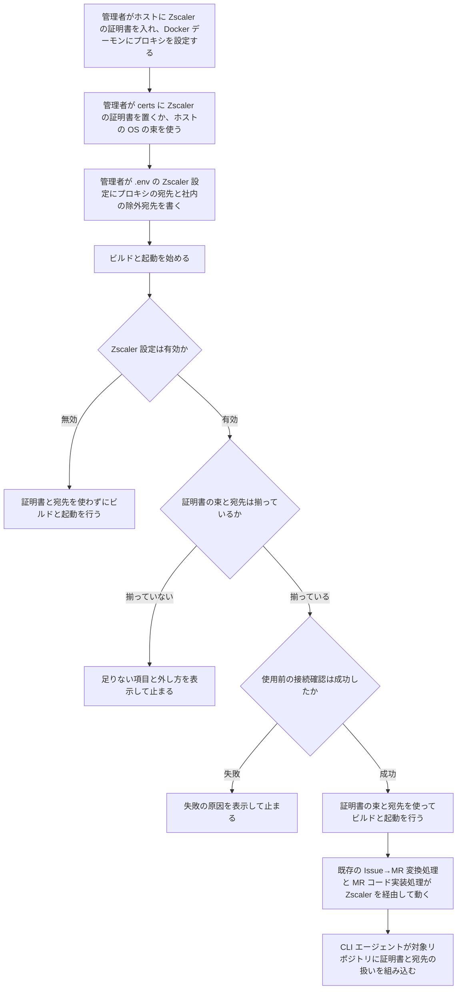
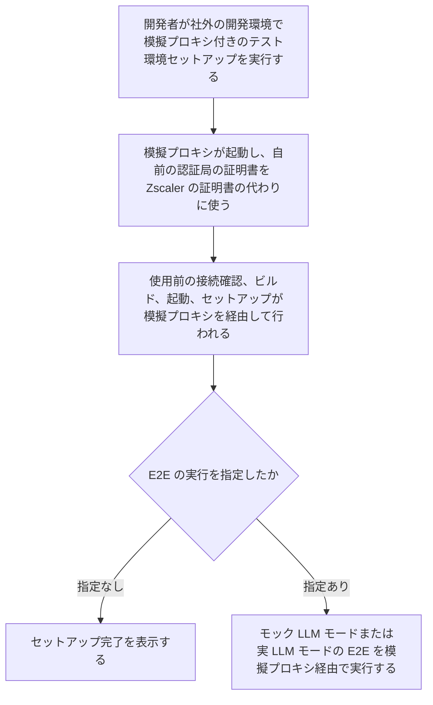

# Zscaler 環境対応 変更要件定義書

**対象システム**: CodingAgentAutomata
**既存要件定義書**: `docs/requirements.md`

---

## 1. 目的・前提

### 1.1 変更の目的

社内のネットワークは、Zscaler が通信の暗号を解いて検査し、自前のルート証明書で署名し直した証明書を返す。本システムは、その証明書を信頼できないため、社内では構築も利用もできない。本変更では、外へ出るすべての通信が Zscaler のプロキシを経由し、Zscaler の証明書を必ず信頼して検証するようにする。あわせて、Zscaler の役をする模擬のプロキシを用意し、社外でも Zscaler 環境での動作を確かめられるようにする。

### 1.2 前提

- 社内の Zscaler は明示型のプロキシである。外へ出る通信は、宛先（ホスト名とポート）を指定したプロキシを経由する。
- Zscaler のプロキシは ID とパスワードによる認証を求めない。
- 今回の変更で、外部連携先（GitLab・LiteLLM Proxy）の追加・削除は無い。変わるのは、外へ出る通信の経路と、証明書の信頼の仕方である。
- Zscaler は外部連携として扱わない。Zscaler との実接続での事前調査は行わず、Zscaler の振る舞い（証明書の差し替え）は模擬のプロキシで再現して確かめる。
- CLI コンテナの中で CLI エージェントが起動するコンテナとビルド（対象リポジトリのテストなど）には、本システムはプロキシの宛先と除外宛先だけを渡し、証明書は差し込まない。CLI エージェントへの指示によって、対象リポジトリ自身が証明書と宛先を扱えるようにする。
- Playwright の Firefox は、起動のたびに新しい設定で立ち上がり、追加の証明書を信頼させる方法が無い。証明書のエラーを無視する以外に手段が無く、証明書の検証を無効にしない方針と両立しないため、CLI コンテナのブラウザの対象から外す。

### 1.3 用語集

| 用語 | 業務上の意味 | 本案件での使用範囲 | 同義語/類義語 |
|---|---|---|---|
| Zscaler | 社内のネットワークで通信を検査するサービス。暗号化された通信を一度解き、自前のルート証明書で署名し直した証明書を返す | 社内の Linux サーバーから外へ出るすべての通信 | SSL 検査、TLS 検査 |
| Zscaler の証明書 | Zscaler が署名し直しに使うルート証明書（必要に応じて中間証明書を含む）。PEM 形式のファイルで管理者が受け取る | 本システムのすべての部品が信頼する証明書 | 社内の認証局の証明書 |
| 証明書の束 | Zscaler の証明書と、公開の認証局の証明書をまとめたもの | 各部品が通信を検証するときに使う信頼先 | CA バンドル |
| Zscaler 設定 | Zscaler 環境で動かすための設定のまとまり。有効・無効のスイッチ、プロキシの宛先、社内の除外宛先からなる | `.env` に書く | なし |
| プロキシの宛先 | 外へ出る通信を送る Zscaler のプロキシのホスト名とポート | Zscaler 設定の一部 | プロキシ URL |
| 除外宛先 | プロキシを経由させない宛先。本システムの部品どうしの名前と、社内のシステム（社内の GitLab、社内の LLM のプロキシなど） | Zscaler 設定が有効なときのすべての部品 | NO_PROXY |
| 使用前の接続確認 | ビルドと起動の前に、プロキシの宛先を経由して外部の HTTPS につなぎ、証明書の束で証明書を検証できるかを確かめる処理 | Zscaler 設定が有効なとき | なし |
| 模擬プロキシ | Zscaler の役をするテスト用のプロキシ。明示型で通信を受け、自前の認証局で署名し直した証明書を返す | テスト環境のみ | Zscaler の模擬 |
| ローカル専用のイメージ名 | 外部のレジストリの名前（ghcr.io など）を含まない、手元でだけ使うコンテナイメージ名 | docker compose がビルドするイメージ | なし |

### 1.4 システムの形態

変更なし。既存要件定義書 `docs/requirements.md` 1.3 を参照。今回の変更で使う形態は CUI（`.env` の設定と、テスト環境セットアップのコマンド）である。

### 1-1. 技術制約

| 制約項目 | 内容 | 出どころ（誰がいつ答えたか） |
|---|---|---|
| 既存コードベース | 変更なし。既存の言語・フレームワーク・docker compose 構成に合わせる | ユーザー、2026-11-01（検討の前提として了承） |
| 配備先 | 社内の Linux サーバー（Docker Engine）。Zscaler の配下で、明示型のプロキシを経由して外へ出る。ユーザーの選択（理由: 常時gitlabのissueを監視して自動的にコーディングを進めるため） | ユーザー、2026-11-01 |
| チームの技術 | 変更なし | ユーザー、2026-11-01（検討の前提として了承） |
| ライセンスとコスト | 変更なし | ユーザー、2026-11-01（検討の前提として了承） |
| 性能と規模の目安 | 変更なし。既存要件定義書 `docs/requirements.md` 第 5 章を参照 | ユーザー、2026-11-01（検討の前提として了承） |

---

## 2. 業務

### 2.1 対象業務の変更

| RQ-BZ-ID | 区分 | 業務名 | 業務の範囲 | 担当者 |
|---|---|---|---|---|
| `RQ-BZ-ZSCALER-COMPAT-TEST` | [追加] | Zscaler 環境での動作確認 | 社外の開発環境で、模擬プロキシを使って本システムの構築と処理を確かめる | 本システムの開発者 |

本システムの構築・運用（`RQ-BZ-SYSTEM-BUILD-OPERATION`）は既存の業務で、範囲に「社内の Linux サーバーの準備と Zscaler 設定」を加える（業務の意味は変わらないので ID は変えない）。既存の業務（Issue→MR 変換処理、MR コード実装処理、ユーザー・Virtual Key 管理）の内容は変わらない。構築・運用の業務で Zscaler 設定を有効にした本システムの上で、既存の業務がそのまま動く。

### 2.2 業務フロー

### 2-1. 業務の問題

| 問題 | 対象業務（RQ-BZ） | あるべき姿 | 現状 | ギャップ（KPI） | 業務影響 |
|---|---|---|---|---|---|
| 社内の Zscaler 環境では本システムを構築も利用もできない | `RQ-BZ-SYSTEM-BUILD-OPERATION` | Zscaler の配下でも、本システムを構築でき、Issue→MR 変換と MR 処理が社外と同じように完了する | Zscaler が差し替えた証明書を各部品が信頼できず、ビルド中のパッケージ取得と、実行時の GitLab API・LLM・git clone の通信が失敗する | Zscaler 環境でのビルドと起動の成功率 0%（目標 100%）。Zscaler 環境での Issue→MR 変換と MR 処理の完了率 0%（目標は社外と同じ水準） | 社内の開発者が本システムによる自動化を使えない |
| 社外の開発環境では Zscaler 環境での動作を確かめられない | `RQ-BZ-ZSCALER-COMPAT-TEST` | 社内へ持ち込む前に、Zscaler 環境で起きる失敗を社外で再現して確かめられる | 開発環境は Zscaler の配下に無く、証明書の差し替えもプロキシの経由も起きない | 社外で確かめられる Zscaler 環境の失敗の種類 0 件（目標: 証明書の信頼、除外宛先、プロキシの経由のすべて） | 社内で初めて動かすときまで不具合が分からない |
| 社内用のイメージが社外へ出るおそれがある | `RQ-BZ-SYSTEM-BUILD-OPERATION` | Zscaler の証明書を含むイメージは手元でだけ使われる | docker compose のイメージ名が ghcr.io の名前で、誤って push すると社内用のイメージが公開される | 誤って公開できる経路 1 つ（目標 0） | 社内の証明書を含むイメージが公開される |

### 2-2. 業務課題一覧

| RQ-BK-ID | 区分 | 業務課題（取り組むこと） | 解決する問題（2-1） | 解決後の状態（KPI の目標値） | 対象業務（RQ-BZ） |
|---|---|---|---|---|---|
| `RQ-BK-ZSCALER-CERT-TRUST` | [追加] | 外へ出るすべての通信を Zscaler のプロキシ経由にし、Zscaler の証明書を必ず信頼して検証させる。Zscaler 設定は既定で必須とし、明示したときだけ外せる | 社内の Zscaler 環境では本システムを構築も利用もできない | Zscaler 環境でのビルドと起動の成功率 100%。Issue→MR 変換と MR 処理の完了率が社外と同じ水準 | `RQ-BZ-SYSTEM-BUILD-OPERATION` |
| `RQ-BK-ZSCALER-MOCK-VERIFICATION` | [追加] | Zscaler の役をする模擬プロキシを用意し、社外で Zscaler 環境での動作を確かめられるようにする | 社外の開発環境では Zscaler 環境での動作を確かめられない | 証明書の信頼、除外宛先、プロキシの経由の失敗を、社外ですべて再現して確かめられる | `RQ-BZ-ZSCALER-COMPAT-TEST` |
| `RQ-BK-INTERNAL-IMAGE-CONTAINMENT` | [追加] | Zscaler の証明書を含むイメージを社外のレジストリへ出さない | 社内用のイメージが社外へ出るおそれがある | 誤って公開できる経路 0 | `RQ-BZ-SYSTEM-BUILD-OPERATION` |

### 2-3. 見込み経営効果

| RQ-EF-ID | 区分 | 効果の種類 | 内容 | 見込み（金額・時間などと算定根拠） | 対応業務課題ID（RQ-BK-*） |
|---|---|---|---|---|---|
| `RQ-EF-SOFT-SAVING-INHOUSE-DEVELOPERS` | [追加] | Soft Saving | 既存の効果（Issue 発生後のブランチ作成・コード実装・テスト実行・コミットの手作業工数の削減）が、社内の Zscaler 環境の開発者にも及ぶ | 算定しない（社内で使う人数がまだ決まっていないため） | `RQ-BK-ZSCALER-CERT-TRUST` |

---

## 3. 機能要件

### 3.1 入力データ

| データ | 区分 | 種別 | 説明 |
|---|---|---|---|
| Zscaler の証明書ファイル | [追加] | 人手（管理者） | PEM 形式のファイル。プロジェクト直下の決まった場所に置く。ルート証明書と中間証明書を 1 ファイルにまとめてよい |
| ホストの OS の証明書の束 | [追加] | ホストの OS | 証明書ファイルが無いときに使う。管理者がホストの準備で Zscaler の証明書を入れておく |
| Zscaler 設定 | [追加] | 人手（管理者） | `.env` に書く。有効・無効のスイッチ、プロキシの宛先、社内の除外宛先 |

### 3.2 出力データ

| データ | 区分 | 出力先 | 説明 |
|---|---|---|---|
| 設定の不足・接続確認の失敗の表示 | [追加] | 標準エラー | Zscaler 設定が有効なのに揃っていない項目の名前、外し方、使用前の接続確認の失敗の原因 |
| CLI エージェントへの Zscaler の指示文 | [追加] | CLI コンテナ内のプロンプト | Zscaler 設定が有効なときにプロンプトの末尾に足す文 |

### 3.3 ユーザー利用フロー

2.2 の 2 つの業務フローが、今回の変更のユーザー利用フローのすべてである。Zscaler 設定を有効にして構築した後の Issue→MR 変換と MR 処理の利用フローは、既存要件定義書 `docs/requirements.md` 3.8 から変わらない。

### 3.4 業務フローと機能の対応関係

| 業務 | 使用機能 |
|---|---|
| 本システムの構築・運用 | 証明書の束の決定、除外宛先の組み立て、Zscaler 設定の必須チェック、使用前の接続確認、ビルド時の Zscaler 設定の適用、実行時の Zscaler 設定の適用、CLI コンテナへの Zscaler 設定の受け渡し、CLI コンテナでの Playwright の標準のブラウザの起動、CLI コンテナのブラウザへの Zscaler 設定の適用、CLI エージェントへの Zscaler の指示、セットアップ用スクリプトのホストでの Zscaler 設定の適用、イメージ名の分離 |
| Zscaler 環境での動作確認 | 模擬プロキシ、模擬プロキシ付きのテスト環境セットアップのコマンド、および構築・運用の機能のすべて |

### 3.5 CUI の仕様

| RQ-ID | 区分 | 名前 | 仕様 | 対応業務課題ID（RQ-BK-*） |
|---|---|---|---|---|
| `RQ-UI-ZSCALER-ENV-SETTINGS` | [追加] | `.env` の Zscaler 設定 | 次の 3 項目を `.env` に書く。① 有効・無効のスイッチ（`ZSCALER_ENABLED`。`true` か `false`。書いていない場合は `true` とみなす）。② プロキシの宛先（`ZSCALER_PROXY_URL`。`http://ホスト名:ポート` の形）。③ 社内の除外宛先（`ZSCALER_NO_PROXY_EXTRA`。カンマ区切りのホスト名・ドメイン・IP アドレス。空でよい）。スイッチが `false` のときは、②③と証明書を使わない | `RQ-BK-ZSCALER-CERT-TRUST` |
| `RQ-UI-TEST-SETUP-ZSCALER-MOCK-OPTION` | [追加] | テスト環境セットアップの `--zscaler-mock` オプション | コマンドは `./scripts/test_setup.sh --zscaler-mock`。既存の `--real`・`--run-tests` と組み合わせられる。動作: ① 模擬プロキシを起動する。② 模擬プロキシの認証局の証明書を Zscaler の証明書の代わりに使い、プロキシの宛先を模擬プロキシに向ける。③ 使用前の接続確認、ビルド、起動、セットアップを行う。④ `--run-tests` があれば E2E を実行する。プロジェクト直下に置いた本物の証明書ファイルと `.env` の Zscaler 設定は書き換えず、模擬の値はファイルに書かずに、このコマンドが起動する環境にだけ渡す。出力: 各ステップの進捗を標準出力に出す。失敗したら、原因（接続確認の失敗、足りない設定の名前など）を標準エラーに出す。終了コード: 成功は 0、失敗は 1 | `RQ-BK-ZSCALER-MOCK-VERIFICATION` |

### 3.6 機能一覧

| RQ-ID | 区分 | カテゴリ | 機能名 | 内容 | 対応業務課題ID（RQ-BK-*） | この機能が無いと何が困るか |
|---|---|---|---|---|---|---|
| `RQ-FT-RESOLVE-CERT-BUNDLE` | [追加] | 共通 | 証明書の束の決定 | Zscaler 設定が有効なとき、プロジェクト直下の決まった場所の証明書ファイルを公開の認証局の証明書と合わせて証明書の束にする。ファイルが無ければ、ホストの OS の証明書の束を使う | `RQ-BK-ZSCALER-CERT-TRUST` | 各部品が信頼する証明書が決まらず、Zscaler の証明書を信頼できない |
| `RQ-FT-BUILD-NO-PROXY-LIST` | [追加] | 共通 | 除外宛先の組み立て | Zscaler 設定が有効なとき、本システムの部品の名前（`localhost`・`127.0.0.1` と、docker compose のサービス名のすべて）を自動で除外宛先に入れ、管理者が書いた社内の除外宛先を足す | `RQ-BK-ZSCALER-CERT-TRUST` | ユーザーの選択（理由: 管理者が部品を書き漏らす可能性があるため） |
| `RQ-FT-APPLY-ZSCALER-SETTINGS-BUILD` | [追加] | 業務機能 | ビルド時の Zscaler 設定の適用 | Zscaler 設定が有効なとき、本システムのイメージ（backend、producer、consumer、frontend のビルド段、CLI コンテナ 2 種）のビルドで、外へ出る最初の処理より前に証明書の束をイメージの OS の信頼先に入れ、ビルド中の通信をプロキシの宛先経由にする。証明書の束はビルド後のイメージにも残る（frontend の配信段は外へ出ないので入れない） | `RQ-BK-ZSCALER-CERT-TRUST` | ビルド中のパッケージ取得が証明書の検証で失敗し、イメージを作れない |
| `RQ-FT-APPLY-ZSCALER-SETTINGS-RUNTIME` | [追加] | 業務機能 | 実行時の Zscaler 設定の適用 | Zscaler 設定が有効なとき、外へ出る部品（backend、producer、consumer、CLI コンテナ 2 種、実 LLM モードの LiteLLM Proxy、テスト用の Playwright の実行コンテナ）が、使っている通信の仕組みごとに信頼先として証明書の束を使い、プロキシの宛先と除外宛先に従って通信する。ビルド済みのイメージをそのまま使う部品（LiteLLM Proxy、Playwright の実行コンテナ）には、証明書の束を読み取り専用で渡す | `RQ-BK-ZSCALER-CERT-TRUST` | 実行時の GitLab API・LLM・git clone の通信が失敗し、Issue→MR 変換と MR 処理が完了しない |
| `RQ-FT-PASS-ZSCALER-SETTINGS-CLI-CONTAINER` | [追加] | 業務機能 | CLI コンテナへの Zscaler 設定の受け渡し | Zscaler 設定が有効なとき、consumer は CLI コンテナを起動するたびに、プロキシの宛先と除外宛先を環境変数で渡す。CLI コンテナの中の Docker デーモンもプロキシの宛先を経由してイメージを取得する。CLI コンテナの中で起動するコンテナとビルドには、プロキシの宛先と除外宛先を自動で渡す。この受け渡しは CLI アダプタ設定によらず、すべての CLI エージェントに同じように行う | `RQ-BK-ZSCALER-CERT-TRUST` | CLI エージェントが LLM と GitLab に接続できず、対象リポジトリのテストも外へ出られない |
| `RQ-FT-RUN-STANDARD-BROWSERS-CLI-CONTAINER` | [追加] | 業務機能 | CLI コンテナでの Playwright の標準のブラウザの起動 | CLI コンテナ 2 種の土台を、Playwright の標準のブラウザ（Chromium 系と WebKit）を Playwright の標準の手順で取得して起動できる Linux にする。既存の CLI コンテナの機能（中の Docker デーモン、Python と uv、Node.js と npm、Playwright、CLI エージェント、追加環境のビルド時埋め込み、TTY 入力待機検知、起動のウォームアップ）は変えない | `RQ-BK-ZSCALER-CERT-TRUST` | ユーザーの選択（理由: 開発するシステムのテストで、Playwright の標準のブラウザの版をそのまま使う必要がある） |
| `RQ-FT-APPLY-ZSCALER-SETTINGS-CLI-BROWSER` | [追加] | 業務機能 | CLI コンテナのブラウザへの Zscaler 設定の適用 | Zscaler 設定が有効なとき、CLI コンテナの中で Playwright が起動する標準のブラウザ（Chromium 系と WebKit）が、CLI を実行する利用者のもとで Zscaler の証明書を信頼し、プロキシの宛先と除外宛先に従って通信する。ブラウザが OS の証明書の束を見ない場合（Chromium 系）は、ブラウザが使う信頼先に Zscaler の証明書を入れる | `RQ-BK-ZSCALER-CERT-TRUST` | ユーザーの選択（理由: 社内で使うブラウザは基本的にzscalerを設定してあるので、同じ環境である必要がある） |
| `RQ-FT-INSTRUCT-CLI-ZSCALER` | [追加] | 業務機能 | CLI エージェントへの Zscaler の指示 | Zscaler 設定が有効なとき、consumer は F-3 と F-4 のプロンプトの末尾に決まった文を足す。文の内容は、Zscaler の配下であること、外への通信はプロキシの宛先を経由すること、CLI コンテナ内の証明書の束の場所、開発するシステムの Dockerfile と docker compose の設定に証明書と宛先の扱いを組み込むこと、開発するシステムの部品どうしの通信を除外宛先に入れること、証明書の検証を無効にしないこと、である。CLI コンテナの決まった場所に証明書の束を置く。Zscaler 設定が無効なときは文を足さない。テンプレートの編集状況（システム設定、ユーザー個別の F-4 テンプレート）によらずに足す | `RQ-BK-ZSCALER-CERT-TRUST` | 開発したシステムが Zscaler の配下で動かず、対象リポジトリのテストも社内で失敗する |
| `RQ-FT-APPLY-ZSCALER-SETTINGS-HOST-SCRIPT` | [追加] | 運用 | セットアップ用スクリプトのホストでの Zscaler 設定の適用 | Zscaler 設定が有効なとき、テスト環境セットアップのスクリプトがホストの Python で行うパッケージの取得に、証明書の束とプロキシの宛先を渡す。ホストの設定は変えない | `RQ-BK-ZSCALER-CERT-TRUST` | 社内の Linux サーバーでテスト環境のセットアップが途中で失敗する |
| `RQ-FT-RUN-ZSCALER-MOCK-PROXY` | [追加] | 業務機能 | 模擬プロキシ | テスト環境でだけ起動する。明示型のプロキシとして通信を受け、宛先の証明書を、自前の認証局で署名し直した証明書に差し替えて返す。自前の認証局の証明書を、Zscaler の証明書の代わりとして取り出せる。自前の認証局を信頼していない通信は、証明書の検証で失敗する | `RQ-BK-ZSCALER-MOCK-VERIFICATION` | 社外では証明書の差し替えとプロキシの経由が起きず、Zscaler 環境の失敗を再現できない |
| `RQ-FT-SEPARATE-PUBLISHED-IMAGE-NAMES` | [追加] | 運用 | イメージ名の分離 | docker compose がビルドするイメージは、Zscaler 設定の有効・無効によらず、常にローカル専用のイメージ名にする。ghcr.io のイメージ名は GitHub Actions のビルドだけが使い、GitHub Actions は Zscaler 設定を無効にしてビルドする | `RQ-BK-INTERNAL-IMAGE-CONTAINMENT` | Zscaler の証明書を含むイメージを誤って ghcr.io へ push できてしまう |

### 3-1. 帳票・出力ファイル

帳票・出力ファイルは無い。設定の不足と接続確認の失敗の表示は、3.2 の出力データと 3-2 の業務ルールで定義する。

### 3-2. 業務ルール

| RQ-ID | 区分 | ルール名 | 内容（条件と結果） | 違反時・エラー時の業務上の扱い | 対応業務課題ID（RQ-BK-*） |
|---|---|---|---|---|---|
| `RQ-FT-REQUIRE-ZSCALER-SETTINGS` | [追加] | Zscaler 設定の必須チェック | Zscaler 設定のスイッチが有効（書いていない場合を含む）なとき、証明書の束（証明書ファイルまたはホストの OS の束）とプロキシの宛先の両方が揃っていなければならない。スイッチを明示的に無効にしたときだけ、証明書と宛先の両方を使わない | ビルドと起動を始めずに止め、足りない項目の名前と、スイッチで外す方法を標準エラーに表示する | `RQ-BK-ZSCALER-CERT-TRUST` |
| `RQ-FT-VERIFY-ZSCALER-TRUST-BEFORE-USE` | [追加] | 使用前の接続確認 | Zscaler 設定が有効なとき、ビルドと起動の前に、プロキシの宛先を経由して外部の HTTPS（パッケージの取得先）につなぎ、証明書の束で証明書を検証できることを確かめる | 検証に失敗したら、ビルドと起動を始めずに止め、失敗の原因（プロキシに接続できない、証明書を検証できない）を標準エラーに表示する | `RQ-BK-ZSCALER-CERT-TRUST` |

### 3-3. 外部連携

外部連携の追加・削除は無い。既存の外部連携（GitLab の REST API と Webhook、LiteLLM Proxy）の内容は変わらず、外へ出る通信の経路だけが Zscaler のプロキシ経由になる（3.6 の実行時の Zscaler 設定の適用で定義する）。

### 3.7 削除する要件

削除する要件は無い。既存要件定義書の各要件（cli-exec コンテナへの情報の渡し方、PAT 埋め込み URL 方式、プロンプトテンプレート、組み込みアダプタ設定のイメージ名を含む）を確かめ、今回の追加要件と矛盾するものが無いことを確認した。CLI コンテナのイメージ名（`coding-agent-cli-exec-claude:latest`・`coding-agent-cli-exec-opencode:latest`）は、すでにローカル専用のイメージ名である。

---

## 4. データ

### 4-1. データ要件一覧

| RQ-ID | 区分 | 種別 | 内容 | 対応業務課題ID（RQ-BK-*） | この要件が無いと何が困るか |
|---|---|---|---|---|---|
| `RQ-DT-ZSCALER-CERT-FILE` | [追加] | 内部データ（ファイル） | Zscaler の証明書ファイルは、プロジェクト直下の決まった場所に置き、git の管理外とする。保持期間は、管理者が置き換えるか削除するまで。DB には保存しない | `RQ-BK-ZSCALER-CERT-TRUST` | 証明書が git に入り、社外のリポジトリへ公開される |
| `RQ-DT-ZSCALER-SETTINGS-ENV` | [追加] | 内部データ（設定） | Zscaler 設定は `.env` にだけ保存し、DB には保存しない。プロキシの宛先は秘密の情報を含まない | `RQ-BK-ZSCALER-CERT-TRUST` | 設定の置き場所が定まらず、部品ごとに設定がずれる |

外部 DB の接続先は変わらない。DB の追加は無い。

### 4-2. 業務エンティティとデータ項目

業務エンティティの追加・変更は無い。既存要件定義書 `docs/requirements.md` 4.1・4.3〜4.6 を参照。

### 4-3. CRUD テーブル

| エンティティ名 | Create | Read（一覧） | Read（詳細） | 検索 | Update | Delete | 備考 |
|---|---|---|---|---|---|---|---|
| ユーザー | ○ | ○ | ○ | ○ | ○ | ○ | 変更なし。検索の条件はユーザー名 |
| CLIアダプタ設定 | ○ | ○ | ○ | × | ○ | △ | 変更なし。組み込みアダプタは削除不可。Zscaler 設定の受け渡しはアダプタ設定に項目を足さずに行う |
| タスク | ○ | ○ | × | ○ | ○ | × | 変更なし。検索の条件はユーザー名・ステータス・種別。重複処理防止の排他制御は既存のまま |
| system_settings | ○ | △ | × | △ | ○ | × | 変更なし。読み取りは一括取得のみ。検索はキー単位。Zscaler の指示文はテンプレートに保存せず、プロンプトを組み立てるときに足す |

### 4-4. 状態遷移

状態遷移の変更は無い。タスクの状態遷移（pending → running → completed / failed）は既存要件定義書 `docs/requirements.md` 4.2 のままで、Zscaler 環境で CLI コンテナの通信が失敗した場合も、既存のとおり failed へ遷移する。

### 4-5. 画面一覧

画面の追加・変更は無い。既存要件定義書 `docs/requirements.md` 3.5 を参照。

---

## 5. 非機能要件

| RQ-ID | 区分 | カテゴリ | 非機能要件名 | 内容 | 対応業務課題ID（RQ-BK-*） | この非機能要件が無いと何が困るか |
|---|---|---|---|---|---|---|
| `RQ-NF-TLS-VERIFICATION-ALWAYS-ON` | [追加] | セキュリティ | 証明書の検証を無効にしない | 本システムのすべての部品と、模擬プロキシを使うテストで、通信の証明書の検証を無効にする設定を使わない | `RQ-BK-ZSCALER-CERT-TRUST`、`RQ-BK-ZSCALER-MOCK-VERIFICATION` | Zscaler の証明書を信頼しないまま通信が通り、なりすましを見抜けなくなる。テストで信頼の不具合が隠れる |
| `RQ-NF-EXISTING-ENV-MIGRATION` | [追加] | 移行性 | 既存の `.env` の移行 | 既存の `.env` には Zscaler 設定が無く、スイッチは有効とみなされる。社外で動かしている既存の環境は、スイッチを無効にする 1 行を `.env` に書き足す。移すデータは無い | `RQ-BK-ZSCALER-CERT-TRUST` | 既存の社外の環境が、変更の取り込み後にビルドと起動で止まる |
| `RQ-NF-CLI-EXTRA-SETUP-MIGRATION` | [追加] | 移行性 | CLI コンテナの追加環境のコマンドの移行 | CLI コンテナの土台の Linux が変わるため、イメージのビルド時に渡す追加環境の構築コマンドは、新しい土台のパッケージ管理の書き方で書く。README の例も新しい書き方にする。CLI アダプタ設定のイメージ名は変えないので、DB のデータの移行は無い | `RQ-BK-ZSCALER-CERT-TRUST` | 旧い土台の書き方の追加環境のコマンドを渡すと、CLI コンテナのビルドが失敗する |

利用者の種別とアクセス経路、性能、利用人数、可用性、認証方式、権限制御は変更なし。既存要件定義書 `docs/requirements.md` 第 5 章を参照。

---

## 6. 運用要件

| RQ-ID | 区分 | 種別 | 内容 | 対応業務課題ID（RQ-BK-*） | この要件が無いと何が困るか |
|---|---|---|---|---|---|
| `RQ-OP-ZSCALER-SETUP-PROCEDURE` | [追加] | 構築手順 | README に Zscaler 環境の構築手順を書く。内容: ① ホスト（社内の Linux サーバー）の準備として、ホストの OS の信頼先への Zscaler の証明書の追加と、Docker デーモンへのプロキシの宛先の設定（管理者が sudo で一度だけ行う）。② 証明書ファイルの置き方。③ `.env` の Zscaler 設定の書き方。④ 社外でスイッチを無効にする方法。⑤ 模擬プロキシ付きのテスト環境セットアップの使い方 | `RQ-BK-ZSCALER-CERT-TRUST`、`RQ-BK-ZSCALER-MOCK-VERIFICATION` | 配備先は社内の Linux サーバー（ユーザーの選択（理由: 常時gitlabのissueを監視して自動的にコーディングを進めるため））で、ホストの準備をしないと Docker がイメージを取得できない。管理者が手順を調べ直す必要がある |

ログ、監査ログ、監視・アラート、バックアップと復旧は変更なし。既存要件定義書 `docs/requirements.md` 3.10・3.11 を参照。

---

## 7. テスト用利用シナリオ

| RQ-ID | 区分 | テスト目的 | 前提条件 | テスト手順 | 期待される結果 | 対応業務課題ID（RQ-BK-*） |
|---|---|---|---|---|---|---|
| `RQ-TS-VERIFY-BUILD-VIA-ZSCALER-MOCK` | [追加] | 模擬プロキシ経由で本システムのイメージをすべてビルドできることを確かめる | 社外の開発環境。証明書ファイルは置いていない | `./scripts/test_setup.sh --zscaler-mock` を実行する | 使用前の接続確認が成功し、本システムのイメージ（backend、producer、consumer、frontend、CLI コンテナ 2 種）のビルドが模擬プロキシ経由で成功し、終了コードが 0 になる | `RQ-BK-ZSCALER-MOCK-VERIFICATION`、`RQ-BK-ZSCALER-CERT-TRUST` |
| `RQ-TS-VERIFY-RUNTIME-HTTPS-VIA-ZSCALER-MOCK` | [追加] | 実行中の各部品から、模擬プロキシ経由で外部の HTTPS に証明書を検証してつなげることを確かめる | 模擬プロキシ付きのセットアップが完了している | backend、producer、consumer と、CLI コンテナ 2 種の中から、外部の HTTPS（パッケージの取得先と LLM の API）へ、各部品が実際に使う通信の仕組みでつなぐ | すべての接続が模擬プロキシを経由し、証明書の検証が成功する | `RQ-BK-ZSCALER-MOCK-VERIFICATION`、`RQ-BK-ZSCALER-CERT-TRUST` |
| `RQ-TS-VERIFY-UNTRUSTED-CERT-STOPS` | [追加] | 模擬プロキシが実際に証明書を差し替えていることと、使用前の接続確認が失敗を止めることを確かめる | 模擬プロキシが起動している | 模擬プロキシの認証局の証明書を含まない証明書の束を使い、プロキシの宛先を模擬プロキシに向けてビルドを始める | 使用前の接続確認が証明書を検証できずに失敗し、ビルドを始めずに止まり、原因が標準エラーに表示され、終了コードが 1 になる | `RQ-BK-ZSCALER-MOCK-VERIFICATION`、`RQ-BK-ZSCALER-CERT-TRUST` |
| `RQ-TS-VERIFY-MISSING-SETTINGS-STOP` | [追加] | Zscaler 設定が欠けているときに止まることを確かめる | スイッチが有効、または書いていない | プロキシの宛先を空にしてビルドを始める | ビルドを始めずに止まり、足りない項目の名前とスイッチで外す方法が標準エラーに表示され、終了コードが 1 になる | `RQ-BK-ZSCALER-CERT-TRUST` |
| `RQ-TS-VERIFY-DISABLED-SWITCH` | [追加] | スイッチを無効にすると証明書と宛先なしで動くことを確かめる | 社外の開発環境。スイッチを無効にしている | `./scripts/test_setup.sh --run-tests` を実行する | 証明書と宛先を使わずにビルド、起動、既存の E2E が成功し、CLI エージェントのプロンプトに Zscaler の指示文が足されない | `RQ-BK-ZSCALER-CERT-TRUST` |
| `RQ-TS-VERIFY-OS-BUNDLE-FALLBACK` | [追加] | 証明書ファイルが無いときに、ホストの OS の証明書の束を使うことを確かめる | 証明書ファイルを置いていない。OS の束として扱う束に、模擬プロキシの認証局の証明書が入っている | 証明書の束の決定と使用前の接続確認を実行する | ホストの OS の束が証明書の束として選ばれ、使用前の接続確認が成功する | `RQ-BK-ZSCALER-CERT-TRUST` |
| `RQ-TS-VERIFY-MOCK-LLM-E2E-WITH-ZSCALER` | [追加] | Zscaler 設定が有効でも、本システムの部品どうしの通信が壊れないことを確かめる | 社外の開発環境 | `./scripts/test_setup.sh --zscaler-mock --run-tests` を実行する | 既存のモック LLM モードの E2E がすべて成功する。本システムの部品どうしの通信は模擬プロキシを経由しない | `RQ-BK-ZSCALER-MOCK-VERIFICATION`、`RQ-BK-ZSCALER-CERT-TRUST` |
| `RQ-TS-VERIFY-REAL-LLM-E2E-VIA-MOCK` | [追加] | 実際の LLM を使った Issue→MR 変換と MR 処理が、模擬プロキシ経由で最後まで完了することを確かめる | 社外の開発環境。実 LLM モードの API キーを `.env` に設定している | `./scripts/test_setup.sh --zscaler-mock --real --run-tests` を実行する | 実 LLM モードの E2E がすべて成功し、LiteLLM Proxy から LLM の API への通信が模擬プロキシを経由する。ユーザーの選択（理由: 本番環境でも構築、運用できる様にする必要がある） | `RQ-BK-ZSCALER-MOCK-VERIFICATION`、`RQ-BK-ZSCALER-CERT-TRUST` |
| `RQ-TS-VERIFY-CLI-ZSCALER-INSTRUCTION` | [追加] | CLI エージェントへの Zscaler の指示文と、CLI コンテナの中への宛先の受け渡しを確かめる | 模擬プロキシ付きのセットアップが完了している。ユーザー個別の F-4 テンプレートを設定したユーザーと、設定していないユーザーがいる | 両方のユーザーで F-3 と F-4 を実行し、CLI コンテナに渡ったプロンプトと、CLI コンテナの中で起動したコンテナの環境変数を確かめる | どのテンプレートでもプロンプトの末尾に Zscaler の指示文が足され、CLI コンテナの決まった場所に証明書の束があり、CLI コンテナの中で起動したコンテナにプロキシの宛先と除外宛先が渡っている | `RQ-BK-ZSCALER-CERT-TRUST` |
| `RQ-TS-VERIFY-CLI-BROWSER-TRUST` | [追加] | CLI コンテナのブラウザが、模擬プロキシ経由で外部のサイトを証明書を検証して開けることを確かめる | 模擬プロキシ付きのセットアップが完了している | CLI コンテナ 2 種それぞれで、CLI を実行する利用者として Playwright の標準の Chromium と WebKit を起動し、証明書のエラーを無視する設定を使わずに外部の HTTPS のサイトを開く | どちらのブラウザでも証明書のエラーが出ずにページが開き、通信が模擬プロキシを経由する | `RQ-BK-ZSCALER-MOCK-VERIFICATION`、`RQ-BK-ZSCALER-CERT-TRUST` |
| `RQ-TS-VERIFY-CLI-STANDARD-BROWSERS` | [追加] | CLI コンテナで Playwright の標準のブラウザが起動し、既存の CLI コンテナの機能が変わらないことを確かめる | Zscaler 設定を無効にした社外の開発環境 | CLI コンテナ 2 種それぞれで、CLI を実行する利用者として Playwright の標準の手順で Chromium と WebKit を取得して起動し、ページを開く。続けて `./scripts/test_setup.sh --run-tests` で既存の E2E（TTY 入力待機検知を含む）を実行する | 両方のブラウザが起動してページを開け、既存の E2E がすべて成功する | `RQ-BK-ZSCALER-CERT-TRUST` |
| `RQ-TS-VERIFY-REAL-SETTINGS-UNCHANGED` | [追加] | 模擬プロキシ付きのセットアップが本物の設定を書き換えないことを確かめる | 証明書ファイルと `.env` の Zscaler 設定に本物の値を書いている | `./scripts/test_setup.sh --zscaler-mock` を実行し、実行前後の証明書ファイルと `.env` を比べる | 証明書ファイルと `.env` の Zscaler 設定が実行前と同じである | `RQ-BK-ZSCALER-MOCK-VERIFICATION` |
| `RQ-TS-VERIFY-LOCAL-IMAGE-NAMES` | [追加] | docker compose がビルドするイメージがローカル専用の名前であることを確かめる | なし | docker compose でビルドし、作られたイメージの名前の一覧を見る | どのイメージ名にも外部のレジストリの名前（ghcr.io など）が含まれない | `RQ-BK-INTERNAL-IMAGE-CONTAINMENT` |

---

## 8. 変更後の業務課題と要件の対応表

| RQ-BK-ID | 対応する要件 |
|---|---|
| `RQ-BK-ZSCALER-CERT-TRUST` | `RQ-EF-SOFT-SAVING-INHOUSE-DEVELOPERS`、`RQ-UI-ZSCALER-ENV-SETTINGS`、`RQ-FT-RESOLVE-CERT-BUNDLE`、`RQ-FT-BUILD-NO-PROXY-LIST`、`RQ-FT-APPLY-ZSCALER-SETTINGS-BUILD`、`RQ-FT-APPLY-ZSCALER-SETTINGS-RUNTIME`、`RQ-FT-PASS-ZSCALER-SETTINGS-CLI-CONTAINER`、`RQ-FT-RUN-STANDARD-BROWSERS-CLI-CONTAINER`、`RQ-FT-APPLY-ZSCALER-SETTINGS-CLI-BROWSER`、`RQ-FT-INSTRUCT-CLI-ZSCALER`、`RQ-FT-APPLY-ZSCALER-SETTINGS-HOST-SCRIPT`、`RQ-FT-REQUIRE-ZSCALER-SETTINGS`、`RQ-FT-VERIFY-ZSCALER-TRUST-BEFORE-USE`、`RQ-DT-ZSCALER-CERT-FILE`、`RQ-DT-ZSCALER-SETTINGS-ENV`、`RQ-NF-TLS-VERIFICATION-ALWAYS-ON`、`RQ-NF-EXISTING-ENV-MIGRATION`、`RQ-NF-CLI-EXTRA-SETUP-MIGRATION`、`RQ-OP-ZSCALER-SETUP-PROCEDURE`、`RQ-TS-VERIFY-BUILD-VIA-ZSCALER-MOCK`、`RQ-TS-VERIFY-RUNTIME-HTTPS-VIA-ZSCALER-MOCK`、`RQ-TS-VERIFY-UNTRUSTED-CERT-STOPS`、`RQ-TS-VERIFY-MISSING-SETTINGS-STOP`、`RQ-TS-VERIFY-DISABLED-SWITCH`、`RQ-TS-VERIFY-OS-BUNDLE-FALLBACK`、`RQ-TS-VERIFY-MOCK-LLM-E2E-WITH-ZSCALER`、`RQ-TS-VERIFY-REAL-LLM-E2E-VIA-MOCK`、`RQ-TS-VERIFY-CLI-ZSCALER-INSTRUCTION`、`RQ-TS-VERIFY-CLI-BROWSER-TRUST`、`RQ-TS-VERIFY-CLI-STANDARD-BROWSERS` |
| `RQ-BK-ZSCALER-MOCK-VERIFICATION` | `RQ-UI-TEST-SETUP-ZSCALER-MOCK-OPTION`、`RQ-FT-RUN-ZSCALER-MOCK-PROXY`、`RQ-NF-TLS-VERIFICATION-ALWAYS-ON`、`RQ-OP-ZSCALER-SETUP-PROCEDURE`、`RQ-TS-VERIFY-BUILD-VIA-ZSCALER-MOCK`、`RQ-TS-VERIFY-RUNTIME-HTTPS-VIA-ZSCALER-MOCK`、`RQ-TS-VERIFY-UNTRUSTED-CERT-STOPS`、`RQ-TS-VERIFY-MOCK-LLM-E2E-WITH-ZSCALER`、`RQ-TS-VERIFY-REAL-LLM-E2E-VIA-MOCK`、`RQ-TS-VERIFY-CLI-BROWSER-TRUST`、`RQ-TS-VERIFY-REAL-SETTINGS-UNCHANGED` |
| `RQ-BK-INTERNAL-IMAGE-CONTAINMENT` | `RQ-FT-SEPARATE-PUBLISHED-IMAGE-NAMES`、`RQ-TS-VERIFY-LOCAL-IMAGE-NAMES` |
