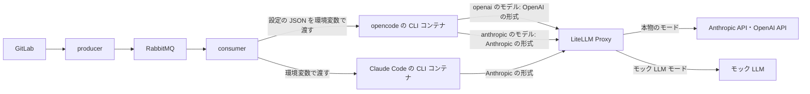
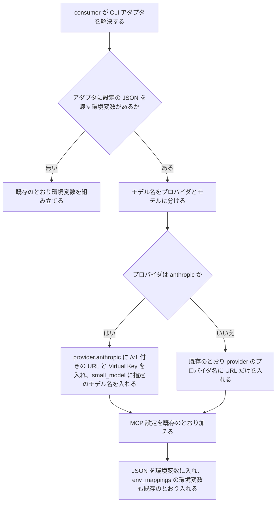
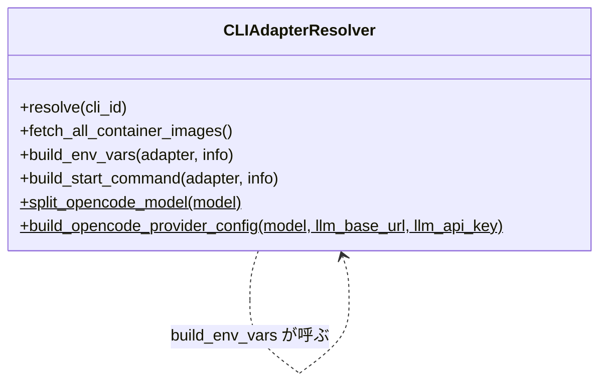

# opencode での Claude のモデルの利用 変更詳細設計書

**対象システム**: CodingAgentAutomata
**入力**: `.history/20261102-opencode-claude-model/change_requirements.md`
**既存設計書**: `docs/detail_design.md`
**外部連携の調査**: `external/litellm/docs/research.md`、`external/litellm/docs/alignment_report.md`（判定: 設計に進める）

---

## 1. 言語・フレームワーク・アーキテクチャの選定

### 1-1. 引き継ぐ技術

既存設計 `docs/detail_design.md` 第 1 章の技術（Python 3.12、pytest 9.2.0、Playwright、docker compose、LiteLLM Proxy）をそのまま使う。変更要件定義書の技術制約は「変更なし」で、既存の技術と矛盾しないため、選び直さない。

### 1-2. 新たに選定した技術

新たに選定した技術は無い。opencode から Claude を呼ぶ部品には、opencode 1.19.5 に同梱されている Anthropic 用の部品を使う。選定の経緯（比較表、推奨、不採用の理由、リスク、ユーザーの最終決定 2026-11-02）は `external/litellm/docs/research.md` 第 7 章に記録した。

---

## 2. システム構成

### 2-1. コンポーネント一覧（変更分）

コンポーネントの追加・削除は無い。役割が変わるのは次の 2 つ。

| コンポーネント | 変更後の役割 |
|---|---|
| consumer | opencode の CLI コンテナに渡す設定の JSON に、プロバイダが `anthropic` のときは、Virtual Key・`/v1` 付きの LiteLLM Proxy の URL・タイトル用のモデルを入れる |
| LiteLLM Proxy（モック LLM モード） | モック LLM が応じない設定項目を捨ててから、モック LLM へ転送する |

### 2-2. 全体構成図（変更後）

### 2-3. コンポーネント間インターフェースとデータフロー（変更分）

| 送り手 | 受け手 | 変わる内容 |
|---|---|---|
| consumer | opencode の CLI コンテナ | 環境変数 `OPENCODE_CONFIG_CONTENT` の JSON。プロバイダが `anthropic` のとき、`provider.anthropic.options` に `baseURL`（LiteLLM Proxy の URL の末尾に `/v1`）と `apiKey`（利用者の Virtual Key）を入れ、最上位に `small_model`（利用者が指定したモデル名）を入れる |
| opencode の CLI コンテナ | LiteLLM Proxy | プロバイダが `anthropic` のとき、`POST /v1/messages`（Anthropic の形式）で呼ぶ。Virtual Key は `x-api-key` で送られる |

### 2-4. ネットワーク構成図

変更なし。既存設計 `docs/detail_design.md` セクション 2-4 を参照。opencode から LiteLLM Proxy への通信は、既存と同じ内部のネットワークの中の通信である。

---

## 3. データ設計

### 3-1. データモデル

変更なし。既存設計 `docs/detail_design.md` セクション 3-1 を参照。CLI アダプタ設定のテーブルの行（組み込みの opencode のアダプタを含む）も変えない。ユーザーのデフォルトモデルとタスクのモデルの列（文字列 255 以内）には、`anthropic/` で始まる名前がそのまま入る。

### 3-2. トランザクションと排他制御

変更なし。既存設計 `docs/detail_design.md` セクション 3-2 を参照。

### 3-3. 状態遷移

変更なし。既存設計 `docs/detail_design.md` セクション 3-3 を参照。opencode で Claude のモデルの呼び出しに失敗した場合も、既存の CLI の失敗の扱いで、タスクは失敗へ遷移する。

### 3-4. CRUD とデータの対応

| エンティティ | Create | Read（一覧） | Read（詳細） | 検索 | Update | Delete | 今回の変更 |
|---|---|---|---|---|---|---|---|
| ユーザー | ○ | ○ | ○ | ○ | ○ | ○ | 変更なし |
| CLI アダプタ設定 | ○ | ○ | × | × | ○ | △ | 変更なし（組み込みの opencode のアダプタは書き換えない） |
| タスク | ○ | ○ | × | ○ | ○ | × | 変更なし |
| システム設定 | ○ | △ | × | △ | ○ | × | 変更なし |

---

## 4. アーキテクチャ設計

### 4-1. 外部設計

利用者向けのインターフェースの追加・削除は無い。デフォルトモデルの欄（ユーザー編集画面）と、MR の説明文のエージェント指定（`agent: cli=opencode model=anthropic/claude-opus-5-5` の形）は既存のまま使い、値に `anthropic/` で始まる名前を書けるようになる。opencode のプロバイダの判定の業務ルールは、既存のエージェント指定と CLI アダプタの解決のエラー仕様の中で、次のように扱う。

| 入力 | 判定 | 結果 |
|---|---|---|
| `anthropic/<モデル>` | Claude のモデル | LiteLLM Proxy 経由で Claude のモデルを Anthropic の形式で呼ぶ |
| `openai/<モデル>`、または `/` を含まないモデル名 | OpenAI のモデル（既存のまま） | 既存のとおり呼ぶ |
| それ以外のプロバイダ、または LiteLLM Proxy に無いモデル | 判定はしない | opencode が失敗し、既存の CLI の失敗と同じく、タスクを失敗にしてコメントする |

外部システム連携: LiteLLM Proxy との連携の中で、opencode から `POST /v1/messages` を呼ぶ形が増える（`external/litellm/docs/research.md` 第 3 章）。本システムのコードは LiteLLM Proxy を直接呼ばないので、連携ライブラリ（`external/litellm/src/`）は作らない（ユーザーの決定 2026-11-02）。モックへの切り替えは、LiteLLM Proxy の転送先をモック LLM にすることで行う（8-3）。

外部 DB 連携は無い。

### 4-2. 内部設計

| DS-ID | 区分 | 処理 | 内容 | 対応要件ID |
|---|---|---|---|---|
| `DS-FN-DETERMINE-OPENCODE-PROVIDER-FT-DETERMINE-OPENCODE-PROVIDER` | [追加] | opencode のプロバイダの判定 | モデル名を最初の `/` で分け、前をプロバイダ、後ろをモデルとする。`/` が無ければプロバイダは `openai`、モデルは名前全体とする（既存の既定と同じ）。モデル名が空なら既存の既定 `openai/gpt-4o-mini` を使う | `RQ-FT-DETERMINE-OPENCODE-PROVIDER` |
| `DS-FN-BUILD-OPENCODE-PROVIDER-CONFIG-FT-CALL-CLAUDE-VIA-OPENCODE` | [追加] | opencode のプロバイダの設定の組み立て | プロバイダとモデル名、LiteLLM Proxy の URL、Virtual Key を受け、設定の JSON のうちプロバイダの部分と `small_model` を返す。プロバイダが `anthropic` のときは、URL の末尾の `/` を取り除いてから `/v1` を付け（すでに `/v1` で終わっていれば付けない）、`options` に `baseURL` と `apiKey`（Virtual Key。空なら入れない）を入れ、`small_model` に利用者が指定したモデル名（`anthropic/<モデル>`）を入れる。それ以外のプロバイダのときは、既存のとおり `options.baseURL` に URL をそのまま入れ、`small_model` は入れない | `RQ-FT-CALL-CLAUDE-VIA-OPENCODE`、`RQ-NF-OPENCODE-CLAUDE-NO-MIGRATION` |

バッチの追加・変更は無い。

---

## 5. クラス設計

### 5-1. クラス一覧

クラスの追加・削除は無い。2 つの処理は、既存の CLIAdapterResolver の静的メソッドとして足す。CLIAdapterResolver の責務（CLI エージェントごとの渡し方の違いを、コアの処理から隠す）の範囲に収まり、単一責任の原則を崩さない。

### 5-2. 主要属性とメソッド

| DS-ID | 区分 | 対象 | 内容 | 対応要件ID |
|---|---|---|---|---|
| `DS-FN-DETERMINE-OPENCODE-PROVIDER-FT-DETERMINE-OPENCODE-PROVIDER` | [追加] | `CLIAdapterResolver.split_opencode_model`（静的メソッド） | 引数: モデル名。戻り値: プロバイダとモデルの組 | `RQ-FT-DETERMINE-OPENCODE-PROVIDER` |
| `DS-FN-BUILD-OPENCODE-PROVIDER-CONFIG-FT-CALL-CLAUDE-VIA-OPENCODE` | [追加] | `CLIAdapterResolver.build_opencode_provider_config`（静的メソッド） | 引数: モデル名、LiteLLM Proxy の URL、Virtual Key。戻り値: 設定の JSON に入れる `provider` と `small_model` の辞書。`build_env_vars` が、設定の JSON を組み立てるときに呼ぶ（既存の `provider` の組み立てを置き換える） | `RQ-FT-CALL-CLAUDE-VIA-OPENCODE`、`RQ-NF-OPENCODE-CLAUDE-NO-MIGRATION` |

### 5-3. クラス図

### 5-4. システム内メッセージ

変更なし。既存設計 `docs/detail_design.md` セクション 5-4 を参照。

---

## 6. エラーハンドリングとセキュリティ設計

### 6-1. エラーハンドリング

| 想定エラー | 利用者への見え方 | ログ | 処理 |
|---|---|---|---|
| `openai`・`anthropic` 以外のプロバイダを指定した | 既存の CLI の失敗のコメント（CLI の出力の末尾を含む） | 既存のとおりタスクに CLI の出力を保存する | タスクを失敗にする（既存の扱い） |
| LiteLLM Proxy に無いモデルを指定した | 同上 | 同上 | 同上 |
| Virtual Key が無効 | 同上 | 同上 | 同上 |

新しいエラーの種類は足さない。どれも opencode の失敗として、既存の MR 処理の成否の判定で扱う。

### 6-2. セキュリティ

- 認証・認可・監査ログは変更なし。既存設計 `docs/detail_design.md` セクション 6-2 を参照。
- Virtual Key は、既存の `OPENAI_API_KEY` に加え、プロバイダが `anthropic` のときは設定の JSON の環境変数にも入る。どちらも同じ CLI コンテナの環境変数で、CLI コンテナの外へは出ない。consumer は設定の JSON の値をログに出さない（既存のとおり、ログに出すのは環境変数の名前だけ）。

---

## 7. コード設計

### 7-1. ディレクトリ構成（変更分）

ディレクトリの追加・削除は無い。

### 7-2. ファイル一覧

ソースファイルの追加・削除は無い。変わるファイルと、置く設計要素は次のとおり。

| ファイル | 既存の DS-MD | 足す設計要素 | 区分 |
|---|---|---|---|
| `consumer/cli_adapter_resolver.py` | `DS-MD-CONSUMER-CLI-ADAPTER-RESOLVER-FT-RESOLVE-CLI-ADAPTER`（変えない） | `DS-FN-DETERMINE-OPENCODE-PROVIDER-FT-DETERMINE-OPENCODE-PROVIDER`、`DS-FN-BUILD-OPENCODE-PROVIDER-CONFIG-FT-CALL-CLAUDE-VIA-OPENCODE` | [追加] |
| `litellm/config.yml` | なし（設定ファイル。テスト環境の運用設計で扱う） | `DS-OP-MOCK-LITELLM-DROP-PARAMS-EX-USE-LOCAL-HTTP-MOCK` | [追加] |
| `e2e/tests/gitlab_integration.spec.ts` | なし（テストファイル） | `DS-TS-OPENCODE-CLAUDE-MODEL-E2E-TS-VERIFY-OPENCODE-CLAUDE-MODEL` | [追加] |
| `tests/consumer/test_cli_adapter_resolver_opencode.py`（新規のテストファイル） | なし（テストファイル） | `DS-TS-OPENCODE-PROVIDER-CONFIG-UNIT-FT-CALL-CLAUDE-VIA-OPENCODE` | [追加] |

コードには要件 ID・設計 ID を書かない。設計 ID とコードの対応は、実装時に `docs/trace_map.md` に登録する（2 つの静的メソッドの行を足す）。

### 7-3. 共通化の方針

- モデル名をプロバイダとモデルに分ける処理は、`split_opencode_model` の 1 か所にする。`build_env_vars` の中にある既存の分け方は、この関数の呼び出しに置き換える。
- LiteLLM Proxy の URL に `/v1` を付ける処理は、`build_opencode_provider_config` の中だけで行う。Claude Code 用の `ANTHROPIC_BASE_URL` には付けない（Claude Code が自分で `/v1` を付けるため）。

### 7-4. コーディング規約

変更なし。既存設計 `docs/detail_design.md` セクション 7-4 を参照。

---

## 8. テスト設計

### 8-1. テストの種類と方針

| DS-ID | 区分 | テスト | 対応要件ID |
|---|---|---|---|
| `DS-TS-OPENCODE-PROVIDER-CONFIG-UNIT-FT-CALL-CLAUDE-VIA-OPENCODE` | [追加] | 単体テスト `tests/consumer/test_cli_adapter_resolver_opencode.py`。① `anthropic/claude-opus-5-5` で、`provider.anthropic.options` の `baseURL` が `/v1` 付き、`apiKey` が Virtual Key、`small_model` が `anthropic/claude-opus-5-5` になる。② URL の末尾に `/` や `/v1` があっても `/v1` が二重にならない。③ `openai/gpt-4o-mini` と `/` の無い名前で、既存と同じ JSON（`provider.openai.options.baseURL` が URL そのまま、`apiKey` と `small_model` なし）になる。④ 空のモデル名で既存の既定になる。⑤ `build_env_vars` が、opencode のアダプタ（`env_mappings` は `OPENAI_API_KEY` のまま）で、上の JSON と `OPENAI_API_KEY` の両方を入れる。⑥ Claude Code のアダプタ（設定の JSON を渡す環境変数が無い）では、出力が変わらない | `RQ-FT-CALL-CLAUDE-VIA-OPENCODE`、`RQ-FT-DETERMINE-OPENCODE-PROVIDER`、`RQ-NF-OPENCODE-CLAUDE-NO-MIGRATION` |

単体テストの実行コマンドは既存のまま（`docker compose --profile test run --rm unit_test`。既存設計 8-5）。

### 8-2. E2E テストのシナリオ

| DS-ID | 対応要件ID | 目的 | 前提条件 | 手順 | 期待結果 |
|---|---|---|---|---|---|
| `DS-TS-OPENCODE-CLAUDE-MODEL-E2E-TS-VERIFY-OPENCODE-CLAUDE-MODEL` | `RQ-TS-VERIFY-OPENCODE-CLAUDE-MODEL`、`RQ-EX-USE-LOCAL-HTTP-MOCK` | opencode で Claude のモデルを指定した MR 処理が最後まで完了する（`e2e/tests/gitlab_integration.spec.ts` の T-35） | テスト環境のセットアップ済み。テストユーザー `testuser-opencode` のデフォルト CLI を backend の API で opencode にしておく（デフォルトモデルは問わない）。実 LLM モードでは `.env` に Anthropic の API キーだけがあればよい | ① 管理者の PAT で main から作業ブランチを作る。② `testuser-opencode` の PAT で、そのブランチの Draft MR を作る。説明文は既存の MR 処理用の作業指示に、`agent: cli=opencode model=anthropic/<Claude のモデル>` の行を足したもの。Claude のモデルは環境変数 `DEFAULT_CLAUDE_MODEL`（既定 `claude-haiku-4-5-20251001`）。③ MR に bot をアサインし、特定ラベルを付ける | MR に完了コメントが付く。backend のタスクの一覧で、その MR のタスクの CLI が `opencode`、モデルが `anthropic/<Claude のモデル>` で、状態が完了になる。モック LLM モードと実 LLM モードの両方で成功する |

Issue→MR 変換を経ずに MR を直接作るのは、Issue→MR 変換ではテストユーザーのデフォルトモデル（OpenAI）が使われ、実 LLM モードで OpenAI の API キーが要ってしまうため。

### 8-3. E2E の実行手段

既存の Playwright（`test_playwright`・`test_playwright_real`）をそのまま使う。モック LLM モードでは、LiteLLM Proxy（`litellm/config.yml`）が Claude のモデル名をモック LLM に転送し、モック LLM が応じない設定項目を捨てる（9-1）。モックの正本は `mock-llm/` と `litellm/config.yml` で、`external/litellm/mock/` からシンボリックリンクで参照する（git で管理する。ユーザーの決定 2026-11-02）。

### 8-4. E2E の実行コマンドと運用

変更なし。既存設計 `docs/detail_design.md` セクション 8-4 を参照（モック LLM モードは `./scripts/test_setup.sh --run-tests`、実 LLM モードは `./scripts/test_setup.sh --real --run-tests` を手動で実行する）。実装時の必須のゴールは、モック LLM モードでの全件の成功。Zscaler の模擬プロキシありと `ZSCALER_ENABLED=false` の両方の通し確認は、Zscaler まわりを変えないので必須にしない。

---

## 9. 運用設計

### 9-1. 起動と設定

| DS-ID | 区分 | 内容 | 対応要件ID |
|---|---|---|---|
| `DS-OP-MOCK-LITELLM-DROP-PARAMS-EX-USE-LOCAL-HTTP-MOCK` | [追加] | `litellm/config.yml`（モック LLM モードの LiteLLM Proxy）に、モック LLM が応じない設定項目を捨てる設定（`litellm_settings` の `drop_params: true`）を足す。本物のモードの `litellm/config-real.yml` は変えない（本物の Anthropic はこれらの設定項目を受け付けるため） | `RQ-EX-USE-LOCAL-HTTP-MOCK` |
| `DS-OP-OPENCODE-CLAUDE-NO-MIGRATION-NF-OPENCODE-CLAUDE-NO-MIGRATION` | [追加] | 既存の環境の移行: 移すデータは無い。DB の CLI アダプタ設定は書き換えず、初期セットアップも再実行しない。更新は、consumer のイメージを作り直して起動し直す（`./scripts/compose.sh` で起動する）ことだけで終わる。CLI コンテナのイメージは変わらない。移した後は、opencode と `anthropic/` で始まるモデルを指定した MR 処理が完了することで確かめる | `RQ-NF-OPENCODE-CLAUDE-NO-MIGRATION` |

### 9-2. 設定値・環境変数の一覧

追加・変更する環境変数は無い。opencode の CLI コンテナに渡す `OPENCODE_CONFIG_CONTENT` の中身だけが、2-3 のとおり変わる。

---

## 10. ログ・監視・アラート・障害対応設計

変更なし。既存設計 `docs/detail_design.md` 第 10 章を参照。opencode で Claude のモデルの呼び出しに失敗したときは、既存の CLI の失敗と同じく、タスクの失敗のコメントと CLI の出力で原因を確かめる（LiteLLM Proxy に無いモデル、無効な Virtual Key など）。

---

## 11. 要件と設計の対応表

| DS-ID | 区分 | 対応要件ID |
|---|---|---|
| `DS-FN-DETERMINE-OPENCODE-PROVIDER-FT-DETERMINE-OPENCODE-PROVIDER` | [追加] | `RQ-FT-DETERMINE-OPENCODE-PROVIDER` |
| `DS-FN-BUILD-OPENCODE-PROVIDER-CONFIG-FT-CALL-CLAUDE-VIA-OPENCODE` | [追加] | `RQ-FT-CALL-CLAUDE-VIA-OPENCODE`、`RQ-NF-OPENCODE-CLAUDE-NO-MIGRATION` |
| `DS-OP-MOCK-LITELLM-DROP-PARAMS-EX-USE-LOCAL-HTTP-MOCK` | [追加] | `RQ-EX-USE-LOCAL-HTTP-MOCK` |
| `DS-OP-OPENCODE-CLAUDE-NO-MIGRATION-NF-OPENCODE-CLAUDE-NO-MIGRATION` | [追加] | `RQ-NF-OPENCODE-CLAUDE-NO-MIGRATION` |
| `DS-TS-OPENCODE-PROVIDER-CONFIG-UNIT-FT-CALL-CLAUDE-VIA-OPENCODE` | [追加] | `RQ-FT-CALL-CLAUDE-VIA-OPENCODE`、`RQ-FT-DETERMINE-OPENCODE-PROVIDER`、`RQ-NF-OPENCODE-CLAUDE-NO-MIGRATION` |
| `DS-TS-OPENCODE-CLAUDE-MODEL-E2E-TS-VERIFY-OPENCODE-CLAUDE-MODEL` | [追加] | `RQ-TS-VERIFY-OPENCODE-CLAUDE-MODEL`、`RQ-EX-USE-LOCAL-HTTP-MOCK` |

削除する設計要素は無い。削除できる要素を確かめた結果:

- CLI アダプタの解決の既存の関数（`build_env_vars`）: 設定の JSON の組み立ての入口として残す。プロバイダの部分の組み立てだけを新しい関数に移す。
- 組み込みの opencode のアダプタの定義（`scripts/setup.py`）: 移行作業を要らなくするため変えない。

### 11-1. 除外要件

除外要件は無い。
