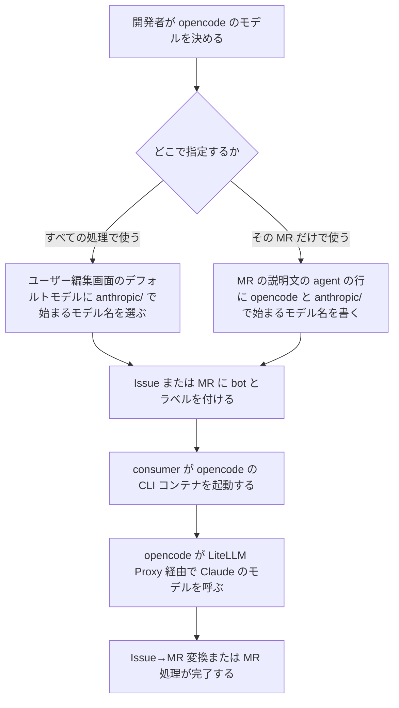

# opencode での Claude のモデルの利用 変更要件定義書

**対象システム**: CodingAgentAutomata
**既存要件定義書**: `docs/requirements.md`
**外部連携の事前確認**: `external/litellm/docs/precheck_report.md`

---

## 1. 目的・前提

### 1.1 変更の目的

opencode は今、OpenAI のモデルでしか動かない。Claude のモデルを指定すると、Issue→MR 変換と MR 処理が失敗する。そのため、Claude のモデルしか契約していない環境では、opencode を選んだ開発者が本システムの自動化を使えない。本変更では、opencode から Claude のモデルを、LiteLLM Proxy 経由で呼べるようにする。

### 1.2 前提

- opencode から LLM を呼ぶ経路は、LiteLLM Proxy 経由だけとする。利用者ごとの Virtual Key で費用を追う既存の仕組みを変えないため。
- LiteLLM Proxy は、opencode からの Claude のモデルの呼び出しを、Anthropic の形式でも OpenAI 互換の形式でも受け付ける。どちらも本物の Anthropic まで届くことを、外部連携の事前確認で確かめた。
- opencode は、本体のモデルとは別に、会話のタイトルを作るためのモデルを呼ぶ。Claude の場合の既定は `claude-haiku-5-5` だが、このモデルは LiteLLM Proxy の設定に無いことがある。
- 外部連携先の追加・削除は無い。既存の LiteLLM Proxy との連携の中で、opencode からの呼び方が増える。
- Zscaler まわりの変更は無い。opencode から LiteLLM Proxy への通信は内部の通信で、プロキシを経由しない。LiteLLM Proxy から Anthropic への通信は、既存の Zscaler 対応で経由できるようになっている。

### 1.3 用語集

| 用語 | 業務上の意味 | 本案件での使用範囲 | 同義語/類義語 |
|---|---|---|---|
| プロバイダ | opencode のモデル名のうち、`/` より前の部分。LLM の呼び方を表す（`openai` は OpenAI のモデル、`anthropic` は Claude のモデル） | opencode のモデル指定（デフォルトモデル、エージェント指定） | なし |
| タイトル用のモデル | opencode が会話のタイトルを作るために、本体のモデルとは別に呼ぶモデル | opencode の実行 | 小さいモデル（small model） |

### 1.4 システムの形態

変更なし。既存要件定義書 `docs/requirements.md` 1.3 を参照。今回の変更は、バッチ（キューのタスクの処理）の中の CLI コンテナの起動に関わる。画面と CUI は変わらない。

### 1-1. 技術制約

| 制約項目 | 内容 | 出どころ（誰がいつ答えたか） |
|---|---|---|
| 既存コードベース | 変更なし。既存要件定義書 `docs/requirements.md` 1-1 を参照 | ユーザー、2026-11-02（変更なしとして了承） |
| 配備先 | 変更なし | ユーザー、2026-11-02（変更なしとして了承） |
| チームの技術 | 変更なし | ユーザー、2026-11-02（変更なしとして了承） |
| ライセンスとコスト | 変更なし。Anthropic の利用料は既存の Claude Code と同じく Virtual Key ごとに追う | ユーザー、2026-11-02（変更なしとして了承） |
| 性能と規模の目安 | 変更なし。既存要件定義書 `docs/requirements.md` 第 5 章を参照 | ユーザー、2026-11-02（変更なしとして了承） |

---

## 2. 業務

### 2.1 対象業務の変更

対象業務の追加・削除は無い。既存の Issue→MR 変換処理と MR コード実装処理で、opencode を使う開発者が Claude のモデルも選べるようになる。業務の範囲は変わらない。

### 2.2 業務フロー

### 2-1. 業務の問題

| 問題 | 対象業務（RQ-BZ） | あるべき姿 | 現状 | ギャップ（KPI） | 業務影響 |
|---|---|---|---|---|---|
| opencode で Claude のモデルを指定すると、処理が失敗する | `RQ-BZ-ISSUE-TO-MR`、`RQ-BZ-MR-IMPLEMENTATION` | opencode でも Claude のモデルで Issue→MR 変換と MR 処理が完了する | opencode は OpenAI のモデルでしか動かず、Claude のモデルを指定すると LLM の呼び出しで失敗する | opencode で Claude のモデルを指定した処理の完了率 0%（目標: Claude Code で Claude のモデルを使ったときと同じ水準） | Claude のモデルしか契約していない環境では、opencode を選んだ開発者が自動化を使えない |

### 2-2. 業務課題一覧

| RQ-BK-ID | 区分 | 業務課題（取り組むこと） | 解決する問題（2-1） | 解決後の状態（KPI の目標値） | 対象業務（RQ-BZ） |
|---|---|---|---|---|---|
| `RQ-BK-OPENCODE-CLAUDE-MODEL` | [追加] | opencode から Claude のモデルを LiteLLM Proxy 経由で呼べるようにする | opencode で Claude のモデルを指定すると、処理が失敗する | opencode で Claude のモデルを指定した処理の完了率が、Claude Code で Claude のモデルを使ったときと同じ水準 | `RQ-BZ-ISSUE-TO-MR`、`RQ-BZ-MR-IMPLEMENTATION` |

### 2-3. 見込み経営効果

| RQ-EF-ID | 区分 | 効果の種類 | 内容 | 見込み（金額・時間などと算定根拠） | 対応業務課題ID（RQ-BK-*） |
|---|---|---|---|---|---|
| `RQ-EF-SOFT-SAVING-OPENCODE-CLAUDE` | [追加] | Soft Saving | 既存の効果（Issue 発生後のブランチ作成・コード実装・テスト実行・コミットの手作業工数の削減）が、opencode で Claude のモデルを使う開発者にも及ぶ | 算定しない（opencode で Claude のモデルを使う人数が決まっていないため） | `RQ-BK-OPENCODE-CLAUDE-MODEL` |

---

## 3. 機能要件

### 3.1 入力データ

| データ | 区分 | 種別 | 説明 |
|---|---|---|---|
| opencode のモデル名 | [追加] | 人手（開発者・管理者） | 「プロバイダ/モデル」の形で書く（例: `anthropic/claude-opus-5-5`）。既存のデフォルトモデルの欄と、MR の説明文のエージェント指定に書く。入力の欄と書き方は既存のまま。値として `anthropic/` で始まる名前を使えるようになる |

### 3.2 出力データ

出力データの追加・変更は無い。処理の結果（MR、コメント、タスクの記録）は既存のとおり。

### 3.3 ユーザー利用フロー

2.2 の業務フローが、今回の変更のユーザー利用フローのすべてである。モデルを指定した後の Issue→MR 変換と MR 処理の利用フローは、既存要件定義書 `docs/requirements.md` 3.2 から変わらない。

### 3.4 業務フローと機能の対応関係

| 業務 | 使用機能 |
|---|---|
| Issue→MR 変換処理 | opencode での Claude のモデルの呼び出し、opencode のプロバイダの判定、および既存の Issue→MR 変換の機能 |
| MR コード実装処理 | opencode での Claude のモデルの呼び出し、opencode のプロバイダの判定、エージェント指定、および既存の MR 処理の機能 |

### 3.5 CUI・Web API の仕様

CUI と Web API の追加・変更は無い。

### 3.6 機能一覧

| RQ-ID | 区分 | カテゴリ | 機能名 | 内容 | 対応業務課題ID（RQ-BK-*） | この機能が無いと何が困るか |
|---|---|---|---|---|---|---|
| `RQ-FT-CALL-CLAUDE-VIA-OPENCODE` | [追加] | 業務機能 | opencode での Claude のモデルの呼び出し | CLI エージェントが opencode で、モデルのプロバイダが `anthropic` のとき、consumer は opencode が LiteLLM Proxy 経由で Claude のモデルを呼べるように、Virtual Key と LiteLLM Proxy の URL を opencode に渡す。Virtual Key は利用者のものをそのまま使い、費用の追跡は既存のとおり利用者ごとに分かれる。opencode のタイトル用のモデルには、利用者が指定したモデルと同じものを使う | `RQ-BK-OPENCODE-CLAUDE-MODEL` | opencode で Claude のモデルを指定した Issue→MR 変換と MR 処理が、LLM の呼び出しで失敗する |

### 3-1. 帳票・出力ファイル

帳票・出力ファイルの追加・変更は無い。

### 3-2. 業務ルール

| RQ-ID | 区分 | ルール名 | 内容（条件と結果） | 違反時・エラー時の業務上の扱い | 対応業務課題ID（RQ-BK-*） |
|---|---|---|---|---|---|
| `RQ-FT-DETERMINE-OPENCODE-PROVIDER` | [追加] | opencode のプロバイダの判定 | opencode のモデル名は「プロバイダ/モデル」の形で書く。プロバイダが `anthropic` なら Claude のモデルとして、`openai` なら OpenAI のモデルとして呼ぶ。`openai` での呼び出しは既存のまま変えない | LiteLLM Proxy に無いモデルや、`openai`・`anthropic` 以外のプロバイダを指定した場合は、既存の CLI の失敗と同じく、タスクを失敗にしてコメントする | `RQ-BK-OPENCODE-CLAUDE-MODEL` |

### 3-3. 外部連携

外部連携先の追加・削除は無い。既存の LiteLLM Proxy との連携（CLI の LLM の呼び出し）の中で、opencode から Claude のモデルを Anthropic の形式で呼ぶようになる。呼び方の詳細と制限は `external/litellm/docs/research.md` を参照。

| RQ-ID | 区分 | 連携先 | 方向 | やり取りするデータ | タイミング | 対応業務課題ID（RQ-BK-*） |
|---|---|---|---|---|---|---|
| `RQ-EX-USE-LOCAL-HTTP-MOCK` | [追加] | LiteLLM Proxy（テスト環境） | 送信 | モック LLM モードでは、既存のモック LLM（ローカルの HTTP サーバー）を LiteLLM Proxy の転送先にし、opencode からの Claude のモデルの呼び出しも受ける。モック LLM が応じない設定項目は、LiteLLM Proxy が捨ててから転送する | opencode で Claude のモデルを指定したシナリオの実行中 | `RQ-BK-OPENCODE-CLAUDE-MODEL`、`RQ-BK-AUTOMATED-VERIFICATION` |

### 3.7 削除する要件

削除する要件は無い。次の既存要件を確かめ、今回の追加要件と矛盾しないことを確認した。

- CLI アダプタの解決：CLI に渡す情報（Virtual Key、LLM の URL、モデル、MCP 設定）は変わらない。
- エージェント指定：書き方は変わらず、モデル名に `anthropic/` で始まる名前を使えるようになるだけ。
- CLI コンテナの仕様の組み込みのアダプタ（opencode の Virtual Key を `OPENAI_API_KEY` で渡すこと）：既存の環境の CLI アダプタ設定を書き換えずに使える要件（5 章）のとおり、この設定は変えない。
- opencode での処理のシナリオ：OpenAI のモデルで確かめる既存のシナリオは、そのまま残す。

---

## 4. データ

### 4-1. データ要件一覧

データ要件の追加・変更は無い。外部 DB の接続先は変わらない。DB の追加は無い。

### 4-2. 業務エンティティとデータ項目

業務エンティティの追加・変更は無い。ユーザーのデフォルトモデル（文字列 255 以内）とタスクのモデルの欄は、既存のまま `anthropic/` で始まる名前を入れられる。既存要件定義書 `docs/requirements.md` 4-2 を参照。

### 4-3. CRUD テーブル

| エンティティ名 | Create | Read（一覧） | Read（詳細） | 検索 | Update | Delete | 備考 |
|---|---|---|---|---|---|---|---|
| ユーザー | ○ | ○ | ○ | ○ | ○ | ○ | 変更なし。検索の条件はユーザー名の前方一致。デフォルトモデルに `anthropic/` で始まる名前を入れられる |
| CLI アダプタ設定 | ○ | ○ | × | × | ○ | △ | 変更なし。管理者のみ。組み込みと使用中のものは削除できない。opencode で Claude のモデルを使うのに、設定の書き換えは要らない |
| タスク | ○ | ○ | × | ○ | ○ | × | 変更なし。検索の条件はユーザー名・状態・種別。重複処理の防止の排他制御は既存のまま |
| システム設定 | ○ | △ | × | △ | ○ | × | 変更なし。読み取りは一括取得のみ。検索はキー単位 |

### 4-4. 状態遷移

状態遷移の変更は無い。opencode で Claude のモデルの呼び出しに失敗した場合も、タスクは既存のとおり失敗へ遷移する。

### 4-5. 画面一覧

画面の追加・変更は無い。ユーザー編集画面のモデル候補には、LiteLLM Proxy のモデルの一覧として `anthropic/` で始まる名前が既存のとおり表示される。

---

## 5. 非機能要件

| RQ-ID | 区分 | カテゴリ | 非機能要件名 | 内容 | 対応業務課題ID（RQ-BK-*） | この非機能要件が無いと何が困るか |
|---|---|---|---|---|---|---|
| `RQ-NF-OPENCODE-CLAUDE-NO-MIGRATION` | [追加] | 移行性 | 既存の環境での移行作業の不要 | 既存の環境は、更新したイメージで起動し直すだけで、opencode で Claude のモデルを使える。DB の CLI アダプタ設定の書き換えも、初期セットアップの再実行も要らない。移すデータは無い | `RQ-BK-OPENCODE-CLAUDE-MODEL` | 運用者が設定の書き換えを忘れると、更新しても opencode で Claude のモデルが使えないまま失敗する |

利用者の種別とアクセス経路、性能、利用人数、可用性、認証方式、権限制御は変更なし。既存要件定義書 `docs/requirements.md` 第 5 章を参照。

---

## 6. 運用要件

運用要件の追加・変更は無い。ログ、監査ログ、監視・アラート、バックアップと復旧は、既存要件定義書 `docs/requirements.md` 第 6 章のとおり。

---

## 7. テスト用利用シナリオ

| RQ-ID | 区分 | テスト目的 | 前提条件 | テスト手順 | 期待される結果 | 対応業務課題ID（RQ-BK-*） |
|---|---|---|---|---|---|---|
| `RQ-TS-VERIFY-OPENCODE-CLAUDE-MODEL` | [追加] | opencode で Claude のモデルを指定した MR 処理が最後まで完了することを確かめる | 既存の opencode のテストユーザーの Draft MR がある。モック LLM モードと実 LLM モードの両方で行う。実 LLM モードでは、Anthropic の API キーだけを `.env` に設定している | MR の説明文のエージェント指定に、opencode と、LiteLLM Proxy にある `anthropic/` で始まる Claude のモデル名を書き、bot とラベルを付けて MR 処理を行わせる | MR 処理が完了し、完了コメントが付く。タスクに使った CLI（opencode）と指定したモデルが記録される。どちらのモードでも成功する | `RQ-BK-OPENCODE-CLAUDE-MODEL`、`RQ-BK-AUTOMATED-VERIFICATION` |

---

## 8. 変更後の業務課題と要件の対応表

| RQ-BK-ID | 対応する要件 |
|---|---|
| `RQ-BK-OPENCODE-CLAUDE-MODEL` | `RQ-EF-SOFT-SAVING-OPENCODE-CLAUDE`、`RQ-FT-CALL-CLAUDE-VIA-OPENCODE`、`RQ-FT-DETERMINE-OPENCODE-PROVIDER`、`RQ-NF-OPENCODE-CLAUDE-NO-MIGRATION`、`RQ-EX-USE-LOCAL-HTTP-MOCK`、`RQ-TS-VERIFY-OPENCODE-CLAUDE-MODEL` |
| `RQ-BK-AUTOMATED-VERIFICATION` | 既存の対応に `RQ-EX-USE-LOCAL-HTTP-MOCK`、`RQ-TS-VERIFY-OPENCODE-CLAUDE-MODEL` を加える |
