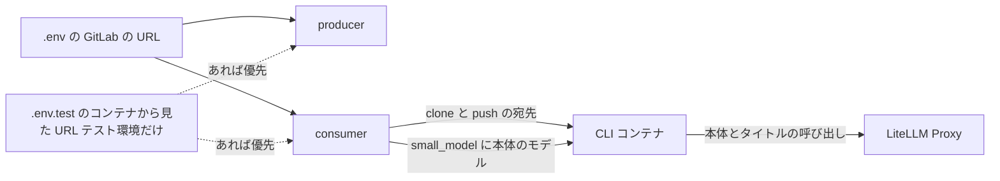
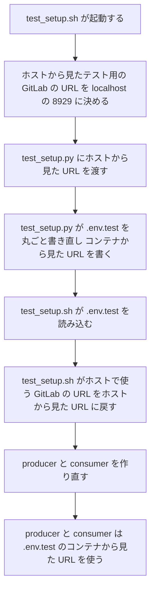
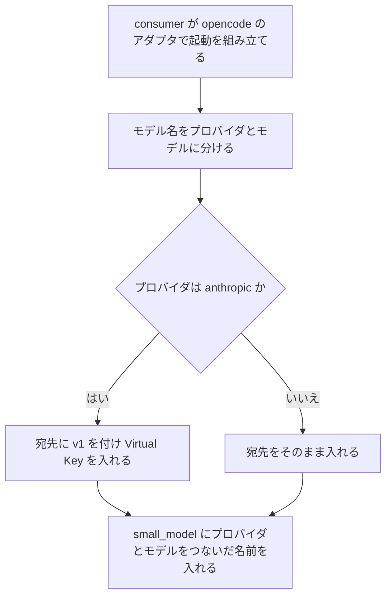
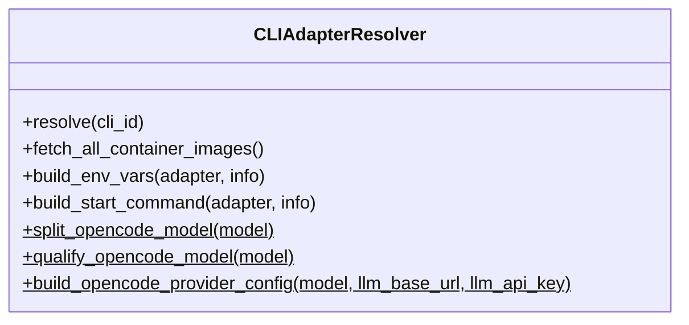

# 本番の GitLab の URL と opencode のタイトル用のモデル 変更詳細設計書

**対象システム**: CodingAgentAutomata
**入力**: `.history/20261103-gitlab-url-and-opencode-small-model/change_requirements.md`
**既存設計書**: `docs/detail_design.md`
**外部連携の調査**: 行わない（既存の GitLab と LiteLLM Proxy の連携の範囲の中に収まるため）。LiteLLM Proxy が LiteLLM Proxy に無いモデルの呼び出しに 400 を返し、ログに `Invalid model name passed in model=<モデル名>` を残すことは、テスト環境の LiteLLM Proxy で確かめた（2026-11-03）

---

## 1. 言語・フレームワーク・アーキテクチャの選定

変更なし。既存設計 `docs/detail_design.md` 第 1 章の技術を引き継ぐ。新たに選定した技術は無い。連携ライブラリとモックの方式も変えない。

---

## 2. システム構成

コンポーネントの追加・削除は無い。変わるのは次の 2 点。

- producer と consumer が使う GitLab の URL の決まり方。起動の構成で値を置き換えず、`.env`、続いてテスト用の設定ファイル（`.env.test`）の順に読んだ値を使う。
- consumer が opencode に渡す設定の JSON。どのプロバイダでも `small_model` に本体のモデルを入れる。

ネットワーク構成図は変更なし。既存設計 `docs/detail_design.md` セクション 2-4 を参照。

---

## 3. データ設計

変更なし。既存設計 `docs/detail_design.md` 第 3 章を参照。

| エンティティ | Create | Read（一覧） | Read（詳細） | 検索 | Update | Delete | 今回の変更 |
|---|---|---|---|---|---|---|---|
| ユーザー | ○ | ○ | ○ | ○ | ○ | ○ | 変更なし |
| CLI アダプタ設定 | ○ | ○ | × | × | ○ | △ | 変更なし |
| タスク | ○ | ○ | × | ○ | ○ | × | 変更なし |
| システム設定 | ○ | △ | × | △ | ○ | × | 変更なし |

---

## 4. アーキテクチャ設計

### 4-1. 外部設計

利用者向けのインターフェースの追加・削除は無い。テスト環境の構築のコマンド（`./scripts/test_setup.sh`）の引数・出力・終了コードは変えない。

テスト用の設定ファイル（`.env.test`）の `GITLAB_API_URL` の値を、ホストから見た URL（`http://localhost:8929`）から、コンテナから見た URL（`http://gitlab:8929`）に変える。ほかの行は変えない。

### 4-2. 内部設計

GitLab の URL の流れを次に示す。

opencode の設定の組み立てを次に示す。

| DS-ID | 区分 | 処理 | 内容 |
|---|---|---|---|
| `DS-FN-BUILD-OPENCODE-PROVIDER-SETTINGS-FT-CALL-CLAUDE-VIA-OPENCODE` | [削除] | opencode のプロバイダの設定の組み立て（`small_model` は `anthropic` のときだけ） | 削除理由: タイトル用のモデルを、どのプロバイダでも指定するように変えるため、下の要素に置き換える |
| `DS-FN-BUILD-OPENCODE-CONFIG` | [追加] | opencode のプロバイダの設定の組み立て | モデル名、LiteLLM Proxy の URL、Virtual Key から、設定の JSON のうち `provider` と `small_model` を作る。プロバイダは opencode のプロバイダの判定で決める。`anthropic` なら、URL の末尾の `/` を取り除いて `/v1` を付け（すでに `/v1` で終わっていれば付けない）、`provider.anthropic.options` に `baseURL` と `apiKey`（Virtual Key。空なら入れない）を入れる。それ以外は `provider.<プロバイダ>.options.baseURL` に URL をそのまま入れる。どのプロバイダでも、`small_model` に「プロバイダ/モデル」の形の名前（つなぐ処理の結果）を入れる。CLI アダプタ設定は変えずに済む |

---

## 5. クラス設計

クラスの追加・削除は無い。CLIAdapterResolver の静的メソッドを次のとおりにする。

| DS-ID | 区分 | 対象 | 内容 |
|---|---|---|---|
| `DS-FN-BUILD-OPENCODE-CONFIG` | [追加] | `CLIAdapterResolver.build_opencode_provider_config`（静的。引数・戻り値は既存のまま） | 4-2 のとおり。プロバイダによる分岐は宛先と Virtual Key の入れ方だけにし、`small_model` を入れる処理は分岐の外で 1 回だけ行う |

システム内メッセージは変更なし。

---

## 6. エラーハンドリングとセキュリティ設計

新しいエラーの種類は足さない。本体のモデルが LiteLLM Proxy に無い場合は、既存の CLI の失敗の扱いでタスクを失敗にする。

テスト環境の producer と consumer は、テスト環境の構築の最初の起動では、前回の `.env.test` の値（初回は `.env` の値）で起動する。初回は GitLab につながらない値で起動することがある。ただしステップ 6（`--run-tests` のときはテスト前の後片付け）で作り直してから使うので、テストには影響しない。セキュリティは変更なし。

---

## 7. コード設計

ソースファイルの追加・削除は無い。

| ファイル | 既存の DS-MD | 置く設計要素 | 区分 |
|---|---|---|---|
| `consumer/cli_adapter_resolver.py` | `DS-MD-CONSUMER-CLI-ADAPTER-RESOLVER-FT-RESOLVE-CLI-ADAPTER`（変えない。含まれる設計要素の欄を新しい ID に差し替える） | `DS-FN-BUILD-OPENCODE-CONFIG` | [追加] |
| `docker-compose.yml` | なし（設定ファイル） | `DS-OP-COMPOSE-GITLAB-URL` | [追加] |
| `scripts/test_setup.sh` | `DS-MD-SCRIPTS-TEST-SETUP-SH-FT-SETUP-TEST-ENVIRONMENT`（変えない。対応要件を差し替える） | `DS-OP-TEST-ENVIRONMENT` | [追加] |
| `scripts/test_setup.py` | なし（テストファイル） | `DS-OP-TEST-ENVIRONMENT` | [追加] |
| `README.md` | なし（文書） | `DS-OP-GITLAB-URL-README` | [追加] |
| `tests/consumer/test_cli_adapter_resolver_opencode.py` | なし（テストファイル） | `DS-TS-OPENCODE-RESOLVER-UNIT` | [追加] |
| `e2e/tests/gitlab_integration.spec.ts` | なし（テストファイル） | `DS-TS-OPENCODE-CLAUDE-ISSUE-TO-MR-E2E` | [追加] |
| `e2e/zscaler/test_runtime_settings_e2e.py`（新しく作る） | なし（テストファイル） | `DS-TS-GITLAB-URL-FROM-ENV-E2E`、`DS-TS-TEST-SETUP-REPEATABLE-E2E`、`DS-TS-OPENCODE-NO-UNKNOWN-MODEL-CALL-E2E` | [追加] |

共通化の方針:

- 新しいホストの E2E は `e2e/zscaler/` に置き、既存の共通処理（`conftest.py` の `run`・`REPO`）を使う。`e2e/zscaler/` は、ホストの pytest から docker の CLI で確かめる E2E の置き場として使う。ステップ 8 の表示も「ホストから確かめる E2E」に改める。
- 「プロバイダ/モデル」の形の名前は、既存の `qualify_opencode_model` だけで作る。起動コマンドの `--model` と `small_model` の両方がこれを使う。

対応表（`docs/trace_map.md`）は、削除する関数の DS-ID の行を `DS-FN-BUILD-OPENCODE-CONFIG` に差し替える。

---

## 8. テスト設計

### 8-1. 単体テスト

| DS-ID | 区分 | テスト |
|---|---|---|
| `DS-TS-OPENCODE-MODEL-NAME-UNIT-FT-DETERMINE-OPENCODE-PROVIDER-BY-NAME` | [削除] | 削除理由: `openai` の名前で `small_model` を入れない前提のため、下の単体テストに置き換える |
| `DS-TS-OPENCODE-RESOLVER-UNIT` | [追加] | 単体テスト `tests/consumer/test_cli_adapter_resolver_opencode.py`。① 判定: `claude-opus-5-5`→`anthropic`、`gpt-5.5`→`openai`、`anthropic/claude-opus-5-5`・`openai/gpt-4o-mini`→書いたまま、空→既定、`litellm/org/model`→最初の `/` で分ける。② つなぎ: 上の各名前が「プロバイダ/モデル」になる。③ 起動コマンド: opencode のアダプタで `claude-opus-5-5` を指定すると `--model anthropic/claude-opus-5-5`、`gpt-5.5` なら `--model openai/gpt-5.5`。Claude Code のアダプタは書いた名前のまま。④ 設定の JSON: `claude-opus-5-5` でも `anthropic/claude-opus-5-5` でも、`/v1` 付きの `baseURL`・`apiKey`・`small_model`（`anthropic/claude-opus-5-5`）が入る。URL の末尾の `/` や `/v1` で `/v1` が二重にならない。`gpt-5.5` でも `openai/gpt-4o-mini` でも、`baseURL` は URL のまま、`small_model` は「プロバイダ/モデル」の形（`openai/gpt-5.5`、`openai/gpt-4o-mini`）。`litellm/org/model` では `small_model` が `litellm/org/model`。⑤ `build_env_vars` が opencode のアダプタで JSON と `OPENAI_API_KEY` の両方を入れ、Claude Code のアダプタの出力は変わらない |

実行コマンドは既存のまま（`ZSCALER_ENABLED=false ./scripts/compose.sh --profile test run --rm --build unit_test`）。

### 8-2. E2E テストのシナリオ

| DS-ID | 区分 | 目的 | 前提条件 | 手順 | 期待結果 |
|---|---|---|---|---|---|
| `DS-TS-GITLAB-URL-FROM-ENV-E2E` | [追加] | 本番の状態とテスト環境で、producer と consumer に渡る GitLab の URL を確かめる | ホストで docker の CLI が使える | 一時ディレクトリに `docker-compose.yml` を写し、`GITLAB_API_URL=https://gitlab.example.invalid` だけを書いた `.env` と、空の `.zscaler/zscaler.env` を置く。① `.env.test` を置かずに、`docker compose --project-directory <一時ディレクトリ> config --format json` で構成を展開する（起動はしない。既存の Zscaler の E2E と同じく構成の展開だけに docker の CLI を使う）。② `GITLAB_API_URL=http://gitlab:8929` を書いた `.env.test` を置いて、もう一度展開する | ① では producer と consumer の `GITLAB_API_URL` が `https://gitlab.example.invalid`。② では `http://gitlab:8929`。どちらも test_playwright・test_playwright_real を含めて、`environment` に `GITLAB_API_URL` が書かれていない |
| `DS-TS-TEST-SETUP-REPEATABLE-E2E` | [追加] | テスト環境の構築を続けて実行しても同じ状態になる | テスト環境の構築を一度実行済み | ① `./scripts/test_setup.sh --run-tests` を実行する（2 回目の構築と E2E）。② ホストの E2E で、`.env` のハッシュが変わっていないことと、`.env.test` の `GITLAB_API_URL` が `http://gitlab:8929` であることを確かめる。`.env` のハッシュは、test_setup.sh が構築の最初に取って、環境変数でホストの E2E に渡す | 2 回目の構築が終了コード 0 で終わる。`.env` のハッシュが同じ。`.env.test` の `GITLAB_API_URL` が `http://gitlab:8929`。Playwright の E2E がすべて通る |
| `DS-TS-OPENCODE-NO-UNKNOWN-MODEL-CALL-E2E` | [追加] | opencode の実行で、LiteLLM Proxy に無いモデルの呼び出しが起きない | テスト環境（モック LLM モード）。test_setup.sh が Playwright の E2E を始める直前の時刻（UTC）と、使っている LiteLLM Proxy のサービス名（`litellm` か `litellm_real`）を環境変数でホストの E2E に渡す | Playwright の E2E（opencode の OpenAI の経路の T-31（Issue→MR 変換）・T-32（MR 処理）・T-34、Claude の経路の T-36（Issue→MR 変換）・T-35（MR 処理）を含む）を実行した後、`docker compose logs --since <開始時刻> <LiteLLM Proxy のサービス>` を読む | `Invalid model name passed in model=` を含む行が 0 件。見つかったら、その行（モデル名）を失敗の内容に出す。環境変数が無い（単独で実行した）ときは飛ばす |
| `DS-TS-OPENCODE-CLAUDE-ISSUE-TO-MR-E2E` | [追加] | opencode で、プロバイダ名の付かない Claude のモデル名を使う Issue→MR 変換が完了する（T-36。上のシナリオで Claude の経路の Issue→MR 変換を通すため） | テスト環境（モック LLM モードと実 LLM モード）。opencode のテストユーザーがいる | ① キューが空になるのを待つ。② backend の API で opencode のテストユーザーのデフォルト CLI を `opencode`、デフォルトモデルを `DEFAULT_CLAUDE_MODEL`（既定 `claude-haiku-4-5-20251001`。プロバイダ名を付けない）にする。変える前のデフォルトモデルを控える。③ そのユーザーで Issue を作り、bot とラベルを付ける。④ タスクの完了と、Issue の MR のコメントを待つ。⑤ 成否にかかわらず、デフォルトモデルを控えた値に戻す | タスクが完了し、タスクの CLI が `opencode`、モデルが書いたままの名前。Issue に MR の作成のコメントが付く。テストの後、opencode のテストユーザーのデフォルトモデルが元に戻っている |

E2E の実行コマンドは既存のまま（モック: `./scripts/test_setup.sh --run-tests`、模擬プロキシあり: `--zscaler-mock` を足す。本物は手動で `--real` を足す）。新しいホストの E2E は、既存のステップ 8 で Zscaler の E2E と一緒に実行する。

---

## 9. 運用設計

### 9-1. 起動・初期化・設定

| DS-ID | 区分 | 対象 | 内容 |
|---|---|---|---|
| `DS-OP-COMPOSE-GITLAB-URL` | [追加] | `docker-compose.yml` | producer・consumer・test_playwright・test_playwright_real の `environment` から `GITLAB_API_URL` の行（と、その上の「localhost の URL を内部名で上書き」のコメント）を取り除く。各サービスは `env_file` の値を使う（producer と consumer は `.env`、続いて `.env.test`。テスト用の 2 つは `.env.test`） |
| `DS-OP-TEST-ENVIRONMENT-FT-SETUP-TEST-ENVIRONMENT` | [削除] | テスト環境 | 削除理由: `.env.test` に書く GitLab の URL と、ホストで使う GitLab の URL の決め方が変わるため、下の要素に置き換える |
| `DS-OP-TEST-ENVIRONMENT` | [追加] | テスト環境 | `scripts/test_setup.py`（GitLab の bot・グループ・プロジェクト・ラベル・Group Webhook・テストユーザー、Virtual Key、管理画面のユーザーの準備と `.env.test` の書き出し）、`litellm/config.yml`・`config-real.yml`、compose の test・test-real のプロファイル、`e2e/` の Playwright の設定と前後処理（キューを空にする、開いた MR を閉じる）。GitLab の URL は次のとおり扱う。① `test_setup.sh` は、ホストから見たテスト用の GitLab の URL を `http://localhost:8929` に決め（`.env` の値は使わない）、`test_setup.py` に渡す。② `test_setup.py` は `.env.test` を丸ごと書き直し、`GITLAB_API_URL` にコンテナから見た URL（環境変数 `GITLAB_CONTAINER_URL`、既定 `http://gitlab:8929`）を書く。③ `test_setup.sh` は `.env.test` を読み込んだ直後に、ホストで使う `GITLAB_API_URL` をホストから見た URL に戻す（後片付けなど、ホストから GitLab を呼ぶ処理のため）。④ 手元の `.env` は、無いときだけ見本から作り、あるときは書き換えない（既存どおり）。⑤ ステップ 7 の Playwright の E2E を始める直前の時刻（UTC）、LiteLLM Proxy のサービス名、構築の最初に取った `.env` のハッシュを、ステップ 8 のホストの E2E に環境変数で渡す |
| `DS-OP-GITLAB-URL-README` | [追加] | `README.md` | 環境変数の表の `GITLAB_API_URL` の説明を「GitLab の URL。本番は社内の GitLab の URL を書く。テスト環境では、テスト環境の構築が `.env.test` に書くコンテナから見た URL が優先される」にする（例の `http://gitlab:80` を消す）。更新の注意として、本番で `docker-compose.yml` の `GITLAB_API_URL` を手で直していた環境は、手直しを戻し（更新で上書きしてよい）、`.env` の `GITLAB_API_URL` が社内の GitLab を指していることを確かめる、と書く。手元のテスト環境は `.env` を書き換えず、`./scripts/test_setup.sh` を実行し直す、と書く |

### 9-2. 設定値・環境変数の一覧

既存設計 `docs/detail_design.md` 9-2 の `GITLAB_API_URL` の行の説明を、「GitLab の URL（compose で producer と consumer は `http://gitlab:8929` に上書き）」から「GitLab の URL。テスト環境では `.env.test` の値（コンテナから見た `http://gitlab:8929`）が優先される」に置き換える。既定値と必須は変えない。

ほかの運用設計は変更なし。

---

## 10. ログ・監視・アラート・障害対応設計

変更なし。opencode の実行のたびに LiteLLM Proxy のログに残っていた、タイトル用のモデルの 400 が無くなる。

---

## 11. 要件と設計の対応表

| DS-ID | 区分 | 対応要件ID |
|---|---|---|
| `DS-OP-COMPOSE-GITLAB-URL` | [追加] | `RQ-FT-USE-GITLAB-URL-FROM-ENV` |
| `DS-MD-CONSUMER-CLI-ADAPTER-RESOLVER-FT-RESOLVE-CLI-ADAPTER` | 変更なし（既存） | `RQ-FT-RESOLVE-CLI-ADAPTER` |
| `DS-OP-TEST-ENVIRONMENT-FT-SETUP-TEST-ENVIRONMENT` | [削除] | `RQ-FT-SETUP-TEST-ENVIRONMENT`、`RQ-UI-TEST-SETUP-CMD` |
| `DS-OP-TEST-ENVIRONMENT` | [追加] | `RQ-FT-SETUP-TEST-ENVIRONMENT-REPEATABLE`、`RQ-UI-TEST-SETUP-CMD`、`RQ-FT-USE-GITLAB-URL-FROM-ENV` |
| `DS-OP-GITLAB-URL-README` | [追加] | `RQ-NF-UPDATE-WITHOUT-MIGRATION-WORK` |
| `DS-MD-SCRIPTS-TEST-SETUP-SH-FT-SETUP-TEST-ENVIRONMENT` | [削除] | `RQ-FT-SETUP-TEST-ENVIRONMENT`、`RQ-UI-TEST-SETUP-CMD`、`RQ-UI-TEST-SETUP-ZSCALER-MOCK-OPTION`、`RQ-FT-RUN-ZSCALER-MOCK-PROXY`、`RQ-FT-APPLY-ZSCALER-SETTINGS-HOST-SCRIPT` |
| `DS-MD-SCRIPTS-TEST-SETUP-SH-FT-SETUP-TEST-ENVIRONMENT` | [追加] | `RQ-FT-SETUP-TEST-ENVIRONMENT-REPEATABLE`、`RQ-UI-TEST-SETUP-CMD`、`RQ-UI-TEST-SETUP-ZSCALER-MOCK-OPTION`、`RQ-FT-RUN-ZSCALER-MOCK-PROXY`、`RQ-FT-APPLY-ZSCALER-SETTINGS-HOST-SCRIPT` |
| `DS-FN-LEGACY-GITLAB-SETUP-FT-SETUP-TEST-ENVIRONMENT` | [削除] | `RQ-FT-SETUP-TEST-ENVIRONMENT` |
| `DS-FN-LEGACY-GITLAB-SETUP-FT-SETUP-TEST-ENVIRONMENT` | [追加] | `RQ-FT-SETUP-TEST-ENVIRONMENT-REPEATABLE` |
| `DS-MD-SCRIPTS-LEGACY-GITLAB-SETUP-FT-SETUP-TEST-ENVIRONMENT` | [削除] | `RQ-FT-SETUP-TEST-ENVIRONMENT` |
| `DS-MD-SCRIPTS-LEGACY-GITLAB-SETUP-FT-SETUP-TEST-ENVIRONMENT` | [追加] | `RQ-FT-SETUP-TEST-ENVIRONMENT-REPEATABLE` |
| `DS-FN-BUILD-OPENCODE-PROVIDER-SETTINGS-FT-CALL-CLAUDE-VIA-OPENCODE` | [削除] | `RQ-FT-CALL-CLAUDE-VIA-OPENCODE`、`RQ-NF-OPENCODE-CLAUDE-NO-MIGRATION`、`RQ-FT-DETERMINE-OPENCODE-PROVIDER-BY-NAME` |
| `DS-FN-BUILD-OPENCODE-CONFIG` | [追加] | `RQ-FT-PASS-CLAUDE-CONNECTION-TO-OPENCODE`、`RQ-FT-USE-MAIN-MODEL-AS-OPENCODE-TITLE-MODEL`、`RQ-FT-DETERMINE-OPENCODE-PROVIDER-BY-NAME`、`RQ-NF-OPENCODE-CLAUDE-NO-MIGRATION`、`RQ-NF-UPDATE-WITHOUT-MIGRATION-WORK` |
| `DS-TS-OPENCODE-MODEL-NAME-UNIT-FT-DETERMINE-OPENCODE-PROVIDER-BY-NAME` | [削除] | `RQ-FT-DETERMINE-OPENCODE-PROVIDER-BY-NAME`、`RQ-FT-CALL-CLAUDE-VIA-OPENCODE`、`RQ-NF-OPENCODE-CLAUDE-NO-MIGRATION` |
| `DS-TS-OPENCODE-RESOLVER-UNIT` | [追加] | `RQ-FT-DETERMINE-OPENCODE-PROVIDER-BY-NAME`、`RQ-FT-PASS-CLAUDE-CONNECTION-TO-OPENCODE`、`RQ-FT-USE-MAIN-MODEL-AS-OPENCODE-TITLE-MODEL`、`RQ-NF-OPENCODE-CLAUDE-NO-MIGRATION` |
| `DS-TS-GITLAB-URL-FROM-ENV-E2E` | [追加] | `RQ-TS-VERIFY-GITLAB-URL-FROM-ENV` |
| `DS-TS-TEST-SETUP-REPEATABLE-E2E` | [追加] | `RQ-TS-VERIFY-TEST-SETUP-REPEATABLE` |
| `DS-TS-OPENCODE-NO-UNKNOWN-MODEL-CALL-E2E` | [追加] | `RQ-TS-VERIFY-OPENCODE-NO-UNKNOWN-MODEL-CALL` |
| `DS-TS-OPENCODE-CLAUDE-ISSUE-TO-MR-E2E` | [追加] | `RQ-TS-VERIFY-OPENCODE-NO-UNKNOWN-MODEL-CALL` |

### 11-1. 除外要件

除外要件は無い。
