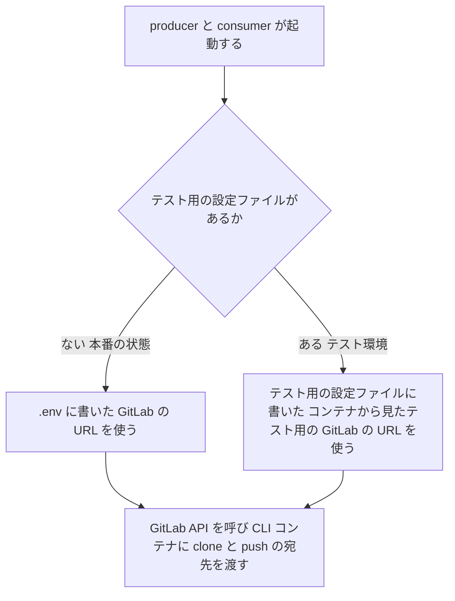
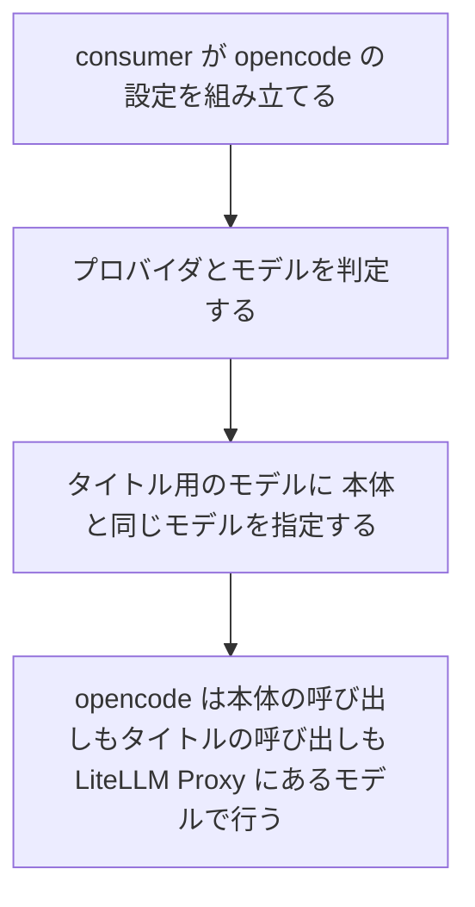

# 本番の GitLab の URL と opencode のタイトル用のモデル 変更要件定義書

**対象システム**: CodingAgentAutomata
**既存要件定義書**: `docs/requirements.md`
**外部連携の事前確認**: 行わない（既存の GitLab と LiteLLM Proxy の連携の範囲の中に収まり、API の使い方は変えないため。ユーザーの決定、2026-11-03）

---

## 1. 目的・前提

### 1.1 変更の目的

次の 2 つの変更を行う。

- 本番では、`.env` に書いた GitLab の URL を、producer と consumer が手直し無しで使うようにする。今は起動の構成（docker compose の設定）がテスト用の GitLab の URL に固定しているので、本番の更新のたびに手で直している。
- opencode のタイトル用のモデルに、どのプロバイダでも本体のモデルを使うようにする。今は OpenAI の経路で、LiteLLM Proxy に無い既定のタイトル用のモデルが呼ばれ、実行のたびに異常でないエラーがログに出る。

### 1.2 前提

- 本番では社内の GitLab を使っている。本番の更新のたびに、起動の構成の producer と consumer の 2 か所を手で直している。`.env` を本番の値に書き換えるのは前提の作業で、手直しには数えない（ユーザー、2026-11-03）。
- 起動の構成が `.env` の値をテスト用の値で置き換えている本番の設定は、GitLab の URL だけである（コードで確認、2026-11-03）。
- テスト環境では、同じ GitLab を 2 つの住所で呼ぶ。ホストで動くテスト環境の構築は `http://localhost:8929`、コンテナの中の producer・consumer・CLI コンテナは `http://gitlab:8929` で呼ぶ。consumer は GitLab の URL のホスト部分から、CLI コンテナの clone と push の宛先も作る（コードで確認、2026-11-03）。
- producer と consumer は、`.env` の後にテスト用の設定ファイルを読み、同じ名前の設定はテスト用の設定ファイルの値を使う。テスト用の設定ファイルは、テスト環境の構築が実行のたびに丸ごと作り直す。本番には無い（コードで確認、2026-11-03）。
- opencode は 1 回の実行で、本体のモデルとは別にタイトル用のモデルを呼ぶ。設定でタイトル用のモデルを指定すれば、そのモデルを使う（`external/litellm/docs/research.md`、2026-11-02 に Claude の経路で確認）。今は Claude の経路だけで指定している。OpenAI の経路では opencode の既定の `gpt-5.4-nano-flex` が呼ばれ、LiteLLM Proxy に無いので 400 になる。その後 opencode が別のモデルで呼び直すので、処理は完了する。
- テスト環境のモック LLM モードでも、opencode は LiteLLM Proxy を通ってモック LLM を呼ぶ。Virtual Key は LiteLLM Proxy から発行する（コードで確認、2026-11-03）。
- 外部連携先の追加・削除は無い。

### 1.3 用語集

| 用語 | 業務上の意味 | 本案件での使用範囲 | 同義語/類義語 |
|---|---|---|---|
| テスト用の設定ファイル | テスト環境の構築が実行のたびに作り直す設定のファイル（`.env.test`）。テスト用の GitLab のトークンや URL を持つ。本番には無い | テスト環境の producer・consumer、E2E | なし |
| 本番の状態 | テスト用の設定ファイルが無く、`.env` の設定だけで本システムが動いている状態 | 本番の環境 | なし |
| 異常でないエラー | 処理の失敗につながらないのに、ログにエラーとして残る応答（opencode が呼び直す前提の 400 など） | LiteLLM Proxy と opencode のログ | なし |

ほかの用語は変更なし。既存要件定義書 `docs/requirements.md` 1.2 を参照。

### 1.4 システムの形態

変更なし。既存要件定義書 `docs/requirements.md` 1.3 を参照。

### 1-1. 技術制約

| 制約項目 | 内容 | 出どころ（誰がいつ答えたか） |
|---|---|---|
| 既存コードベース | 変更なし。既存要件定義書 `docs/requirements.md` 1-1 を参照 | ユーザー、2026-11-03（変更なしとして了承） |
| 配備先 | 変更なし | 同上 |
| チームの技術 | 変更なし | 同上 |
| ライセンスとコスト | 変更なし | 同上 |
| 性能と規模の目安 | 変更なし | 同上 |

---

## 2. 業務

### 2.1 対象業務の変更

対象業務の追加・削除は無い。既存の本システムの構築・運用の業務で、本番の更新時の手直しと、ログの調査の手間が減る。

### 2.2 業務フロー

GitLab の URL の決まり方を次に示す。

opencode のタイトル用のモデルの決まり方を次に示す。

### 2-1. 業務の問題

| 問題 | 対象業務（RQ-BZ） | あるべき姿 | 現状 | ギャップ（KPI） | 業務影響 |
|---|---|---|---|---|---|
| 本番で社内の GitLab を使うには、起動の構成を手で直し続ける必要がある | `RQ-BZ-SYSTEM-BUILD-OPERATION` | `.env` に書いた GitLab の URL を、手直し無しで producer と consumer が使う | 起動の構成がテスト用の `http://gitlab:8929` に固定しているので、本番では producer と consumer の 2 か所を更新のたびに手で直す | 本番の更新ごとの手直し 2 か所（目標 0） | 更新のたびに手間がかかる。直し忘れると、Issue→MR 変換と MR 処理がすべて止まる |
| opencode の OpenAI の経路で、異常でないエラーが実行のたびに出る | `RQ-BZ-SYSTEM-BUILD-OPERATION` | ログに出るエラーは、本当の失敗だけ | タイトル用のモデルの呼び出しが、実行のたびに LiteLLM Proxy で 400 になり、ログに残る | 1 回の実行あたりの異常でないエラー 1 件以上（目標 0 件） | 本当の失敗の調査や監視の邪魔になる |

### 2-2. 業務課題一覧

| RQ-BK-ID | 区分 | 業務課題（取り組むこと） | 解決する問題（2-1） | 解決後の状態（KPI の目標値） | 対象業務（RQ-BZ） |
|---|---|---|---|---|---|
| `RQ-BK-GITLAB-URL-FROM-ENV` | [追加] | `.env` に書いた GitLab の URL を、本番では手直し無しで producer と consumer が使うようにする。テスト環境の住所の違い（ホストからは `localhost`、コンテナからは `gitlab`）は、テスト環境の側で吸収する | 本番で社内の GitLab を使うには、起動の構成を手で直し続ける必要がある | 本番の更新ごとの手直し 0 か所 | `RQ-BZ-SYSTEM-BUILD-OPERATION` |
| `RQ-BK-OPENCODE-NO-SPURIOUS-ERRORS` | [追加] | どのプロバイダでも、opencode のタイトル用のモデルに本体のモデルを使い、異常でないエラーを無くす | opencode の OpenAI の経路で、異常でないエラーが実行のたびに出る | 1 回の実行あたりの異常でないエラー 0 件 | `RQ-BZ-SYSTEM-BUILD-OPERATION` |

### 2-3. 見込み経営効果

| RQ-EF-ID | 区分 | 効果の種類 | 内容 | 見込み（金額・時間などと算定根拠） | 対応業務課題ID（RQ-BK-*） |
|---|---|---|---|---|---|
| `RQ-EF-SOFT-SAVING-OPS-EFFORT` | [追加] | Soft Saving | 本番の更新時の手直しと、ログの調査の工数を減らす | 算定しない（数値の根拠が無いため） | `RQ-BK-GITLAB-URL-FROM-ENV`、`RQ-BK-OPENCODE-NO-SPURIOUS-ERRORS` |

---

## 3. 機能要件

### 3.1 入力データ

| データ | 区分 | 種別 | 説明 |
|---|---|---|---|
| GitLab の URL | [追加] | 人手（管理者） | `.env` の `GITLAB_API_URL` に書く。本番では社内の GitLab の URL。producer と consumer が、GitLab API の呼び出しと、CLI コンテナの clone と push の宛先に使う |

### 3.2 出力データ

| データ | 区分 | 出力先 | 説明 |
|---|---|---|---|
| テスト用の設定ファイル | [追加] | プロジェクト直下の `.env.test` | テスト環境の構築が実行のたびに丸ごと作り直す。既存の内容（テスト用の GitLab のトークンなど）に加え、コンテナから見たテスト用の GitLab の URL を書く |

### 3.3 ユーザー利用フロー

2.2 の業務フローのとおり。Issue→MR 変換と MR 処理の利用フローは、既存要件定義書 `docs/requirements.md` 3.2 から変わらない。

### 3.4 業務フローと機能の対応関係

| 業務 | 使用機能 |
|---|---|
| 本システムの構築・運用 | GitLab の URL の受け取り、テスト環境の構築（何度実行しても同じ状態になる）、および既存の構築・運用の機能 |
| Issue→MR 変換処理 | opencode への Claude の接続情報の受け渡し、opencode のタイトル用のモデルの指定、および既存の Issue→MR 変換の機能 |
| MR コード実装処理 | opencode への Claude の接続情報の受け渡し、opencode のタイトル用のモデルの指定、および既存の MR 処理の機能 |

### 3.5 CUI・Web API の仕様

CUI と Web API の追加・変更は無い。テスト環境の構築のコマンドの引数・出力・終了コードは変えない。

### 3.6 機能一覧

| RQ-ID | 区分 | カテゴリ | 機能名 | 内容 | 対応業務課題ID（RQ-BK-*） | この機能が無いと何が困るか |
|---|---|---|---|---|---|---|
| `RQ-FT-USE-GITLAB-URL-FROM-ENV` | [追加] | 運用 | GitLab の URL の受け取り | producer と consumer は、`.env` に書いた GitLab の URL を、GitLab API の呼び出しと、CLI コンテナの clone と push の宛先に使う。起動の構成で別の値に置き換えない。テスト用の設定ファイルがあるときだけ、そこに書いた値を使う | `RQ-BK-GITLAB-URL-FROM-ENV` | 本番で社内の GitLab を使うたびに、起動の構成を手で直すことになる |
| `RQ-FT-SETUP-TEST-ENVIRONMENT` | [削除] | 運用 | テスト環境の構築 | 削除理由: 何度実行しても同じ状態になることと、コンテナから見たテスト用の GitLab の URL をテスト用の設定ファイルに書くことを加えるため、下の新しい要件に置き換える | `RQ-BK-AUTOMATED-VERIFICATION` | – |
| `RQ-FT-SETUP-TEST-ENVIRONMENT-REPEATABLE` | [追加] | 運用 | テスト環境の構築（何度実行しても同じ状態になる） | テスト環境を一括で作る（サービスの起動、GitLab の初期化、bot・グループ・プロジェクト・ラベル・Group Webhook・テストユーザーの準備、Virtual Key の発行、管理画面のユーザーの登録）。指定すれば E2E を実行する。何度実行しても同じ状態になる。テスト用の設定ファイルは実行のたびに丸ごと作り直し、コンテナから見たテスト用の GitLab の URL を書く。手元の `.env` は、無いときだけ見本から作り、あるときは書き換えない | `RQ-BK-AUTOMATED-VERIFICATION`、`RQ-BK-GITLAB-URL-FROM-ENV` | 動作確認のたびに環境を手で作ることになる。起動の構成の固定をやめると、テスト環境の producer と consumer がテスト用の GitLab につながらない |
| `RQ-FT-CALL-CLAUDE-VIA-OPENCODE` | [削除] | 業務機能 | opencode での Claude のモデルの呼び出し | 削除理由: タイトル用のモデルの指定を、Claude に限らないルール（3-2）に移すため、タイトル用のモデルの記述を除いた下の新しい要件に置き換える | `RQ-BK-OPENCODE-CLAUDE-MODEL` | – |
| `RQ-FT-PASS-CLAUDE-CONNECTION-TO-OPENCODE` | [追加] | 業務機能 | opencode への Claude の接続情報の受け渡し | CLI エージェントが opencode で、モデルのプロバイダが `anthropic` のとき、opencode が LiteLLM Proxy 経由で Claude のモデルを呼べるように、Virtual Key と LiteLLM Proxy の URL を opencode に渡す。Virtual Key は利用者のものをそのまま使い、費用の追跡は利用者ごとに分かれる | `RQ-BK-OPENCODE-CLAUDE-MODEL` | opencode で Claude のモデルを指定した Issue→MR 変換と MR 処理が、LLM の呼び出しで失敗する |

### 3-1. 帳票・出力ファイル

帳票・出力ファイルの追加・変更は無い（テスト用の設定ファイルは 3.2 のとおり）。

### 3-2. 業務ルール

| RQ-ID | 区分 | ルール名 | 内容（条件と結果） | 違反時・エラー時の業務上の扱い | 対応業務課題ID（RQ-BK-*） | この要件が無いと何が困るか |
|---|---|---|---|---|---|---|
| `RQ-FT-USE-MAIN-MODEL-AS-OPENCODE-TITLE-MODEL` | [追加] | opencode のタイトル用のモデルの指定 | CLI エージェントが opencode のとき、プロバイダにかかわらず、タイトル用のモデルに本体のモデル（「プロバイダ/モデル」の形に直した名前）を指定する | 本体のモデルが LiteLLM Proxy に無い場合は、既存のとおり CLI の失敗としてタスクを失敗にし、コメントする | `RQ-BK-OPENCODE-NO-SPURIOUS-ERRORS`、`RQ-BK-OPENCODE-CLAUDE-MODEL` | opencode が LiteLLM Proxy に無い既定のタイトル用のモデルを呼び、実行のたびに異常でないエラーが出る。Claude の経路でも、既定のタイトル用のモデル（`claude-haiku-5-5`）が LiteLLM Proxy に無いと、同じエラーが起きる |

### 3-3. 外部連携

外部連携の追加・削除は無い。GitLab への接続先は `.env` の値になる。LiteLLM Proxy へのタイトルの呼び出しのモデル名は、どのプロバイダでも本体と同じモデル名になる。モック LLM モードのモックの方式（モック LLM を LiteLLM Proxy の転送先にする）は変えない。

### 3.7 CLI コンテナの仕様の変更

既存要件定義書 `docs/requirements.md` 3.5 の「組み込みのアダプタ」の表の、opencode の llm_base_url の欄を次のとおり置き換える。

| 項目 | 区分 | opencode |
|---|---|---|
| llm_base_url | [削除] | `OPENCODE_CONFIG_CONTENT` の JSON の `provider.<プロバイダー>.options.baseURL`。プロバイダが `anthropic` のときは末尾に `/v1` を付け、JSON の `small_model` に「プロバイダ/モデル」の形のモデル名を入れる |
| llm_base_url | [追加] | `OPENCODE_CONFIG_CONTENT` の JSON の `provider.<プロバイダー>.options.baseURL`。プロバイダが `anthropic` のときは末尾に `/v1` を付ける。JSON の `small_model` には、プロバイダにかかわらず「プロバイダ/モデル」の形のモデル名を入れる |

CLI アダプタ設定（DB）は変えない。

### 3.8 削除する要件

3.6 の機能 2 件を、意味が変わるため [削除] し、新しい ID で [追加] した。そのほかに次の既存要件を確かめ、今回の変更と矛盾しないことを確認した。

- 環境変数の設定: すべての設定を `.env` で受け取る要件が、GitLab の URL でも成り立つようになる。
- opencode のプロバイダの判定: 判定の仕方は変わらない。判定の結果を、タイトル用のモデルにも使う。
- モック LLM を LiteLLM Proxy の転送先にする外部連携のモック: 変えない。
- 既存の環境での移行作業の不要（opencode で Claude のモデルを使う変更のもの）: 今回の変更でも成り立つ。

---

## 4. データ

### 4-1. データ要件一覧

データ要件の追加・変更は無い。

### 4-2. 業務エンティティとデータ項目

業務エンティティの追加・変更は無い。

### 4-3. CRUD テーブル

| エンティティ名 | Create | Read（一覧） | Read（詳細） | 検索 | Update | Delete | 備考 |
|---|---|---|---|---|---|---|---|
| ユーザー | ○ | ○ | ○ | ○ | ○ | ○ | 変更なし。検索はユーザー名の前方一致 |
| CLI アダプタ設定 | ○ | ○ | × | × | ○ | △ | 変更なし。管理者のみ。組み込みと使用中のものは削除できない |
| タスク | ○ | ○ | × | ○ | ○ | × | 変更なし。検索はユーザー名・状態・種別 |
| システム設定 | ○ | △ | × | △ | ○ | × | 変更なし。読み取りは一括取得のみ。検索はキー単位 |

### 4-4. 状態遷移

状態遷移の変更は無い。

### 4-5. 画面一覧

画面の追加・変更は無い。

---

## 5. 非機能要件

| RQ-ID | 区分 | カテゴリ | 非機能要件名 | 対応業務課題ID（RQ-BK-*） | この非機能要件が無いと何が困るか |
|---|---|---|---|---|---|
| `RQ-NF-UPDATE-WITHOUT-MIGRATION-WORK` | [追加] | 移行性 | 既存の環境の移行: 本番の環境は、手で直した起動の構成を元に戻し（更新で上書きしてよい）、`.env` の GitLab の URL が社内の GitLab を指していることを確かめるだけで済む。開発者の手元のテスト環境は、`.env` を書き換えず、テスト環境の構築を実行し直すだけで動く。タイトル用のモデルの変更は、更新した consumer で起動し直すだけで効き、DB の CLI アダプタ設定の書き換えも初期セットアップの再実行も要らない。移すデータは無い | `RQ-BK-GITLAB-URL-FROM-ENV`、`RQ-BK-OPENCODE-NO-SPURIOUS-ERRORS` | 開発者が手元の `.env` の書き換えを忘れると、テスト環境の producer と consumer が GitLab につながらない。移行に DB の設定の書き換えが要ると、書き換え忘れで更新しても異常でないエラーが残る |

ほかの非機能要件の追加・変更は無い。

---

## 6. 運用要件

運用要件の追加・変更は無い。

---

## 7. テスト用利用シナリオ

| RQ-ID | 区分 | テスト目的 | 前提条件 | テスト手順 | 期待される結果 | 対応業務課題ID（RQ-BK-*） |
|---|---|---|---|---|---|---|
| `RQ-TS-VERIFY-GITLAB-URL-FROM-ENV` | [追加] | 本番の状態で、producer と consumer が `.env` に書いた GitLab の URL を使うことを確かめる | `.env` の GitLab の URL に、テスト用の GitLab と違う URL を書いた状態と、テスト環境の構築が作ったテスト用の設定ファイルがある状態の 2 つを用意する | 起動の構成を展開し、producer と consumer に渡る GitLab の URL を、それぞれの状態で読む | テスト用の設定ファイルが無いときは `.env` に書いた URL になる。あるときは、テスト用の設定ファイルに書いたコンテナから見たテスト用の GitLab の URL になる | `RQ-BK-GITLAB-URL-FROM-ENV`、`RQ-BK-AUTOMATED-VERIFICATION` |
| `RQ-TS-VERIFY-TEST-SETUP-REPEATABLE` | [追加] | テスト環境の構築を何度実行しても同じ状態になり、テスト環境の E2E が通ることを確かめる | テスト環境の構築を一度実行し、`.env` がある | テスト環境の構築を続けてもう一度実行し、続けて E2E（モック LLM モード）を実行する | 2 回目の構築も成功し、`.env` は書き換わらない。テスト用の設定ファイルは作り直され、コンテナから見たテスト用の GitLab の URL が書かれている。既存の E2E がすべて通る | `RQ-BK-GITLAB-URL-FROM-ENV`、`RQ-BK-AUTOMATED-VERIFICATION` |
| `RQ-TS-VERIFY-OPENCODE-NO-UNKNOWN-MODEL-CALL` | [追加] | opencode の実行で、LiteLLM Proxy に無いモデルの呼び出しが起きないことを確かめる | テスト環境（モック LLM モード）。opencode のテストユーザーがいる。opencode は LiteLLM Proxy を通ってモック LLM を呼ぶ | opencode の OpenAI の経路のモデル（テスト環境の既定）と、Claude の経路のモデルで、それぞれ Issue→MR 変換と MR 処理を行わせ、その間の LiteLLM Proxy への呼び出しを調べる | 処理が完了し、完了コメントが付く。その間の LiteLLM Proxy への呼び出しに、LiteLLM Proxy に無いモデルの呼び出し（モデルが無いことによる 400）が 0 件 | `RQ-BK-OPENCODE-NO-SPURIOUS-ERRORS`、`RQ-BK-AUTOMATED-VERIFICATION` |

どのプロバイダでも opencode に渡す設定のタイトル用のモデルが本体のモデルになることは、上のシナリオに加えて単体テストでも確かめる。

---

## 8. 変更後の業務課題と要件の対応表

| RQ-BK-ID | 対応する要件 |
|---|---|
| `RQ-BK-GITLAB-URL-FROM-ENV` | `RQ-EF-SOFT-SAVING-OPS-EFFORT`、`RQ-FT-USE-GITLAB-URL-FROM-ENV`、`RQ-FT-SETUP-TEST-ENVIRONMENT-REPEATABLE`、`RQ-NF-UPDATE-WITHOUT-MIGRATION-WORK`、`RQ-TS-VERIFY-GITLAB-URL-FROM-ENV`、`RQ-TS-VERIFY-TEST-SETUP-REPEATABLE` |
| `RQ-BK-OPENCODE-NO-SPURIOUS-ERRORS` | `RQ-EF-SOFT-SAVING-OPS-EFFORT`、`RQ-FT-USE-MAIN-MODEL-AS-OPENCODE-TITLE-MODEL`、`RQ-NF-UPDATE-WITHOUT-MIGRATION-WORK`、`RQ-TS-VERIFY-OPENCODE-NO-UNKNOWN-MODEL-CALL` |
| `RQ-BK-AUTOMATED-VERIFICATION` | 既存の対応から、3.6 で [削除] したテスト環境の構築の機能を除き、`RQ-FT-SETUP-TEST-ENVIRONMENT-REPEATABLE`、`RQ-TS-VERIFY-GITLAB-URL-FROM-ENV`、`RQ-TS-VERIFY-TEST-SETUP-REPEATABLE`、`RQ-TS-VERIFY-OPENCODE-NO-UNKNOWN-MODEL-CALL` を加える |
| `RQ-BK-OPENCODE-CLAUDE-MODEL` | 既存の対応から、3.6 で [削除] した opencode での Claude のモデルの呼び出しの機能を除き、`RQ-FT-PASS-CLAUDE-CONNECTION-TO-OPENCODE`、`RQ-FT-USE-MAIN-MODEL-AS-OPENCODE-TITLE-MODEL` を加える |
