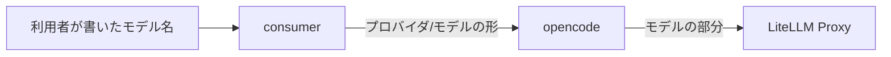
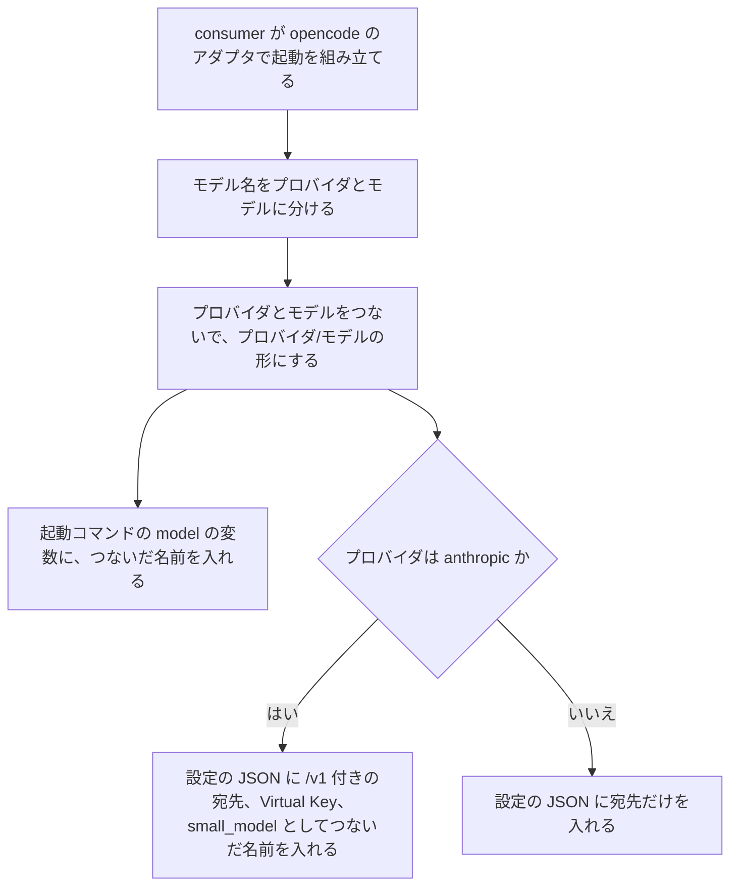
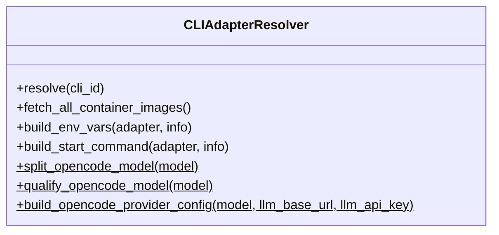

# opencode のモデル名の判定を本番の名前に合わせる 変更詳細設計書

**対象システム**: CodingAgentAutomata
**入力**: `.history/20261103-opencode-model-name-rule/change_requirements.md`
**既存設計書**: `docs/detail_design.md`
**外部連携の調査**: `external/litellm/docs/research.md`・`alignment_report.md` の追補（2026-11-03。判定: 設計に進める）

---

## 1. 言語・フレームワーク・アーキテクチャの選定

変更なし。既存設計 `docs/detail_design.md` 第 1 章の技術を引き継ぐ。新たに選定した技術は無い。

---

## 2. システム構成

コンポーネントの追加・削除は無い。consumer が opencode に渡すモデル名（起動コマンドの `--model` と、設定の JSON の `small_model`）が、常に「プロバイダ/モデル」の形になる。

ネットワーク構成図は変更なし。既存設計 `docs/detail_design.md` セクション 2-4 を参照。

---

## 3. データ設計

変更なし。既存設計 `docs/detail_design.md` 第 3 章を参照。タスクのモデルの列には、利用者が書いた名前をそのまま記録する（既存どおり）。

| エンティティ | Create | Read（一覧） | Read（詳細） | 検索 | Update | Delete | 今回の変更 |
|---|---|---|---|---|---|---|---|
| ユーザー | ○ | ○ | ○ | ○ | ○ | ○ | 変更なし |
| CLI アダプタ設定 | ○ | ○ | × | × | ○ | △ | 変更なし |
| タスク | ○ | ○ | × | ○ | ○ | × | 変更なし |
| システム設定 | ○ | △ | × | △ | ○ | × | 変更なし |

---

## 4. アーキテクチャ設計

### 4-1. 外部設計

利用者向けのインターフェースの追加・削除は無い。opencode のモデル名（デフォルトモデルの欄とエージェント指定）の扱いを、次の表に置き換える。

| 利用者が書いた名前 | プロバイダ | opencode に渡す名前 | LiteLLM Proxy に届く名前 |
|---|---|---|---|
| `claude-opus-5-5`（`/` なし、`claude-` で始まる） | `anthropic` | `anthropic/claude-opus-5-5` | `claude-opus-5-5` |
| `gpt-5.5`（`/` なし、それ以外） | `openai` | `openai/gpt-5.5` | `gpt-5.5` |
| `anthropic/claude-opus-5-5`、`openai/gpt-4o-mini`（`/` あり） | `/` の前 | 書いたまま | `/` の後ろ |
| 空 | `openai` | `openai/gpt-4o-mini`（既存の既定） | `gpt-4o-mini` |
| `openai`・`anthropic` 以外のプロバイダ、または LiteLLM Proxy に無いモデル | 判定どおり | 判定どおり | – （opencode が失敗し、CLI の失敗と同じく、タスクを失敗にしてコメントする） |

### 4-2. 内部設計

| DS-ID | 区分 | 処理 | 内容 | 対応要件ID |
|---|---|---|---|---|
| `DS-FN-DETERMINE-OPENCODE-PROVIDER-FT-DETERMINE-OPENCODE-PROVIDER` | [削除] | opencode のプロバイダの判定（「プロバイダ/モデル」の形に限る） | 削除理由: 対応する業務ルールが削除され、`/` の無い名前を `claude-` で判定する新しい判定に置き換わるため | `RQ-FT-DETERMINE-OPENCODE-PROVIDER` |
| `DS-FN-DETERMINE-OPENCODE-PROVIDER-BY-NAME-FT-DETERMINE-OPENCODE-PROVIDER-BY-NAME` | [追加] | opencode のプロバイダの判定（本番のモデル名を含む） | モデル名を分ける処理: 空なら既定の `openai/gpt-4o-mini` を使う。最初の `/` があれば、前をプロバイダ、後ろをモデルとする。無ければ、名前が `claude-` で始まるときはプロバイダ `anthropic`、それ以外は `openai` とし、モデルは名前全体とする。つなぐ処理: 分けた結果を「プロバイダ/モデル」の 1 つの名前にする。起動コマンドの組み立ては、アダプタに設定の JSON を渡す環境変数があるとき（opencode のとき）だけ、`{model}` につないだ名前を入れる。それ以外のアダプタ（Claude Code）は、書いた名前のまま入れる（既存どおり） | `RQ-FT-DETERMINE-OPENCODE-PROVIDER-BY-NAME` |
| `DS-FN-BUILD-OPENCODE-PROVIDER-CONFIG-FT-CALL-CLAUDE-VIA-OPENCODE` | [削除] | opencode のプロバイダの設定の組み立て（`small_model` に書いた名前を入れる） | 削除理由: `small_model` に書いた名前をそのまま入れると、`/` の無い名前で opencode が止まるため、下の要素に置き換える | `RQ-FT-CALL-CLAUDE-VIA-OPENCODE`、`RQ-NF-OPENCODE-CLAUDE-NO-MIGRATION` |
| `DS-FN-BUILD-OPENCODE-PROVIDER-SETTINGS-FT-CALL-CLAUDE-VIA-OPENCODE` | [追加] | opencode のプロバイダの設定の組み立て | モデル名、LiteLLM Proxy の URL、Virtual Key から、設定の JSON のうち `provider` と `small_model` を作る。プロバイダは上の判定で決める。`anthropic` なら、URL の末尾の `/` を取り除いて `/v1` を付け（すでに `/v1` で終わっていれば付けない）、`provider.anthropic.options` に `baseURL` と `apiKey`（Virtual Key。空なら入れない）を入れ、`small_model` に「プロバイダ/モデル」の形の名前を入れる。それ以外は `provider.<プロバイダ>.options.baseURL` に URL をそのまま入れ、`small_model` は入れない。CLI アダプタ設定は変えずに済む | `RQ-FT-CALL-CLAUDE-VIA-OPENCODE`、`RQ-NF-OPENCODE-CLAUDE-NO-MIGRATION`、`RQ-FT-DETERMINE-OPENCODE-PROVIDER-BY-NAME` |

---

## 5. クラス設計

クラスの追加・削除は無い。CLIAdapterResolver の静的メソッドを次のとおりにする。

| DS-ID | 区分 | 対象 | 内容 | 対応要件ID |
|---|---|---|---|---|
| `DS-FN-DETERMINE-OPENCODE-PROVIDER-BY-NAME-FT-DETERMINE-OPENCODE-PROVIDER-BY-NAME` | [追加] | `CLIAdapterResolver.split_opencode_model`（静的。引数: モデル名。戻り値: プロバイダとモデルの組）、`CLIAdapterResolver.qualify_opencode_model`（静的。引数: モデル名。戻り値: 「プロバイダ/モデル」の名前）。`build_start_command` が opencode のアダプタのときに `qualify_opencode_model` を呼ぶ | 4-2 のとおり | `RQ-FT-DETERMINE-OPENCODE-PROVIDER-BY-NAME` |
| `DS-FN-BUILD-OPENCODE-PROVIDER-SETTINGS-FT-CALL-CLAUDE-VIA-OPENCODE` | [追加] | `CLIAdapterResolver.build_opencode_provider_config`（静的。引数・戻り値は既存のまま） | 4-2 のとおり | `RQ-FT-CALL-CLAUDE-VIA-OPENCODE`、`RQ-NF-OPENCODE-CLAUDE-NO-MIGRATION`、`RQ-FT-DETERMINE-OPENCODE-PROVIDER-BY-NAME` |

システム内メッセージは変更なし。

---

## 6. エラーハンドリングとセキュリティ設計

新しいエラーの種類は足さない。判定の結果、opencode が失敗した場合（LiteLLM Proxy に無いモデル、未対応のプロバイダ）は、既存の CLI の失敗の扱いでタスクを失敗にする。セキュリティは変更なし。

---

## 7. コード設計

ソースファイルの追加・削除は無い。

| ファイル | 既存の DS-MD | 置く設計要素 | 区分 |
|---|---|---|---|
| `consumer/cli_adapter_resolver.py` | `DS-MD-CONSUMER-CLI-ADAPTER-RESOLVER-FT-RESOLVE-CLI-ADAPTER`（変えない。含まれる設計要素と対応要件の欄を、新しい ID に差し替える） | `DS-FN-DETERMINE-OPENCODE-PROVIDER-BY-NAME-FT-DETERMINE-OPENCODE-PROVIDER-BY-NAME`、`DS-FN-BUILD-OPENCODE-PROVIDER-SETTINGS-FT-CALL-CLAUDE-VIA-OPENCODE` | [追加] |
| `tests/consumer/test_cli_adapter_resolver_opencode.py` | なし（テストファイル） | `DS-TS-OPENCODE-MODEL-NAME-UNIT-FT-DETERMINE-OPENCODE-PROVIDER-BY-NAME` | [追加] |
| `e2e/tests/gitlab_integration.spec.ts` | なし（テストファイル） | `DS-TS-OPENCODE-UNPREFIXED-CLAUDE-E2E-TS-VERIFY-OPENCODE-UNPREFIXED-CLAUDE-MODEL` | [追加] |

共通化の方針: モデル名の判定とつなぎは `split_opencode_model` と `qualify_opencode_model` の 2 か所だけで行い、起動コマンドと設定の JSON の両方がこれを使う。対応表は、削除する 2 つの DS-ID の行を新しい DS-ID に差し替え、`qualify_opencode_model` の行を足す。

---

## 8. テスト設計

| DS-ID | 区分 | テスト | 対応要件ID |
|---|---|---|---|
| `DS-TS-OPENCODE-PROVIDER-CONFIG-UNIT-FT-CALL-CLAUDE-VIA-OPENCODE` | [削除] | 単体テスト（`anthropic/` の名前を前提にしたもの） | 削除理由: 下の単体テストに置き換えるため（`RQ-FT-CALL-CLAUDE-VIA-OPENCODE`、`RQ-FT-DETERMINE-OPENCODE-PROVIDER`、`RQ-NF-OPENCODE-CLAUDE-NO-MIGRATION`） |
| `DS-TS-OPENCODE-MODEL-NAME-UNIT-FT-DETERMINE-OPENCODE-PROVIDER-BY-NAME` | [追加] | 単体テスト `tests/consumer/test_cli_adapter_resolver_opencode.py`。① 判定: `claude-opus-5-5`→`anthropic`、`gpt-5.5`→`openai`、`anthropic/claude-opus-5-5`・`openai/gpt-4o-mini`→書いたまま、空→既定、`litellm/org/model`→最初の `/` で分ける。② つなぎ: 上の各名前が「プロバイダ/モデル」になる。③ 起動コマンド: opencode のアダプタで `claude-opus-5-5` を指定すると `--model anthropic/claude-opus-5-5`、`gpt-5.5` なら `--model openai/gpt-5.5`。Claude Code のアダプタは書いた名前のまま。④ 設定の JSON: `claude-opus-5-5` でも `anthropic/claude-opus-5-5` でも、`/v1` 付きの `baseURL`・`apiKey`・`small_model`（`anthropic/claude-opus-5-5`）が入る。URL の末尾の `/` や `/v1` で `/v1` が二重にならない。`openai` の名前では既存と同じ JSON。⑤ `build_env_vars` が opencode のアダプタで JSON と `OPENAI_API_KEY` の両方を入れ、Claude Code のアダプタの出力は変わらない | `RQ-FT-DETERMINE-OPENCODE-PROVIDER-BY-NAME`、`RQ-FT-CALL-CLAUDE-VIA-OPENCODE`、`RQ-NF-OPENCODE-CLAUDE-NO-MIGRATION` |

| DS-ID | 対応要件ID | 目的 | 前提条件 | 手順 | 期待結果 |
|---|---|---|---|---|---|
| `DS-TS-OPENCODE-CLAUDE-MODEL-E2E-TS-VERIFY-OPENCODE-CLAUDE-MODEL` | `RQ-TS-VERIFY-OPENCODE-CLAUDE-MODEL`、`RQ-EX-USE-LOCAL-HTTP-MOCK` | [削除] 削除理由: 対応するシナリオが削除され、下のシナリオに置き換わるため | – | – | – |
| `DS-TS-OPENCODE-UNPREFIXED-CLAUDE-E2E-TS-VERIFY-OPENCODE-UNPREFIXED-CLAUDE-MODEL` | `RQ-TS-VERIFY-OPENCODE-UNPREFIXED-CLAUDE-MODEL`、`RQ-EX-USE-LOCAL-HTTP-MOCK` | [追加] opencode で、プロバイダ名の付かない Claude のモデル名を指定した MR 処理が完了する（T-35 を置き換える） | 既存の T-35 と同じ | 既存の T-35 と同じ。ただしエージェント指定のモデル名を、プロバイダ名を付けない `DEFAULT_CLAUDE_MODEL`（既定 `claude-haiku-4-5-20251001`）にする | 完了コメントが付き、タスクの CLI が `opencode`、モデルが書いたままの名前、状態が完了。モックと本物の両方で成功する |

E2E の実行手段・実行コマンドは変更なし（モック: `./scripts/test_setup.sh --zscaler-mock --run-tests`、本物は手動で `--real` を足す）。

---

## 9. 運用設計

変更なし。既存の環境の移行作業は要らない（既存の「プロバイダ/モデル」の形の名前も、そのまま使える）。

---

## 10. ログ・監視・アラート・障害対応設計

変更なし。

---

## 11. 要件と設計の対応表

| DS-ID | 区分 | 対応要件ID |
|---|---|---|
| `DS-FN-DETERMINE-OPENCODE-PROVIDER-FT-DETERMINE-OPENCODE-PROVIDER` | [削除] | `RQ-FT-DETERMINE-OPENCODE-PROVIDER` |
| `DS-FN-DETERMINE-OPENCODE-PROVIDER-BY-NAME-FT-DETERMINE-OPENCODE-PROVIDER-BY-NAME` | [追加] | `RQ-FT-DETERMINE-OPENCODE-PROVIDER-BY-NAME` |
| `DS-FN-BUILD-OPENCODE-PROVIDER-CONFIG-FT-CALL-CLAUDE-VIA-OPENCODE` | [削除] | `RQ-FT-CALL-CLAUDE-VIA-OPENCODE`、`RQ-NF-OPENCODE-CLAUDE-NO-MIGRATION` |
| `DS-FN-BUILD-OPENCODE-PROVIDER-SETTINGS-FT-CALL-CLAUDE-VIA-OPENCODE` | [追加] | `RQ-FT-CALL-CLAUDE-VIA-OPENCODE`、`RQ-NF-OPENCODE-CLAUDE-NO-MIGRATION`、`RQ-FT-DETERMINE-OPENCODE-PROVIDER-BY-NAME` |
| `DS-TS-OPENCODE-PROVIDER-CONFIG-UNIT-FT-CALL-CLAUDE-VIA-OPENCODE` | [削除] | `RQ-FT-CALL-CLAUDE-VIA-OPENCODE`、`RQ-FT-DETERMINE-OPENCODE-PROVIDER`、`RQ-NF-OPENCODE-CLAUDE-NO-MIGRATION` |
| `DS-TS-OPENCODE-MODEL-NAME-UNIT-FT-DETERMINE-OPENCODE-PROVIDER-BY-NAME` | [追加] | `RQ-FT-DETERMINE-OPENCODE-PROVIDER-BY-NAME`、`RQ-FT-CALL-CLAUDE-VIA-OPENCODE`、`RQ-NF-OPENCODE-CLAUDE-NO-MIGRATION` |
| `DS-TS-OPENCODE-CLAUDE-MODEL-E2E-TS-VERIFY-OPENCODE-CLAUDE-MODEL` | [削除] | `RQ-TS-VERIFY-OPENCODE-CLAUDE-MODEL`、`RQ-EX-USE-LOCAL-HTTP-MOCK` |
| `DS-TS-OPENCODE-UNPREFIXED-CLAUDE-E2E-TS-VERIFY-OPENCODE-UNPREFIXED-CLAUDE-MODEL` | [追加] | `RQ-TS-VERIFY-OPENCODE-UNPREFIXED-CLAUDE-MODEL`、`RQ-EX-USE-LOCAL-HTTP-MOCK` |

### 11-1. 除外要件

除外要件は無い。
