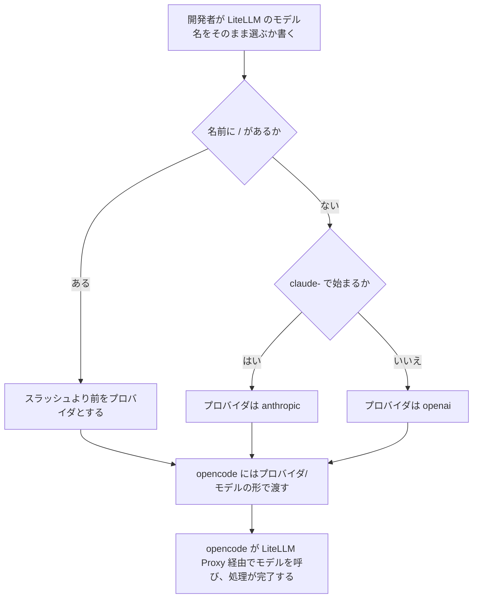

# opencode のモデル名の判定を本番の名前に合わせる 変更要件定義書

**対象システム**: CodingAgentAutomata
**既存要件定義書**: `docs/requirements.md`
**外部連携の事前確認**: `external/litellm/docs/precheck_report.md`（LiteLLM Proxy。今回の変更は、その連携の範囲の中に収まる）

---

## 1. 目的・前提

### 1.1 変更の目的

本番の LiteLLM Proxy のモデル名には、`anthropic/` や `openai/` のようなプロバイダ名が付いていない（例: `claude-opus-5-5`、`gpt-5.5`）。一方、opencode は「プロバイダ/モデル」の形でしかモデルを受け付けず、`/` の無い名前を渡すと、Claude でも OpenAI でもモデルが見つからずに止まる。本変更では、利用者が本番の LiteLLM Proxy のモデル名をそのまま指定しても、opencode で処理が完了するようにする。

### 1.2 前提

- 本番の LiteLLM Proxy のモデル名には、プロバイダ名が付いていない。本番の Claude のモデル名は、すべて `claude-` で始まる（ユーザー、2026-11-03）。
- opencode に `/` の無いモデル名を渡すと、opencode はその名前をプロバイダ名と読み、`ProviderModelNotFoundError` で止まる。OpenAI の `gpt-4o-mini` でも同じ（テスト環境で確認、2026-11-03）。
- ユーザー編集画面のモデル候補は LiteLLM Proxy のモデル一覧から取るので、本番では `/` の無い名前が並ぶ。
- 外部連携先の追加・削除は無い。

### 1.3 用語集

| 用語 | 業務上の意味 | 本案件での使用範囲 | 同義語/類義語 |
|---|---|---|---|
| プロバイダ | opencode がモデルを呼ぶときの呼び方を表す名前（`openai` は OpenAI のモデル、`anthropic` は Claude のモデル）。利用者がモデル名に `/` を付けて書いた場合は、`/` より前の部分。`/` を付けずに書いた場合は、本システムがモデル名から決める | opencode のモデル指定（デフォルトモデル、エージェント指定） | なし |

用語「プロバイダ」の意味を、上のとおり置き換える（`/` を付けない書き方を含めるため）。ほかの用語は変更なし。

### 1.4 システムの形態

変更なし。既存要件定義書 `docs/requirements.md` 1.3 を参照。

### 1-1. 技術制約

| 制約項目 | 内容 | 出どころ（誰がいつ答えたか） |
|---|---|---|
| 既存コードベース | 変更なし。既存要件定義書 `docs/requirements.md` 1-1 を参照 | ユーザー、2026-11-03（変更なしとして了承） |
| 配備先 | 変更なし | 同上 |
| チームの技術 | 変更なし | 同上 |
| ライセンスとコスト | 変更なし | 同上 |
| 性能と規模の目安 | 変更なし | 同上 |

---

## 2. 業務

### 2.1 対象業務の変更

対象業務の追加・削除は無い。既存の Issue→MR 変換処理と MR コード実装処理で、opencode を使う開発者が、本番の LiteLLM Proxy のモデル名をそのまま指定できるようになる。

### 2.2 業務フロー

### 2-1. 業務の問題

| 問題 | 対象業務（RQ-BZ） | あるべき姿 | 現状 | ギャップ（KPI） | 業務影響 |
|---|---|---|---|---|---|
| 本番の LiteLLM Proxy のモデル名では、opencode の処理が失敗する | `RQ-BZ-ISSUE-TO-MR`、`RQ-BZ-MR-IMPLEMENTATION` | 本番の LiteLLM Proxy のモデル名（プロバイダ名が付かない）を opencode でもそのまま指定でき、Issue→MR 変換と MR 処理が完了する | opencode に `/` の無い名前を渡すとモデルが見つからずに止まる。Claude でも OpenAI でも同じ | 本番のモデル名で opencode を指定した処理の完了率 0%（目標: Claude Code と同じ水準） | 本番では、opencode を選んだ開発者が自動化を使えない |

### 2-2. 業務課題一覧

| RQ-BK-ID | 区分 | 業務課題（取り組むこと） | 解決する問題（2-1） | 解決後の状態（KPI の目標値） | 対象業務（RQ-BZ） |
|---|---|---|---|---|---|
| `RQ-BK-OPENCODE-UNPREFIXED-MODEL-NAMES` | [追加] | opencode で、本番の LiteLLM Proxy のモデル名をプロバイダ名を付けずにそのまま使えるようにする | 本番の LiteLLM Proxy のモデル名では、opencode の処理が失敗する | 本番のモデル名で opencode を指定した処理の完了率が、Claude Code と同じ水準 | `RQ-BZ-ISSUE-TO-MR`、`RQ-BZ-MR-IMPLEMENTATION` |

### 2-3. 見込み経営効果

見込み経営効果の追加・削除は無い。今回の業務課題は、既存の効果（手作業工数の削減）が opencode を使う開発者に及ぶための前提を本番で満たすもので、新しい種類の効果は生まない。

---

## 3. 機能要件

### 3.1 入力データ

| データ | 区分 | 種別 | 説明 |
|---|---|---|---|
| opencode のモデル名 | [追加] | 人手（開発者・管理者） | LiteLLM Proxy のモデル名をそのまま書く（例: `claude-opus-5-5`、`gpt-5.5`）。プロバイダを明示したいときは「プロバイダ/モデル」の形でも書ける（例: `anthropic/claude-opus-5-5`）。デフォルトモデルの欄とエージェント指定に書く |
| opencode のモデル名（「プロバイダ/モデル」の形で書く） | [削除] | 人手（開発者・管理者） | 削除理由: 「プロバイダ/モデル」の形に限らなくなるため、上の行に置き換える |

### 3.2 出力データ

出力データの追加・変更は無い。

### 3.3 ユーザー利用フロー

2.2 の業務フローのとおり。モデルを指定した後の Issue→MR 変換と MR 処理の利用フローは、既存要件定義書 `docs/requirements.md` 3.2 から変わらない。

### 3.4 業務フローと機能の対応関係

| 業務 | 使用機能 |
|---|---|
| Issue→MR 変換処理 | opencode のプロバイダの判定、opencode での Claude のモデルの呼び出し、および既存の Issue→MR 変換の機能 |
| MR コード実装処理 | opencode のプロバイダの判定、opencode での Claude のモデルの呼び出し、エージェント指定、および既存の MR 処理の機能 |

### 3.5 CUI・Web API の仕様

CUI と Web API の追加・変更は無い。

### 3.6 機能一覧

機能の追加・削除は無い。opencode での Claude のモデルの呼び出しの機能は、プロバイダが `anthropic` と判定されたときの動きとして、そのまま使う。

### 3-1. 帳票・出力ファイル

帳票・出力ファイルの追加・変更は無い。

### 3-2. 業務ルール

| RQ-ID | 区分 | ルール名 | 内容（条件と結果） | 違反時・エラー時の業務上の扱い | 対応業務課題ID（RQ-BK-*） | この要件が無いと何が困るか |
|---|---|---|---|---|---|---|
| `RQ-FT-DETERMINE-OPENCODE-PROVIDER` | [削除] | opencode のプロバイダの判定（「プロバイダ/モデル」の形に限る） | 削除理由: 本番の LiteLLM Proxy のモデル名にはプロバイダ名が付かず、「プロバイダ/モデル」の形に限る判定では本番の名前を扱えないため、下の新しい判定に置き換える | – | `RQ-BK-OPENCODE-CLAUDE-MODEL` | – |
| `RQ-FT-DETERMINE-OPENCODE-PROVIDER-BY-NAME` | [追加] | opencode のプロバイダの判定（本番のモデル名を含む） | opencode のモデル名に `/` があれば、`/` より前をプロバイダ、後ろをモデルとする。`/` が無ければ、名前が `claude-` で始まるときはプロバイダを `anthropic`、それ以外は `openai` とし、モデルは名前全体とする。opencode には常に「プロバイダ/モデル」の形で渡し、LiteLLM Proxy にはモデルの部分（`/` が無い名前ならその名前のまま）を渡す。タスクに記録するモデル名は、利用者が書いた名前のまま | LiteLLM Proxy に無いモデルや、`openai`・`anthropic` 以外のプロバイダを指定した場合は、CLI の失敗と同じく、タスクを失敗にしてコメントする | `RQ-BK-OPENCODE-UNPREFIXED-MODEL-NAMES`、`RQ-BK-OPENCODE-CLAUDE-MODEL` | ユーザーの選択（理由: 本番環境ではプロバイダ名/モデルというルールが無い） |

### 3-3. 外部連携

外部連携の追加・削除は無い。LiteLLM Proxy へ渡すモデル名は、本番の LiteLLM Proxy のモデル名そのものになる。モック LLM モードのモックの方式（既存のモック LLM を LiteLLM Proxy の転送先にする）は変えない。

### 3.7 削除する要件

3-2 の業務ルール 1 件を、意味が変わるため [削除] し、新しい ID で [追加] した。そのほかに次の既存要件を確かめ、今回の変更と矛盾しないことを確認した。

- opencode での Claude のモデルの呼び出し: プロバイダが `anthropic` のときの動きは変わらない。判定の仕方だけが変わる。
- 既存の環境での移行作業の不要: 既存の利用者が書いた「プロバイダ/モデル」の形の名前は、そのまま使える。DB の書き換えは要らない。
- CLI コンテナの仕様の組み込みのアダプタ: CLI アダプタ設定は変えない。

---

## 4. データ

### 4-1. データ要件一覧

データ要件の追加・変更は無い。

### 4-2. 業務エンティティとデータ項目

業務エンティティの追加・変更は無い。ユーザーのデフォルトモデルとタスクのモデルの欄（文字列 255 以内）には、`/` の無い名前も「プロバイダ/モデル」の形の名前も、これまでどおり入れられる。

### 4-3. CRUD テーブル

| エンティティ名 | Create | Read（一覧） | Read（詳細） | 検索 | Update | Delete | 備考 |
|---|---|---|---|---|---|---|---|
| ユーザー | ○ | ○ | ○ | ○ | ○ | ○ | 変更なし。検索の条件はユーザー名の前方一致 |
| CLI アダプタ設定 | ○ | ○ | × | × | ○ | △ | 変更なし。管理者のみ。組み込みと使用中のものは削除できない |
| タスク | ○ | ○ | × | ○ | ○ | × | 変更なし。検索の条件はユーザー名・状態・種別。モデルは利用者が書いた名前のまま記録する |
| システム設定 | ○ | △ | × | △ | ○ | × | 変更なし。読み取りは一括取得のみ。検索はキー単位 |

### 4-4. 状態遷移

状態遷移の変更は無い。

### 4-5. 画面一覧

画面の追加・変更は無い。ユーザー編集画面のモデル候補に並ぶ `/` の無い名前を選べば、opencode でも使えるようになる。

---

## 5. 非機能要件

非機能要件の追加・変更は無い。既存の環境での移行作業の不要の非機能要件は、今回の変更でも成り立つ。

---

## 6. 運用要件

運用要件の追加・変更は無い。

---

## 7. テスト用利用シナリオ

| RQ-ID | 区分 | テスト目的 | 前提条件 | テスト手順 | 期待される結果 | 対応業務課題ID（RQ-BK-*） |
|---|---|---|---|---|---|---|
| `RQ-TS-VERIFY-OPENCODE-CLAUDE-MODEL` | [削除] | opencode で Claude のモデルを指定した MR 処理（`anthropic/` で始まる名前） | 削除理由: 本番の書き方（`/` の無い名前）で確かめるシナリオに置き換えるため | – | – | `RQ-BK-OPENCODE-CLAUDE-MODEL` |
| `RQ-TS-VERIFY-OPENCODE-UNPREFIXED-CLAUDE-MODEL` | [追加] | opencode で、プロバイダ名の付かない Claude のモデル名を指定した MR 処理が最後まで完了することを確かめる | 既存の opencode のテストユーザーの Draft MR がある。モック LLM モードと実 LLM モードの両方で行う。実 LLM モードでは、Anthropic の API キーだけを `.env` に設定している | エージェント指定に opencode と、LiteLLM Proxy にある `claude-` で始まるモデル名（プロバイダ名を付けない）を書き、bot とラベルを付けて MR 処理を行わせる | MR 処理が完了し、完了コメントが付く。タスクに使った CLI（opencode）と、書いたままのモデル名が記録される | `RQ-BK-OPENCODE-UNPREFIXED-MODEL-NAMES`、`RQ-BK-OPENCODE-CLAUDE-MODEL`、`RQ-BK-AUTOMATED-VERIFICATION` |

OpenAI のモデルのプロバイダ名の付かない名前と、「プロバイダ/モデル」の形の名前は、このシナリオではなく単体テストで確かめる（ユーザーの決定、2026-11-03）。既存の opencode のシナリオ（Issue→MR 変換と MR 処理）は、テスト環境の既定の `openai/gpt-4o-mini` のまま残す。

---

## 8. 変更後の業務課題と要件の対応表

| RQ-BK-ID | 対応する要件 |
|---|---|
| `RQ-BK-OPENCODE-UNPREFIXED-MODEL-NAMES` | `RQ-FT-DETERMINE-OPENCODE-PROVIDER-BY-NAME`、`RQ-TS-VERIFY-OPENCODE-UNPREFIXED-CLAUDE-MODEL` |
| `RQ-BK-OPENCODE-CLAUDE-MODEL` | 既存の対応から `RQ-FT-DETERMINE-OPENCODE-PROVIDER`、`RQ-TS-VERIFY-OPENCODE-CLAUDE-MODEL` を除き、`RQ-FT-DETERMINE-OPENCODE-PROVIDER-BY-NAME`、`RQ-TS-VERIFY-OPENCODE-UNPREFIXED-CLAUDE-MODEL` を加える |
| `RQ-BK-AUTOMATED-VERIFICATION` | 既存の対応から `RQ-TS-VERIFY-OPENCODE-CLAUDE-MODEL` を除き、`RQ-TS-VERIFY-OPENCODE-UNPREFIXED-CLAUDE-MODEL` を加える |
