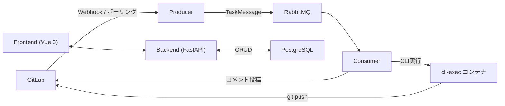

# CodingAgentAutomata

GitLab の Issue／MR を検出し、Claude Code や opencode などの CLI エージェントを自動実行するシステムです。

## システム概要



### 主な機能

| 機能 | 説明 |
|---|---|
| F-1 Webhook受信 | GitLab Webhook を受信してタスクをキューに投入 |
| F-2 ポーリング | 定期的に GitLab API をポーリングしてタスクを検出 |
| F-3 Issue→MR変換 | Issue を分析して作業ブランチと Draft MR を自動作成 |
| F-4 MR処理 | MR の指示に従い CLI エージェントがコードを実装・プッシュ |
| F-5 CLI実行環境管理 | Docker コンテナ上で CLI エージェントを隔離実行 |
| F-8 進捗報告 | CLI 実行中の標準出力を定期的に MR コメントに更新 |
| F-9 Web管理画面 | ユーザー管理・タスク履歴・CLI アダプタ設定 |
| F-10 重複処理防止 | DB ユニーク制約による二重処理防止 |

---

## 前提条件

- Docker 26 以上
- Docker Compose v2 以上
- Python 3.10 以上（テスト環境セットアップ `scripts/test_setup.sh` がホスト上で `scripts/test_setup.py` を実行するため。macOS 標準の Python 3.9 は不可）

---

## 起動方法

起動とビルドは `./scripts/compose.sh` から行います（Zscaler 設定の準備を行ってから `docker compose` を実行します）。Zscaler を使わない環境では、先に `.env` に `ZSCALER_ENABLED=false` を書いてください（「Zscaler 環境での構築」を参照）。

### 本番環境起動

```bash
./scripts/compose.sh up -d --build
```

GitLab・LiteLLM Proxy を含まず、本システムコンポーネント（producer / consumer / backend / frontend / postgresql / rabbitmq）のみが起動します。`.env` を変えたら、同じコマンドで準備し直してください。

### テスト環境起動

```bash
./scripts/compose.sh --profile test up -d --build
```

GitLab CE・LiteLLM Proxy を含む全コンポーネントが起動します。

### cli-exec コンテナイメージのビルド

```bash
./scripts/build_cli_exec.sh
```

共通の土台（Ubuntu 24.04）と、Claude Code 用・opencode 用の cli-exec コンテナイメージをビルドします。追加の言語やツールは、環境変数 `CLI_EXTRA_SETUP_COMMANDS` に apt の書き方で渡します（例: `CLI_EXTRA_SETUP_COMMANDS="apt-get update && apt-get install -y --no-install-recommends golang ruby" ./scripts/build_cli_exec.sh`）。以前の Alpine の書き方（`apk add ...`）はビルドが失敗します。

---

## Zscaler 環境での構築

Zscaler（明示型のプロキシで、通信の証明書を差し替える）の配下では、次の準備をしてから起動します。外へ出るすべての通信が Zscaler のプロキシを経由し、Zscaler の証明書で検証されます。

1. **ホストの準備（社内の Linux サーバーで、sudo で一度だけ行う。Ubuntu の例）**
   - Zscaler の証明書を `/usr/local/share/ca-certificates/zscaler.crt` に置き、`sudo update-ca-certificates` を実行する。
   - Docker デーモンにプロキシを設定する: `/etc/systemd/system/docker.service.d/http-proxy.conf` に `[Service]` と `Environment="HTTP_PROXY=http://プロキシ:ポート" "HTTPS_PROXY=http://プロキシ:ポート" "NO_PROXY=localhost,127.0.0.1"` を書き、`sudo systemctl daemon-reload && sudo systemctl restart docker` を実行する。
2. **証明書ファイル**: プロジェクト直下の `certs/zscaler-ca.pem` に PEM 形式で置く（中間証明書をまとめてよい）。置かなければ、ホストの OS の証明書の束を使う。`certs/` は git に入れない。
3. **`.env` の Zscaler 設定**

   | 変数名 | 説明 |
   |---|---|
   | `ZSCALER_ENABLED` | `true` か `false`。書いていない場合は `true` |
   | `ZSCALER_PROXY_URL` | Zscaler のプロキシの宛先（`http://ホスト名:ポート`）。`true` のときは必須 |
   | `ZSCALER_NO_PROXY_EXTRA` | プロキシを経由させない社内の宛先（社内の GitLab、社内の LLM のプロキシなど。カンマ区切り）。本システムの部品の名前は自動で入る |

4. **起動**: `./scripts/compose.sh up -d --build`。ビルドと起動の前に、プロキシ経由で PyPI へつないで証明書を検証できるかを確かめ、できなければ原因を表示して止まります。
5. **社外の環境**: Zscaler を使わない環境では `.env` に `ZSCALER_ENABLED=false` と書きます。既存の `.env` にはこの項目が無く、有効とみなされて止まるので、書き足してください。
6. **社外での確認**: `./scripts/test_setup.sh --zscaler-mock` で、Zscaler の役をする模擬プロキシ（mitmproxy）を経由して構築します（`--run-tests` で E2E、`--real` で実 LLM も）。`certs/` と `.env` は書き換えません。

CLI エージェントには、Zscaler の配下であること、証明書の場所、開発するシステムに証明書とプロキシの扱いを組み込むことをプロンプトで伝えます。Playwright の Chromium と WebKit は Zscaler の証明書を信頼済みです（Firefox は信頼させる方法が無いため対象外）。

---

## システムセットアップ手順

`./scripts/compose.sh up -d --build` 実行後に **初回のみ** 以下のコマンドを実行してください。

```bash
./scripts/setup.sh \
  --username admin \
  --email admin@example.com \
  --password 'Admin@123456' \
  --virtual-key 'sk-your-litellm-key' \
  --default-cli claude \
  --default-model claude-opus-4-5
```

このコマンドにより以下が自動実行されます:

- CLI イメージ（claude / opencode）のビルド
- 初期管理者ユーザーの作成
- F-3 / F-4 初期プロンプトテンプレートの DB 投入
- 組み込み CLI アダプタ（`claude`・`opencode`）の登録

### 初期ユーザー

最初の管理者ユーザーは、上の `setup.sh` の引数（`--username`・`--email`・`--password`）で作ります。Web 管理画面（`http://localhost/`）に、そのユーザー名とパスワードでログインします。引数を省くと対話で入力を求めます。

---

## テスト環境セットアップ手順

以下のコマンド一発でセットアップが完了します。`.env` が存在しない場合は `.env.example` から自動生成します。

**モック LLM モード**（実 API キー不要・デフォルト）:

```bash
./scripts/test_setup.sh
```

**実 LLM モード**（`ANTHROPIC_API_KEY` / `OPENAI_API_KEY` が必要）:

```bash
./scripts/test_setup.sh --real
```

**模擬プロキシ（Zscaler の役）を経由するモード**（`--real`・`--run-tests` と組み合わせられる）:

```bash
./scripts/test_setup.sh --zscaler-mock --run-tests
```

Zscaler の配下でない開発環境で模擬プロキシを使わないときは、`.env` に `ZSCALER_ENABLED=false` を書くか、`ZSCALER_ENABLED=false ./scripts/test_setup.sh` で実行します。

**単体テスト・結合テスト**:

```bash
docker compose --profile test run --rm unit_test
```

このコマンドにより以下が自動実行されます:

- `.env` が存在しない場合は `.env.example` からコピーし、`ENCRYPTION_KEY` 等を自動生成
- `setup.sh` の実行（CLI イメージビルド + 初期管理者ユーザー/CLIアダプタ登録）
- テスト環境コンテナの起動
- Alembic マイグレーション
- GitLab botアカウント作成・PAT 発行
- テスト用プロジェクト作成・Webhook 設定
- テストユーザー（`testuser-claude`・`testuser-opencode`）作成
- LiteLLM Proxy でテスト用 Virtual Key 発行
- Backend API にテストユーザー登録

### テスト時のユーザー一覧（固定パスワード）

テストセットアップ時に作成または更新されるユーザーは以下です。

#### GitLab ユーザー

| ユーザー名 | 用途 | パスワード |
|---|---|---|
| `root` | GitLab 管理者 | `Admin@123456` |
| `coding-agent-bot` | bot 実行ユーザー | `Bot@SecurePassword123!` |
| `testuser-claude` | Claude シナリオ用テストユーザー | `Test@123456` |
| `testuser-opencode` | opencode シナリオ用テストユーザー | `Test@123456` |

#### 本システム（Web管理画面）ユーザー

| ユーザー名 | ロール | パスワード |
|---|---|---|
| `admin` | admin | `Admin@123456` |
| `testuser-claude` | user | `Test@123456` |
| `testuser-opencode` | user | `Test@123456` |

補足:

- `testuser-claude` と `testuser-opencode` のパスワードは `TEST_USER_PASSWORD` で上書き可能（未指定時は `Test@123456`）
- `ADMIN_PASSWORD` を指定した場合、本システム管理者 `admin` のログインパスワードはその値になる

---

## 環境変数

`.env` ファイルを作成して設定してください。`.env.example` に全変数の説明があります。

```bash
cp .env.example .env
# .env を編集して各値を設定
```

### 必須環境変数（最小構成）

| 変数名 | 説明 |
|---|---|
| `GITLAB_PAT` | GitLab bot アカウントの Personal Access Token |
| `GITLAB_API_URL` | GitLab の URL。本番は社内の GitLab の URL を書く。テスト環境では、テスト環境の構築が `.env.test` に書くコンテナから見た URL（`http://gitlab:8929`）が優先される |
| `GITLAB_BOT_NAME` | bot アカウントのユーザー名 |
| `DATABASE_URL` | PostgreSQL 接続文字列 |
| `RABBITMQ_URL` | RabbitMQ AMQP 接続 URL |
| `ENCRYPTION_KEY` | AES-256-GCM 鍵（base64エンコード, 32バイト） |
| `JWT_SECRET_KEY` | JWT 署名鍵 |
| `GITLAB_WEBHOOK_SECRET` | Webhook 受信トークン |
| `GITLAB_PROJECT_IDS` | ポーリング対象 GitLab プロジェクト ID（カンマ区切り） |

### GitLab の URL についての更新の注意

以前の版は `docker-compose.yml` で producer と consumer の `GITLAB_API_URL` を `http://gitlab:8929` に固定していたため、`.env` の値が効きませんでした。今の版は `.env` の値を使います。

- 本番で `docker-compose.yml` の `GITLAB_API_URL` を手で直していた環境は、その手直しを戻し（更新で上書きしてかまいません）、`.env` の `GITLAB_API_URL` が社内の GitLab を指していることを確かめてください。
- 手元のテスト環境は、`.env` を書き換えずに `./scripts/test_setup.sh` を実行し直してください。

### テスト環境追加変数

| 変数名 | 説明 |
|---|---|
| `OPENAI_API_KEY` | OpenAI API キー（LiteLLM Proxy で使用） |
| `ANTHROPIC_API_KEY` | Anthropic API キー（LiteLLM Proxy で使用） |
| `LITELLM_MASTER_KEY` | LiteLLM Proxy マスターキー |

---

## Web 管理画面

- **URL**: `http://localhost:80`
- ログイン後の遷移先:
  - 管理者 → `/users`（ユーザー一覧）
  - 一般ユーザー → `/tasks`（タスク実行履歴）

| 画面 | URL | 権限 |
|---|---|---|
| SC-01 ログイン | `/login` | 全員 |
| SC-02 ユーザー一覧 | `/users` | admin |
| SC-03 ユーザー詳細 | `/users/:username` | admin / 自分のみ |
| SC-04 ユーザー作成 | `/users/new` | admin |
| SC-05 ユーザー編集 | `/users/:username/edit` | admin / 自分のみ |
| SC-06 タスク履歴 | `/tasks` | admin: 全件 / user: 自分のみ |
| SC-07 システム設定 | `/settings` | admin |

---

## E2E テスト実行方法

`./scripts/test_setup.sh` 完了後に以下を実行してください。

セットアップと同時に実行する場合は `--run-tests` オプションを使用することもできます。

```bash
./scripts/test_setup.sh --run-tests
```

セットアップ済みの環境に対して単独で実行する場合:

```bash
docker compose run --rm test_playwright sh -c "cd /e2e && npm install --silent && npx playwright test tests/gitlab_integration.spec.ts --reporter=list 2>&1"
```

### テスト結果確認

```bash
# HTML レポートを生成してブラウザで確認
docker compose run --rm test_playwright sh -c "cd /e2e && npm install --silent && npx playwright test tests/gitlab_integration.spec.ts --reporter=html 2>&1"
```

### テストシナリオ一覧

| テストファイル | 対象シナリオ |
|---|---|
| `e2e/tests/auth.spec.ts` | T-01（ログイン）・T-19〜T-21（権限制御）・T-27 |
| `e2e/tests/users.spec.ts` | T-01〜T-03（ユーザーCRUD）・T-15（削除）・T-17〜T-18・T-22 |
| `e2e/tests/tasks.spec.ts` | T-14（タスク履歴）・T-23（一般ユーザー権限）・T-25 |

---

## アーキテクチャ

### コンポーネント一覧

| コンポーネント | 役割 |
|---|---|
| `producer/` | Webhook受信・ポーリング・タスクキュー投入 |
| `consumer/` | タスクデキュー・CLI コンテナ管理・F-3/F-4処理 |
| `backend/` | FastAPI REST API・認証・ユーザー/タスク管理 |
| `frontend/` | Vue 3 + Vuetify 3 管理画面 |
| `shared/` | GitLabClient・RabbitMQClient・DBモデル・設定 |
| `cli-exec/claude/` | Claude Code 実行コンテナ（DinD） |
| `cli-exec/opencode/` | opencode 実行コンテナ（DinD） |

### セキュリティ

- **Virtual Key**: AES-256-GCM で暗号化保存。復号はタスク実行直前のみ
- **パスワード**: bcrypt（コストファクタ12）でハッシュ化
- **JWT 認証**: HS256、有効期限24時間
- **Webhook**: `X-Gitlab-Token` ヘッダーで検証
- **CLI ログ**: PostgreSQL 保存前に GitLab PAT をマスク処理
