# CodingAgentAutomata 詳細設計書

この詳細設計書は、2026-11-01 に既存のコード（コミット `3a275d0`）から逆引きで書き起こし、同日に Zscaler 環境対応の変更設計（`.history/20261101-zscaler-support/change_detail_design.md`）を反映したもの。Zscaler 環境対応の部分は実装前の設計である。要件は `docs/requirements.md`、設計 ID とコードの対応は `docs/trace_map.md` にある。不具合の可能性は `.history/BACKLOG.md` に記録している。

---

## 1. 言語・フレームワーク・アーキテクチャの選定

既存のコードの技術をそのまま記録する（既存資産との整合が最優先の判断軸のため、選び直しはしていない）。判定日: 2026-11-01。技術制約の要約: 配備先は社内の Linux サーバー（Docker Engine）。チームの技術とライセンス・コストに特別な制約は無い。

| 対象 | 選定結果 |
|---|---|
| 言語 | Python 3.12（backend・producer・consumer・shared・スクリプト・モック LLM）、TypeScript（frontend・E2E）、bash（スクリプト） |
| フレームワーク | FastAPI（backend）、aiohttp（Webhook の受信）、SQLAlchemy 2 と Alembic（DB）、pydantic と pydantic-settings、Vue 3・Vuetify 3・Pinia・vue-router・axios・Vite（frontend）、Playwright（E2E） |
| 主なライブラリ | python-gitlab（GitLab API）、pika（RabbitMQ）、Docker SDK（CLI コンテナ）、python-jose（JWT）、bcrypt、cryptography（AES-256-GCM）、httpx（LiteLLM） |
| DB・キュー | PostgreSQL 16、RabbitMQ 3.13 |
| 実行形態 | docker compose によるコンテナ。CLI コンテナは consumer がホストの Docker で起動する単発のコンテナ（Ubuntu 24.04 の共通の土台。1-1 のとおり） |
| ユーザー承認 | 2026-11-01（既存の技術を引き継ぐことの承認） |

フロントエンドとバックエンドは分かれている。frontend はビルドした静的ファイルを nginx で配信し、`/api/` だけを backend（`http://backend:8000/api/`）へ転送する。API の経路は `/api` に統一している。認証の境界は backend で、すべての API が JWT を確かめる（ログインを除く）。

### 1-1. Zscaler 環境対応で選定した技術


判定日時: 2026-11-01。技術制約の要約: 配備先は社内の Linux サーバー（Docker Engine）で、Zscaler の明示型プロキシを経由して外へ出る（変更要件定義書 1-1）。CLI コンテナで Playwright の標準のブラウザを起動する必要がある。

| 判断軸 | 該当 | この案件で効く条件 |
|---|---|---|
| 既存資産との整合 | あり | Python のサービスは Debian 系。証明書の入れ方を 1 通りにしたい |
| 配備先 | あり | Playwright の標準のブラウザと Docker Engine の両方が公式に対応する Linux であること |
| 外部連携 | あり | Zscaler の振る舞い（明示型で受け、自前の認証局で署名し直す）を再現できること |
| チームの技術 | あり | 社内では Ubuntu が主流 |
| ライセンスとコスト | あり | OSS で無償 |
| 保守性 | あり | 保守されていて、サポート期限が十分に先 |
| 認証と認可の境界・画面の規模・データの規模 | なし | 今回の変更で変わらない |

**CLI コンテナの土台**

| 候補 | Playwright の対応 | Docker Engine の対応 | サポート期限 | 評価 | 出典 | 確認日 |
|---|---|---|---|---|---|---|
| Ubuntu 24.04 LTS | 対応 | 対応 | 2029-05-31 | 採用 | https://playwright.dev/docs/intro 、https://docs.docker.com/engine/install/ubuntu/ 、https://endoflife.date/ubuntu | 2026-11-01 |
| Debian 13（`node:24-trixie-slim`） | 対応 | 対応 | 2028-06-30 | 不採用（社内の主流ではない） | https://docs.docker.com/engine/install/debian/ 、https://endoflife.date/debian | 2026-11-01 |
| Playwright 公式イメージ | 対応 | 別途導入 | Ubuntu に従う | 不採用（ブラウザの版が固定され、イメージが大きい） | https://playwright.dev/docs/intro | 2026-11-01 |

**模擬プロキシ**

| 候補 | 版 | ライセンス | 評価 | 出典 | 確認日 |
|---|---|---|---|---|---|
| mitmproxy（公式イメージ `mitmproxy/mitmproxy`） | 12.3.1 | MIT | 採用 | https://hub.docker.com/r/mitmproxy/mitmproxy 、https://pypi.org/project/mitmproxy/ | 2026-11-01 |
| Squid（SSL の検査機能） | — | GPL | 不採用（証明書を作る補助の仕組みと細かい設定が要る） | — | 2026-11-01 |

**単体テスト・結合テスト**

| 候補 | 版 | ライセンス | 評価 | 出典 | 確認日 |
|---|---|---|---|---|---|
| pytest | 9.2.0 | MIT | 採用 | https://pypi.org/project/pytest/ | 2026-11-01 |
| unittest | Python 3.12 同梱 | PSF | 不採用（書く量が多い） | — | 2026-11-01 |

**最終選定結果**

| 対象 | 選定 | 選定理由 |
|---|---|---|
| CLI コンテナの土台 | Ubuntu 24.04 LTS。Node.js 24（NodeSource の apt）、Docker Engine 29.9.2（Docker 公式の apt）、Python 3.12（Ubuntu 標準）、uv（公式の取得スクリプト）。コンテナ内で Docker デーモンを動かす起動用スクリプトは moby の `docker-v29.9.2` タグの `hack/dind` をチェックサム付きで取り込む | Playwright の標準のブラウザと Docker Engine の両方が公式に対応し、社内の主流に合う。証明書は他のイメージと同じ `update-ca-certificates` で入れられる |
| 模擬プロキシ | mitmproxy 12.3.1 | 設定なしで明示型の受け付けと署名し直しを再現でき、認証局の証明書をファイルで取り出せる |
| テスト | pytest 9.2.0 | 単体テストとシェルのスクリプトの確認を同じ道具で書ける |

**ユーザー承認の記録**

| 対象 | 承認日 | 備考 |
|---|---|---|
| CLI コンテナの土台 | 2026-11-01 | ユーザーの選択（理由: 社内ではubuntsuが主流のため） |
| 模擬プロキシ | 2026-11-01 | 推奨どおり |
| テスト | 2026-11-01 | 推奨どおり |

---

---

## 2. システム構成

### 2-1. コンポーネント一覧

| コンポーネント | 役割 | 根拠となる要件 |
|---|---|---|
| producer | Webhook の受信、ポーリング、処理対象の判定、重複の確認、タスクの投入 | Webhook の受信、ポーリング、タスクの投入 |
| consumer | タスクの受信と振り分け、Issue→MR 変換、MR 処理、CLI コンテナの管理、進捗報告、アサイン監視 | Issue→MR 変換、MR 処理、CLI 実行環境の管理 |
| CLI コンテナ | CLI エージェントを動かす単発のコンテナ（中で Docker デーモンを動かせる） | CLI 実行環境の管理 |
| backend | 管理画面の API、認証と権限、起動時の DB の移行 | ユーザー管理、CLI アダプタ管理、システム設定、タスク実行履歴 |
| frontend | 管理画面（7 画面） | 画面一覧 |
| postgresql | 本体の DB | DB の必要性 |
| rabbitmq | タスクのキュー | タスクのメッセージ |
| テスト用（GitLab CE、LiteLLM Proxy と専用の PostgreSQL、モック LLM、Playwright の実行コンテナ） | テスト環境 | テスト環境の構築、モック LLM |

### 2-2. 全体構成図

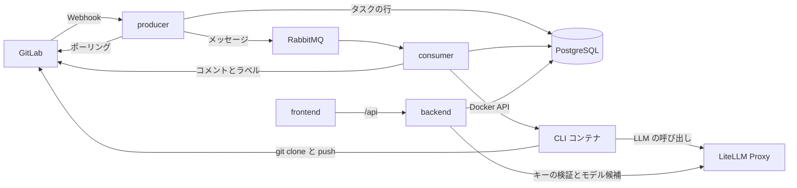

### 2-3. コンポーネント間のインターフェースとデータフロー

| 送信元 | 送信先 | インターフェース | データ |
|---|---|---|---|
| GitLab | producer | HTTP の POST（`/webhook`、`X-Gitlab-Token`） | Issue／MR のイベント |
| producer | GitLab | REST API（ポーリング、Issue の作成者の補完） | Issue／MR の一覧と詳細 |
| producer | PostgreSQL・RabbitMQ | SQL、AMQP | タスクの行、タスクのメッセージ |
| consumer | RabbitMQ・PostgreSQL | AMQP、SQL | メッセージの受信、タスクの状態、ユーザー・アダプタ・設定の読み出し |
| consumer | CLI コンテナ | Docker API（ホストの `docker.sock`） | 環境変数、`/tmp/prompt.txt`、`/tmp/start_command.sh`、標準出力 |
| consumer | GitLab | REST API | コメント、ラベル、ブランチ、MR |
| CLI コンテナ | GitLab・LiteLLM Proxy | git（HTTP）、LLM の API | clone と push、LLM の呼び出し |
| frontend | backend | HTTP（`/api`、JWT） | 4-1-2 の API |
| backend | LiteLLM Proxy | HTTP（`/models`） | Virtual Key の検証、モデルの一覧 |

### 2-4. ネットワーク構成図

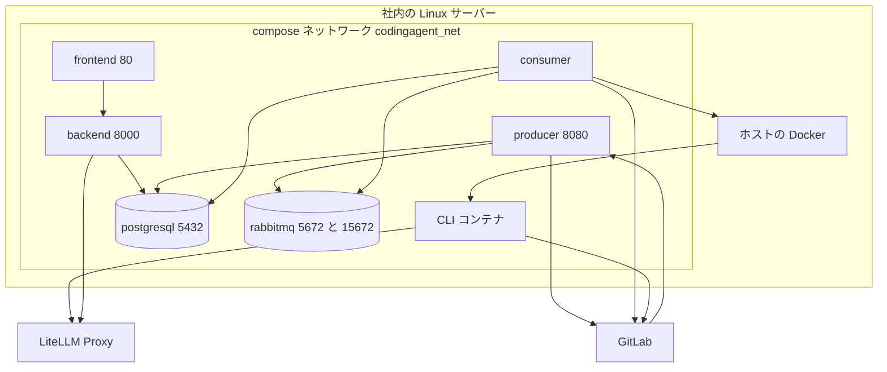

### 2-5. Zscaler 環境対応の構成

#### 2-5-1. コンポーネント


| コンポーネント | 役割 | 根拠となる要件 |
|---|---|---|
| Zscaler 設定の準備処理 | `.env` の Zscaler 設定と証明書から、各部品が使う生成物（証明書の束、環境変数のファイル、ビルド用の値）を作り、必須チェックと使用前の接続確認を行う | 証明書の束の決定、除外宛先の組み立て、Zscaler 設定の必須チェック、使用前の接続確認 |
| compose の入口スクリプト | 準備処理を行ってから docker compose を実行する | Zscaler 設定の必須チェック |
| イメージ内の証明書の導入処理 | ビルドの最初に、生成物の証明書をイメージの OS の信頼先と利用者ごとのブラウザの信頼先に入れる | ビルド時の Zscaler 設定の適用、CLI コンテナのブラウザへの Zscaler 設定の適用 |
| CLI コンテナの共通の土台イメージ | Ubuntu 24.04 に、中の Docker デーモン、Node.js、Python と uv、Playwright とブラウザの依存物、証明書の道具を入れる。Claude Code 用と opencode 用の土台になる | CLI コンテナでの Playwright の標準のブラウザの起動 |
| CLI コンテナ（Claude Code 用・opencode 用） | 共通の土台イメージの上に、それぞれの CLI エージェントだけを入れる | CLI コンテナでの Playwright の標準のブラウザの起動 |
| consumer の Zscaler 設定 | consumer の環境変数から Zscaler 設定を読み、CLI コンテナへ渡す環境変数と、CLI エージェントへの指示文を作る | CLI コンテナへの Zscaler 設定の受け渡し、CLI エージェントへの Zscaler の指示 |
| 模擬プロキシ | テスト環境だけで、本システムとは別の compose プロジェクトとして起動する mitmproxy | 模擬プロキシ |
| 単体テスト用のサービス | consumer のイメージにテストの道具を足したテスト用のコンテナ | テスト設計（第 8 章） |


#### 2-5-2. 全体構成図


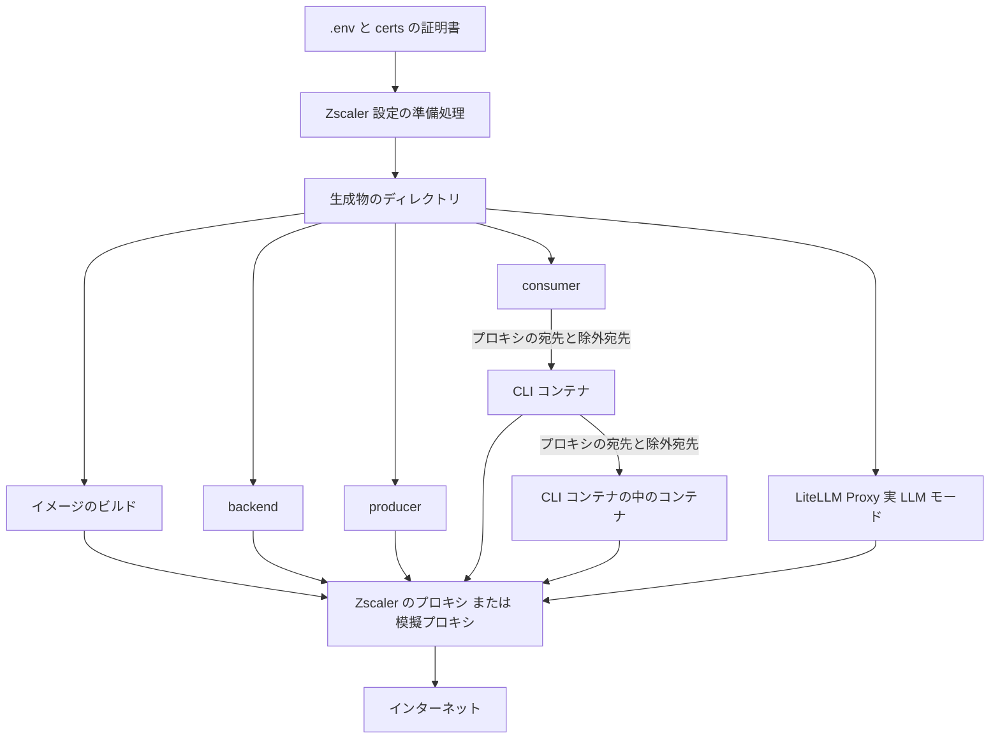


#### 2-5-3. インターフェースとデータフロー


| 送信元 | 送信先 | インターフェース | データ |
|---|---|---|---|
| 準備処理 | ビルド | docker compose の追加のビルドコンテキストと、ビルド引数 | 生成物のディレクトリ（証明書、状態の印、導入処理）、ビルド用のプロキシの宛先と除外宛先 |
| 準備処理 | 実行中の各部品 | docker compose の環境変数ファイル | Zscaler 設定の有効・無効、プロキシの宛先、除外宛先 |
| 準備処理 | LiteLLM Proxy・Playwright の実行コンテナ | 読み取り専用のファイルのマウント | 証明書の束 |
| consumer | CLI コンテナ | Docker API の環境変数と追加のホスト名 | プロキシの宛先、除外宛先、有効・無効。模擬プロキシのホスト名の解決先 |
| consumer | CLI エージェント | プロンプトのファイル | Zscaler の指示文 |
| CLI コンテナ | 中の Docker デーモンと中のコンテナ | 環境変数と Docker クライアントの設定ファイル | プロキシの宛先（中のコンテナ向けは IP アドレスに解決したもの）と除外宛先 |


#### 2-5-4. ネットワーク構成図


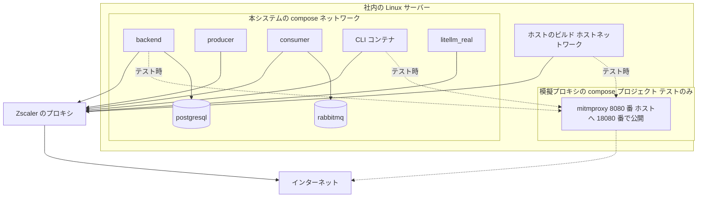

本番では、ビルドも実行中の部品も同じ Zscaler のプロキシの宛先を使う。模擬プロキシを使うテストでは、ビルド（ホストネットワーク）は `http://127.0.0.1:18080`、実行中の部品と CLI コンテナは `http://host.docker.internal:18080` を使う。`host.docker.internal` は compose の追加のホスト名（ホストのゲートウェイ）で解決する。

---


---

## 3. データ設計

### 3-1. データモデル

DB は PostgreSQL 16 を使う（ユーザー・アダプタ・タスク・設定の参照関係と、重複防止の制約が要るため）。スキーマは Alembic の移行 `001` で作る。

| DS-ID | 名前 | 内容 | 対応要件ID |
|---|---|---|---|
| `DS-SC-CLI-ADAPTERS-TABLE-DT-CLI-ADAPTER-ENTITY` | cli_adapters テーブル | 3-1 の表 | `RQ-DT-CLI-ADAPTER-ENTITY`、`RQ-DT-POSTGRESQL-STORE` |
| `DS-SC-GITLAB-RESPONSE-MODELS-EX-GITLAB-REST-API` | GitLab のレスポンスのモデル | GitLabUser・GitLabIssue・GitLabMR（定義だけで、どこからも使われていない） | `RQ-EX-GITLAB-REST-API` |
| `DS-SC-SYSTEM-SETTINGS-TABLE-DT-SYSTEM-SETTINGS-ENTITY` | system_settings テーブル | 3-1 の表 | `RQ-DT-SYSTEM-SETTINGS-ENTITY`、`RQ-DT-POSTGRESQL-STORE` |
| `DS-SC-TASK-MESSAGE-DT-TASK-MESSAGE` | タスクのメッセージ | キュー `tasks` の JSON（task_uuid、task_type、gitlab_project_id、source_iid、username） | `RQ-DT-TASK-MESSAGE` |
| `DS-SC-TASKS-TABLE-DT-TASK-ENTITY` | tasks テーブル | 3-1 の表。部分ユニークインデックス `tasks_no_duplicate_active` を含む | `RQ-DT-TASK-ENTITY`、`RQ-DT-POSTGRESQL-STORE`、`RQ-FT-PREVENT-DUPLICATE-TASK`、`RQ-DT-TASK-CREATE-PENDING`、`RQ-DT-TASK-PENDING-TO-RUNNING`、`RQ-DT-TASK-RUNNING-TO-COMPLETED`、`RQ-DT-TASK-RUNNING-TO-FAILED` |
| `DS-SC-USERS-TABLE-DT-USER-ENTITY` | users テーブル | 3-1 の表 | `RQ-DT-USER-ENTITY`、`RQ-DT-POSTGRESQL-STORE`、`RQ-DT-USER-ACTIVATION` |
| `DS-SC-ZSCALER-CERT-FILE-DT-ZSCALER-CERT-FILE` | Zscaler の証明書ファイル | プロジェクト直下の `certs/zscaler-ca.pem`。PEM 形式で、証明書を 1 つ以上含む。`certs/` は git の管理外 | `RQ-DT-ZSCALER-CERT-FILE` |
| `DS-SC-ZSCALER-GENERATED-DIR-FT-RESOLVE-CERT-BUNDLE` | 生成物のディレクトリ `.zscaler/`（git の管理外） | `state`（`enabled` か `disabled` の 1 行）、`extra-ca.pem`（イメージに足す証明書。有効なときだけ）、`ca-bundle.pem`（証明書の束。常に作る）、`install-ca.sh`（イメージ内の導入処理の写し）、`zscaler.env`（実行中の部品の環境変数: `ZSCALER_ENABLED`、`HTTP_PROXY`、`HTTPS_PROXY`、`NO_PROXY` と、それぞれの小文字版。無効なときプロキシと除外宛先は空）、`build.env`（ビルド用: `ZSCALER_BUILD_PROXY`、`ZSCALER_BUILD_NO_PROXY`） | `RQ-FT-RESOLVE-CERT-BUNDLE`、`RQ-FT-APPLY-ZSCALER-SETTINGS-BUILD`、`RQ-FT-APPLY-ZSCALER-SETTINGS-RUNTIME` |
| `DS-SC-ZSCALER-SETTINGS-ENV-DT-ZSCALER-SETTINGS-ENV` | `.env` の Zscaler 設定 | `ZSCALER_ENABLED`（`true` か `false`。書いていない場合は `true`）、`ZSCALER_PROXY_URL`（`http://ホスト名:ポート`。有効なときは必須）、`ZSCALER_NO_PROXY_EXTRA`（カンマ区切り。空でよい）。値は、プロセスの環境変数にあればそれを、無ければ `.env` のものを使う | `RQ-DT-ZSCALER-SETTINGS-ENV`、`RQ-UI-ZSCALER-ENV-SETTINGS` |

**users**

| カラム | 型 | 制約 | 要件のデータ項目 |
|---|---|---|---|
| username | VARCHAR(255) | 主キー | username |
| email | VARCHAR(255) | NOT NULL、UNIQUE | email |
| virtual_key_encrypted | BYTEA | NOT NULL（nonce 12 バイト＋暗号文） | virtual_key |
| default_cli | VARCHAR(255) | NOT NULL、cli_adapters.cli_id を参照 | default_cli |
| default_model | VARCHAR(255) | NOT NULL | default_model |
| role | VARCHAR(20) | NOT NULL、CHECK（admin・user） | role |
| is_active | BOOLEAN | NOT NULL、既定 true | is_active |
| password_hash | VARCHAR(255) | NOT NULL（bcrypt） | password |
| system_mcp_enabled | BOOLEAN | NOT NULL、既定 true | system_mcp_enabled |
| user_mcp_config | JSONB | NULL 可 | user_mcp_config |
| f4_prompt_template | TEXT | NULL 可 | f4_prompt_template |
| created_at・updated_at | TIMESTAMPTZ | NOT NULL、既定 NOW()（更新時は ORM が更新） | created_at・updated_at |

**cli_adapters**

| カラム | 型 | 制約 |
|---|---|---|
| cli_id | VARCHAR(255) | 主キー |
| container_image | VARCHAR(512) | NOT NULL |
| start_command_template | TEXT | NOT NULL |
| env_mappings | JSONB | NOT NULL |
| config_content_env | VARCHAR(255) | NULL 可 |
| is_builtin | BOOLEAN | NOT NULL、既定 false |
| created_at・updated_at | TIMESTAMPTZ | NOT NULL、既定 NOW() |

**tasks**

| カラム | 型 | 制約 |
|---|---|---|
| task_uuid | UUID | 主キー |
| task_type | VARCHAR(50) | NOT NULL、CHECK（issue・merge_request） |
| gitlab_project_id・source_iid | BIGINT | NOT NULL |
| username | VARCHAR(255) | NOT NULL、users.username を参照 |
| status | VARCHAR(20) | NOT NULL、CHECK（pending・running・completed・failed） |
| cli_type | VARCHAR(255) | NULL 可、cli_adapters.cli_id を参照 |
| model・cli_log・error_message | VARCHAR(255)・TEXT・TEXT | NULL 可 |
| created_at | TIMESTAMPTZ | NOT NULL、既定 NOW() |
| started_at・completed_at | TIMESTAMPTZ | NULL 可 |

部分ユニークインデックス `tasks_no_duplicate_active`: (gitlab_project_id, source_iid, task_type) で、status が pending か running の行に限る。

**system_settings**

| カラム | 型 | 制約 |
|---|---|---|
| key | VARCHAR(255) | 主キー（f3_prompt_template・f4_prompt_template・system_mcp_config） |
| value | TEXT | NOT NULL |
| updated_at | TIMESTAMPTZ | NOT NULL、既定 NOW() |

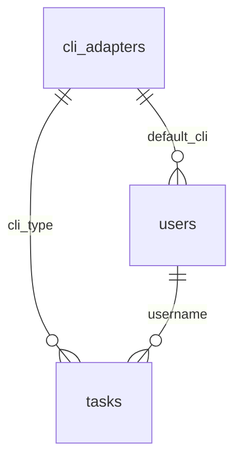

入力チェックは、API の入力の型と必須を pydantic で、メールの形式を email-validator で、ロール・状態・種別の値を DB の CHECK 制約とサービス層で確かめる。文字数の上限のチェックは API には無い（DB の型で上限を守る）。

### 3-2. トランザクションと排他制御

| 操作 | トランザクションの範囲 | ロールバックの条件 | 排他制御 |
|---|---|---|---|
| タスクの投入 | tasks への 1 行の挿入（コミットしてからキューへ送る） | 一意制約の違反（重複）なら挿入をやめる。キューへの送信の失敗では行は戻さない | 楽観的。部分ユニークインデックスで、同じ Issue／MR の待機中・実行中のタスクを 1 件に限る（Webhook とポーリングが同時に拾っても重複しない） |
| タスクの状態の更新 | 1 回の状態の更新ごと | 更新の失敗は例外として扱う | 無し（1 件のタスクを処理するのは 1 つの consumer だけ） |
| ユーザーの作成・更新・削除 | 1 回の API の呼び出しごと | 重複・検証の失敗では保存しない | 楽観的（一意制約） |
| 初期データの投入 | アダプタ・テンプレート・管理者をまとめて 1 回 | どれかが失敗すれば全体を戻す | 無し |

Zscaler の生成物: トランザクション・排他制御が要る操作は無い。生成物のディレクトリは、準備処理が一時ディレクトリに作ってから置き換えるので、途中で失敗しても前回の生成物は壊れない。

### 3-3. 状態遷移

タスクの状態は tasks の status に持つ。

| 要件の遷移 | 状態の持ち方 | 遷移を行う処理（DS-ID） |
|---|---|---|
| なし → pending | status を pending にした行を挿入する | `DS-FN-HANDLE-GITLAB-EVENT-FT-JUDGE-TARGET-EVENT` |
| pending → running | status を running にし、started_at を記録する | `DS-FN-CONVERT-ISSUE-TO-MR-FT-CONVERT-ISSUE-TO-MR`、`DS-FN-PROCESS-MR-FT-PROCESS-MR` |
| running → completed | status を completed にし、completed_at と cli_log（F-4 は cli_type・model も）を記録する | 同上 |
| running → failed | status を failed にし、completed_at・error_message・cli_log を記録する | 同上 |
| ユーザーの有効・無効 | users の is_active | `DS-FN-MANAGE-USERS-FT-MANAGE-USERS` |

許されない遷移の扱い: F-4 は、受け取ったタスクがすでに completed か failed なら何もしない。F-3 にはこの確認は無い。

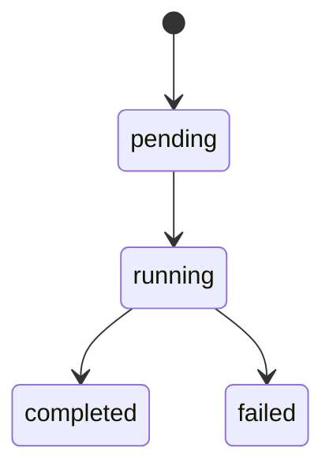

---

## 4. アーキテクチャ設計

### 4-1. 外部設計

| DS-ID | 名前 | 内容 | 対応要件ID |
|---|---|---|---|
| `DS-IF-AUTH-API-UI-AUTH-API` | 認証 API | `POST /api/auth/login`。ユーザー名とパスワードを受け、JWT（`access_token`、`token_type=bearer`）を返す。失敗は理由を区別せず 401 | `RQ-UI-AUTH-API`、`RQ-FT-AUTHENTICATE-USER` |
| `DS-IF-BUILD-CLI-EXEC-CMD-UI-BUILD-CLI-EXEC-CMD` | CLI イメージのビルドのコマンド | `./scripts/build_cli_exec.sh`（引数なし） | `RQ-UI-BUILD-CLI-EXEC-CMD` |
| `DS-IF-CLI-ADAPTER-API-UI-CLI-ADAPTER-API` | CLI アダプタ API | `GET/POST /api/cli-adapters`、`PUT/DELETE /api/cli-adapters/{cli_id}`（管理者のみ） | `RQ-UI-CLI-ADAPTER-API`、`RQ-FT-MANAGE-CLI-ADAPTERS`、`RQ-FT-RESTRICT-ADAPTER-DELETE` |
| `DS-IF-COMPOSE-WRAPPER-FT-REQUIRE-ZSCALER-SETTINGS` | compose の入口スクリプト | `./scripts/compose.sh <docker compose の引数>`。準備処理を行ってから、ビルド用の値を環境に入れて `docker compose` を実行する（例: `./scripts/compose.sh up -d --build`） | `RQ-FT-REQUIRE-ZSCALER-SETTINGS` |
| `DS-IF-ENV-SETTINGS-UI-ENV-SETTINGS` | 環境変数の設定 | `.env` と compose の環境変数（第 9 章 9-2 の一覧） | `RQ-UI-ENV-SETTINGS` |
| `DS-IF-GITLAB-COMMENTS-UI-GITLAB-COMMENTS` | GitLab へのコメント | 3-1 のコメントの本文（4-1-4 の表） | `RQ-UI-GITLAB-COMMENTS` |
| `DS-IF-GITLAB-REST-API-EX-GITLAB-REST-API` | GitLab REST API の呼び出し | python-gitlab で REST API v4 を呼ぶ。CLI コンテナからは PAT 入りの URL で git の clone と push を行う | `RQ-EX-GITLAB-REST-API` |
| `DS-IF-HEALTH-API-UI-HEALTH-API` | 死活確認 | backend の `GET /health` と producer の `GET /health` | `RQ-UI-HEALTH-API`、`RQ-OP-HEALTH-MONITORING` |
| `DS-IF-LITELLM-PROXY-EX-LITELLM-PROXY` | LiteLLM Proxy の呼び出し | CLI が `ANTHROPIC_BASE_URL` などで LLM を呼ぶ。backend は `GET {LiteLLM}/models` で Virtual Key の検証とモデル一覧の取得を行う | `RQ-EX-LITELLM-PROXY` |
| `DS-IF-LOGIN-SCREEN-UI-LOGIN-SCREEN` | SC-01 ログイン | 4-1-1 の画面の仕様 | `RQ-UI-LOGIN-SCREEN` |
| `DS-IF-SETTINGS-API-UI-SETTINGS-API` | システム設定 API | `GET/PUT /api/settings`（管理者のみ） | `RQ-UI-SETTINGS-API`、`RQ-FT-MANAGE-SYSTEM-SETTINGS` |
| `DS-IF-SETUP-CMD-UI-SETUP-CMD` | 初期セットアップのコマンド | `./scripts/setup.sh [--username U --email E --password P --virtual-key K --default-cli C --default-model M]` | `RQ-UI-SETUP-CMD` |
| `DS-IF-SYSTEM-SETTINGS-SCREEN-UI-SYSTEM-SETTINGS-SCREEN` | SC-07 システム設定 | 4-1-1 の画面の仕様 | `RQ-UI-SYSTEM-SETTINGS-SCREEN` |
| `DS-IF-TASK-API-UI-TASK-API` | タスク API | `GET /api/tasks`（username・status・task_type・page）。一般ユーザーは username が本人に固定される | `RQ-UI-TASK-API`、`RQ-FT-LIST-TASK-HISTORY` |
| `DS-IF-TASK-HISTORY-SCREEN-UI-TASK-HISTORY-SCREEN` | SC-06 タスク実行履歴 | 4-1-1 の画面の仕様 | `RQ-UI-TASK-HISTORY-SCREEN` |
| `DS-IF-TEST-SETUP-CMD-UI-TEST-SETUP-CMD` | テスト環境の構築のコマンド | `./scripts/test_setup.sh [--real] [--run-tests]` | `RQ-UI-TEST-SETUP-CMD` |
| `DS-IF-TEST-SETUP-ZSCALER-MOCK-UI-TEST-SETUP-ZSCALER-MOCK-OPTION` | テスト環境セットアップの `--zscaler-mock` | `./scripts/test_setup.sh --zscaler-mock [--real] [--run-tests]` | `RQ-UI-TEST-SETUP-ZSCALER-MOCK-OPTION` |
| `DS-IF-USER-API-UI-USER-API` | ユーザー API | `GET/POST /api/users`、`GET/PUT/DELETE /api/users/{username}`、`PUT /api/users/{username}/me`、`GET /api/users/{username}/model-candidates` | `RQ-UI-USER-API`、`RQ-FT-MANAGE-USERS`、`RQ-FT-VALIDATE-USER-INPUT`、`RQ-FT-SUGGEST-MODEL-CANDIDATES` |
| `DS-IF-USER-CREATE-SCREEN-UI-USER-CREATE-SCREEN` | SC-04 ユーザー作成 | 4-1-1 の画面の仕様 | `RQ-UI-USER-CREATE-SCREEN` |
| `DS-IF-USER-DETAIL-SCREEN-UI-USER-DETAIL-SCREEN` | SC-03 ユーザー詳細 | 4-1-1 の画面の仕様 | `RQ-UI-USER-DETAIL-SCREEN` |
| `DS-IF-USER-EDIT-SCREEN-UI-USER-EDIT-SCREEN` | SC-05 ユーザー編集 | 4-1-1 の画面の仕様 | `RQ-UI-USER-EDIT-SCREEN` |
| `DS-IF-USER-LIST-SCREEN-UI-USER-LIST-SCREEN` | SC-02 ユーザー一覧 | 4-1-1 の画面の仕様 | `RQ-UI-USER-LIST-SCREEN` |
| `DS-IF-WEBHOOK-API-UI-WEBHOOK-API` | Webhook の受け口 | producer の `POST /webhook`（ポート 8080） | `RQ-UI-WEBHOOK-API`、`RQ-FT-RECEIVE-WEBHOOK`、`RQ-EX-GITLAB-WEBHOOK` |
| `DS-IF-ZSCALER-ENV-SETTINGS-UI-ZSCALER-ENV-SETTINGS` | `.env` の Zscaler 設定 | 3-1 の Zscaler 設定の 3 項目を書く | `RQ-UI-ZSCALER-ENV-SETTINGS` |
| `DS-IF-ZSCALER-PREPARE-CMD-FT-REQUIRE-ZSCALER-SETTINGS` | 準備処理のコマンド | `./scripts/zscaler_prepare.sh [--mock] [--project-dir DIR] [--host-bundle FILE]`。`--mock` は模擬プロキシの値を使う。`--project-dir` と `--host-bundle` はテストで置き場所を差し替えるためのもので、通常は使わない | `RQ-FT-REQUIRE-ZSCALER-SETTINGS`、`RQ-FT-VERIFY-ZSCALER-TRUST-BEFORE-USE` |

#### 4-1-1. 画面の仕様

| 画面 | 目的 | 主要要素 | 入力項目 | 表示項目 | エラー時の見え方 |
|---|---|---|---|---|---|
| SC-01 ログイン | ログイン | 表題、ログインボタン、エラーの表示 | ユーザー名（必須）、パスワード（必須） | — | 未入力:「ユーザー名とパスワードを入力してください。」。認証の失敗:「ユーザー名またはパスワードが正しくありません。」。そのほか:「ログインに失敗しました。しばらく経ってから再試行してください。」 |
| SC-02 ユーザー一覧 | ユーザーを探して開く | 新規作成ボタン、検索欄、一覧、件数、ページ送り | 検索（前方一致） | ユーザー名、メール、ロール、有効・無効、登録日時 | 「ユーザー一覧の取得に失敗しました。」。0 件なら「ユーザーが見つかりません」 |
| SC-03 ユーザー詳細 | ユーザーを確かめる | 戻る、編集、削除（管理者。確認あり） | — | ユーザー名、ロール、有効、メール、Virtual Key（マスク）、デフォルト CLI、デフォルトモデル、システム MCP、登録・更新日時 | 「ユーザーが見つかりません。」「ユーザー情報の取得に失敗しました。」「ユーザーの削除に失敗しました。」 |
| SC-04 ユーザー作成 | ユーザーを作る | 作成、キャンセル | ユーザー名・メール・パスワード（8 文字以上）・確認・Virtual Key・デフォルト CLI（一覧から選ぶ）・デフォルトモデル（すべて必須）、ロール | — | 重複:「このユーザー名は既に使用されています。」。そのほか:「ユーザーの作成に失敗しました。」 |
| SC-05 ユーザー編集 | ユーザーを直す | 保存、キャンセル、F-4 テンプレートのクリア（確認あり） | 共通: メール、デフォルト CLI、デフォルトモデル（候補あり）、システム MCP、個別 MCP（JSON）、F-4 テンプレート。管理者: Virtual Key、ロール、有効。本人: 現在のパスワード、新しいパスワード、確認 | F-4 テンプレートの変数の説明 | 「ユーザー個別MCP設定のJSON形式が不正です。」「更新権限がありません。」「入力内容に誤りがあります: …」「保存に失敗しました。」。候補が無ければ「モデル候補を取得できませんでした（手入力で入力してください）」 |
| SC-06 タスク実行履歴 | 処理の結果を確かめる | 更新ボタン、絞り込み、一覧、件数、ページ送り | 状態、ユーザー名（一般ユーザーは自分に固定）、種別 | UUID（先頭 8 文字）、種別、ユーザー名、プロジェクト ID、IID、状態、CLI、モデル、作成・完了日時 | 「タスク一覧の取得に失敗しました。」。0 件なら「タスクが見つかりません」 |
| SC-07 システム設定 | テンプレート・アダプタ・MCP を管理する | タブ 4 つ（F-3、F-4、CLI アダプタ、MCP）、保存、アダプタの追加・編集・削除のダイアログ | テンプレート、MCP（JSON）、アダプタの CLI ID・イメージ・起動コマンド・環境変数の対応（JSON）・設定内容の環境変数名・組み込み | 変数の説明、アダプタの一覧 | 「システムMCP設定のJSON形式が不正です。」「設定の保存に失敗しました。」「このCLI IDは既に使用されています。」「このアダプタは組み込みアダプタまたはユーザーが使用中のため削除できません。」 |

ナビゲーションバーは、ログイン中だけ出し、ユーザー一覧とシステム設定は管理者だけに出す。未ログインで画面を開くと SC-01、一般ユーザーが管理者専用の画面や他人のユーザーの画面を開くと SC-06 へ移す。API が 401 を返したらログアウトして SC-01 へ移す。

#### 4-1-2. Web API の仕様

| API | 入力とバリデーション | 出力 | エラー仕様 |
|---|---|---|---|
| `POST /api/auth/login` | username、password（必須） | 200 `access_token`、`token_type` | 401（ユーザーが無い・パスワードの不一致・無効を区別しない）、422 |
| `GET /api/users` | search（任意）、page（1 以上）。管理者のみ | 200 items・total・page・per_page（20） | 401、403、422 |
| `POST /api/users` | username・email（メール形式）・password・virtual_key・default_cli・default_model（必須）、role（既定 user）。業務ルール「ユーザーの入力チェック」 | 201 ユーザー | 400（ロール）、409（ユーザー名・メールの重複）、422 |
| `GET /api/users/{username}` | 管理者か本人 | 200 ユーザー（Virtual Key は末尾 4 文字のマスク） | 403、404 |
| `PUT /api/users/{username}` | 管理者のみ。項目はすべて任意（null は変更しない）。Virtual Key は「LLM キーの検証」 | 200 ユーザー | 400（ロール、キーの検証の失敗）、404、409、422 |
| `PUT /api/users/{username}/me` | 本人のみ。パスワードを変えるときは current_password が必須 | 200 ユーザー | 400（現在のパスワード）、403、404、409、422 |
| `DELETE /api/users/{username}` | 管理者のみ | 204 | 404 |
| `GET /api/users/{username}/model-candidates` | 管理者か本人 | 200 モデル名の一覧（失敗・権限なしは空） | 401 |
| `GET /api/tasks` | username（管理者のみ有効）、status、task_type、page | 200 items（cli_log は含めない）・total・page・per_page（20） | 401、422 |
| `GET/POST /api/cli-adapters`、`PUT/DELETE /api/cli-adapters/{cli_id}` | 管理者のみ。業務ルール「CLI アダプタの削除の制限」 | 200・201・204 | 400（組み込み・使用中）、404、409（CLI ID の重複）、422 |
| `GET/PUT /api/settings` | 管理者のみ。項目はすべて任意 | 200 f3_prompt_template・f4_prompt_template・system_mcp_config | 401、403 |
| `POST /webhook`（producer） | `X-Gitlab-Token`、JSON の本文 | 200 | 403（トークンの不一致） |
| `GET /health`（backend・producer） | — | 200 | — |

すべての API（ログインと `/health`・`/webhook` を除く）は JWT を確かめる。トークンが無効なら 401、ユーザーが無効化されていれば 403、管理者専用の API に一般ユーザーなら 403。

#### 4-1-3. CUI の仕様

| コマンド | 引数 | 出力 | 終了コード |
|---|---|---|---|
| `./scripts/setup.sh` | `--username --email --password --virtual-key --default-cli --default-model`（省略すると対話で入力） | 進捗のログ | 成功 0、ビルドや投入の失敗 1、引数の誤り 2 |
| `./scripts/build_cli_exec.sh` | なし | docker build のログ | 失敗すると 0 以外 |
| `./scripts/test_setup.sh` | `--real`、`--run-tests` | 各ステップの進捗、`.env`（無ければ作る）、`.env.test` | 成功 0、失敗 1。`--run-tests` なら E2E の終了コード |

#### 4-1-4. GitLab へのコメント

| 場面 | 投稿先 | 本文 |
|---|---|---|
| 未登録・無効のユーザー、アダプタが無い | Issue／MR | `❌ エラー: …` と Task ID |
| Draft MR の作成 | Issue | `✅ Draft MR を作成しました。`、MR の URL、ブランチ名 |
| Issue のコメントのコピー | MR | `*(Issueからコピー)*` と元の本文 |
| F-4 の開始 | MR | `🤖 CLI 処理を開始しました。`、CLI とモデル |
| F-4 の進捗 | MR（1 件を更新し続ける） | 直近の出力と、折りたたんだ全体のログ |
| F-4 のタイムアウト | MR | `⏰ CLI 実行がタイムアウトしました（N秒）。` |
| F-4 のアサイン解除 | MR | `🛑 強制終了: bot がアサイニーから外されたため、CLI 処理を中断しました。` |
| F-4 の完了 | MR | `✅ CLI 処理が完了しました。`。コミットが無いときは注意を添える |
| F-3・F-4 のそのほかのエラー | Issue／MR | `❌ F-3（F-4）処理中にエラーが発生しました。`、Task ID、エラーの内容 |

#### 4-1-5. 外部システム連携

| 連携先 | インターフェース | 連携の部品 |
|---|---|---|
| GitLab REST API | python-gitlab（`GITLAB_API_URL`、`GITLAB_PAT`） | GitLab API のクライアント |
| GitLab Webhook | Group Webhook（Issue と MR のイベント） | Webhook の受信 |
| LiteLLM Proxy | OpenAI 互換・Anthropic 互換の API、`/models` | CLI エージェント、LiteLLM のキー検証とモデル候補 |

外部 DB との連携は無い。

#### 4-1-6. Zscaler 設定と準備処理のインターフェース


| DS-ID | 入力とバリデーション | 出力 | エラー仕様 |
|---|---|---|---|
| `DS-IF-ZSCALER-ENV-SETTINGS-UI-ZSCALER-ENV-SETTINGS` | `ZSCALER_ENABLED` は `true`・`false`・未設定のいずれか。`ZSCALER_PROXY_URL` は `http://` で始まり、ホスト名とポート番号を持つ。`ZSCALER_NO_PROXY_EXTRA` はカンマ区切りで、前後の空白を取り除く（業務ルール「Zscaler 設定の必須チェック」） | 準備処理の生成物 | 不正な値は準備処理のエラーとして扱う（次行） |
| `DS-IF-ZSCALER-PREPARE-CMD-FT-REQUIRE-ZSCALER-SETTINGS` | 上の 3 項目、`certs/zscaler-ca.pem`、ホストの OS の証明書の束 | 生成物のディレクトリ。進捗を標準出力に出す。終了コードは成功 0、失敗 1 | ① `ZSCALER_ENABLED` が不正な値: 値と、使える値を表示。② 有効なのにプロキシの宛先が無い・形が不正: 項目名 `ZSCALER_PROXY_URL` と、`ZSCALER_ENABLED=false` で外せることを表示。③ 有効なのに証明書ファイルもホストの OS の束も無い: 証明書ファイルの置き場所と外し方を表示。④ 使用前の接続確認の失敗: 「プロキシに接続できない」（接続拒否・名前解決失敗・時間切れ）か「証明書を検証できない」（証明書の検証の失敗）を、宛先とあわせて表示。いずれも標準エラーに出し、生成物を書き換えずに終了コード 1 で終わる |
| `DS-IF-COMPOSE-WRAPPER-FT-REQUIRE-ZSCALER-SETTINGS` | docker compose の引数 | docker compose の出力と終了コード | 準備処理が失敗したら docker compose を実行せず、準備処理の終了コードで終わる |
| `DS-IF-TEST-SETUP-ZSCALER-MOCK-UI-TEST-SETUP-ZSCALER-MOCK-OPTION` | 既存の `--real`・`--run-tests` と組み合わせる | 既存のステップの進捗に加えて、模擬プロキシの起動と準備処理の結果を標準出力に出す。終了コードは成功 0、失敗 1 | 模擬プロキシが 60 秒以内に認証局の証明書を書き出さない、または準備処理が失敗したら、原因を標準エラーに出して終了コード 1 で終わる。`certs/` と `.env` には書き込まない |


外部連携の追加は無い。既存の連携先（GitLab、LiteLLM Proxy、LLM の API）への通信が、プロキシの宛先を経由する。帳票・出力ファイルは無い。外部 DB 連携の変更は無い。

### 4-2. 内部設計

#### 4-2-1. タスクの投入

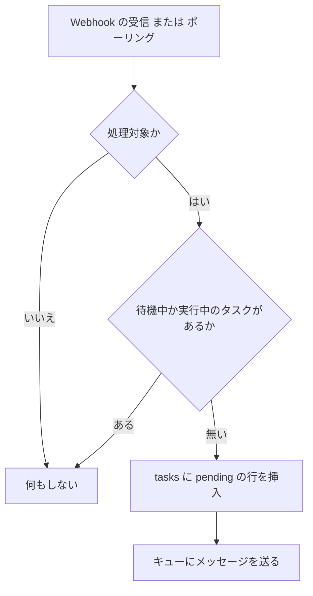

| DS-ID | 名前 | 内容 | 対応要件ID |
|---|---|---|---|
| `DS-BT-POLL-GITLAB-FT-POLL-GITLAB` | ポーリング | `POLLING_INTERVAL_SECONDS` ごとに、bot にアサインされ特定ラベルの付いた open の Issue と MR を全プロジェクトから取り、プロジェクトごとにイベントの処理へ渡す | `RQ-FT-POLL-GITLAB` |

| DS-ID | 名前 | 内容 | 対応要件ID |
|---|---|---|---|
| `DS-EV-TASK-QUEUE-DT-TASK-MESSAGE` | タスクのキュー | producer が既定の exchange からキュー `tasks`（永続）へ送り、consumer が 1 件ずつ受け取る（prefetch 1、手動の ACK、例外は再投入） | `RQ-DT-TASK-MESSAGE`、`RQ-FT-ENQUEUE-TASK` |

#### 4-2-2. Issue→MR 変換の手順

1. タスクを running にする。
2. ユーザーを取る。未登録・無効なら Issue にコメントし、failed にして終える。
3. Virtual Key を復号し、Issue を取る（無ければ failed）。特定ラベルを外して処理中ラベルを付ける。
4. Issue のコメント、プロジェクトの情報、既存のブランチ（最大 100 件）からプロンプトを作る。
5. デフォルト CLI のアダプタを解決し（無ければコメントして failed）、MCP 設定（`mcpServers` で包む）、環境変数、起動コマンドを作る。
6. CLI コンテナを起動し（clone はしない）、タイムアウトまで終了を待つ。出力から `branch_name` と `mr_title` の JSON を探す。
7. `main` からブランチを作り、Draft MR を作り、Issue のコメントをコピーし、Issue にコメントし、ラベルを完了ラベルに付け替える。
8. completed にする（cli_log はマスクしない）。例外のときは、停止中でなければコメントして処理中ラベルを外し、failed にする。最後にコンテナを止める。

#### 4-2-3. MR 処理の手順

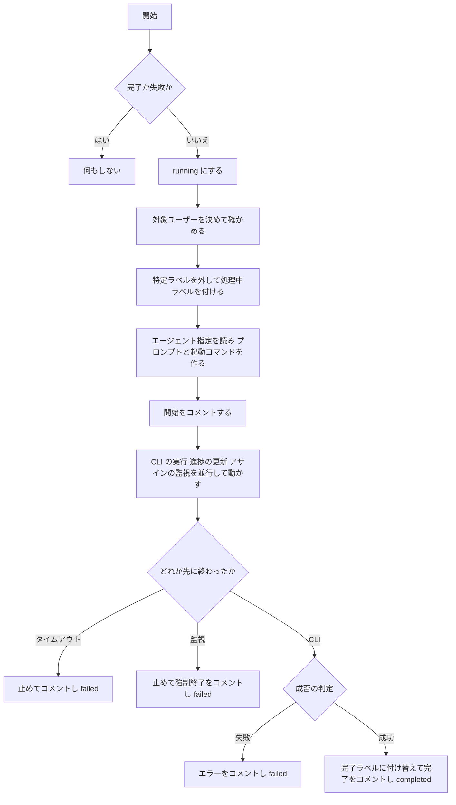

- CLI コンテナのスクリプトは、git の設定、PAT 入りの URL での clone、ブランチの切り替え、開始時の HEAD の出力、CLI の実行、終了時の HEAD と未コミットの変更の有無の出力、`git push` を行う。
- 監視の処理が先に終わったときは、戻り値によらず bot が外されたとして扱う。
- cli_log はマスクしてから保存する。

#### 4-2-4. 管理画面の処理

管理画面の操作は、画面 → API の呼び出し → ルーター → サービス（業務ルール）→ リポジトリ（DB）の順に流れる。ユーザーの Virtual Key の更新では、サービスが LiteLLM で検証してから暗号化して保存する。

#### 4-2-5. Zscaler 設定の準備処理のフロー


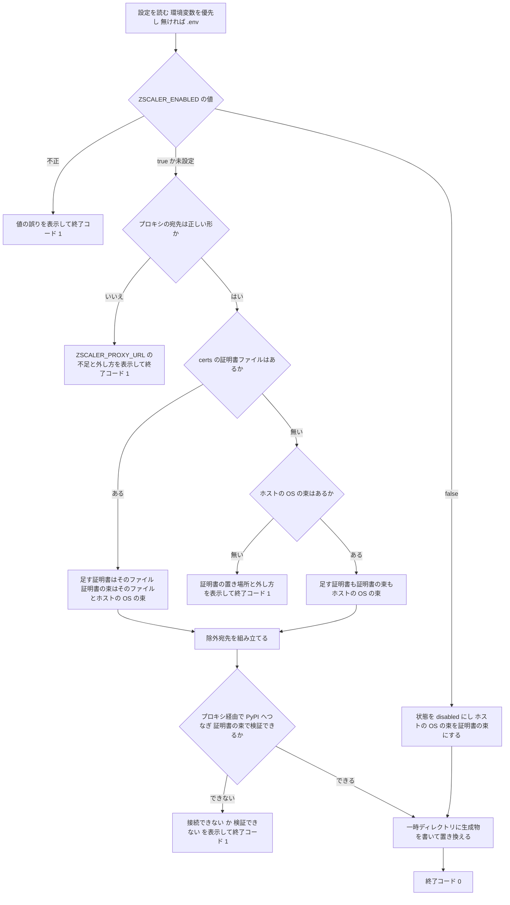

模擬プロキシのとき（`--mock`）は、`.env` の `ZSCALER_ENABLED` と `ZSCALER_PROXY_URL` を使わず、有効として扱う。足す証明書は模擬プロキシの認証局の証明書（`zscaler-mock/.data/mitmproxy-ca-cert.pem`）、証明書の束はそれとホストの OS の束、ビルド用の宛先は `http://127.0.0.1:18080`、実行中の部品の宛先は `http://host.docker.internal:18080` にする。`ZSCALER_NO_PROXY_EXTRA` は `.env` のものを使う。

ホストの OS の束は、`/etc/ssl/certs/ca-certificates.crt`、`/etc/pki/tls/certs/ca-bundle.crt`、`/etc/ssl/cert.pem` の順に探し、最初に見つかったものを使う。


#### 4-2-6. ビルドでの Zscaler 設定の適用


各 Dockerfile は、外へ出る最初の処理の前に、生成物のディレクトリを追加のビルドコンテキスト `zscaler` として読み取り専用でマウントし、導入処理を実行する。

1. 状態が `disabled` なら何もしない。
2. 状態が `enabled` で、ビルド引数のプロキシの宛先が空なら、「Zscaler 設定が有効ですが、ビルドにプロキシの宛先が渡されていません。`./scripts/compose.sh` などのスクリプトからビルドしてください」と表示して失敗する。
3. `update-ca-certificates` がある土台（Debian・Ubuntu）では、足す証明書を `/usr/local/share/ca-certificates/zscaler.crt` に置いて `update-ca-certificates` を実行する。無い土台（frontend のビルド段の Alpine）では、足す証明書を `/etc/ssl/certs/ca-certificates.crt` の末尾に足す。
4. CLI コンテナの土台では、続けて CLI を実行する利用者（root と claude）ごとに、Chromium 系が読む証明書データベース（`~/.pki/nssdb` と `~/.local/share/pki/nssdb`）を作り、足す証明書を信頼する認証局として登録する。

各 Dockerfile は、Zscaler 設定の有効・無効によらず、次の環境変数を OS の証明書の束（`/etc/ssl/certs/ca-certificates.crt`）に向ける: `SSL_CERT_FILE`、`REQUESTS_CA_BUNDLE`、`PIP_CERT`、`NODE_EXTRA_CA_CERTS`。束は公開の認証局と（有効なときは）Zscaler の証明書を含むので、無効なときも動作は変わらない。

プロキシの宛先は、docker compose のビルド引数（`HTTP_PROXY`・`HTTPS_PROXY`・`NO_PROXY` と小文字版）で渡す。値は compose の入口スクリプトなどが `build.env` から環境に入れる。すべてのビルドはホストネットワークで行う（模擬プロキシのビルド用の宛先 `127.0.0.1` に届かせるため）。


#### 4-2-7. CLI コンテナの起動と Zscaler 設定の受け渡し


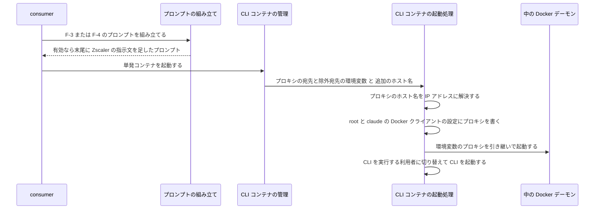

- CLI コンテナの管理処理は、Zscaler 設定が有効なとき、CLI アダプタ設定から作った環境変数に、プロキシの宛先と除外宛先（大文字版と小文字版）と `ZSCALER_ENABLED=true` を足す。無効なときは `ZSCALER_ENABLED=false` だけを足す。どちらの場合も、追加のホスト名 `host.docker.internal`（ホストのゲートウェイ）を付ける。
- Playwright の Chromium 系と WebKit は、デスクトップ環境の無い Linux ではプロキシの環境変数に従うので、CLI コンテナの環境変数のプロキシの宛先と除外宛先をそのまま使う。ブラウザごとのプロキシの設定は足さない。
- 中のコンテナは、CLI コンテナの名前解決を使えないので、Docker クライアントの設定に書くプロキシの宛先は、CLI コンテナの中で IP アドレスに解決したものにする。中の Docker デーモン自身は CLI コンテナの名前解決を使えるので、ホスト名のまま引き継ぐ。
- Zscaler の指示文は次の内容の固定文にする。「この環境は Zscaler の配下にある。外への通信は環境変数のプロキシを経由する。Zscaler の証明書は `/usr/local/share/ca-certificates/zscaler.crt`、証明書の束は `/etc/ssl/certs/ca-certificates.crt` にある。開発するシステムの Dockerfile と docker compose の設定には、ビルド時に外から証明書とプロキシの宛先を渡せる作りを組み込み、証明書ファイルそのものはリポジトリにコミットしない。開発するシステムの部品どうしの通信は除外宛先に入れる。証明書の検証を無効にする設定（証明書のエラーを無視する設定を含む）は使わない。Playwright の Chromium と WebKit は Zscaler の証明書を信頼済みで、Firefox は信頼させられないので使わない。」


---

## 5. クラス設計

### 5-1. クラス一覧

| DS-ID | クラス | ファイル | 役割 | 対応要件ID |
|---|---|---|---|---|
| `DS-CL-AUTH-SERVICE-FT-AUTHENTICATE-USER` | AuthService | `backend/services/auth_service.py` | 認証 | `RQ-FT-AUTHENTICATE-USER` |
| `DS-CL-BACKEND-VIRTUAL-KEY-SERVICE-FT-ENCRYPT-VIRTUAL-KEY` | VirtualKeyService | `backend/services/virtual_key_service.py` | Virtual Key の暗号化と復号（backend 用） | `RQ-FT-ENCRYPT-VIRTUAL-KEY` |
| `DS-CL-CLI-ADAPTER-REPOSITORY-FT-MANAGE-CLI-ADAPTERS` | CLIAdapterRepository | `backend/repositories/cli_adapter_repository.py` | cli_adapters の読み書き | `RQ-FT-MANAGE-CLI-ADAPTERS` |
| `DS-CL-CLI-ADAPTER-RESOLVER-FT-RESOLVE-CLI-ADAPTER` | CLIAdapterResolver | `consumer/cli_adapter_resolver.py` | CLI アダプタの解決 | `RQ-FT-RESOLVE-CLI-ADAPTER` |
| `DS-CL-CLI-ADAPTER-SERVICE-FT-MANAGE-CLI-ADAPTERS` | CLIAdapterService | `backend/services/cli_adapter_service.py` | CLI アダプタ管理の業務ロジック | `RQ-FT-MANAGE-CLI-ADAPTERS` |
| `DS-CL-CLI-CONTAINER-MANAGER-FT-RUN-CLI-CONTAINER` | CLIContainerManager | `consumer/cli_container_manager.py` | CLI コンテナの管理 | `RQ-FT-RUN-CLI-CONTAINER` |
| `DS-CL-CLI-LOG-MASKER-FT-MASK-CLI-LOG` | CLILogMasker | `consumer/cli_log_masker.py` | CLI ログのマスク | `RQ-FT-MASK-CLI-LOG` |
| `DS-CL-CODE-SYMBOLS-FT-CHECK-TRACEABILITY` | CodeSymbols | `scripts/isdd/trace_map_checker.py` | コードから取り出した記号の集まり | `RQ-FT-CHECK-TRACEABILITY` |
| `DS-CL-CONSUMER-VIRTUAL-KEY-SERVICE-FT-ENCRYPT-VIRTUAL-KEY` | VirtualKeyService | `consumer/virtual_key_service.py` | Virtual Key の復号（consumer 用） | `RQ-FT-ENCRYPT-VIRTUAL-KEY` |
| `DS-CL-CONSUMER-WORKER-FT-GRACEFUL-SHUTDOWN` | ConsumerWorker | `consumer/consumer.py` | キューの受信と停止 | `RQ-FT-GRACEFUL-SHUTDOWN` |
| `DS-CL-DUPLICATE-CHECK-SERVICE-FT-PREVENT-DUPLICATE-TASK` | DuplicateCheckService | `producer/gitlab_event_handler.py` | 重複の確認 | `RQ-FT-PREVENT-DUPLICATE-TASK` |
| `DS-CL-EBPF-ENVIRONMENT-CHECKER-FT-DETECT-TTY-WAIT` | EBPFEnvironmentChecker | `consumer/ebpf_environment_checker.py` | eBPF の条件の判定（未接続） | `RQ-FT-DETECT-TTY-WAIT` |
| `DS-CL-GITLAB-CLIENT-EX-GITLAB-REST-API` | GitLabClient | `shared/gitlab_client/gitlab_client.py` | GitLab API のクライアント | `RQ-EX-GITLAB-REST-API` |
| `DS-CL-GITLAB-EVENT-HANDLER-FT-JUDGE-TARGET-EVENT` | GitLabEventHandler | `producer/gitlab_event_handler.py` | 処理対象の判定とタスクの投入 | `RQ-FT-JUDGE-TARGET-EVENT`、`RQ-FT-ENQUEUE-TASK`、`RQ-FT-SUPPRESS-DUPLICATE-WEBHOOK`、`RQ-FT-DETERMINE-TASK-USER` |
| `DS-CL-ISSUE-TO-MR-CONVERTER-FT-CONVERT-ISSUE-TO-MR` | IssueToMRConverter | `consumer/issue_to_mr_converter.py` | Issue→MR 変換 | `RQ-FT-CONVERT-ISSUE-TO-MR` |
| `DS-CL-MOCK-LLM-HANDLER-FT-PROVIDE-MOCK-LLM` | MockLLMHandler | `mock-llm/server.py` | モック LLM の HTTP ハンドラ | `RQ-FT-PROVIDE-MOCK-LLM` |
| `DS-CL-MODEL-CANDIDATE-SERVICE-FT-SUGGEST-MODEL-CANDIDATES` | ModelCandidateService | `backend/services/model_candidate_service.py` | LiteLLM のキー検証とモデル候補 | `RQ-FT-SUGGEST-MODEL-CANDIDATES`、`RQ-FT-VALIDATE-LLM-KEY` |
| `DS-CL-MR-PROCESSOR-FT-PROCESS-MR` | MRProcessor | `consumer/mr_processor.py` | MR 処理 | `RQ-FT-PROCESS-MR` |
| `DS-CL-POLLING-LOOP-FT-POLL-GITLAB` | PollingLoop | `producer/polling_loop.py` | ポーリングの繰り返し | `RQ-FT-POLL-GITLAB` |
| `DS-CL-PROGRESS-MANAGER-FT-REPORT-PROGRESS` | ProgressManager | `consumer/progress_manager.py` | 進捗報告 | `RQ-FT-REPORT-PROGRESS` |
| `DS-CL-PROMPT-BUILDER-FT-BUILD-PROMPT` | PromptBuilder | `consumer/prompt_builder.py` | プロンプトの生成 | `RQ-FT-BUILD-PROMPT` |
| `DS-CL-RABBITMQ-CLIENT-DT-TASK-MESSAGE` | RabbitMQClient | `shared/messaging/rabbitmq_client.py` | RabbitMQ のクライアント | `RQ-DT-TASK-MESSAGE` |
| `DS-CL-SETTINGS-UI-ENV-SETTINGS` | Settings | `shared/config/config.py` | 設定値 | `RQ-UI-ENV-SETTINGS` |
| `DS-CL-SYSTEM-SETTINGS-REPOSITORY-FT-MANAGE-SYSTEM-SETTINGS` | SystemSettingsRepository | `backend/repositories/system_settings_repository.py` | system_settings の読み書き | `RQ-FT-MANAGE-SYSTEM-SETTINGS` |
| `DS-CL-SYSTEM-SETTINGS-SERVICE-FT-MANAGE-SYSTEM-SETTINGS` | SystemSettingsService | `backend/services/system_settings_service.py` | システム設定の業務ロジック | `RQ-FT-MANAGE-SYSTEM-SETTINGS` |
| `DS-CL-TASK-PROCESSOR-FT-CONVERT-ISSUE-TO-MR` | TaskProcessor | `consumer/task_processor.py` | タスクの振り分け | `RQ-FT-CONVERT-ISSUE-TO-MR`、`RQ-FT-PROCESS-MR` |
| `DS-CL-TASK-REPOSITORY-FT-LIST-TASK-HISTORY` | TaskRepository | `backend/repositories/task_repository.py` | tasks の読み出し | `RQ-FT-LIST-TASK-HISTORY` |
| `DS-CL-TASK-SERVICE-FT-LIST-TASK-HISTORY` | TaskService | `backend/services/task_service.py` | タスクの一覧 | `RQ-FT-LIST-TASK-HISTORY` |
| `DS-CL-TRACE-MAP-CHECKER-FT-CHECK-TRACEABILITY` | TraceMapChecker | `scripts/isdd/trace_map_checker.py` | 対応表の確認 | `RQ-FT-CHECK-TRACEABILITY` |
| `DS-CL-TTY-WAIT-DETECTOR-FT-DETECT-TTY-WAIT` | TTYWaitDetector | `consumer/tty_wait_detector.py` | TTY 入力待機の検知（未接続） | `RQ-FT-DETECT-TTY-WAIT` |
| `DS-CL-USER-REPOSITORY-FT-MANAGE-USERS` | UserRepository | `backend/repositories/user_repository.py` | users の読み書き | `RQ-FT-MANAGE-USERS` |
| `DS-CL-USER-SERVICE-FT-MANAGE-USERS` | UserService | `backend/services/user_service.py` | ユーザー管理の業務ロジック | `RQ-FT-MANAGE-USERS` |
| `DS-CL-WEBHOOK-SERVER-FT-RECEIVE-WEBHOOK` | WebhookServer | `producer/webhook_server.py` | Webhook の受信と死活確認の HTTP サーバー | `RQ-FT-RECEIVE-WEBHOOK`、`RQ-UI-HEALTH-API` |
| `DS-CL-ZSCALER-SETTINGS-FT-PASS-ZSCALER-SETTINGS-CLI-CONTAINER` | ZscalerSettings | `consumer/zscaler_settings.py` | consumer の Zscaler 設定（環境変数の読み込み、CLI コンテナへの環境変数、指示文） | `RQ-FT-PASS-ZSCALER-SETTINGS-CLI-CONTAINER`、`RQ-FT-INSTRUCT-CLI-ZSCALER` |

SOLID 原則への適合状況:

| 観点 | 状況 |
|---|---|
| 単一責任 | おおむね適合。MRProcessor は MR 処理の全体（ユーザーの確認、プロンプト、CLI、監視、判定、コメント）を持ち、責務が大きい |
| 開放閉鎖 | CLI エージェントの追加は CLI アダプタ設定とイメージだけで行え、コアの処理を変えない |
| リスコフの置換 | 継承をほとんど使っていないため、該当しない |
| インターフェース分離 | 部品ごとにクラスが分かれている |
| 依存性逆転 | consumer の各クラスはコンストラクタで依存を受け取る。backend はサービスがリポジトリを直接作る |

### 5-2. 関数・処理の設計要素

| DS-ID | 設計要素 | 内容 | 実装する関数・メソッド | 対応要件ID |
|---|---|---|---|---|
| `DS-FN-RECEIVE-WEBHOOK-FT-RECEIVE-WEBHOOK` | Webhook の受信 | `X-Gitlab-Token` と `GITLAB_WEBHOOK_SECRET` を比べ（秘密の値が空なら比べない）、違えば 403。本文を JSON として読み、`X-Idempotency-Key` とあわせてイベントの処理へ渡す。本文が壊れていても、処理で例外が出ても 200 | `WebhookServer.start` | `RQ-FT-RECEIVE-WEBHOOK`、`RQ-NF-WEBHOOK-ENQUEUE-3S`、`RQ-NF-SECRET-PROTECTION` |
| `DS-FN-HANDLE-GITLAB-EVENT-FT-JUDGE-TARGET-EVENT` | イベントの処理 | 重複受信の抑止（キーを最大 10,000 件覚える）、処理対象の判定（bot のアサイン、特定ラベル、完了ラベルなし）、対象ユーザーの決定、重複の確認、tasks への pending の行の挿入、キューへの送信。Issue の作成者は GitLab API で補う。MR のアサインは単数形の `assignee` で判定する | `GitLabEventHandler.handle_event`、`GitLabEventHandler.handle_polling_items` | `RQ-FT-JUDGE-TARGET-EVENT`、`RQ-FT-SUPPRESS-DUPLICATE-WEBHOOK`、`RQ-FT-DETERMINE-TASK-USER`、`RQ-FT-ENQUEUE-TASK`、`RQ-DT-TASK-CREATE-PENDING` |
| `DS-FN-CHECK-DUPLICATE-TASK-FT-PREVENT-DUPLICATE-TASK` | 重複の確認 | 同じプロジェクト・IID・種別で pending か running の行の件数を数える。挿入時の一意制約の違反でも投入をやめる | `DuplicateCheckService.is_duplicate` | `RQ-FT-PREVENT-DUPLICATE-TASK` |
| `DS-FN-START-PRODUCER-FT-ENQUEUE-TASK` | producer の起動 | 設定・GitLab クライアント・RabbitMQ の接続・DB のセッションを作り、Webhook の受信とポーリングを同時に動かす | `main` | `RQ-FT-ENQUEUE-TASK`、`RQ-FT-RECEIVE-WEBHOOK`、`RQ-FT-POLL-GITLAB` |
| `DS-FN-START-CONSUMER-FT-GRACEFUL-SHUTDOWN` | consumer の起動と停止 | 各サービスを組み立ててキュー `tasks` の受信を始める。SIGTERM・SIGINT で停止の要求を立て、処理中のタスクが終わってから受信を止める | `ConsumerWorker.shutdown`、`ConsumerWorker.start`、`main` | `RQ-FT-GRACEFUL-SHUTDOWN`、`RQ-FT-ENQUEUE-TASK` |
| `DS-FN-SHARE-SHUTDOWN-STATE-FT-GRACEFUL-SHUTDOWN` | 停止の要求の共有 | プロセス全体で共有する停止の要求の印の設定・解除・参照 | `is_shutdown_requested`、`request_shutdown`、`reset_shutdown` | `RQ-FT-GRACEFUL-SHUTDOWN` |
| `DS-FN-DISPATCH-TASK-FT-CONVERT-ISSUE-TO-MR` | タスクの振り分け | メッセージを検証し、task_type が issue なら Issue→MR 変換、merge_request なら MR 処理へ渡す。検証に失敗したら記録だけして終える | `TaskProcessor.process` | `RQ-FT-CONVERT-ISSUE-TO-MR`、`RQ-FT-PROCESS-MR` |
| `DS-FN-CONVERT-ISSUE-TO-MR-FT-CONVERT-ISSUE-TO-MR` | Issue→MR 変換 | 4-2-2 の手順 | `IssueToMRConverter.convert` | `RQ-FT-CONVERT-ISSUE-TO-MR`、`RQ-FT-REJECT-UNREGISTERED-USER`、`RQ-FT-TRANSITION-LABELS`、`RQ-FT-BUILD-MCP-CONFIG`、`RQ-FT-ENFORCE-CLI-TIMEOUT`、`RQ-DT-TASK-PENDING-TO-RUNNING`、`RQ-DT-TASK-RUNNING-TO-COMPLETED`、`RQ-DT-TASK-RUNNING-TO-FAILED`、`RQ-UI-GITLAB-COMMENTS` |
| `DS-FN-PROCESS-MR-FT-PROCESS-MR` | MR 処理 | 4-2-3 の手順 | `MRProcessor.process` | `RQ-FT-PROCESS-MR`、`RQ-FT-OVERRIDE-CLI-MODEL`、`RQ-FT-MONITOR-BOT-ASSIGNMENT`、`RQ-FT-ENFORCE-CLI-TIMEOUT`、`RQ-FT-JUDGE-MR-COMPLETION`、`RQ-FT-DETERMINE-TASK-USER`、`RQ-FT-REJECT-UNREGISTERED-USER`、`RQ-FT-TRANSITION-LABELS`、`RQ-FT-BUILD-MCP-CONFIG`、`RQ-FT-PROTECT-GITLAB-PAT`、`RQ-FT-PREVENT-DUPLICATE-TASK`、`RQ-DT-TASK-PENDING-TO-RUNNING`、`RQ-DT-TASK-RUNNING-TO-COMPLETED`、`RQ-DT-TASK-RUNNING-TO-FAILED`、`RQ-UI-GITLAB-COMMENTS` |
| `DS-FN-RUN-CLI-CONTAINER-FT-RUN-CLI-CONTAINER` | CLI コンテナの実行 | 同じ名前の残骸を消し、特権・自動削除・consumer と同じネットワークで単発のコンテナを作り、プロンプトと起動コマンドのファイルを書き込み、起動前に出力のストリームを取ってから起動する。終了を待ち（Docker の時間切れはタイムアウトとして扱う）、止めて消す。起動時は各イメージで `echo warmup` を 1 回動かす。常駐のコンテナを起動してコマンドを実行する処理と、git の設定を書く処理も残っている（どこからも使われていない） | `CLIContainerManager.configure_git`、`CLIContainerManager.exec_command`、`CLIContainerManager.get_stdout_stream`、`CLIContainerManager.run_container_once`、`CLIContainerManager.start_container`、`CLIContainerManager.stop_container`、`CLIContainerManager.wait_container_exit`、`CLIContainerManager.write_file` | `RQ-FT-RUN-CLI-CONTAINER`、`RQ-FT-ENFORCE-CLI-TIMEOUT`、`RQ-NF-CLI-START-3MIN` |
| `DS-FN-CONTROL-CLI-PROCESS-FT-DETECT-TTY-WAIT` | CLI の処理の強制終了 | CLI コンテナの中の CLI の処理番号を調べて止める（TTY 入力待機検知のための部品で、どこからも使われていない） | `CLIContainerManager.get_container_pid`、`CLIContainerManager.kill_process` | `RQ-FT-DETECT-TTY-WAIT` |
| `DS-FN-RESOLVE-CLI-ADAPTER-FT-RESOLVE-CLI-ADAPTER` | CLI アダプタの解決 | CLI ID からアダプタ設定を取り、`env_mappings` で環境変数を、`config_content_env` があれば opencode 用の JSON（`provider.<プロバイダー>.options.baseURL` と `mcp`）を、`start_command_template` の `{model}` と `{mcp_config}` を展開して起動コマンドを作る。全アダプタのイメージの一覧も返す | `CLIAdapterResolver.build_env_vars`、`CLIAdapterResolver.build_start_command`、`CLIAdapterResolver.fetch_all_container_images`、`CLIAdapterResolver.resolve` | `RQ-FT-RESOLVE-CLI-ADAPTER`、`RQ-FT-BUILD-MCP-CONFIG` |
| `DS-FN-BUILD-PROMPT-FT-BUILD-PROMPT` | プロンプトの生成 | F-3 は `{issue_title}`・`{issue_description}`・`{issue_comments}`・`{project_name}`・`{repository_url}`・`{existing_branches}`、F-4 は `{mr_description}`・`{mr_comments}`・`{branch_name}`・`{repository_url}` を展開する。F-4 はユーザー個別のテンプレートを優先し、テンプレートに無い必須の情報を末尾に補う | `PromptBuilder.build_f3_prompt`、`PromptBuilder.build_f4_prompt` | `RQ-FT-BUILD-PROMPT` |
| `DS-FN-REPORT-PROGRESS-FT-REPORT-PROGRESS` | 進捗報告 | CLI の出力を 1 行ずつ溜め（stream-json は読める文に直す）、`PROGRESS_REPORT_INTERVAL_SEC` ごとに MR の 1 件のコメントを作成・更新する。直近 `PROGRESS_REPORT_SUMMARY_LINES` 行と全体のログ（最大 `PROGRESS_REPORT_BUFFER_MAX_LINES` 行）を出す。3 回続けて失敗したら更新をやめる | `ProgressManager.append_line`、`ProgressManager.decode_stream_json_line`、`ProgressManager.flush`、`ProgressManager.start`、`ProgressManager.stop` | `RQ-FT-REPORT-PROGRESS`、`RQ-UI-GITLAB-COMMENTS` |
| `DS-FN-MASK-CLI-LOG-FT-MASK-CLI-LOG` | CLI ログのマスク | URL に埋め込まれたトークン（`oauth2:TOKEN@` と `TOKEN@`）を `****` に置き換える | `CLILogMasker.mask` | `RQ-FT-MASK-CLI-LOG`、`RQ-FT-PROTECT-GITLAB-PAT` |
| `DS-FN-CRYPT-VIRTUAL-KEY-FT-ENCRYPT-VIRTUAL-KEY` | Virtual Key の暗号化と復号 | `ENCRYPTION_KEY`（base64 で 32 バイト）で AES-256-GCM。12 バイトの乱数の nonce を暗号文の先頭に付ける。同じ実装が backend と consumer にある | `VirtualKeyService.decrypt`、`VirtualKeyService.encrypt`、`VirtualKeyService.decrypt`、`VirtualKeyService.encrypt` | `RQ-FT-ENCRYPT-VIRTUAL-KEY`、`RQ-NF-SECRET-PROTECTION` |
| `DS-FN-DETECT-TTY-WAIT-FT-DETECT-TTY-WAIT` | TTY 入力待機の検知 | Tracee（`aquasec/tracee:latest`）を CLI コンテナごとに起動し、`read` のイベントのうち `/dev/pts/` か `tty` を含むものを TTY 待ちとみなす（どこからも使われていない） | `TTYWaitDetector.is_tty_wait`、`TTYWaitDetector.poll_event`、`TTYWaitDetector.start`、`TTYWaitDetector.stop` | `RQ-FT-DETECT-TTY-WAIT` |
| `DS-FN-CHECK-EBPF-ENVIRONMENT-FT-DETECT-TTY-WAIT` | eBPF の使える条件の判定 | `/sys/kernel/btf/vmlinux` の有無と、ケーパビリティ（CAP_BPF・CAP_PERFMON）を 5 秒以内に判定する（どこからも使われていない） | `EBPFEnvironmentChecker.check_btf`、`EBPFEnvironmentChecker.check_caps`、`EBPFEnvironmentChecker.evaluate` | `RQ-FT-DETECT-TTY-WAIT` |
| `DS-FN-LOAD-SETTINGS-UI-ENV-SETTINGS` | 設定の読み込み | 環境変数と `.env` から設定を読む。プロジェクト ID の一覧を返す関数もある（使われていない） | `get_project_ids`、`get_settings` | `RQ-UI-ENV-SETTINGS` |
| `DS-FN-OPEN-DB-SESSION-DT-POSTGRESQL-STORE` | DB のセッション | `DATABASE_URL` で接続し（接続の生存確認あり）、リクエストごとのセッションを渡す | `Base`、`get_db` | `RQ-DT-POSTGRESQL-STORE` |
| `DS-FN-CALL-GITLAB-API-EX-GITLAB-REST-API` | GitLab API の呼び出し | Issue・MR・コメント・ラベル・ブランチ・プロジェクト・ユーザーの取得と更新。タイムアウト 30 秒、再試行あり、停止の要求中は中止。ページは自前で数えて回す。Draft の MR のタイトルを整える | `GitLabClient.branch_exists`、`GitLabClient.create_branch`、`GitLabClient.create_issue_note`、`GitLabClient.create_merge_request`、`GitLabClient.create_merge_request_note`、`GitLabClient.get_issue`、`GitLabClient.get_issue_notes`、`GitLabClient.get_merge_request`、`GitLabClient.get_merge_request_notes`、`GitLabClient.get_project_info`、`GitLabClient.get_user_by_username`、`GitLabClient.list_assigned_issues_all_projects`、`GitLabClient.list_assigned_merge_requests_all_projects`、`GitLabClient.list_branches`、`GitLabClient.list_issues`、`GitLabClient.list_merge_requests`、`GitLabClient.update_issue_labels`、`GitLabClient.update_merge_request`、`GitLabClient.update_merge_request_labels`、`GitLabClient.update_merge_request_note` | `RQ-EX-GITLAB-REST-API` |
| `DS-FN-EXCHANGE-TASK-MESSAGE-DT-TASK-MESSAGE` | キューの送受信 | 接続（最大 10 回、待ち時間を倍にして再試行）、永続化付きの送信（切れていたら 1 回だけ再接続）、別スレッドで処理する受信、受信の停止、切断 | `RabbitMQClient.close`、`RabbitMQClient.connect`、`RabbitMQClient.consume`、`RabbitMQClient.publish`、`RabbitMQClient.stop_consuming` | `RQ-DT-TASK-MESSAGE`、`RQ-FT-ENQUEUE-TASK` |
| `DS-FN-MIGRATE-DB-FT-MIGRATE-DB-ON-STARTUP` | DB の移行 | backend の起動時に Alembic で最新まで移行する。失敗したら起動を中断する。移行の定義は 1 本（4 テーブルと部分ユニークインデックスの作成・削除） | `run_migrations_offline`、`run_migrations_online`、`downgrade`、`upgrade`、`lifespan`、`run_migrations` | `RQ-FT-MIGRATE-DB-ON-STARTUP` |
| `DS-FN-AUTHENTICATE-USER-FT-AUTHENTICATE-USER` | 認証 | bcrypt（コスト 12）でパスワードを照合し、有効なユーザーにだけ JWT（HS256、24 時間、`sub` と `role`）を出す。トークンを検証する | `AuthService.create_access_token`、`AuthService.hash_password`、`AuthService.login`、`AuthService.verify_password`、`AuthService.verify_token` | `RQ-FT-AUTHENTICATE-USER`、`RQ-NF-SECRET-PROTECTION` |
| `DS-FN-AUTHORIZE-REQUEST-FT-AUTHORIZE-BY-ROLE` | 権限の確認 | トークンからユーザーを DB で引き直し、無効なら 403。管理者専用の操作は role で確かめる | `get_current_user`、`require_admin` | `RQ-FT-AUTHORIZE-BY-ROLE` |
| `DS-FN-MANAGE-USERS-FT-MANAGE-USERS` | ユーザー管理 | 一覧（ユーザー名の前方一致、20 件ずつ）・作成・参照（管理者か本人）・管理者による更新（Virtual Key は検証してから暗号化）・本人による更新（パスワードの変更は現在のパスワードが要る）・削除。null の項目は変更しない | `UserRepository.create`、`UserRepository.delete`、`UserRepository.email_exists`、`UserRepository.get_all`、`UserRepository.get_by_username`、`UserRepository.update`、`UserService.create_user`、`UserService.delete_user`、`UserService.get_user`、`UserService.list_users`、`UserService.update_user_admin`、`UserService.update_user_self` | `RQ-FT-MANAGE-USERS`、`RQ-FT-VALIDATE-USER-INPUT`、`RQ-DT-USER-ACTIVATION`、`RQ-FT-ENCRYPT-VIRTUAL-KEY` |
| `DS-FN-VALIDATE-LLM-KEY-FT-VALIDATE-LLM-KEY` | LLM キーの検証 | `GET {LiteLLM}/models` を Virtual Key で呼び、200 なら有効。接続できない・時間切れは有効とみなす。全体で 15 秒を超えたら失敗 | `ModelCandidateService.validate_key` | `RQ-FT-VALIDATE-LLM-KEY` |
| `DS-FN-FETCH-MODEL-CANDIDATES-FT-SUGGEST-MODEL-CANDIDATES` | モデル候補の取得 | `GET {LiteLLM}/models` の `data[].id` を返す。失敗はすべて空の一覧 | `ModelCandidateService.fetch_models` | `RQ-FT-SUGGEST-MODEL-CANDIDATES` |
| `DS-FN-LIST-TASKS-FT-LIST-TASK-HISTORY` | タスクの一覧 | 絞り込み（ユーザー名・状態・種別）と、作成日時の新しい順に 20 件ずつ。一般ユーザーは本人に固定する | `TaskRepository.get_all`、`TaskService.list_tasks` | `RQ-FT-LIST-TASK-HISTORY` |
| `DS-FN-MANAGE-CLI-ADAPTERS-FT-MANAGE-CLI-ADAPTERS` | CLI アダプタ管理 | 一覧（CLI ID の順）・追加（ID の重複は 409）・更新・削除（組み込みとユーザーが使用中のものは 400） | `CLIAdapterRepository.create`、`CLIAdapterRepository.delete`、`CLIAdapterRepository.get_all`、`CLIAdapterRepository.get_by_id`、`CLIAdapterRepository.is_referenced_by_users`、`CLIAdapterRepository.update`、`CLIAdapterService.create_adapter`、`CLIAdapterService.delete_adapter`、`CLIAdapterService.list_adapters`、`CLIAdapterService.update_adapter` | `RQ-FT-MANAGE-CLI-ADAPTERS`、`RQ-FT-RESTRICT-ADAPTER-DELETE` |
| `DS-FN-MANAGE-SYSTEM-SETTINGS-FT-MANAGE-SYSTEM-SETTINGS` | システム設定の管理 | キーと値の表とレスポンスの変換、部分更新（文字列以外は JSON にして保存） | `SystemSettingsRepository.get`、`SystemSettingsRepository.get_all`、`SystemSettingsRepository.set`、`SystemSettingsRepository.upsert_many`、`SystemSettingsService.get_settings`、`SystemSettingsService.update_settings` | `RQ-FT-MANAGE-SYSTEM-SETTINGS` |
| `DS-FN-SETUP-INITIAL-DATA-FT-SETUP-INITIAL-DATA` | 初期データの投入 | 組み込みの CLI アダプタ（claude・opencode）の登録と上書き、F-3・F-4 のテンプレートの投入（既にあれば上書きしない）、最初の管理者の作成を 1 回のコミットで行う。引数が無ければ対話で聞く | `main`、`setup` | `RQ-FT-SETUP-INITIAL-DATA`、`RQ-UI-SETUP-CMD` |
| `DS-FN-LEGACY-GITLAB-SETUP-FT-SETUP-TEST-ENVIRONMENT` | 旧版の GitLab セットアップ | テスト用の GitLab の準備の旧版（どこからも呼ばれていない） | `create_root_pat`、`get_root_token`、`main`、`save_env_test`、`setup_backend`、`setup_gitlab_bot`、`setup_gitlab_test_users`、`setup_group_webhook`、`setup_test_group`、`setup_test_project`、`wait_for_gitlab` | `RQ-FT-SETUP-TEST-ENVIRONMENT` |
| `DS-FN-MEASURE-CLI-CONTAINER-START-FT-MEASURE-CLI-CONTAINER-STARTUP` | CLI コンテナの起動時間の計測 | Docker SDK と CLI で、run・create と start・削除の各段階の時間を測る | `main`、`test_containers_run`、`test_containers_run_sleep`、`test_create_start`、`test_create_start_while_dind_running`、`test_create_with_auto_remove`、`test_docker_cli`、`test_remove_running_dind`、`test_run_immediately_after_dind_remove`、`test_run_while_dind_running`、`test_run_with_existing_running_container` | `RQ-FT-MEASURE-CLI-CONTAINER-STARTUP` |
| `DS-FN-SERVE-MOCK-LLM-FT-PROVIDE-MOCK-LLM` | モック LLM の応答 | OpenAI 互換（chat/completions・models・responses）、Anthropic 互換（messages。ストリーミングあり）、LiteLLM のキー管理（key/generate・key/info・key/delete）の真似。F-3 の指示には固定のブランチ名と MR のタイトルの JSON を返す | `MockLLMHandler.do_GET`、`MockLLMHandler.do_POST`、`MockLLMHandler.log_message`、`main` | `RQ-FT-PROVIDE-MOCK-LLM` |
| `DS-FN-CALL-BACKEND-API-FT-MANAGE-USERS` | 管理画面からの API の呼び出し | `/api` を基点に、JWT を付けて backend の API を呼ぶ。401 ならログアウトしてログイン画面へ移る | `apiLogin`、`createAdapter`、`createUser`、`deleteAdapter`、`deleteUser`、`getAdapters`、`getModelCandidates`、`getSettings`、`getTasks`、`getUser`、`getUsers`、`updateAdapter`、`updateSettings`、`updateUser`、`updateUserSelf` | `RQ-FT-MANAGE-USERS`、`RQ-UI-AUTH-API`、`RQ-UI-USER-API`、`RQ-UI-TASK-API`、`RQ-UI-CLI-ADAPTER-API`、`RQ-UI-SETTINGS-API` |
| `DS-FN-ROUTE-SCREENS-FT-AUTHORIZE-BY-ROLE` | 画面の振り分け | 画面のルート定義と、未ログイン・管理者専用・他人の画面への移動の制限 | `LoginView`、`SettingsView`、`TaskListView`、`UserCreateView`、`UserDetailView`、`UserEditView`、`UserListView` | `RQ-FT-AUTHORIZE-BY-ROLE` |
| `DS-FN-MANAGE-LOGIN-STATE-FT-AUTHENTICATE-USER` | ログインの状態 | トークンとユーザー（JWT から取り出したユーザー名とロール）をブラウザに保存し、ログインとログアウトを行う | `login`、`logout`、`parseJwt` | `RQ-FT-AUTHENTICATE-USER` |
| `DS-FN-CHECK-TRACE-MAP-FT-CHECK-TRACEABILITY` | 対応表の確認 | 詳細設計書・対応表・コードの 3 つを突き合わせ、壊れた参照をエラー、未登録を警告として出す。`--strict` なら警告でも失敗にする | `CodeSymbols.add`、`TraceMapChecker.report`、`TraceMapChecker.run`、`collect_code`、`extract_python`、`extract_regex`、`main`、`parse_design`、`parse_trace_map` | `RQ-FT-CHECK-TRACEABILITY` |
| `DS-FN-CHECK-IMPLEMENTATION-COMPLETENESS-FT-CHECK-TRACEABILITY` | 実装完了の確認 | `scripts/isdd/completeness.json` の実行形態・認証・外部連携に応じて、compose・E2E・README・対応表がそろっているかを確かめる | `check_docker_compose`、`check_e2e_tests`、`check_readme`、`check_trace_map`、`load_profile`、`main`、`print_report`、`run_checks` | `RQ-FT-CHECK-TRACEABILITY` |
| `DS-FN-LOAD-ZSCALER-SETTINGS-FT-PASS-ZSCALER-SETTINGS-CLI-CONTAINER` | ZscalerSettings.from_env | 環境変数の辞書から、有効・無効（`ZSCALER_ENABLED` が `true` のときだけ有効）、プロキシの宛先（`HTTPS_PROXY`）、除外宛先（`NO_PROXY`）を読む | — | `RQ-FT-PASS-ZSCALER-SETTINGS-CLI-CONTAINER` |
| `DS-FN-BUILD-CLI-PROXY-ENV-FT-PASS-ZSCALER-SETTINGS-CLI-CONTAINER` | ZscalerSettings.build_cli_env | 4-2-3 の環境変数の辞書を返す | — | `RQ-FT-PASS-ZSCALER-SETTINGS-CLI-CONTAINER` |
| `DS-FN-BUILD-ZSCALER-INSTRUCTION-FT-INSTRUCT-CLI-ZSCALER` | ZscalerSettings.build_instruction | 有効なら 4-2-3 の指示文を、無効なら空文字を返す | — | `RQ-FT-INSTRUCT-CLI-ZSCALER` |
| `DS-FN-APPEND-ZSCALER-INSTRUCTION-FT-INSTRUCT-CLI-ZSCALER` | PromptBuilder.build_f3_prompt・build_f4_prompt | 変数の展開（と F-4 の補足）の後に、指示文が空でなければ区切り線を挟んで末尾に足す。システム設定のテンプレートとユーザー個別のテンプレートのどちらにも同じように足す | — | `RQ-FT-INSTRUCT-CLI-ZSCALER` |
| `DS-FN-MERGE-ZSCALER-CLI-ENV-FT-PASS-ZSCALER-SETTINGS-CLI-CONTAINER` | CLIContainerManager.run_container_once・start_container | 渡された環境変数に build_cli_env の結果を足し（同じ名前は渡された側を優先）、追加のホスト名を付けてコンテナを作る | — | `RQ-FT-PASS-ZSCALER-SETTINGS-CLI-CONTAINER` |
| `DS-FN-RESOLVE-CERT-BUNDLE-FT-RESOLVE-CERT-BUNDLE` | `zscaler_resolve_bundle` | 4-2-1 の証明書の決め方（証明書ファイル、ホストの OS の束、模擬プロキシの認証局） | — | `RQ-FT-RESOLVE-CERT-BUNDLE` |
| `DS-FN-BUILD-NO-PROXY-LIST-FT-BUILD-NO-PROXY-LIST` | `zscaler_build_no_proxy` | `localhost`、`127.0.0.1`、`::1` と、本システムの compose のサービス名・ネットワークの別名のすべて（postgresql、postgresql_litellm、rabbitmq、backend、frontend、producer、consumer、mock_llm、gitlab、litellm、litellm_real、test_playwright、test_playwright_real、cli_exec_base、cli_exec_claude、cli_exec_opencode、unit_test）に、`ZSCALER_NO_PROXY_EXTRA` を足し、重複を除いてカンマでつなぐ | — | `RQ-FT-BUILD-NO-PROXY-LIST` |
| `DS-FN-REQUIRE-ZSCALER-SETTINGS-FT-REQUIRE-ZSCALER-SETTINGS` | `zscaler_require_settings` | 4-1-2 の①〜③の判定 | — | `RQ-FT-REQUIRE-ZSCALER-SETTINGS` |
| `DS-FN-VERIFY-TRUST-BEFORE-USE-FT-VERIFY-ZSCALER-TRUST-BEFORE-USE` | `zscaler_preflight` | ホストの curl で、ビルド用の宛先を経由して `https://pypi.org/simple/` へ、証明書の束を信頼先にして 20 秒以内につなぐ。curl の失敗の種類で「接続できない」と「検証できない」を分ける | — | `RQ-FT-VERIFY-ZSCALER-TRUST-BEFORE-USE` |
| `DS-FN-PREPARE-ZSCALER-FT-APPLY-ZSCALER-SETTINGS-RUNTIME` | `zscaler_prepare`・`zscaler_export_build_env` | 4-2-1 の全体の流れと生成物の書き込み。`build.env` の値を呼び出し元の環境に入れる。呼び出し元のスクリプトで準備済み（環境変数 `ZSCALER_PREPARED=1` を子のプロセスへ引き継ぐ）なら繰り返さない | — | `RQ-FT-APPLY-ZSCALER-SETTINGS-RUNTIME`、`RQ-FT-APPLY-ZSCALER-SETTINGS-BUILD` |
| `DS-FN-INSTALL-CA-SYSTEM-FT-APPLY-ZSCALER-SETTINGS-BUILD` | `install-ca.sh` の既定の動作 | 4-2-2 の 1〜3 | — | `RQ-FT-APPLY-ZSCALER-SETTINGS-BUILD` |
| `DS-FN-INSTALL-CA-NSS-FT-APPLY-ZSCALER-SETTINGS-CLI-BROWSER` | `install-ca.sh nss <利用者>` | 4-2-2 の 4 | — | `RQ-FT-APPLY-ZSCALER-SETTINGS-CLI-BROWSER` |
| `DS-FN-START-ZSCALER-MOCK-FT-RUN-ZSCALER-MOCK-PROXY` | `start_zscaler_mock` | 模擬プロキシの compose プロジェクトを起動し、認証局の証明書のファイルができるまで最大 60 秒待つ | — | `RQ-FT-RUN-ZSCALER-MOCK-PROXY` |
| `DS-FN-INSTALL-HOST-PYTHON-DEPS-FT-APPLY-ZSCALER-SETTINGS-HOST-SCRIPT` | `install_host_python_deps` | ホストの仮想環境の pip に、有効なら証明書の束（`--cert`）とビルド用の宛先（`--proxy`）を渡して必要なライブラリ（requests、pytest）を入れる | — | `RQ-FT-APPLY-ZSCALER-SETTINGS-HOST-SCRIPT` |
| `DS-FN-START-DIND-AND-RUN-CLI-FT-RUN-STANDARD-BROWSERS-CLI-CONTAINER` | `dind-start.sh` の本体 | iptables の方式を選んで中の Docker デーモンを起動し（moby の起動用スクリプト経由）、`CLI_RUN_AS` が指定されていればその利用者に切り替えて（`setpriv`）コマンドを実行する。引数が無ければデーモンのログを表示し続ける | — | `RQ-FT-RUN-STANDARD-BROWSERS-CLI-CONTAINER` |
| `DS-FN-CONFIGURE-INNER-DOCKER-PROXY-FT-PASS-ZSCALER-SETTINGS-CLI-CONTAINER` | `configure_inner_docker_proxy` | `ZSCALER_ENABLED=true` なら、プロキシのホスト名を IP アドレスに解決し、root と claude の `~/.docker/config.json` の `proxies` にプロキシの宛先と除外宛先を書く | — | `RQ-FT-PASS-ZSCALER-SETTINGS-CLI-CONTAINER` |

### 5-3. クラス図

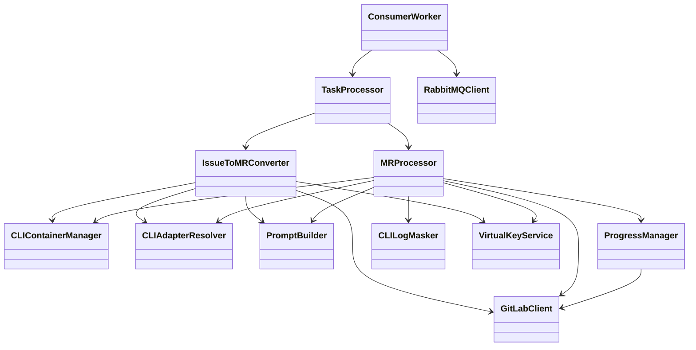

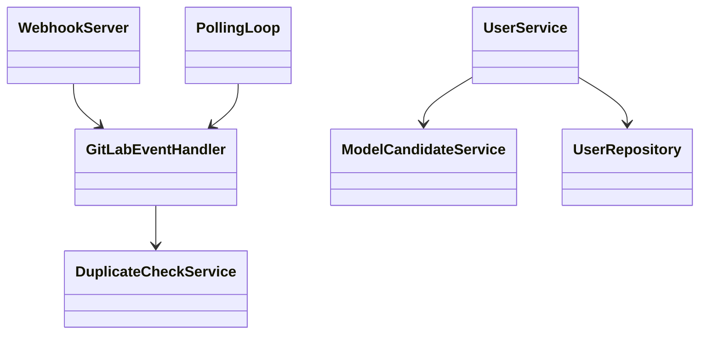

Zscaler 環境対応のクラス:


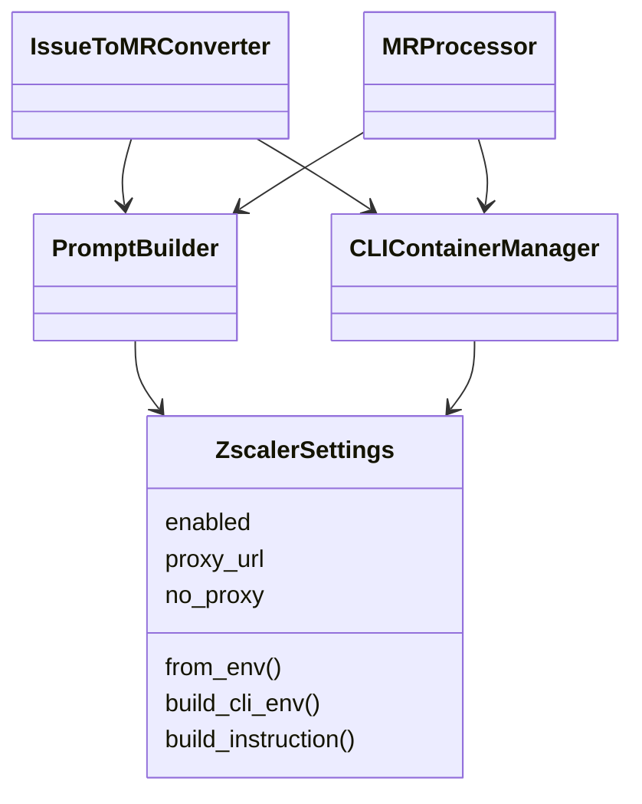


既存の PromptBuilder と CLIContainerManager は、コンストラクタで ZscalerSettings を受け取る（依存を外から渡す）。クラスの責務は変えない。

### 5-4. システム内のメッセージ

| メッセージ | 送信元 | 宛先 | 内容 |
|---|---|---|---|
| タスクのメッセージ | producer | consumer（キュー `tasks`） | task_uuid、task_type、gitlab_project_id、source_iid、username |
| 停止の要求 | シグナルの処理 | consumer の各処理 | プロセスで共有する停止の印 |

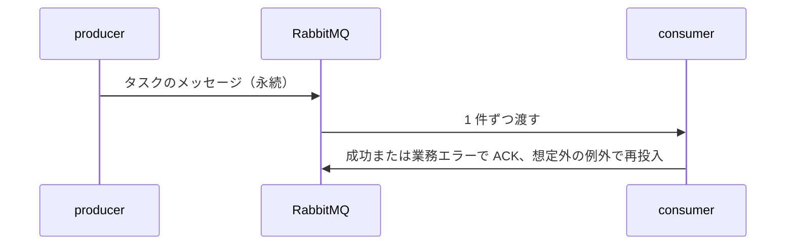

---

## 6. エラーハンドリングとセキュリティ設計

### 6-1. エラーハンドリング

| エラー | 発生箇所 | 利用者への見え方 | ログ | 続行か中止か |
|---|---|---|---|---|
| Webhook のトークンの不一致 | producer | 403 | WARNING | 中止 |
| Webhook の本文の誤り | producer | 200 | WARNING | 中止（GitLab の再送に任せる） |
| キューへの送信の失敗 | producer | なし | ERROR | 中止（行は pending のまま残る） |
| 未登録・無効のユーザー、アダプタが無い | consumer | Issue／MR のコメント | ERROR | タスクを failed |
| CLI の失敗・タイムアウト・アサイン解除・成否の判定の失敗 | consumer | MR のコメント | ERROR | タスクを failed |
| 想定外の例外（状態の更新の前など） | consumer | なし | ERROR | メッセージを再投入 |
| 後片付けの失敗（コンテナの停止など） | consumer | なし | WARNING | 続行 |
| API の入力の誤り・権限の不足 | backend | 画面のエラー（4-1-1） | — | 中止 |
| LLM キーの検証の失敗 | backend | 400 | WARNING | 保存しない |

### 6-2. 認証・認可・監査

| 項目 | 設計 |
|---|---|
| 認証 | ユーザー名とパスワード。JWT（HS256、`JWT_SECRET_KEY`、24 時間）。リフレッシュは無い |
| 認可 | ロールは admin と user |
| 監査ログ | 無い |

| 操作 | admin | user |
|---|---|---|
| ユーザーの一覧・作成・削除 | ○ | × |
| ユーザーの参照・更新 | 全員 | 本人のみ（ロール・有効・Virtual Key は変えられない） |
| タスクの一覧 | 全員分 | 本人の分のみ |
| CLI アダプタ・システム設定 | ○ | × |

制御は画面（ルートとナビゲーション）と API（依存関数とサービス）の両方で行い、データの単位（本人かどうか）はサービスで確かめる。

### 6-3. そのほかのセキュリティ対策

| 対象 | 設計 |
|---|---|
| Virtual Key | AES-256-GCM（`ENCRYPTION_KEY`）。API は末尾 4 文字だけを返す |
| パスワード | bcrypt（コスト 12） |
| GitLab の PAT | 環境変数だけで持つ。CLI コンテナには渡さず、F-4 の clone の URL にだけ埋め込み、F-4 の cli_log はマスクする |
| CLI コンテナ | 特権で動くため、信頼できる利用者だけに使わせる（README に書く） |
| アクセス経路 | 社内のネットワークの中だけで使う。HTTP（TLS なし）。CORS は全オリジンを許可している |

### 6-4. Zscaler 環境対応のエラー処理とセキュリティ


| エラー | 発生箇所 | 利用者への見え方 | 処理 |
|---|---|---|---|
| Zscaler 設定の値の誤り・不足 | 準備処理 | 4-1-2 の①〜③の表示 | 中止（終了コード 1） |
| 使用前の接続確認の失敗 | 準備処理 | 4-1-2 の④の表示 | 中止（終了コード 1） |
| 準備処理を通さないビルド | イメージ内の導入処理 | 4-2-2 の 2 の表示 | ビルドの失敗 |
| 生成物のディレクトリが無い状態での docker compose | docker compose | docker compose の「ビルドコンテキスト・環境変数ファイルが見つからない」エラー | 中止。README に「`./scripts/compose.sh` で一度準備する」と書く |
| CLI コンテナでプロキシのホスト名を解決できない | CLI コンテナの起動処理 | CLI のログに警告を出す | 中のコンテナ向けにはホスト名のまま書いて続行する |
| 実行中の通信の失敗（プロキシや証明書の不備） | 各部品 | 既存のエラー処理のまま（タスクは failed、GitLab へ失敗コメント） | 既存どおり |


| 項目 | 設計 |
|---|---|
| 認証・認可 | 変更なし。既存設計 `docs/detail_design.md` セクション 6 を参照 |
| 監査ログ | 変更なし |
| 証明書の検証 | どの部品・テストでも、証明書の検証を無効にする設定（Python の `verify=False`、Node の `NODE_TLS_REJECT_UNAUTHORIZED=0`、Playwright の `ignoreHTTPSErrors`、curl の `--insecure`、pip の `--trusted-host`、LiteLLM の `ssl_verify: false`）を使わない。単体テストでリポジトリ全体を検査する |
| 証明書ファイル | `certs/`、`.zscaler/`、`zscaler-mock/.data/` を git の管理外にする。CLI エージェントへの指示文で、対象リポジトリにも証明書をコミットしないよう求める |
| 社内用のイメージ | compose のイメージ名をローカル専用にし、ghcr.io の名前は Zscaler 設定を無効にした GitHub Actions だけが使う |

---


---

## 7. コード設計

### 7-1. ディレクトリ構成

| ディレクトリ | 中身 |
|---|---|
| `backend/` | FastAPI のアプリ（`routers/`、`schemas/`、`services/`、`repositories/`、`alembic/`） |
| `producer/` | Webhook の受信、ポーリング、イベントの処理 |
| `consumer/` | タスクの処理、CLI コンテナの管理 |
| `shared/` | 設定（`config/`）、DB（`database/`、`models/`）、GitLab（`gitlab_client/`）、キュー（`messaging/`） |
| `frontend/src/` | 管理画面（`views/`、`api/`、`stores/`、`router/`、`plugins/`） |
| `scripts/` | 初期セットアップ、テスト環境、CLI イメージのビルド、開発用の道具、isdd の対応表チェック（`isdd/`） |
| `mock-llm/` | モック LLM |
| `cli-exec/` | CLI コンテナのイメージ（`base/`、`claude/`、`opencode/`） |
| `default-template/` | 既定のテンプレート |
| `litellm/` | テスト用の LiteLLM Proxy の設定 |
| `e2e/` | Playwright の E2E |

Zscaler 環境対応で足すディレクトリ:

| ディレクトリ | 中身 |
|---|---|
| `certs/` | 管理者が置く Zscaler の証明書。git 管理外 |
| `.zscaler/` | 準備処理の生成物。git 管理外 |
| `scripts/lib/` | シェルの共通処理 |
| `scripts/zscaler/` | イメージ内の導入処理 |
| `consumer/` | consumer のコード |
| `cli-exec/base/` | CLI コンテナの共通の土台 |
| `cli-exec/claude/`・`cli-exec/opencode/` | 各 CLI エージェントのイメージ |
| `zscaler-mock/` | 模擬プロキシの compose プロジェクト |
| `zscaler-mock/.data/` | mitmproxy の認証局。git 管理外 |
| `tests/consumer/`・`tests/scripts/` | 単体テスト・結合テスト |
| `e2e/zscaler/` | Zscaler の E2E |


### 7-2. ファイル一覧

テストファイル（`scripts/test_setup.py` を含む）は載せない。

| DS-ID | ファイル | 役割 | 含まれるクラス・関数の設計要素（DS-ID） | 対応要件ID |
|---|---|---|---|---|
| `DS-MD-BACKEND-ALEMBIC-ENV-FT-MIGRATE-DB-ON-STARTUP` | `backend/alembic/env.py` | Alembic の実行環境（`DATABASE_URL` で接続） | `DS-FN-MIGRATE-DB-FT-MIGRATE-DB-ON-STARTUP` | `RQ-FT-MIGRATE-DB-ON-STARTUP` |
| `DS-MD-BACKEND-MIGRATION-INITIAL-FT-MIGRATE-DB-ON-STARTUP` | `backend/alembic/versions/001_initial.py` | 初期の DB の移行（4 テーブルと部分ユニークインデックス） | `DS-FN-MIGRATE-DB-FT-MIGRATE-DB-ON-STARTUP` | `RQ-FT-MIGRATE-DB-ON-STARTUP`、`RQ-DT-POSTGRESQL-STORE` |
| `DS-MD-BACKEND-MAIN-FT-MIGRATE-DB-ON-STARTUP` | `backend/main.py` | FastAPI のアプリ。起動時の移行、ルーターの登録、`/health` | `DS-FN-MIGRATE-DB-FT-MIGRATE-DB-ON-STARTUP`、`DS-IF-HEALTH-API-UI-HEALTH-API` | `RQ-FT-MIGRATE-DB-ON-STARTUP`、`RQ-UI-HEALTH-API` |
| `DS-MD-BACKEND-CLI-ADAPTER-REPOSITORY-FT-MANAGE-CLI-ADAPTERS` | `backend/repositories/cli_adapter_repository.py` | cli_adapters の読み書き | `DS-CL-CLI-ADAPTER-REPOSITORY-FT-MANAGE-CLI-ADAPTERS`、`DS-FN-MANAGE-CLI-ADAPTERS-FT-MANAGE-CLI-ADAPTERS` | `RQ-FT-MANAGE-CLI-ADAPTERS` |
| `DS-MD-BACKEND-SYSTEM-SETTINGS-REPOSITORY-FT-MANAGE-SYSTEM-SETTINGS` | `backend/repositories/system_settings_repository.py` | system_settings の読み書き | `DS-CL-SYSTEM-SETTINGS-REPOSITORY-FT-MANAGE-SYSTEM-SETTINGS`、`DS-FN-MANAGE-SYSTEM-SETTINGS-FT-MANAGE-SYSTEM-SETTINGS` | `RQ-FT-MANAGE-SYSTEM-SETTINGS` |
| `DS-MD-BACKEND-TASK-REPOSITORY-FT-LIST-TASK-HISTORY` | `backend/repositories/task_repository.py` | tasks の読み出し | `DS-CL-TASK-REPOSITORY-FT-LIST-TASK-HISTORY`、`DS-FN-LIST-TASKS-FT-LIST-TASK-HISTORY` | `RQ-FT-LIST-TASK-HISTORY` |
| `DS-MD-BACKEND-USER-REPOSITORY-FT-MANAGE-USERS` | `backend/repositories/user_repository.py` | users の読み書き | `DS-CL-USER-REPOSITORY-FT-MANAGE-USERS`、`DS-FN-MANAGE-USERS-FT-MANAGE-USERS` | `RQ-FT-MANAGE-USERS` |
| `DS-MD-BACKEND-AUTH-ROUTER-UI-AUTH-API` | `backend/routers/auth.py` | 認証 API | `DS-IF-AUTH-API-UI-AUTH-API` | `RQ-UI-AUTH-API` |
| `DS-MD-BACKEND-CLI-ADAPTERS-ROUTER-UI-CLI-ADAPTER-API` | `backend/routers/cli_adapters.py` | CLI アダプタ API | `DS-IF-CLI-ADAPTER-API-UI-CLI-ADAPTER-API` | `RQ-UI-CLI-ADAPTER-API` |
| `DS-MD-BACKEND-SETTINGS-ROUTER-UI-SETTINGS-API` | `backend/routers/settings.py` | システム設定 API | `DS-IF-SETTINGS-API-UI-SETTINGS-API` | `RQ-UI-SETTINGS-API` |
| `DS-MD-BACKEND-TASKS-ROUTER-UI-TASK-API` | `backend/routers/tasks.py` | タスク API | `DS-IF-TASK-API-UI-TASK-API` | `RQ-UI-TASK-API` |
| `DS-MD-BACKEND-USERS-ROUTER-UI-USER-API` | `backend/routers/users.py` | ユーザー API | `DS-IF-USER-API-UI-USER-API` | `RQ-UI-USER-API` |
| `DS-MD-BACKEND-AUTH-SCHEMA-UI-AUTH-API` | `backend/schemas/auth.py` | 認証 API の入出力 | `DS-IF-AUTH-API-UI-AUTH-API` | `RQ-UI-AUTH-API` |
| `DS-MD-BACKEND-CLI-ADAPTER-SCHEMA-UI-CLI-ADAPTER-API` | `backend/schemas/cli_adapter.py` | CLI アダプタ API の入出力 | `DS-IF-CLI-ADAPTER-API-UI-CLI-ADAPTER-API` | `RQ-UI-CLI-ADAPTER-API` |
| `DS-MD-BACKEND-SETTINGS-SCHEMA-UI-SETTINGS-API` | `backend/schemas/settings.py` | システム設定 API の入出力 | `DS-IF-SETTINGS-API-UI-SETTINGS-API` | `RQ-UI-SETTINGS-API` |
| `DS-MD-BACKEND-TASK-SCHEMA-UI-TASK-API` | `backend/schemas/task.py` | タスク API の入出力（cli_log は含めない） | `DS-IF-TASK-API-UI-TASK-API` | `RQ-UI-TASK-API` |
| `DS-MD-BACKEND-USER-SCHEMA-UI-USER-API` | `backend/schemas/user.py` | ユーザー API の入出力 | `DS-IF-USER-API-UI-USER-API` | `RQ-UI-USER-API` |
| `DS-MD-BACKEND-AUTH-SERVICE-FT-AUTHENTICATE-USER` | `backend/services/auth_service.py` | 認証と権限の確認 | `DS-CL-AUTH-SERVICE-FT-AUTHENTICATE-USER`、`DS-FN-AUTHENTICATE-USER-FT-AUTHENTICATE-USER`、`DS-FN-AUTHORIZE-REQUEST-FT-AUTHORIZE-BY-ROLE` | `RQ-FT-AUTHENTICATE-USER`、`RQ-FT-AUTHORIZE-BY-ROLE` |
| `DS-MD-BACKEND-CLI-ADAPTER-SERVICE-FT-MANAGE-CLI-ADAPTERS` | `backend/services/cli_adapter_service.py` | CLI アダプタ管理の業務ロジック | `DS-CL-CLI-ADAPTER-SERVICE-FT-MANAGE-CLI-ADAPTERS`、`DS-FN-MANAGE-CLI-ADAPTERS-FT-MANAGE-CLI-ADAPTERS` | `RQ-FT-MANAGE-CLI-ADAPTERS`、`RQ-FT-RESTRICT-ADAPTER-DELETE` |
| `DS-MD-BACKEND-MODEL-CANDIDATE-SERVICE-FT-SUGGEST-MODEL-CANDIDATES` | `backend/services/model_candidate_service.py` | LiteLLM のキー検証とモデル候補 | `DS-CL-MODEL-CANDIDATE-SERVICE-FT-SUGGEST-MODEL-CANDIDATES`、`DS-FN-FETCH-MODEL-CANDIDATES-FT-SUGGEST-MODEL-CANDIDATES`、`DS-FN-VALIDATE-LLM-KEY-FT-VALIDATE-LLM-KEY` | `RQ-FT-SUGGEST-MODEL-CANDIDATES`、`RQ-FT-VALIDATE-LLM-KEY`、`RQ-EX-LITELLM-PROXY` |
| `DS-MD-BACKEND-SYSTEM-SETTINGS-SERVICE-FT-MANAGE-SYSTEM-SETTINGS` | `backend/services/system_settings_service.py` | システム設定の業務ロジック | `DS-CL-SYSTEM-SETTINGS-SERVICE-FT-MANAGE-SYSTEM-SETTINGS`、`DS-FN-MANAGE-SYSTEM-SETTINGS-FT-MANAGE-SYSTEM-SETTINGS` | `RQ-FT-MANAGE-SYSTEM-SETTINGS` |
| `DS-MD-BACKEND-TASK-SERVICE-FT-LIST-TASK-HISTORY` | `backend/services/task_service.py` | タスクの一覧 | `DS-CL-TASK-SERVICE-FT-LIST-TASK-HISTORY`、`DS-FN-LIST-TASKS-FT-LIST-TASK-HISTORY` | `RQ-FT-LIST-TASK-HISTORY` |
| `DS-MD-BACKEND-USER-SERVICE-FT-MANAGE-USERS` | `backend/services/user_service.py` | ユーザー管理の業務ロジック | `DS-CL-USER-SERVICE-FT-MANAGE-USERS`、`DS-FN-MANAGE-USERS-FT-MANAGE-USERS` | `RQ-FT-MANAGE-USERS`、`RQ-FT-VALIDATE-USER-INPUT`、`RQ-FT-VALIDATE-LLM-KEY` |
| `DS-MD-BACKEND-VIRTUAL-KEY-SERVICE-FT-ENCRYPT-VIRTUAL-KEY` | `backend/services/virtual_key_service.py` | Virtual Key の暗号化と復号 | `DS-CL-BACKEND-VIRTUAL-KEY-SERVICE-FT-ENCRYPT-VIRTUAL-KEY`、`DS-FN-CRYPT-VIRTUAL-KEY-FT-ENCRYPT-VIRTUAL-KEY` | `RQ-FT-ENCRYPT-VIRTUAL-KEY` |
| `DS-MD-CONSUMER-CLI-ADAPTER-RESOLVER-FT-RESOLVE-CLI-ADAPTER` | `consumer/cli_adapter_resolver.py` | CLI アダプタの解決 | `DS-CL-CLI-ADAPTER-RESOLVER-FT-RESOLVE-CLI-ADAPTER`、`DS-FN-RESOLVE-CLI-ADAPTER-FT-RESOLVE-CLI-ADAPTER` | `RQ-FT-RESOLVE-CLI-ADAPTER` |
| `DS-MD-CONSUMER-CLI-CONTAINER-MANAGER-FT-RUN-CLI-CONTAINER` | `consumer/cli_container_manager.py` | CLI コンテナの管理 | `DS-CL-CLI-CONTAINER-MANAGER-FT-RUN-CLI-CONTAINER`、`DS-FN-CONTROL-CLI-PROCESS-FT-DETECT-TTY-WAIT`、`DS-FN-RUN-CLI-CONTAINER-FT-RUN-CLI-CONTAINER` | `RQ-FT-RUN-CLI-CONTAINER`、`RQ-FT-DETECT-TTY-WAIT`、`RQ-FT-PASS-ZSCALER-SETTINGS-CLI-CONTAINER` |
| `DS-MD-CONSUMER-CLI-LOG-MASKER-FT-MASK-CLI-LOG` | `consumer/cli_log_masker.py` | CLI ログのマスク | `DS-CL-CLI-LOG-MASKER-FT-MASK-CLI-LOG`、`DS-FN-MASK-CLI-LOG-FT-MASK-CLI-LOG` | `RQ-FT-MASK-CLI-LOG` |
| `DS-MD-CONSUMER-ENTRY-FT-GRACEFUL-SHUTDOWN` | `consumer/consumer.py` | consumer の起動と停止 | `DS-CL-CONSUMER-WORKER-FT-GRACEFUL-SHUTDOWN`、`DS-FN-START-CONSUMER-FT-GRACEFUL-SHUTDOWN` | `RQ-FT-GRACEFUL-SHUTDOWN`、`RQ-FT-PASS-ZSCALER-SETTINGS-CLI-CONTAINER` |
| `DS-MD-CONSUMER-EBPF-ENVIRONMENT-CHECKER-FT-DETECT-TTY-WAIT` | `consumer/ebpf_environment_checker.py` | eBPF の条件の判定（未接続） | `DS-CL-EBPF-ENVIRONMENT-CHECKER-FT-DETECT-TTY-WAIT`、`DS-FN-CHECK-EBPF-ENVIRONMENT-FT-DETECT-TTY-WAIT` | `RQ-FT-DETECT-TTY-WAIT` |
| `DS-MD-CONSUMER-ISSUE-TO-MR-CONVERTER-FT-CONVERT-ISSUE-TO-MR` | `consumer/issue_to_mr_converter.py` | Issue→MR 変換 | `DS-CL-ISSUE-TO-MR-CONVERTER-FT-CONVERT-ISSUE-TO-MR`、`DS-FN-CONVERT-ISSUE-TO-MR-FT-CONVERT-ISSUE-TO-MR` | `RQ-FT-CONVERT-ISSUE-TO-MR` |
| `DS-MD-CONSUMER-MR-PROCESSOR-FT-PROCESS-MR` | `consumer/mr_processor.py` | MR 処理 | `DS-CL-MR-PROCESSOR-FT-PROCESS-MR`、`DS-FN-PROCESS-MR-FT-PROCESS-MR` | `RQ-FT-PROCESS-MR`、`RQ-FT-MONITOR-BOT-ASSIGNMENT`、`RQ-FT-JUDGE-MR-COMPLETION` |
| `DS-MD-CONSUMER-PROGRESS-MANAGER-FT-REPORT-PROGRESS` | `consumer/progress_manager.py` | 進捗報告 | `DS-CL-PROGRESS-MANAGER-FT-REPORT-PROGRESS`、`DS-FN-REPORT-PROGRESS-FT-REPORT-PROGRESS` | `RQ-FT-REPORT-PROGRESS` |
| `DS-MD-CONSUMER-PROMPT-BUILDER-FT-BUILD-PROMPT` | `consumer/prompt_builder.py` | プロンプトの生成 | `DS-CL-PROMPT-BUILDER-FT-BUILD-PROMPT`、`DS-FN-BUILD-PROMPT-FT-BUILD-PROMPT` | `RQ-FT-BUILD-PROMPT`、`RQ-FT-INSTRUCT-CLI-ZSCALER` |
| `DS-MD-CONSUMER-TASK-PROCESSOR-FT-CONVERT-ISSUE-TO-MR` | `consumer/task_processor.py` | タスクの振り分け | `DS-CL-TASK-PROCESSOR-FT-CONVERT-ISSUE-TO-MR`、`DS-FN-DISPATCH-TASK-FT-CONVERT-ISSUE-TO-MR` | `RQ-FT-CONVERT-ISSUE-TO-MR`、`RQ-FT-PROCESS-MR` |
| `DS-MD-CONSUMER-TTY-WAIT-DETECTOR-FT-DETECT-TTY-WAIT` | `consumer/tty_wait_detector.py` | TTY 入力待機の検知（未接続） | `DS-CL-TTY-WAIT-DETECTOR-FT-DETECT-TTY-WAIT`、`DS-FN-DETECT-TTY-WAIT-FT-DETECT-TTY-WAIT` | `RQ-FT-DETECT-TTY-WAIT` |
| `DS-MD-CONSUMER-VIRTUAL-KEY-SERVICE-FT-ENCRYPT-VIRTUAL-KEY` | `consumer/virtual_key_service.py` | Virtual Key の復号 | `DS-CL-CONSUMER-VIRTUAL-KEY-SERVICE-FT-ENCRYPT-VIRTUAL-KEY`、`DS-FN-CRYPT-VIRTUAL-KEY-FT-ENCRYPT-VIRTUAL-KEY` | `RQ-FT-ENCRYPT-VIRTUAL-KEY` |
| `DS-MD-FRONTEND-APP-FT-AUTHORIZE-BY-ROLE` | `frontend/src/App.vue` | 画面の外枠とナビゲーション（ロールで項目を出し分ける） | — | `RQ-FT-AUTHORIZE-BY-ROLE` |
| `DS-MD-FRONTEND-API-CLIENT-FT-MANAGE-USERS` | `frontend/src/api/client.ts` | API の呼び出しと型 | `DS-FN-CALL-BACKEND-API-FT-MANAGE-USERS` | `RQ-FT-MANAGE-USERS`、`RQ-UI-AUTH-API`、`RQ-UI-USER-API`、`RQ-UI-TASK-API`、`RQ-UI-CLI-ADAPTER-API`、`RQ-UI-SETTINGS-API` |
| `DS-MD-FRONTEND-MAIN-FT-AUTHORIZE-BY-ROLE` | `frontend/src/main.ts` | アプリの起動 | — | `RQ-FT-AUTHORIZE-BY-ROLE` |
| `DS-MD-FRONTEND-VUETIFY-FT-AUTHORIZE-BY-ROLE` | `frontend/src/plugins/vuetify.ts` | Vuetify の設定 | — | `RQ-FT-AUTHORIZE-BY-ROLE` |
| `DS-MD-FRONTEND-ROUTER-FT-AUTHORIZE-BY-ROLE` | `frontend/src/router/index.ts` | 画面のルートと移動の制限 | `DS-FN-ROUTE-SCREENS-FT-AUTHORIZE-BY-ROLE` | `RQ-FT-AUTHORIZE-BY-ROLE` |
| `DS-MD-FRONTEND-AUTH-STORE-FT-AUTHENTICATE-USER` | `frontend/src/stores/auth.ts` | ログインの状態 | `DS-FN-MANAGE-LOGIN-STATE-FT-AUTHENTICATE-USER` | `RQ-FT-AUTHENTICATE-USER` |
| `DS-MD-FRONTEND-LOGIN-VIEW-UI-LOGIN-SCREEN` | `frontend/src/views/LoginView.vue` | SC-01 ログイン | — | `RQ-UI-LOGIN-SCREEN` |
| `DS-MD-FRONTEND-SETTINGS-VIEW-UI-SYSTEM-SETTINGS-SCREEN` | `frontend/src/views/SettingsView.vue` | SC-07 システム設定 | — | `RQ-UI-SYSTEM-SETTINGS-SCREEN` |
| `DS-MD-FRONTEND-TASK-LIST-VIEW-UI-TASK-HISTORY-SCREEN` | `frontend/src/views/TaskListView.vue` | SC-06 タスク実行履歴 | — | `RQ-UI-TASK-HISTORY-SCREEN` |
| `DS-MD-FRONTEND-USER-CREATE-VIEW-UI-USER-CREATE-SCREEN` | `frontend/src/views/UserCreateView.vue` | SC-04 ユーザー作成 | — | `RQ-UI-USER-CREATE-SCREEN` |
| `DS-MD-FRONTEND-USER-DETAIL-VIEW-UI-USER-DETAIL-SCREEN` | `frontend/src/views/UserDetailView.vue` | SC-03 ユーザー詳細 | — | `RQ-UI-USER-DETAIL-SCREEN` |
| `DS-MD-FRONTEND-USER-EDIT-VIEW-UI-USER-EDIT-SCREEN` | `frontend/src/views/UserEditView.vue` | SC-05 ユーザー編集 | — | `RQ-UI-USER-EDIT-SCREEN` |
| `DS-MD-FRONTEND-USER-LIST-VIEW-UI-USER-LIST-SCREEN` | `frontend/src/views/UserListView.vue` | SC-02 ユーザー一覧 | — | `RQ-UI-USER-LIST-SCREEN` |
| `DS-MD-MOCK-LLM-SERVER-FT-PROVIDE-MOCK-LLM` | `mock-llm/server.py` | モック LLM | `DS-CL-MOCK-LLM-HANDLER-FT-PROVIDE-MOCK-LLM`、`DS-FN-SERVE-MOCK-LLM-FT-PROVIDE-MOCK-LLM` | `RQ-FT-PROVIDE-MOCK-LLM` |
| `DS-MD-PRODUCER-GITLAB-EVENT-HANDLER-FT-JUDGE-TARGET-EVENT` | `producer/gitlab_event_handler.py` | 処理対象の判定、重複の確認、タスクの投入 | `DS-CL-DUPLICATE-CHECK-SERVICE-FT-PREVENT-DUPLICATE-TASK`、`DS-CL-GITLAB-EVENT-HANDLER-FT-JUDGE-TARGET-EVENT`、`DS-FN-CHECK-DUPLICATE-TASK-FT-PREVENT-DUPLICATE-TASK`、`DS-FN-HANDLE-GITLAB-EVENT-FT-JUDGE-TARGET-EVENT` | `RQ-FT-JUDGE-TARGET-EVENT`、`RQ-FT-PREVENT-DUPLICATE-TASK`、`RQ-FT-ENQUEUE-TASK` |
| `DS-MD-PRODUCER-POLLING-LOOP-FT-POLL-GITLAB` | `producer/polling_loop.py` | ポーリング | `DS-BT-POLL-GITLAB-FT-POLL-GITLAB`、`DS-CL-POLLING-LOOP-FT-POLL-GITLAB` | `RQ-FT-POLL-GITLAB` |
| `DS-MD-PRODUCER-ENTRY-FT-ENQUEUE-TASK` | `producer/producer.py` | producer の起動 | `DS-FN-START-PRODUCER-FT-ENQUEUE-TASK` | `RQ-FT-ENQUEUE-TASK` |
| `DS-MD-PRODUCER-WEBHOOK-SERVER-FT-RECEIVE-WEBHOOK` | `producer/webhook_server.py` | Webhook の受信と死活確認 | `DS-CL-WEBHOOK-SERVER-FT-RECEIVE-WEBHOOK`、`DS-FN-RECEIVE-WEBHOOK-FT-RECEIVE-WEBHOOK` | `RQ-FT-RECEIVE-WEBHOOK`、`RQ-EX-GITLAB-WEBHOOK`、`RQ-UI-HEALTH-API` |
| `DS-MD-SCRIPTS-BUILD-CLI-EXEC-FT-BUILD-CLI-IMAGES` | `scripts/build_cli_exec.sh` | CLI イメージのビルド | — | `RQ-FT-BUILD-CLI-IMAGES`、`RQ-UI-BUILD-CLI-EXEC-CMD`、`RQ-FT-APPLY-ZSCALER-SETTINGS-BUILD`、`RQ-FT-RUN-STANDARD-BROWSERS-CLI-CONTAINER` |
| `DS-MD-SCRIPTS-DEBUG-DOCKER-RUN-FT-MEASURE-CLI-CONTAINER-STARTUP` | `scripts/debug_docker_run.py` | CLI コンテナの起動時間の計測（開発用の道具） | `DS-FN-MEASURE-CLI-CONTAINER-START-FT-MEASURE-CLI-CONTAINER-STARTUP` | `RQ-FT-MEASURE-CLI-CONTAINER-STARTUP` |
| `DS-MD-SCRIPTS-LEGACY-GITLAB-SETUP-FT-SETUP-TEST-ENVIRONMENT` | `scripts/gitlab_setup.py` | テスト用の GitLab の準備の旧版（開発用の道具。未使用） | `DS-FN-LEGACY-GITLAB-SETUP-FT-SETUP-TEST-ENVIRONMENT` | `RQ-FT-SETUP-TEST-ENVIRONMENT` |
| `DS-MD-SCRIPTS-ISDD-CHECK-SH-FT-CHECK-TRACEABILITY` | `scripts/isdd/check.sh` | 対応表チェックの入口（isdd-setup が生成） | — | `RQ-FT-CHECK-TRACEABILITY` |
| `DS-MD-SCRIPTS-ISDD-COMPLETENESS-CHECKER-FT-CHECK-TRACEABILITY` | `scripts/isdd/implementation_completeness_checker.py` | 実装完了チェッカー（isdd-setup が複製） | `DS-FN-CHECK-IMPLEMENTATION-COMPLETENESS-FT-CHECK-TRACEABILITY` | `RQ-FT-CHECK-TRACEABILITY` |
| `DS-MD-SCRIPTS-ISDD-TRACE-MAP-CHECKER-FT-CHECK-TRACEABILITY` | `scripts/isdd/trace_map_checker.py` | 対応表チェッカー（isdd-setup が複製） | `DS-CL-CODE-SYMBOLS-FT-CHECK-TRACEABILITY`、`DS-CL-TRACE-MAP-CHECKER-FT-CHECK-TRACEABILITY`、`DS-FN-CHECK-TRACE-MAP-FT-CHECK-TRACEABILITY` | `RQ-FT-CHECK-TRACEABILITY` |
| `DS-MD-SCRIPTS-SETUP-PY-FT-SETUP-INITIAL-DATA` | `scripts/setup.py` | 初期データの投入 | `DS-FN-SETUP-INITIAL-DATA-FT-SETUP-INITIAL-DATA` | `RQ-FT-SETUP-INITIAL-DATA` |
| `DS-MD-SCRIPTS-SETUP-SH-FT-SETUP-INITIAL-DATA` | `scripts/setup.sh` | 初期セットアップの入口（CLI イメージのビルドと初期データの投入） | — | `RQ-FT-SETUP-INITIAL-DATA`、`RQ-UI-SETUP-CMD`、`RQ-FT-REQUIRE-ZSCALER-SETTINGS` |
| `DS-MD-SCRIPTS-TEST-SETUP-SH-FT-SETUP-TEST-ENVIRONMENT` | `scripts/test_setup.sh` | テスト環境の一括構築と E2E の実行 | — | `RQ-FT-SETUP-TEST-ENVIRONMENT`、`RQ-UI-TEST-SETUP-CMD`、`RQ-UI-TEST-SETUP-ZSCALER-MOCK-OPTION`、`RQ-FT-RUN-ZSCALER-MOCK-PROXY`、`RQ-FT-APPLY-ZSCALER-SETTINGS-HOST-SCRIPT` |
| `DS-MD-SCRIPTS-VERIFY-DIND-WARMUP-FT-MEASURE-CLI-CONTAINER-STARTUP` | `scripts/verify_dind_warmup.sh` | CLI コンテナのウォームアップの効果の計測（開発用の道具） | — | `RQ-FT-MEASURE-CLI-CONTAINER-STARTUP` |
| `DS-MD-SHARED-PACKAGE-UI-ENV-SETTINGS` | `shared/__init__.py` | shared パッケージ | — | `RQ-UI-ENV-SETTINGS` |
| `DS-MD-SHARED-CONFIG-PACKAGE-UI-ENV-SETTINGS` | `shared/config/__init__.py` | config パッケージ | — | `RQ-UI-ENV-SETTINGS` |
| `DS-MD-SHARED-CONFIG-UI-ENV-SETTINGS` | `shared/config/config.py` | 設定の読み込み | `DS-CL-SETTINGS-UI-ENV-SETTINGS`、`DS-FN-LOAD-SETTINGS-UI-ENV-SETTINGS` | `RQ-UI-ENV-SETTINGS` |
| `DS-MD-SHARED-DATABASE-PACKAGE-DT-POSTGRESQL-STORE` | `shared/database/__init__.py` | database パッケージ | — | `RQ-DT-POSTGRESQL-STORE` |
| `DS-MD-SHARED-DATABASE-DT-POSTGRESQL-STORE` | `shared/database/database.py` | DB の接続とセッション | `DS-FN-OPEN-DB-SESSION-DT-POSTGRESQL-STORE` | `RQ-DT-POSTGRESQL-STORE` |
| `DS-MD-SHARED-GITLAB-CLIENT-PACKAGE-EX-GITLAB-REST-API` | `shared/gitlab_client/__init__.py` | gitlab_client パッケージ | — | `RQ-EX-GITLAB-REST-API` |
| `DS-MD-SHARED-GITLAB-CLIENT-EX-GITLAB-REST-API` | `shared/gitlab_client/gitlab_client.py` | GitLab API のクライアント | `DS-CL-GITLAB-CLIENT-EX-GITLAB-REST-API`、`DS-FN-CALL-GITLAB-API-EX-GITLAB-REST-API` | `RQ-EX-GITLAB-REST-API` |
| `DS-MD-SHARED-MESSAGING-PACKAGE-DT-TASK-MESSAGE` | `shared/messaging/__init__.py` | messaging パッケージ | — | `RQ-DT-TASK-MESSAGE` |
| `DS-MD-SHARED-RABBITMQ-CLIENT-DT-TASK-MESSAGE` | `shared/messaging/rabbitmq_client.py` | RabbitMQ のクライアント | `DS-CL-RABBITMQ-CLIENT-DT-TASK-MESSAGE`、`DS-FN-EXCHANGE-TASK-MESSAGE-DT-TASK-MESSAGE` | `RQ-DT-TASK-MESSAGE` |
| `DS-MD-SHARED-MODELS-PACKAGE-DT-POSTGRESQL-STORE` | `shared/models/__init__.py` | models パッケージ | — | `RQ-DT-POSTGRESQL-STORE` |
| `DS-MD-SHARED-DB-MODELS-DT-POSTGRESQL-STORE` | `shared/models/db.py` | ORM モデル（4 テーブル） | `DS-SC-CLI-ADAPTERS-TABLE-DT-CLI-ADAPTER-ENTITY`、`DS-SC-SYSTEM-SETTINGS-TABLE-DT-SYSTEM-SETTINGS-ENTITY`、`DS-SC-TASKS-TABLE-DT-TASK-ENTITY`、`DS-SC-USERS-TABLE-DT-USER-ENTITY` | `RQ-DT-POSTGRESQL-STORE`、`RQ-DT-USER-ENTITY`、`RQ-DT-CLI-ADAPTER-ENTITY`、`RQ-DT-TASK-ENTITY`、`RQ-DT-SYSTEM-SETTINGS-ENTITY` |
| `DS-MD-SHARED-GITLAB-MODELS-EX-GITLAB-REST-API` | `shared/models/gitlab.py` | GitLab のレスポンスのモデル（未使用） | `DS-SC-GITLAB-RESPONSE-MODELS-EX-GITLAB-REST-API` | `RQ-EX-GITLAB-REST-API` |
| `DS-MD-SHARED-TASK-MESSAGE-MODEL-DT-TASK-MESSAGE` | `shared/models/task.py` | タスクのメッセージのモデル | `DS-SC-TASK-MESSAGE-DT-TASK-MESSAGE` | `RQ-DT-TASK-MESSAGE` |
| `DS-MD-SHARED-SHUTDOWN-STATE-FT-GRACEFUL-SHUTDOWN` | `shared/shutdown_state.py` | 停止の要求の共有 | `DS-FN-SHARE-SHUTDOWN-STATE-FT-GRACEFUL-SHUTDOWN` | `RQ-FT-GRACEFUL-SHUTDOWN` |
| `DS-MD-ENV-LOADER-UI-ZSCALER-ENV-SETTINGS` | `scripts/lib/env.sh`（Zscaler 環境対応で新しく作る） | `.env` の読み込み（`test_setup.sh` の読み込み処理をここへ移して共通化する） | — | `RQ-UI-ZSCALER-ENV-SETTINGS` |
| `DS-MD-ZSCALER-LIB-FT-RESOLVE-CERT-BUNDLE` | `scripts/lib/zscaler.sh`（Zscaler 環境対応で新しく作る） | 準備処理の本体（関数群） | `DS-FN-RESOLVE-CERT-BUNDLE-FT-RESOLVE-CERT-BUNDLE`、`DS-FN-BUILD-NO-PROXY-LIST-FT-BUILD-NO-PROXY-LIST`、`DS-FN-REQUIRE-ZSCALER-SETTINGS-FT-REQUIRE-ZSCALER-SETTINGS`、`DS-FN-VERIFY-TRUST-BEFORE-USE-FT-VERIFY-ZSCALER-TRUST-BEFORE-USE`、`DS-FN-PREPARE-ZSCALER-FT-APPLY-ZSCALER-SETTINGS-RUNTIME` | `RQ-FT-RESOLVE-CERT-BUNDLE`、`RQ-FT-BUILD-NO-PROXY-LIST`、`RQ-FT-REQUIRE-ZSCALER-SETTINGS`、`RQ-FT-VERIFY-ZSCALER-TRUST-BEFORE-USE`、`RQ-FT-APPLY-ZSCALER-SETTINGS-RUNTIME` |
| `DS-MD-ZSCALER-PREPARE-CMD-FT-REQUIRE-ZSCALER-SETTINGS` | `scripts/zscaler_prepare.sh`（Zscaler 環境対応で新しく作る） | 準備処理のコマンド（引数の解析と本体の呼び出し） | `DS-IF-ZSCALER-PREPARE-CMD-FT-REQUIRE-ZSCALER-SETTINGS` | `RQ-FT-REQUIRE-ZSCALER-SETTINGS` |
| `DS-MD-COMPOSE-WRAPPER-FT-REQUIRE-ZSCALER-SETTINGS` | `scripts/compose.sh`（Zscaler 環境対応で新しく作る） | compose の入口スクリプト | `DS-IF-COMPOSE-WRAPPER-FT-REQUIRE-ZSCALER-SETTINGS` | `RQ-FT-REQUIRE-ZSCALER-SETTINGS` |
| `DS-MD-INSTALL-CA-FT-APPLY-ZSCALER-SETTINGS-BUILD` | `scripts/zscaler/install-ca.sh`（Zscaler 環境対応で新しく作る） | イメージ内の導入処理。準備処理が生成物のディレクトリへ写す | `DS-FN-INSTALL-CA-SYSTEM-FT-APPLY-ZSCALER-SETTINGS-BUILD`、`DS-FN-INSTALL-CA-NSS-FT-APPLY-ZSCALER-SETTINGS-CLI-BROWSER` | `RQ-FT-APPLY-ZSCALER-SETTINGS-BUILD`、`RQ-FT-APPLY-ZSCALER-SETTINGS-CLI-BROWSER` |
| `DS-MD-ZSCALER-SETTINGS-FT-PASS-ZSCALER-SETTINGS-CLI-CONTAINER` | `consumer/zscaler_settings.py`（Zscaler 環境対応で新しく作る） | ZscalerSettings | `DS-CL-ZSCALER-SETTINGS-FT-PASS-ZSCALER-SETTINGS-CLI-CONTAINER`、`DS-FN-LOAD-ZSCALER-SETTINGS-FT-PASS-ZSCALER-SETTINGS-CLI-CONTAINER`、`DS-FN-BUILD-CLI-PROXY-ENV-FT-PASS-ZSCALER-SETTINGS-CLI-CONTAINER`、`DS-FN-BUILD-ZSCALER-INSTRUCTION-FT-INSTRUCT-CLI-ZSCALER` | `RQ-FT-PASS-ZSCALER-SETTINGS-CLI-CONTAINER`、`RQ-FT-INSTRUCT-CLI-ZSCALER` |
| `DS-MD-DIND-START-FT-RUN-STANDARD-BROWSERS-CLI-CONTAINER` | `cli-exec/base/dind-start.sh`（Zscaler 環境対応で新しく作る） | CLI コンテナの起動処理。今の Dockerfile の中に書いている起動処理を、共通の土台のファイルに移して 2 種で共有する | `DS-FN-START-DIND-AND-RUN-CLI-FT-RUN-STANDARD-BROWSERS-CLI-CONTAINER`、`DS-FN-CONFIGURE-INNER-DOCKER-PROXY-FT-PASS-ZSCALER-SETTINGS-CLI-CONTAINER` | `RQ-FT-RUN-STANDARD-BROWSERS-CLI-CONTAINER`、`RQ-FT-PASS-ZSCALER-SETTINGS-CLI-CONTAINER` |

### 7-3. 共通化の方針

| 対象 | 置き場所 |
|---|---|
| 設定・DB・GitLab・キューのクライアント、ORM モデル、停止の要求 | `shared/` |
| CLI エージェントごとの違い | CLI アダプタ設定（DB）と CLIAdapterResolver |
| Virtual Key の暗号化と復号 | backend と consumer に同じ実装がある（共通化されていない） |

Zscaler 環境対応の共通化:

| 共通化の対象 | 置き場所 | 理由 |
|---|---|---|
| `.env` の読み込み | `scripts/lib/env.sh` | `test_setup.sh` と準備処理の両方が使う |
| 準備処理 | `scripts/lib/zscaler.sh` | compose の入口・`setup.sh`・`build_cli_exec.sh`・`test_setup.sh`・GitHub Actions が同じ処理を使い、同じプロセスでは 1 回だけ行う |
| イメージへの証明書の導入 | `scripts/zscaler/install-ca.sh` | 6 つの Dockerfile が同じ処理を使う |
| CLI コンテナの土台 | `cli-exec/base/` | Claude Code 用と opencode 用の共通部分（OS、中の Docker、Node.js、Python、Playwright、証明書、起動処理）を 1 つにする |
| CLI コンテナへの Zscaler 設定の付加 | CLIContainerManager | F-3 と F-4 の両方が通る単発コンテナの起動で一度だけ付ける |
| 指示文の付加 | PromptBuilder | F-3 と F-4 の両方のプロンプトの組み立てで一度だけ付ける |


### 7-4. コーディング規約

| 対象 | 規約 |
|---|---|
| Python | PEP8、型ヒント、docstring、日本語のコメント |
| TypeScript・Vue | API の呼び出しは `frontend/src/api/client.ts` に集める |
| ログ | 秘密の値（PAT、Virtual Key）を出さない。CLI のログはマスクしてから保存する |

コードには要件 ID・設計 ID を書かない。設計 ID とコードの対応は `docs/trace_map.md` に記録する。

---

## 8. テスト設計

### 8-1. テストの種類と方針

| 種類 | 目的 | 方法 |
|---|---|---|
| 単体テスト・結合テスト | Zscaler 環境対応の処理の正しさ | pytest（8-5 のとおり） |
| 総合テスト・E2E | 第 7 章の利用シナリオ | Playwright（`e2e/tests/*.spec.ts`）。テスト環境の GitLab CE・LiteLLM Proxy・モック LLM を使う |

性能の非機能要件のうち、Webhook の 3 秒は Webhook の受信のシナリオで、Issue→MR 変換の 5 分は Issue→MR 変換のシナリオ（待ちの上限 120 秒）で確かめる。

### 8-2. E2E テストのシナリオ

| DS-ID | 名前 | 内容 | 対応要件ID |
|---|---|---|---|
| `DS-TS-BOT-UNASSIGN-STOP-E2E-TS-VERIFY-BOT-UNASSIGN-STOP` | `e2e/tests/gitlab_integration.spec.ts（T-30）` | 要件定義書 7 章の同じ名前のシナリオを、このファイルの Playwright のテストで確かめる（目的・前提・手順・期待結果は要件定義書のとおり） | `RQ-TS-VERIFY-BOT-UNASSIGN-STOP` |
| `DS-TS-BUILD-VIA-ZSCALER-MOCK-TS-VERIFY-BUILD-VIA-ZSCALER-MOCK` | 全イメージを模擬プロキシ経由でビルドできる | 前提: 社外の開発環境。`certs/` に証明書ファイルが無い。手順: `./scripts/test_setup.sh --zscaler-mock` を実行し、模擬プロキシのログを見る。期待結果: 終了コード 0。backend・producer・consumer・frontend・CLI コンテナの土台と 2 種のビルドの通信が模擬プロキシのログに残る | `RQ-TS-VERIFY-BUILD-VIA-ZSCALER-MOCK` |
| `DS-TS-CLI-BROWSER-TRUST-TS-VERIFY-CLI-BROWSER-TRUST` | CLI コンテナのブラウザが Zscaler の証明書を信頼する | 前提: `--zscaler-mock` でセットアップ済み。手順: CLI コンテナ 2 種で、CLI を実行する利用者として `npx playwright install chromium webkit` を行い、証明書のエラーを無視する設定を使わずに `https://example.com/` を開く。期待結果: 両方のブラウザでページの題名が取れ、通信が模擬プロキシのログに残る | `RQ-TS-VERIFY-CLI-BROWSER-TRUST` |
| `DS-TS-CLI-STANDARD-BROWSERS-TS-VERIFY-CLI-STANDARD-BROWSERS` | 標準のブラウザが起動し、既存の CLI コンテナの機能が変わらない | 前提: `.env` に `ZSCALER_ENABLED=false`。手順: CLI コンテナ 2 種で、CLI を実行する利用者として Chromium と WebKit を取得して `https://example.com/` を開き、`./scripts/test_setup.sh --run-tests` で既存の E2E（TTY 入力待機検知を含む）を実行する。期待結果: 両方のブラウザでページが開け、既存の E2E がすべて成功する | `RQ-TS-VERIFY-CLI-STANDARD-BROWSERS` |
| `DS-TS-CLI-ZSCALER-INSTRUCTION-TS-VERIFY-CLI-ZSCALER-INSTRUCTION` | 指示文と中のコンテナへの宛先の受け渡し | 前提: `--zscaler-mock` でセットアップ済み。ユーザー個別の F-4 テンプレートがある利用者と無い利用者。手順: 両方の利用者で F-3 と F-4 を実行してタスクのログのプロンプトを確かめ、CLI コンテナの中で `docker run` したコンテナの環境変数と、そのコンテナから `https://pypi.org/simple/` への接続を確かめる。期待結果: すべてのプロンプトの末尾に指示文があり、中のコンテナにプロキシの宛先（IP アドレス）と除外宛先が渡り、そのコンテナからの接続要求が模擬プロキシのログに残る（中のコンテナには本システムが証明書を入れないので、証明書の検証の成否は確かめない） | `RQ-TS-VERIFY-CLI-ZSCALER-INSTRUCTION` |
| `DS-TS-DISABLED-SWITCH-TS-VERIFY-DISABLED-SWITCH` | 無効なら証明書と宛先なしで動く | 前提: `.env` に `ZSCALER_ENABLED=false`。手順: `./scripts/test_setup.sh --run-tests` を実行し、CLI コンテナに渡ったプロンプトを確かめる。期待結果: 終了コード 0、既存の E2E がすべて成功し、プロンプトに指示文が無い | `RQ-TS-VERIFY-DISABLED-SWITCH` |
| `DS-TS-DOCKER-COMPOSE-IN-CLI-E2E-TS-VERIFY-DOCKER-COMPOSE-IN-CLI` | `e2e/tests/gitlab_integration.spec.ts（T-33・T-34）` | 要件定義書 7 章の同じ名前のシナリオを、このファイルの Playwright のテストで確かめる（目的・前提・手順・期待結果は要件定義書のとおり） | `RQ-TS-VERIFY-DOCKER-COMPOSE-IN-CLI` |
| `DS-TS-ISSUE-TO-MR-E2E-TS-VERIFY-ISSUE-TO-MR` | `e2e/tests/gitlab_integration.spec.ts（T-04〜T-06）` | 要件定義書 7 章の同じ名前のシナリオを、このファイルの Playwright のテストで確かめる（目的・前提・手順・期待結果は要件定義書のとおり） | `RQ-TS-VERIFY-ISSUE-TO-MR`、`RQ-NF-ISSUE-TO-MR-5MIN` |
| `DS-TS-LLM-SETTINGS-E2E-TS-VERIFY-LLM-SETTINGS` | `e2e/tests/llm_settings.spec.ts` | 要件定義書 7 章の同じ名前のシナリオを、このファイルの Playwright のテストで確かめる（目的・前提・手順・期待結果は要件定義書のとおり） | `RQ-TS-VERIFY-LLM-SETTINGS` |
| `DS-TS-LOCAL-IMAGE-NAMES-TS-VERIFY-LOCAL-IMAGE-NAMES` | compose のイメージ名がローカル専用 | 前提: なし。手順: `docker compose config --images` の結果を見る。期待結果: `ghcr.io` などのレジストリの名前を含む行が無い | `RQ-TS-VERIFY-LOCAL-IMAGE-NAMES` |
| `DS-TS-LOGIN-AND-ACCESS-E2E-TS-VERIFY-LOGIN-AND-ACCESS` | `e2e/tests/auth.spec.ts` | 要件定義書 7 章の同じ名前のシナリオを、このファイルの Playwright のテストで確かめる（目的・前提・手順・期待結果は要件定義書のとおり） | `RQ-TS-VERIFY-LOGIN-AND-ACCESS` |
| `DS-TS-MISSING-SETTINGS-STOP-TS-VERIFY-MISSING-SETTINGS-STOP` | 設定の不足で止まる | 前提: なし。手順: 一時ディレクトリの `.env` で `ZSCALER_PROXY_URL` を空にして準備処理と `scripts/compose.sh build` を実行する。期待結果: どちらも終了コード 1、`ZSCALER_PROXY_URL` と `ZSCALER_ENABLED=false` の案内が標準エラーに出て、ビルドが始まらない | `RQ-TS-VERIFY-MISSING-SETTINGS-STOP` |
| `DS-TS-MOCK-LLM-E2E-WITH-ZSCALER-TS-VERIFY-MOCK-LLM-E2E-WITH-ZSCALER` | Zscaler 設定が有効でも部品どうしの通信が壊れない | 前提: 社外の開発環境。手順: `./scripts/test_setup.sh --zscaler-mock --run-tests` を実行し、模擬プロキシのログを見る。あわせて、除外宛先の自動の一覧と `docker compose config --services` の結果を比べる。期待結果: 既存の Playwright の E2E と Zscaler の E2E がすべて成功し、模擬プロキシのログに本システムの部品の名前の宛先が無い。compose のすべてのサービス名が自動の一覧に含まれる | `RQ-TS-VERIFY-MOCK-LLM-E2E-WITH-ZSCALER` |
| `DS-TS-MR-PROGRESS-REPORT-E2E-TS-VERIFY-MR-PROGRESS-REPORT` | `e2e/tests/gitlab_integration.spec.ts（T-28）` | 要件定義書 7 章の同じ名前のシナリオを、このファイルの Playwright のテストで確かめる（目的・前提・手順・期待結果は要件定義書のとおり） | `RQ-TS-VERIFY-MR-PROGRESS-REPORT` |
| `DS-TS-NO-DUPLICATE-PROCESSING-E2E-TS-VERIFY-NO-DUPLICATE-PROCESSING` | `e2e/tests/gitlab_integration.spec.ts（T-24）` | 要件定義書 7 章の同じ名前のシナリオを、このファイルの Playwright のテストで確かめる（目的・前提・手順・期待結果は要件定義書のとおり） | `RQ-TS-VERIFY-NO-DUPLICATE-PROCESSING` |
| `DS-TS-NO-TLS-VERIFY-DISABLE-NF-TLS-VERIFICATION-ALWAYS-ON` | 単体・結合テスト | リポジトリ全体（`node_modules`、仮想環境、`.history/`、`docs/`、このテスト自身を除く）に、6-2 の証明書の検証を無効にする設定が無いことを確かめる単体テスト | `RQ-NF-TLS-VERIFICATION-ALWAYS-ON` |
| `DS-TS-NON-TARGET-EVENTS-E2E-TS-VERIFY-NON-TARGET-EVENTS` | `e2e/tests/gitlab_integration.spec.ts（T-10〜T-13）` | 要件定義書 7 章の同じ名前のシナリオを、このファイルの Playwright のテストで確かめる（目的・前提・手順・期待結果は要件定義書のとおり） | `RQ-TS-VERIFY-NON-TARGET-EVENTS` |
| `DS-TS-OPENCODE-CLI-E2E-TS-VERIFY-OPENCODE-CLI` | `e2e/tests/gitlab_integration.spec.ts（T-31・T-32）` | 要件定義書 7 章の同じ名前のシナリオを、このファイルの Playwright のテストで確かめる（目的・前提・手順・期待結果は要件定義書のとおり） | `RQ-TS-VERIFY-OPENCODE-CLI` |
| `DS-TS-OS-BUNDLE-FALLBACK-TS-VERIFY-OS-BUNDLE-FALLBACK` | 証明書ファイルが無いときホストの OS の束を使う | 前提: 模擬プロキシが起動している。手順: 一時ディレクトリを `--project-dir` にし、証明書ファイルなし、`--host-bundle` に模擬の認証局を足した束を渡して、`ZSCALER_PROXY_URL=http://127.0.0.1:18080` で準備処理を実行する。期待結果: 終了コード 0、生成物の `extra-ca.pem` と `ca-bundle.pem` がその束と同じ内容 | `RQ-TS-VERIFY-OS-BUNDLE-FALLBACK` |
| `DS-TS-PROMPT-TEMPLATES-E2E-TS-VERIFY-PROMPT-TEMPLATES` | `e2e/tests/prompt_templates.spec.ts` | 要件定義書 7 章の同じ名前のシナリオを、このファイルの Playwright のテストで確かめる（目的・前提・手順・期待結果は要件定義書のとおり） | `RQ-TS-VERIFY-PROMPT-TEMPLATES` |
| `DS-TS-REAL-LLM-E2E-VIA-MOCK-TS-VERIFY-REAL-LLM-E2E-VIA-MOCK` | 実際の LLM の F-3・F-4 が模擬経由で完了する | 前提: 実 LLM の API キーを `.env` に設定済み。手順: `./scripts/test_setup.sh --zscaler-mock --real --run-tests` を実行する。期待結果: 実 LLM モードの E2E がすべて成功し、LLM の API への通信が模擬プロキシのログに残る | `RQ-TS-VERIFY-REAL-LLM-E2E-VIA-MOCK` |
| `DS-TS-REAL-SETTINGS-UNCHANGED-TS-VERIFY-REAL-SETTINGS-UNCHANGED` | 模擬のセットアップが本物の設定を書き換えない | 前提: `certs/zscaler-ca.pem` と `.env` に本物の値（テスト用のダミーの証明書）。手順: 実行前後で両ファイルのハッシュを比べる。期待結果: 同じ | `RQ-TS-VERIFY-REAL-SETTINGS-UNCHANGED` |
| `DS-TS-RUNTIME-HTTPS-VIA-ZSCALER-MOCK-TS-VERIFY-RUNTIME-HTTPS-VIA-ZSCALER-MOCK` | 実行中の各部品から模擬経由で検証付きの HTTPS 接続ができる | 前提: 上のセットアップ済み。手順: backend・producer・consumer で requests と httpx による `https://pypi.org/simple/` への接続、CLI コンテナ 2 種で Node.js の fetch・curl・git・uv・pip による接続と、`https://api.anthropic.com/` への接続を、`docker compose exec` と `docker run` で行う。期待結果: すべて成功し、模擬プロキシのログに記録される | `RQ-TS-VERIFY-RUNTIME-HTTPS-VIA-ZSCALER-MOCK` |
| `DS-TS-TASK-HISTORY-E2E-TS-VERIFY-TASK-HISTORY` | `e2e/tests/tasks.spec.ts` | 要件定義書 7 章の同じ名前のシナリオを、このファイルの Playwright のテストで確かめる（目的・前提・手順・期待結果は要件定義書のとおり） | `RQ-TS-VERIFY-TASK-HISTORY` |
| `DS-TS-TTY-DETECTION-E2E-TS-VERIFY-TTY-DETECTION` | `e2e/tests/tty_detection.spec.ts` | 要件定義書 7 章の同じ名前のシナリオを、このファイルの Playwright のテストで確かめる（目的・前提・手順・期待結果は要件定義書のとおり） | `RQ-TS-VERIFY-TTY-DETECTION` |
| `DS-TS-UNTRUSTED-CERT-STOPS-TS-VERIFY-UNTRUSTED-CERT-STOPS` | 信頼していない証明書で使用前の接続確認が止める | 前提: 模擬プロキシが起動している。手順: 一時ディレクトリを `--project-dir` にし、`ZSCALER_PROXY_URL=http://127.0.0.1:18080`、証明書ファイルなし、`--host-bundle` に模擬の認証局を含まない束を渡して準備処理を実行する。期待結果: 終了コード 1、「証明書を検証できない」が標準エラーに出て、生成物が作られない | `RQ-TS-VERIFY-UNTRUSTED-CERT-STOPS` |
| `DS-TS-USER-MANAGEMENT-E2E-TS-VERIFY-USER-MANAGEMENT` | `e2e/tests/users.spec.ts` | 要件定義書 7 章の同じ名前のシナリオを、このファイルの Playwright のテストで確かめる（目的・前提・手順・期待結果は要件定義書のとおり） | `RQ-TS-VERIFY-USER-MANAGEMENT` |
| `DS-TS-WEBHOOK-RECEIVE-E2E-TS-VERIFY-WEBHOOK-RECEIVE` | `e2e/tests/group_webhook.spec.ts` | 要件定義書 7 章の同じ名前のシナリオを、このファイルの Playwright のテストで確かめる（目的・前提・手順・期待結果は要件定義書のとおり） | `RQ-TS-VERIFY-WEBHOOK-RECEIVE`、`RQ-NF-WEBHOOK-ENQUEUE-3S` |
| `DS-TS-ZSCALER-SCRIPT-TESTS-FT-REQUIRE-ZSCALER-SETTINGS` | 単体・結合テスト | 準備処理の単体・結合テスト（スイッチの値の判定、宛先の形、証明書の決め方、除外宛先、生成物の中身、エラー時に生成物を書き換えないこと） | `RQ-FT-REQUIRE-ZSCALER-SETTINGS`、`RQ-FT-RESOLVE-CERT-BUNDLE`、`RQ-FT-BUILD-NO-PROXY-LIST` |
| `DS-TS-ZSCALER-UNIT-TESTS-FT-PASS-ZSCALER-SETTINGS-CLI-CONTAINER` | 単体・結合テスト | ZscalerSettings（有効・無効・値なし）、PromptBuilder（F-3、F-4 のシステム設定、F-4 のユーザー個別、無効時に足さない）、CLIContainerManager（環境変数の優先順位、追加のホスト名）の単体テスト | `RQ-FT-PASS-ZSCALER-SETTINGS-CLI-CONTAINER`、`RQ-FT-INSTRUCT-CLI-ZSCALER` |

外部連携のモードは、モック LLM を使う既定のモード（プロファイル test）と、実際の LLM を使う real のモード（プロファイル test-real）の 2 つ。CLI コンテナの中の docker compose のシナリオは real のモードだけで通る。

### 8-3. E2E の実行手段

Web の GUI の E2E は Playwright（`@playwright/test` 1.59 系、実行コンテナは `mcr.microsoft.com/playwright:v1.59.0`）で行う。テスト実行のサービス `test_playwright`（プロファイル test）と `test_playwright_real`（test-real）が `./e2e` をマウントし、compose の中のサービス名（`http://frontend:80` など）で接続する。

### 8-4. E2E の実行コマンドと運用

| 対象 | コマンド |
|---|---|
| モック LLM のモード | `./scripts/test_setup.sh --run-tests` |
| real のモード（手動） | `./scripts/test_setup.sh --real --run-tests` |

テスト資産は `e2e/` に置く。実行の前後に、キューを空にし、テスト用の GitLab の残りを片付ける。失敗したら修正と再実行を全件成功まで繰り返す。

### 8-5. Zscaler 環境対応のテスト


| 種類 | 目的 | 方法 |
|---|---|---|
| 単体テスト | ZscalerSettings、PromptBuilder の指示文の付加、CLIContainerManager の環境変数の付加、準備処理の各関数（ネットワークを使わない判定と組み立て）の正しさ | `tests/` 配下の pytest。シェルの関数は bash で読み込んで呼び出し、出力と終了コードを確かめる |
| 結合テスト | 準備処理のコマンドが、実際のファイルで生成物を作り、エラー時に生成物を書き換えないこと | `tests/scripts/` 配下の pytest。一時ディレクトリを `--project-dir` に渡す |
| 総合テスト・E2E | 8-2 のシナリオ | 8-3 のとおり |


単体テスト・結合テストの実行コマンド:

```bash
docker compose --profile test run --rm unit_test
```

`unit_test` サービスは consumer の Dockerfile のテスト段（実行段に pytest 9.2.0 を足したもの）から作り、リポジトリを読み取り専用で `/repo` にマウントして `pytest /repo/tests -q` を実行する。


外部連携が無いため、mock / real のモードは設けない（模擬プロキシの有無は `--zscaler-mock`、LLM の実物かモックかは既存の `--real` で切り替える）。


- 既存の Web の GUI の E2E は、既存の Playwright（`test_playwright`・`test_playwright_real`）をそのまま使う。
- Zscaler の E2E（8-2 の各シナリオのうち、既存の Playwright の E2E 以外）は、ホストの仮想環境の pytest で `e2e/zscaler/` に書く。docker の CLI でコンテナに入って確かめる（ホストのコマンドとコンテナの操作が要るため、コンテナの中では実行しない）。
- `test_playwright`・`test_playwright_real` は、Zscaler 設定の環境変数ファイルと証明書の束のマウントを受ける（9-1）。

### 8-4. E2E の実行コマンドと運用

| 対象 | コマンド |
|---|---|
| 既存の E2E（Zscaler 設定は無効） | `./scripts/test_setup.sh --run-tests` |
| 模擬プロキシを使う E2E（モック LLM） | `./scripts/test_setup.sh --zscaler-mock --run-tests` |
| 模擬プロキシを使う E2E（実 LLM。手動で実行する） | `./scripts/test_setup.sh --zscaler-mock --real --run-tests` |

`--run-tests` は、既存の Playwright の E2E の後に、`--zscaler-mock` のときは `e2e/zscaler/` の pytest も実行する。実装時の必須ゴールは、上の 1 行目と 2 行目の全件通過とする。3 行目は API キーと費用が要るので、手動の実行を必須にする。テストが失敗したら、修正と再実行を全件成功まで繰り返す。

---


---

## 9. 運用設計

### 9-1. 起動・初期化・設定

| DS-ID | 名前 | 内容 | 対応要件ID |
|---|---|---|---|
| `DS-OP-CLI-EXEC-UBUNTU-BASE-FT-RUN-STANDARD-BROWSERS-CLI-CONTAINER` | Zscaler 環境対応 | `cli-exec/base/Dockerfile`: Ubuntu 24.04 に、導入処理（システムと root・claude の証明書データベース）、ca-certificates・curl・git・jq・bash・libnss3-tools・iptables、Docker Engine 29.9.2 一式（compose と buildx の追加機能を含み、`docker-compose` の名前でも呼べるようにする）、moby の起動用スクリプト、Node.js 24、Python 3 と pip・venv、uv（`/usr/local/bin` に置く）、Playwright（npm の全体）と Chromium・WebKit の依存物（`npx playwright install-deps chromium webkit`）を入れ、利用者 claude（docker グループ）、`/workspace`、起動処理を用意する。ブラウザ本体は入れず、対象リポジトリの Playwright の版に合わせて実行時に取得する。`cli-exec/claude/Dockerfile` は土台の上に Claude Code を入れ、`CLI_RUN_AS=claude` を設定する。`cli-exec/opencode/Dockerfile` は土台の上に opencode を入れ、今と同じく本体を直接呼ぶ起動用のスクリプトを置く。どちらも追加環境の構築コマンドのビルド引数を残す。イメージ名は今と同じ | `RQ-FT-RUN-STANDARD-BROWSERS-CLI-CONTAINER`、`RQ-FT-APPLY-ZSCALER-SETTINGS-CLI-BROWSER`、`RQ-FT-APPLY-ZSCALER-SETTINGS-BUILD`、`RQ-FT-BUILD-CLI-IMAGES`、`RQ-FT-RUN-CLI-CONTAINER`、`RQ-NF-DIND-TRUSTED-USERS` |
| `DS-OP-CLI-EXTRA-SETUP-MIGRATION-NF-CLI-EXTRA-SETUP-MIGRATION` | Zscaler 環境対応 | README と要件の例の追加環境の構築コマンドを、apt の書き方（例: `apt-get update && apt-get install -y --no-install-recommends golang ruby`）にする。旧い apk の書き方は失敗することを書く | `RQ-NF-CLI-EXTRA-SETUP-MIGRATION` |
| `DS-OP-COMPONENT-DOCKERFILES-OP-HEALTH-MONITORING` | 部品のイメージ | backend・producer・consumer・mock-llm は `python:3.12-slim` に shared と各部品を入れる。起動コマンドは backend が uvicorn の 8000 番、producer と consumer が `python -m`、mock-llm が `python server.py` | `RQ-OP-HEALTH-MONITORING`、`RQ-FT-MIGRATE-DB-ON-STARTUP` |
| `DS-OP-COMPOSE-SERVICES-FT-RUN-CLI-CONTAINER` | compose の構成 | `docker-compose.yml`。サービス、プロファイル（なし・test・test-real・build-only）、ネットワーク `codingagent_net`、ボリューム、`restart: always`、consumer への `docker.sock` のマウント。consumer の台数で同時処理数を増やす | `RQ-FT-RUN-CLI-CONTAINER`、`RQ-NF-CONCURRENT-TASKS`、`RQ-OP-HEALTH-MONITORING`、`RQ-UI-ENV-SETTINGS` |
| `DS-OP-COMPOSE-ZSCALER-RUNTIME-FT-APPLY-ZSCALER-SETTINGS-RUNTIME` | Zscaler 環境対応 | `docker-compose.yml`: ① 自前のイメージのすべてのビルドに、追加のビルドコンテキスト `zscaler: ./.zscaler`、ビルド引数のプロキシの宛先と除外宛先、ホストネットワークを付ける。② backend・producer・consumer・litellm_real・test_playwright・test_playwright_real に、環境変数ファイル `.zscaler/zscaler.env` と追加のホスト名 `host.docker.internal:host-gateway` を付ける。③ litellm_real に証明書の束を `/etc/zscaler/ca-bundle.pem` へ読み取り専用でマウントし、`SSL_CERT_FILE` をそこへ向け、`AIOHTTP_TRUST_ENV=True` を設定する。④ test_playwright・test_playwright_real に同じ束をマウントし、`NODE_EXTRA_CA_CERTS` をそこへ向ける。⑤ build-only のプロファイルに `cli_exec_base` を足し、Claude Code 用と opencode 用は追加のビルドコンテキスト `base: service:cli_exec_base` で土台を使う。⑥ test のプロファイルに `unit_test` を足す | `RQ-FT-APPLY-ZSCALER-SETTINGS-RUNTIME`、`RQ-FT-APPLY-ZSCALER-SETTINGS-BUILD` |
| `DS-OP-DEFAULT-TEMPLATES-FT-SETUP-INITIAL-DATA` | 既定のテンプレート | `default-template/f3_prompt_template.md`（ブランチ名と MR のタイトルを JSON で出させる）と `f4_prompt_template.md` | `RQ-FT-SETUP-INITIAL-DATA` |
| `DS-OP-DOCKERFILE-ZSCALER-BUILD-FT-APPLY-ZSCALER-SETTINGS-BUILD` | Zscaler 環境対応 | backend・producer・consumer・frontend（ビルド段）の Dockerfile の、外へ出る最初の処理の前に、追加のビルドコンテキスト `zscaler` をマウントした導入処理の実行を足し、4-2-2 の環境変数を設定する。consumer の Dockerfile には、実行段に pytest 9.2.0 を足したテスト段を加える（`unit_test` が使う） | `RQ-FT-APPLY-ZSCALER-SETTINGS-BUILD` |
| `DS-OP-ENV-EXAMPLE-ZSCALER-NF-EXISTING-ENV-MIGRATION` | Zscaler 環境対応 | `.env.example` に Zscaler 設定の 3 項目を説明付きで足す（`ZSCALER_ENABLED=true`、ほかは空）。README に、既存の社外の環境は `ZSCALER_ENABLED=false` を書き足すことを書く | `RQ-NF-EXISTING-ENV-MIGRATION` |
| `DS-OP-FRONTEND-SPA-DELIVERY-NF-SCREEN-TRANSITION-2S` | 管理画面の配信 | `node:20-alpine` でビルドし、nginx で配信する。画面の遷移はブラウザの中で行い、`/api/` だけを backend へ転送する | `RQ-NF-SCREEN-TRANSITION-2S` |
| `DS-OP-GITIGNORE-ZSCALER-DT-ZSCALER-CERT-FILE` | Zscaler 環境対応 | `.gitignore` に `certs/`、`.zscaler/`、`zscaler-mock/.data/` を足す | `RQ-DT-ZSCALER-CERT-FILE` |
| `DS-OP-HEALTH-MONITORING-OP-HEALTH-MONITORING` | 死活監視 | PostgreSQL の `pg_isready`、backend と producer の `/health`、全サービスの自動再起動 | `RQ-OP-HEALTH-MONITORING` |
| `DS-OP-LOCAL-IMAGE-NAMES-FT-SEPARATE-PUBLISHED-IMAGE-NAMES` | Zscaler 環境対応 | `docker-compose.yml` の自前のイメージ名を `codingagentautomata-<部品名>:local` にする。`.github/workflows/build-and-push.yml` は、ビルドの前に `ZSCALER_ENABLED=false ./scripts/zscaler_prepare.sh` を実行し、各ビルドに追加のビルドコンテキスト `zscaler=.zscaler` を渡す。push 先の ghcr.io の名前は今のまま | `RQ-FT-SEPARATE-PUBLISHED-IMAGE-NAMES` |
| `DS-OP-LOGGING-OP-TASK-LOG-STORE` | ログ | 各部品は標準出力にログを出す（INFO 以上）。CLI の出力とエラーの内容を tasks の `cli_log` と `error_message` に保存する（F-4 はマスク済み） | `RQ-OP-TASK-LOG-STORE` |
| `DS-OP-NETWORK-EXPOSURE-NF-INTERNAL-NETWORK-ONLY` | 公開するポート | ホストへ公開するのは frontend の 80、backend の 8000、PostgreSQL の 5432、RabbitMQ の 5672・15672（テストでは GitLab の 8929、モック LLM の 4000、LiteLLM の 4001）。どれも HTTP（TLS なし）で、社内のネットワークの中だけで使う | `RQ-NF-INTERNAL-NETWORK-ONLY` |
| `DS-OP-PUBLISH-IMAGES-FT-PUBLISH-COMPONENT-IMAGES` | イメージの公開 | `.github/workflows/build-and-push.yml`。main と `copilot/**` への push と手動の実行で、backend・frontend・producer・consumer・mock-llm のイメージを ghcr.io に `latest` とコミットのハッシュで push する | `RQ-FT-PUBLISH-COMPONENT-IMAGES` |
| `DS-OP-README-OPERATIONS-NF-DIND-TRUSTED-USERS` | README | 起動、初期セットアップ、テスト環境、画面の一覧、E2E の実行、CLI コンテナが特権で動くため信頼できる利用者に限る旨 | `RQ-NF-DIND-TRUSTED-USERS`、`RQ-UI-SETUP-CMD`、`RQ-UI-TEST-SETUP-CMD` |
| `DS-OP-TEST-ENVIRONMENT-FT-SETUP-TEST-ENVIRONMENT` | テスト環境 | `scripts/test_setup.py`（GitLab の bot・グループ・プロジェクト・ラベル・Group Webhook・テストユーザー、Virtual Key、管理画面のユーザーの準備と `.env.test` の書き出し）、`litellm/config.yml`・`config-real.yml`、compose の test・test-real のプロファイル、`e2e/` の Playwright の設定と前後処理（キューを空にする、開いた MR を閉じる） | `RQ-FT-SETUP-TEST-ENVIRONMENT`、`RQ-UI-TEST-SETUP-CMD` |
| `DS-OP-TRACEABILITY-HOOKS-FT-CHECK-TRACEABILITY` | 対応表チェックの仕組み | `scripts/isdd/pre-commit`（`.git/hooks/pre-commit` に組み込み。壊れた参照でコミットを止める）、`scripts/isdd/completeness.json`（実行形態 container・認証あり・外部連携あり）、`scripts/isdd/VERSION`、`.claude/settings.json` の応答終了時のフック、`AGENTS.md` と `CLAUDE.md` の規則 | `RQ-FT-CHECK-TRACEABILITY` |
| `DS-OP-ZSCALER-MOCK-COMPOSE-FT-RUN-ZSCALER-MOCK-PROXY` | Zscaler 環境対応 | `zscaler-mock/compose.yaml`: プロジェクト名 `zscaler-mock`、サービス `zscaler_mock`（`mitmproxy/mitmproxy:12.3.1`）。`mitmdump` を明示型（regular モード）で 8080 番で待ち受け、ホストの 18080 番に公開する。設定のディレクトリを `zscaler-mock/.data/` にマウントし、起動時に作られる認証局の証明書（`mitmproxy-ca-cert.pem`）を取り出せるようにする。通信の記録を標準出力に出す | `RQ-FT-RUN-ZSCALER-MOCK-PROXY` |
| `DS-OP-ZSCALER-SETUP-README-OP-ZSCALER-SETUP-PROCEDURE` | Zscaler 環境対応 | README に「Zscaler 環境での構築」の節を足す。① ホストの準備（Ubuntu の例: 証明書を `/usr/local/share/ca-certificates/` に置いて `update-ca-certificates`、Docker デーモンの systemd の設定にプロキシの宛先と除外宛先を書いて再起動。sudo で一度だけ行う）。② `certs/zscaler-ca.pem` の置き方（無ければホストの OS の束を使う）。③ `.env` の 3 項目。④ 社外では `ZSCALER_ENABLED=false`。⑤ 起動は `./scripts/compose.sh up -d --build`、`.env` を変えたら同じコマンドで準備し直す。⑥ `./scripts/test_setup.sh --zscaler-mock` の使い方 | `RQ-OP-ZSCALER-SETUP-PROCEDURE` |

- 起動は `./scripts/compose.sh up -d --build`（本番。Zscaler 設定の準備を含む）。テスト環境は `./scripts/test_setup.sh` で作る。
- 初期化: backend の起動時に DB を移行する。初回だけ `./scripts/setup.sh` で組み込みのアダプタ・テンプレート・最初の管理者を作る（初期ユーザーは setup.sh の引数で決める）。
- バックアップ・移行・可用性の要件は無い。
- 起動の方法と操作の説明は README.md に書く。

### 9-2. 設定値・環境変数の一覧

| 名前 | 用途 | 既定値 | 必須 |
|---|---|---|---|
| `GITLAB_PAT` | bot の PAT | 空 | ○ |
| `GITLAB_API_URL` | GitLab の URL（compose で producer と consumer は `http://gitlab:8929` に上書き） | `https://gitlab.com` | ○ |
| `GITLAB_BOT_NAME` | bot のユーザー名 | 空 | ○ |
| `GITLAB_BOT_LABEL`・`GITLAB_PROCESSING_LABEL`・`GITLAB_DONE_LABEL` | 特定ラベル・処理中ラベル・完了ラベル | `coding agent`・`coding agent processing`・`coding agent done` | — |
| `GITLAB_WEBHOOK_SECRET` | Webhook のトークン | 空（空なら確かめない） | ○ |
| `WEBHOOK_PORT` | Webhook の待ち受けのポート | 8080 | — |
| `POLLING_INTERVAL_SECONDS` | ポーリングの間隔 | 30 | — |
| `LITELLM_PROXY_URL`（backend は `LITELLM_ENDPOINT` を優先） | LiteLLM Proxy の URL | `http://litellm:4000` | — |
| `DATABASE_URL` | DB の接続先 | — | ○ |
| `POSTGRES_USER`・`POSTGRES_PASSWORD`・`POSTGRES_DB` | PostgreSQL の作成 | user・—・db | — |
| `RABBITMQ_URL` | RabbitMQ の接続先 | — | ○ |
| `ENCRYPTION_KEY` | Virtual Key の暗号化の鍵（base64、32 バイト） | 無し | ○ |
| `JWT_SECRET_KEY` | JWT の署名鍵 | 無し | ○ |
| `PROGRESS_REPORT_INTERVAL_SEC` | 進捗の更新とアサイン監視の間隔 | 60 | — |
| `PROGRESS_REPORT_SUMMARY_LINES`・`PROGRESS_REPORT_BUFFER_MAX_LINES` | 進捗の直近の行数・ログの最大行数 | 20・20000 | — |
| `CLI_EXEC_TIMEOUT_SEC` | CLI のタイムアウト | 10800 | — |
| `DOCKER_CLIENT_TIMEOUT_SEC` | Docker クライアントのタイムアウト（`CLI_EXEC_TIMEOUT_SEC` 未満なら切り上げ） | `CLI_EXEC_TIMEOUT_SEC`（compose では 240） | — |
| `CLI_DOCKER_NETWORK` | CLI コンテナのネットワーク | consumer 自身のネットワーク | — |
| `LITELLM_MASTER_KEY`・`OPENAI_API_KEY`・`ANTHROPIC_API_KEY`・`DEFAULT_*_MODEL*` | テスト環境の LiteLLM Proxy | — | テストのみ |

Zscaler 環境対応の設定値・環境変数:


| 名前 | 用途 | 既定値 | 必須 |
|---|---|---|---|
| `ZSCALER_ENABLED` | Zscaler 設定の有効・無効 | `true` | いいえ |
| `ZSCALER_PROXY_URL` | プロキシの宛先 | なし | 有効なときは必須 |
| `ZSCALER_NO_PROXY_EXTRA` | 社内の除外宛先 | 空 | いいえ |
| `CLI_RUN_AS` | CLI コンテナで CLI を実行する利用者（イメージで設定する） | なし（root で実行） | いいえ |

---


---

## 10. ログ・監視・アラート・障害対応設計

- ログ: 各部品は標準出力にログを出す。CLI の出力とエラーの内容はタスクに保存する（9-1 のログの設計要素）。
- 監視・アラート: 死活確認と自動再起動だけを行う（9-1 の死活監視の設計要素）。アラートの通知は無い。

| 障害 | 検知 | 対応 | 復旧の確認 |
|---|---|---|---|
| 部品の停止 | compose の状態、`/health` | 自動再起動。駄目なら `docker compose logs` で原因を見て直す | `/health` が 200 |
| GitLab に接続できない | タスクの失敗、ログ | GitLab と PAT を確かめる | 次のタスクが完了する |
| LiteLLM に接続できない | タスクの失敗、キーの検証の警告 | LiteLLM Proxy と Virtual Key を確かめる | 同上 |
| タスクが pending のまま残る | タスク実行履歴 | キューの状態を確かめ、行を failed にして再度ラベルを付ける | タスクが作り直される |
| ディスクの不足 | ホストの監視 | 古いイメージと不要なタスクのログを消す | 空きが戻る |

Zscaler 環境対応の障害対応:

ログ、監視・アラートの変更は無い（要件の運用要件に変更が無いため）。既存設計 `docs/detail_design.md` セクション 10 を参照。

| 障害 | 検知 | 対応 | 復旧の確認 |
|---|---|---|---|
| Zscaler の証明書が更新された | 準備処理の使用前の接続確認が「証明書を検証できない」で止まる | 新しい証明書を `certs/zscaler-ca.pem`（またはホストの OS の信頼先）に置き、`./scripts/compose.sh up -d --build` で作り直す | 準備処理が成功し、タスクが完了する |
| プロキシの宛先が変わった・止まっている | 準備処理が「プロキシに接続できない」で止まる。実行中は、タスクが failed になり GitLab に失敗コメントが付く | `.env` の `ZSCALER_PROXY_URL` を直すか、社内のネットワークの担当に確認する | 同上 |
| 社内の宛先がプロキシに回っている | タスクや設定の検証が社内の宛先への接続で失敗する | `.env` の `ZSCALER_NO_PROXY_EXTRA` に宛先を足し、作り直す | 同上 |
| CLI コンテナの中のコンテナが外に出られない | 対象リポジトリのテストのログ | CLI エージェントへの指示どおり、対象リポジトリに証明書の受け渡しが組み込まれているかを MR で確かめる | 対象リポジトリのテストが成功する |

---

---

## 11. 要件と設計の対応表

| DS-ID | 対応要件ID |
|---|---|
| `DS-BT-POLL-GITLAB-FT-POLL-GITLAB` | `RQ-FT-POLL-GITLAB` |
| `DS-CL-AUTH-SERVICE-FT-AUTHENTICATE-USER` | `RQ-FT-AUTHENTICATE-USER` |
| `DS-CL-BACKEND-VIRTUAL-KEY-SERVICE-FT-ENCRYPT-VIRTUAL-KEY` | `RQ-FT-ENCRYPT-VIRTUAL-KEY` |
| `DS-CL-CLI-ADAPTER-REPOSITORY-FT-MANAGE-CLI-ADAPTERS` | `RQ-FT-MANAGE-CLI-ADAPTERS` |
| `DS-CL-CLI-ADAPTER-RESOLVER-FT-RESOLVE-CLI-ADAPTER` | `RQ-FT-RESOLVE-CLI-ADAPTER` |
| `DS-CL-CLI-ADAPTER-SERVICE-FT-MANAGE-CLI-ADAPTERS` | `RQ-FT-MANAGE-CLI-ADAPTERS` |
| `DS-CL-CLI-CONTAINER-MANAGER-FT-RUN-CLI-CONTAINER` | `RQ-FT-RUN-CLI-CONTAINER` |
| `DS-CL-CLI-LOG-MASKER-FT-MASK-CLI-LOG` | `RQ-FT-MASK-CLI-LOG` |
| `DS-CL-CODE-SYMBOLS-FT-CHECK-TRACEABILITY` | `RQ-FT-CHECK-TRACEABILITY` |
| `DS-CL-CONSUMER-VIRTUAL-KEY-SERVICE-FT-ENCRYPT-VIRTUAL-KEY` | `RQ-FT-ENCRYPT-VIRTUAL-KEY` |
| `DS-CL-CONSUMER-WORKER-FT-GRACEFUL-SHUTDOWN` | `RQ-FT-GRACEFUL-SHUTDOWN` |
| `DS-CL-DUPLICATE-CHECK-SERVICE-FT-PREVENT-DUPLICATE-TASK` | `RQ-FT-PREVENT-DUPLICATE-TASK` |
| `DS-CL-EBPF-ENVIRONMENT-CHECKER-FT-DETECT-TTY-WAIT` | `RQ-FT-DETECT-TTY-WAIT` |
| `DS-CL-GITLAB-CLIENT-EX-GITLAB-REST-API` | `RQ-EX-GITLAB-REST-API` |
| `DS-CL-GITLAB-EVENT-HANDLER-FT-JUDGE-TARGET-EVENT` | `RQ-FT-JUDGE-TARGET-EVENT`、`RQ-FT-ENQUEUE-TASK`、`RQ-FT-SUPPRESS-DUPLICATE-WEBHOOK`、`RQ-FT-DETERMINE-TASK-USER` |
| `DS-CL-ISSUE-TO-MR-CONVERTER-FT-CONVERT-ISSUE-TO-MR` | `RQ-FT-CONVERT-ISSUE-TO-MR` |
| `DS-CL-MOCK-LLM-HANDLER-FT-PROVIDE-MOCK-LLM` | `RQ-FT-PROVIDE-MOCK-LLM` |
| `DS-CL-MODEL-CANDIDATE-SERVICE-FT-SUGGEST-MODEL-CANDIDATES` | `RQ-FT-SUGGEST-MODEL-CANDIDATES`、`RQ-FT-VALIDATE-LLM-KEY` |
| `DS-CL-MR-PROCESSOR-FT-PROCESS-MR` | `RQ-FT-PROCESS-MR` |
| `DS-CL-POLLING-LOOP-FT-POLL-GITLAB` | `RQ-FT-POLL-GITLAB` |
| `DS-CL-PROGRESS-MANAGER-FT-REPORT-PROGRESS` | `RQ-FT-REPORT-PROGRESS` |
| `DS-CL-PROMPT-BUILDER-FT-BUILD-PROMPT` | `RQ-FT-BUILD-PROMPT` |
| `DS-CL-RABBITMQ-CLIENT-DT-TASK-MESSAGE` | `RQ-DT-TASK-MESSAGE` |
| `DS-CL-SETTINGS-UI-ENV-SETTINGS` | `RQ-UI-ENV-SETTINGS` |
| `DS-CL-SYSTEM-SETTINGS-REPOSITORY-FT-MANAGE-SYSTEM-SETTINGS` | `RQ-FT-MANAGE-SYSTEM-SETTINGS` |
| `DS-CL-SYSTEM-SETTINGS-SERVICE-FT-MANAGE-SYSTEM-SETTINGS` | `RQ-FT-MANAGE-SYSTEM-SETTINGS` |
| `DS-CL-TASK-PROCESSOR-FT-CONVERT-ISSUE-TO-MR` | `RQ-FT-CONVERT-ISSUE-TO-MR`、`RQ-FT-PROCESS-MR` |
| `DS-CL-TASK-REPOSITORY-FT-LIST-TASK-HISTORY` | `RQ-FT-LIST-TASK-HISTORY` |
| `DS-CL-TASK-SERVICE-FT-LIST-TASK-HISTORY` | `RQ-FT-LIST-TASK-HISTORY` |
| `DS-CL-TRACE-MAP-CHECKER-FT-CHECK-TRACEABILITY` | `RQ-FT-CHECK-TRACEABILITY` |
| `DS-CL-TTY-WAIT-DETECTOR-FT-DETECT-TTY-WAIT` | `RQ-FT-DETECT-TTY-WAIT` |
| `DS-CL-USER-REPOSITORY-FT-MANAGE-USERS` | `RQ-FT-MANAGE-USERS` |
| `DS-CL-USER-SERVICE-FT-MANAGE-USERS` | `RQ-FT-MANAGE-USERS` |
| `DS-CL-WEBHOOK-SERVER-FT-RECEIVE-WEBHOOK` | `RQ-FT-RECEIVE-WEBHOOK`、`RQ-UI-HEALTH-API` |
| `DS-CL-ZSCALER-SETTINGS-FT-PASS-ZSCALER-SETTINGS-CLI-CONTAINER` | `RQ-FT-PASS-ZSCALER-SETTINGS-CLI-CONTAINER`、`RQ-FT-INSTRUCT-CLI-ZSCALER` |
| `DS-EV-TASK-QUEUE-DT-TASK-MESSAGE` | `RQ-DT-TASK-MESSAGE`、`RQ-FT-ENQUEUE-TASK` |
| `DS-FN-APPEND-ZSCALER-INSTRUCTION-FT-INSTRUCT-CLI-ZSCALER` | `RQ-FT-INSTRUCT-CLI-ZSCALER` |
| `DS-FN-AUTHENTICATE-USER-FT-AUTHENTICATE-USER` | `RQ-FT-AUTHENTICATE-USER`、`RQ-NF-SECRET-PROTECTION` |
| `DS-FN-AUTHORIZE-REQUEST-FT-AUTHORIZE-BY-ROLE` | `RQ-FT-AUTHORIZE-BY-ROLE` |
| `DS-FN-BUILD-CLI-PROXY-ENV-FT-PASS-ZSCALER-SETTINGS-CLI-CONTAINER` | `RQ-FT-PASS-ZSCALER-SETTINGS-CLI-CONTAINER` |
| `DS-FN-BUILD-NO-PROXY-LIST-FT-BUILD-NO-PROXY-LIST` | `RQ-FT-BUILD-NO-PROXY-LIST` |
| `DS-FN-BUILD-PROMPT-FT-BUILD-PROMPT` | `RQ-FT-BUILD-PROMPT` |
| `DS-FN-BUILD-ZSCALER-INSTRUCTION-FT-INSTRUCT-CLI-ZSCALER` | `RQ-FT-INSTRUCT-CLI-ZSCALER` |
| `DS-FN-CALL-BACKEND-API-FT-MANAGE-USERS` | `RQ-FT-MANAGE-USERS`、`RQ-UI-AUTH-API`、`RQ-UI-USER-API`、`RQ-UI-TASK-API`、`RQ-UI-CLI-ADAPTER-API`、`RQ-UI-SETTINGS-API` |
| `DS-FN-CALL-GITLAB-API-EX-GITLAB-REST-API` | `RQ-EX-GITLAB-REST-API` |
| `DS-FN-CHECK-DUPLICATE-TASK-FT-PREVENT-DUPLICATE-TASK` | `RQ-FT-PREVENT-DUPLICATE-TASK` |
| `DS-FN-CHECK-EBPF-ENVIRONMENT-FT-DETECT-TTY-WAIT` | `RQ-FT-DETECT-TTY-WAIT` |
| `DS-FN-CHECK-IMPLEMENTATION-COMPLETENESS-FT-CHECK-TRACEABILITY` | `RQ-FT-CHECK-TRACEABILITY` |
| `DS-FN-CHECK-TRACE-MAP-FT-CHECK-TRACEABILITY` | `RQ-FT-CHECK-TRACEABILITY` |
| `DS-FN-CONFIGURE-INNER-DOCKER-PROXY-FT-PASS-ZSCALER-SETTINGS-CLI-CONTAINER` | `RQ-FT-PASS-ZSCALER-SETTINGS-CLI-CONTAINER` |
| `DS-FN-CONTROL-CLI-PROCESS-FT-DETECT-TTY-WAIT` | `RQ-FT-DETECT-TTY-WAIT` |
| `DS-FN-CONVERT-ISSUE-TO-MR-FT-CONVERT-ISSUE-TO-MR` | `RQ-FT-CONVERT-ISSUE-TO-MR`、`RQ-FT-REJECT-UNREGISTERED-USER`、`RQ-FT-TRANSITION-LABELS`、`RQ-FT-BUILD-MCP-CONFIG`、`RQ-FT-ENFORCE-CLI-TIMEOUT`、`RQ-DT-TASK-PENDING-TO-RUNNING`、`RQ-DT-TASK-RUNNING-TO-COMPLETED`、`RQ-DT-TASK-RUNNING-TO-FAILED`、`RQ-UI-GITLAB-COMMENTS` |
| `DS-FN-CRYPT-VIRTUAL-KEY-FT-ENCRYPT-VIRTUAL-KEY` | `RQ-FT-ENCRYPT-VIRTUAL-KEY`、`RQ-NF-SECRET-PROTECTION` |
| `DS-FN-DETECT-TTY-WAIT-FT-DETECT-TTY-WAIT` | `RQ-FT-DETECT-TTY-WAIT` |
| `DS-FN-DISPATCH-TASK-FT-CONVERT-ISSUE-TO-MR` | `RQ-FT-CONVERT-ISSUE-TO-MR`、`RQ-FT-PROCESS-MR` |
| `DS-FN-EXCHANGE-TASK-MESSAGE-DT-TASK-MESSAGE` | `RQ-DT-TASK-MESSAGE`、`RQ-FT-ENQUEUE-TASK` |
| `DS-FN-FETCH-MODEL-CANDIDATES-FT-SUGGEST-MODEL-CANDIDATES` | `RQ-FT-SUGGEST-MODEL-CANDIDATES` |
| `DS-FN-HANDLE-GITLAB-EVENT-FT-JUDGE-TARGET-EVENT` | `RQ-FT-JUDGE-TARGET-EVENT`、`RQ-FT-SUPPRESS-DUPLICATE-WEBHOOK`、`RQ-FT-DETERMINE-TASK-USER`、`RQ-FT-ENQUEUE-TASK`、`RQ-DT-TASK-CREATE-PENDING` |
| `DS-FN-INSTALL-CA-NSS-FT-APPLY-ZSCALER-SETTINGS-CLI-BROWSER` | `RQ-FT-APPLY-ZSCALER-SETTINGS-CLI-BROWSER` |
| `DS-FN-INSTALL-CA-SYSTEM-FT-APPLY-ZSCALER-SETTINGS-BUILD` | `RQ-FT-APPLY-ZSCALER-SETTINGS-BUILD` |
| `DS-FN-INSTALL-HOST-PYTHON-DEPS-FT-APPLY-ZSCALER-SETTINGS-HOST-SCRIPT` | `RQ-FT-APPLY-ZSCALER-SETTINGS-HOST-SCRIPT` |
| `DS-FN-LEGACY-GITLAB-SETUP-FT-SETUP-TEST-ENVIRONMENT` | `RQ-FT-SETUP-TEST-ENVIRONMENT` |
| `DS-FN-LIST-TASKS-FT-LIST-TASK-HISTORY` | `RQ-FT-LIST-TASK-HISTORY` |
| `DS-FN-LOAD-SETTINGS-UI-ENV-SETTINGS` | `RQ-UI-ENV-SETTINGS` |
| `DS-FN-LOAD-ZSCALER-SETTINGS-FT-PASS-ZSCALER-SETTINGS-CLI-CONTAINER` | `RQ-FT-PASS-ZSCALER-SETTINGS-CLI-CONTAINER` |
| `DS-FN-MANAGE-CLI-ADAPTERS-FT-MANAGE-CLI-ADAPTERS` | `RQ-FT-MANAGE-CLI-ADAPTERS`、`RQ-FT-RESTRICT-ADAPTER-DELETE` |
| `DS-FN-MANAGE-LOGIN-STATE-FT-AUTHENTICATE-USER` | `RQ-FT-AUTHENTICATE-USER` |
| `DS-FN-MANAGE-SYSTEM-SETTINGS-FT-MANAGE-SYSTEM-SETTINGS` | `RQ-FT-MANAGE-SYSTEM-SETTINGS` |
| `DS-FN-MANAGE-USERS-FT-MANAGE-USERS` | `RQ-FT-MANAGE-USERS`、`RQ-FT-VALIDATE-USER-INPUT`、`RQ-DT-USER-ACTIVATION`、`RQ-FT-ENCRYPT-VIRTUAL-KEY` |
| `DS-FN-MASK-CLI-LOG-FT-MASK-CLI-LOG` | `RQ-FT-MASK-CLI-LOG`、`RQ-FT-PROTECT-GITLAB-PAT` |
| `DS-FN-MEASURE-CLI-CONTAINER-START-FT-MEASURE-CLI-CONTAINER-STARTUP` | `RQ-FT-MEASURE-CLI-CONTAINER-STARTUP` |
| `DS-FN-MERGE-ZSCALER-CLI-ENV-FT-PASS-ZSCALER-SETTINGS-CLI-CONTAINER` | `RQ-FT-PASS-ZSCALER-SETTINGS-CLI-CONTAINER` |
| `DS-FN-MIGRATE-DB-FT-MIGRATE-DB-ON-STARTUP` | `RQ-FT-MIGRATE-DB-ON-STARTUP` |
| `DS-FN-OPEN-DB-SESSION-DT-POSTGRESQL-STORE` | `RQ-DT-POSTGRESQL-STORE` |
| `DS-FN-PREPARE-ZSCALER-FT-APPLY-ZSCALER-SETTINGS-RUNTIME` | `RQ-FT-APPLY-ZSCALER-SETTINGS-RUNTIME`、`RQ-FT-APPLY-ZSCALER-SETTINGS-BUILD` |
| `DS-FN-PROCESS-MR-FT-PROCESS-MR` | `RQ-FT-PROCESS-MR`、`RQ-FT-OVERRIDE-CLI-MODEL`、`RQ-FT-MONITOR-BOT-ASSIGNMENT`、`RQ-FT-ENFORCE-CLI-TIMEOUT`、`RQ-FT-JUDGE-MR-COMPLETION`、`RQ-FT-DETERMINE-TASK-USER`、`RQ-FT-REJECT-UNREGISTERED-USER`、`RQ-FT-TRANSITION-LABELS`、`RQ-FT-BUILD-MCP-CONFIG`、`RQ-FT-PROTECT-GITLAB-PAT`、`RQ-FT-PREVENT-DUPLICATE-TASK`、`RQ-DT-TASK-PENDING-TO-RUNNING`、`RQ-DT-TASK-RUNNING-TO-COMPLETED`、`RQ-DT-TASK-RUNNING-TO-FAILED`、`RQ-UI-GITLAB-COMMENTS` |
| `DS-FN-RECEIVE-WEBHOOK-FT-RECEIVE-WEBHOOK` | `RQ-FT-RECEIVE-WEBHOOK`、`RQ-NF-WEBHOOK-ENQUEUE-3S`、`RQ-NF-SECRET-PROTECTION` |
| `DS-FN-REPORT-PROGRESS-FT-REPORT-PROGRESS` | `RQ-FT-REPORT-PROGRESS`、`RQ-UI-GITLAB-COMMENTS` |
| `DS-FN-REQUIRE-ZSCALER-SETTINGS-FT-REQUIRE-ZSCALER-SETTINGS` | `RQ-FT-REQUIRE-ZSCALER-SETTINGS` |
| `DS-FN-RESOLVE-CERT-BUNDLE-FT-RESOLVE-CERT-BUNDLE` | `RQ-FT-RESOLVE-CERT-BUNDLE` |
| `DS-FN-RESOLVE-CLI-ADAPTER-FT-RESOLVE-CLI-ADAPTER` | `RQ-FT-RESOLVE-CLI-ADAPTER`、`RQ-FT-BUILD-MCP-CONFIG` |
| `DS-FN-ROUTE-SCREENS-FT-AUTHORIZE-BY-ROLE` | `RQ-FT-AUTHORIZE-BY-ROLE` |
| `DS-FN-RUN-CLI-CONTAINER-FT-RUN-CLI-CONTAINER` | `RQ-FT-RUN-CLI-CONTAINER`、`RQ-FT-ENFORCE-CLI-TIMEOUT`、`RQ-NF-CLI-START-3MIN` |
| `DS-FN-SERVE-MOCK-LLM-FT-PROVIDE-MOCK-LLM` | `RQ-FT-PROVIDE-MOCK-LLM` |
| `DS-FN-SETUP-INITIAL-DATA-FT-SETUP-INITIAL-DATA` | `RQ-FT-SETUP-INITIAL-DATA`、`RQ-UI-SETUP-CMD` |
| `DS-FN-SHARE-SHUTDOWN-STATE-FT-GRACEFUL-SHUTDOWN` | `RQ-FT-GRACEFUL-SHUTDOWN` |
| `DS-FN-START-CONSUMER-FT-GRACEFUL-SHUTDOWN` | `RQ-FT-GRACEFUL-SHUTDOWN`、`RQ-FT-ENQUEUE-TASK` |
| `DS-FN-START-DIND-AND-RUN-CLI-FT-RUN-STANDARD-BROWSERS-CLI-CONTAINER` | `RQ-FT-RUN-STANDARD-BROWSERS-CLI-CONTAINER` |
| `DS-FN-START-PRODUCER-FT-ENQUEUE-TASK` | `RQ-FT-ENQUEUE-TASK`、`RQ-FT-RECEIVE-WEBHOOK`、`RQ-FT-POLL-GITLAB` |
| `DS-FN-START-ZSCALER-MOCK-FT-RUN-ZSCALER-MOCK-PROXY` | `RQ-FT-RUN-ZSCALER-MOCK-PROXY` |
| `DS-FN-VALIDATE-LLM-KEY-FT-VALIDATE-LLM-KEY` | `RQ-FT-VALIDATE-LLM-KEY` |
| `DS-FN-VERIFY-TRUST-BEFORE-USE-FT-VERIFY-ZSCALER-TRUST-BEFORE-USE` | `RQ-FT-VERIFY-ZSCALER-TRUST-BEFORE-USE` |
| `DS-IF-AUTH-API-UI-AUTH-API` | `RQ-UI-AUTH-API`、`RQ-FT-AUTHENTICATE-USER` |
| `DS-IF-BUILD-CLI-EXEC-CMD-UI-BUILD-CLI-EXEC-CMD` | `RQ-UI-BUILD-CLI-EXEC-CMD` |
| `DS-IF-CLI-ADAPTER-API-UI-CLI-ADAPTER-API` | `RQ-UI-CLI-ADAPTER-API`、`RQ-FT-MANAGE-CLI-ADAPTERS`、`RQ-FT-RESTRICT-ADAPTER-DELETE` |
| `DS-IF-COMPOSE-WRAPPER-FT-REQUIRE-ZSCALER-SETTINGS` | `RQ-FT-REQUIRE-ZSCALER-SETTINGS` |
| `DS-IF-ENV-SETTINGS-UI-ENV-SETTINGS` | `RQ-UI-ENV-SETTINGS` |
| `DS-IF-GITLAB-COMMENTS-UI-GITLAB-COMMENTS` | `RQ-UI-GITLAB-COMMENTS` |
| `DS-IF-GITLAB-REST-API-EX-GITLAB-REST-API` | `RQ-EX-GITLAB-REST-API` |
| `DS-IF-HEALTH-API-UI-HEALTH-API` | `RQ-UI-HEALTH-API`、`RQ-OP-HEALTH-MONITORING` |
| `DS-IF-LITELLM-PROXY-EX-LITELLM-PROXY` | `RQ-EX-LITELLM-PROXY` |
| `DS-IF-LOGIN-SCREEN-UI-LOGIN-SCREEN` | `RQ-UI-LOGIN-SCREEN` |
| `DS-IF-SETTINGS-API-UI-SETTINGS-API` | `RQ-UI-SETTINGS-API`、`RQ-FT-MANAGE-SYSTEM-SETTINGS` |
| `DS-IF-SETUP-CMD-UI-SETUP-CMD` | `RQ-UI-SETUP-CMD` |
| `DS-IF-SYSTEM-SETTINGS-SCREEN-UI-SYSTEM-SETTINGS-SCREEN` | `RQ-UI-SYSTEM-SETTINGS-SCREEN` |
| `DS-IF-TASK-API-UI-TASK-API` | `RQ-UI-TASK-API`、`RQ-FT-LIST-TASK-HISTORY` |
| `DS-IF-TASK-HISTORY-SCREEN-UI-TASK-HISTORY-SCREEN` | `RQ-UI-TASK-HISTORY-SCREEN` |
| `DS-IF-TEST-SETUP-CMD-UI-TEST-SETUP-CMD` | `RQ-UI-TEST-SETUP-CMD` |
| `DS-IF-TEST-SETUP-ZSCALER-MOCK-UI-TEST-SETUP-ZSCALER-MOCK-OPTION` | `RQ-UI-TEST-SETUP-ZSCALER-MOCK-OPTION` |
| `DS-IF-USER-API-UI-USER-API` | `RQ-UI-USER-API`、`RQ-FT-MANAGE-USERS`、`RQ-FT-VALIDATE-USER-INPUT`、`RQ-FT-SUGGEST-MODEL-CANDIDATES` |
| `DS-IF-USER-CREATE-SCREEN-UI-USER-CREATE-SCREEN` | `RQ-UI-USER-CREATE-SCREEN` |
| `DS-IF-USER-DETAIL-SCREEN-UI-USER-DETAIL-SCREEN` | `RQ-UI-USER-DETAIL-SCREEN` |
| `DS-IF-USER-EDIT-SCREEN-UI-USER-EDIT-SCREEN` | `RQ-UI-USER-EDIT-SCREEN` |
| `DS-IF-USER-LIST-SCREEN-UI-USER-LIST-SCREEN` | `RQ-UI-USER-LIST-SCREEN` |
| `DS-IF-WEBHOOK-API-UI-WEBHOOK-API` | `RQ-UI-WEBHOOK-API`、`RQ-FT-RECEIVE-WEBHOOK`、`RQ-EX-GITLAB-WEBHOOK` |
| `DS-IF-ZSCALER-ENV-SETTINGS-UI-ZSCALER-ENV-SETTINGS` | `RQ-UI-ZSCALER-ENV-SETTINGS` |
| `DS-IF-ZSCALER-PREPARE-CMD-FT-REQUIRE-ZSCALER-SETTINGS` | `RQ-FT-REQUIRE-ZSCALER-SETTINGS`、`RQ-FT-VERIFY-ZSCALER-TRUST-BEFORE-USE` |
| `DS-MD-BACKEND-ALEMBIC-ENV-FT-MIGRATE-DB-ON-STARTUP` | `RQ-FT-MIGRATE-DB-ON-STARTUP` |
| `DS-MD-BACKEND-AUTH-ROUTER-UI-AUTH-API` | `RQ-UI-AUTH-API` |
| `DS-MD-BACKEND-AUTH-SCHEMA-UI-AUTH-API` | `RQ-UI-AUTH-API` |
| `DS-MD-BACKEND-AUTH-SERVICE-FT-AUTHENTICATE-USER` | `RQ-FT-AUTHENTICATE-USER`、`RQ-FT-AUTHORIZE-BY-ROLE` |
| `DS-MD-BACKEND-CLI-ADAPTER-REPOSITORY-FT-MANAGE-CLI-ADAPTERS` | `RQ-FT-MANAGE-CLI-ADAPTERS` |
| `DS-MD-BACKEND-CLI-ADAPTER-SCHEMA-UI-CLI-ADAPTER-API` | `RQ-UI-CLI-ADAPTER-API` |
| `DS-MD-BACKEND-CLI-ADAPTER-SERVICE-FT-MANAGE-CLI-ADAPTERS` | `RQ-FT-MANAGE-CLI-ADAPTERS`、`RQ-FT-RESTRICT-ADAPTER-DELETE` |
| `DS-MD-BACKEND-CLI-ADAPTERS-ROUTER-UI-CLI-ADAPTER-API` | `RQ-UI-CLI-ADAPTER-API` |
| `DS-MD-BACKEND-MAIN-FT-MIGRATE-DB-ON-STARTUP` | `RQ-FT-MIGRATE-DB-ON-STARTUP`、`RQ-UI-HEALTH-API` |
| `DS-MD-BACKEND-MIGRATION-INITIAL-FT-MIGRATE-DB-ON-STARTUP` | `RQ-FT-MIGRATE-DB-ON-STARTUP`、`RQ-DT-POSTGRESQL-STORE` |
| `DS-MD-BACKEND-MODEL-CANDIDATE-SERVICE-FT-SUGGEST-MODEL-CANDIDATES` | `RQ-FT-SUGGEST-MODEL-CANDIDATES`、`RQ-FT-VALIDATE-LLM-KEY`、`RQ-EX-LITELLM-PROXY` |
| `DS-MD-BACKEND-SETTINGS-ROUTER-UI-SETTINGS-API` | `RQ-UI-SETTINGS-API` |
| `DS-MD-BACKEND-SETTINGS-SCHEMA-UI-SETTINGS-API` | `RQ-UI-SETTINGS-API` |
| `DS-MD-BACKEND-SYSTEM-SETTINGS-REPOSITORY-FT-MANAGE-SYSTEM-SETTINGS` | `RQ-FT-MANAGE-SYSTEM-SETTINGS` |
| `DS-MD-BACKEND-SYSTEM-SETTINGS-SERVICE-FT-MANAGE-SYSTEM-SETTINGS` | `RQ-FT-MANAGE-SYSTEM-SETTINGS` |
| `DS-MD-BACKEND-TASK-REPOSITORY-FT-LIST-TASK-HISTORY` | `RQ-FT-LIST-TASK-HISTORY` |
| `DS-MD-BACKEND-TASK-SCHEMA-UI-TASK-API` | `RQ-UI-TASK-API` |
| `DS-MD-BACKEND-TASK-SERVICE-FT-LIST-TASK-HISTORY` | `RQ-FT-LIST-TASK-HISTORY` |
| `DS-MD-BACKEND-TASKS-ROUTER-UI-TASK-API` | `RQ-UI-TASK-API` |
| `DS-MD-BACKEND-USER-REPOSITORY-FT-MANAGE-USERS` | `RQ-FT-MANAGE-USERS` |
| `DS-MD-BACKEND-USER-SCHEMA-UI-USER-API` | `RQ-UI-USER-API` |
| `DS-MD-BACKEND-USER-SERVICE-FT-MANAGE-USERS` | `RQ-FT-MANAGE-USERS`、`RQ-FT-VALIDATE-USER-INPUT`、`RQ-FT-VALIDATE-LLM-KEY` |
| `DS-MD-BACKEND-USERS-ROUTER-UI-USER-API` | `RQ-UI-USER-API` |
| `DS-MD-BACKEND-VIRTUAL-KEY-SERVICE-FT-ENCRYPT-VIRTUAL-KEY` | `RQ-FT-ENCRYPT-VIRTUAL-KEY` |
| `DS-MD-COMPOSE-WRAPPER-FT-REQUIRE-ZSCALER-SETTINGS` | `RQ-FT-REQUIRE-ZSCALER-SETTINGS` |
| `DS-MD-CONSUMER-CLI-ADAPTER-RESOLVER-FT-RESOLVE-CLI-ADAPTER` | `RQ-FT-RESOLVE-CLI-ADAPTER` |
| `DS-MD-CONSUMER-CLI-CONTAINER-MANAGER-FT-RUN-CLI-CONTAINER` | `RQ-FT-RUN-CLI-CONTAINER`、`RQ-FT-DETECT-TTY-WAIT`、`RQ-FT-PASS-ZSCALER-SETTINGS-CLI-CONTAINER` |
| `DS-MD-CONSUMER-CLI-LOG-MASKER-FT-MASK-CLI-LOG` | `RQ-FT-MASK-CLI-LOG` |
| `DS-MD-CONSUMER-EBPF-ENVIRONMENT-CHECKER-FT-DETECT-TTY-WAIT` | `RQ-FT-DETECT-TTY-WAIT` |
| `DS-MD-CONSUMER-ENTRY-FT-GRACEFUL-SHUTDOWN` | `RQ-FT-GRACEFUL-SHUTDOWN`、`RQ-FT-PASS-ZSCALER-SETTINGS-CLI-CONTAINER` |
| `DS-MD-CONSUMER-ISSUE-TO-MR-CONVERTER-FT-CONVERT-ISSUE-TO-MR` | `RQ-FT-CONVERT-ISSUE-TO-MR` |
| `DS-MD-CONSUMER-MR-PROCESSOR-FT-PROCESS-MR` | `RQ-FT-PROCESS-MR`、`RQ-FT-MONITOR-BOT-ASSIGNMENT`、`RQ-FT-JUDGE-MR-COMPLETION` |
| `DS-MD-CONSUMER-PROGRESS-MANAGER-FT-REPORT-PROGRESS` | `RQ-FT-REPORT-PROGRESS` |
| `DS-MD-CONSUMER-PROMPT-BUILDER-FT-BUILD-PROMPT` | `RQ-FT-BUILD-PROMPT`、`RQ-FT-INSTRUCT-CLI-ZSCALER` |
| `DS-MD-CONSUMER-TASK-PROCESSOR-FT-CONVERT-ISSUE-TO-MR` | `RQ-FT-CONVERT-ISSUE-TO-MR`、`RQ-FT-PROCESS-MR` |
| `DS-MD-CONSUMER-TTY-WAIT-DETECTOR-FT-DETECT-TTY-WAIT` | `RQ-FT-DETECT-TTY-WAIT` |
| `DS-MD-CONSUMER-VIRTUAL-KEY-SERVICE-FT-ENCRYPT-VIRTUAL-KEY` | `RQ-FT-ENCRYPT-VIRTUAL-KEY` |
| `DS-MD-DIND-START-FT-RUN-STANDARD-BROWSERS-CLI-CONTAINER` | `RQ-FT-RUN-STANDARD-BROWSERS-CLI-CONTAINER`、`RQ-FT-PASS-ZSCALER-SETTINGS-CLI-CONTAINER` |
| `DS-MD-ENV-LOADER-UI-ZSCALER-ENV-SETTINGS` | `RQ-UI-ZSCALER-ENV-SETTINGS` |
| `DS-MD-FRONTEND-API-CLIENT-FT-MANAGE-USERS` | `RQ-FT-MANAGE-USERS`、`RQ-UI-AUTH-API`、`RQ-UI-USER-API`、`RQ-UI-TASK-API`、`RQ-UI-CLI-ADAPTER-API`、`RQ-UI-SETTINGS-API` |
| `DS-MD-FRONTEND-APP-FT-AUTHORIZE-BY-ROLE` | `RQ-FT-AUTHORIZE-BY-ROLE` |
| `DS-MD-FRONTEND-AUTH-STORE-FT-AUTHENTICATE-USER` | `RQ-FT-AUTHENTICATE-USER` |
| `DS-MD-FRONTEND-LOGIN-VIEW-UI-LOGIN-SCREEN` | `RQ-UI-LOGIN-SCREEN` |
| `DS-MD-FRONTEND-MAIN-FT-AUTHORIZE-BY-ROLE` | `RQ-FT-AUTHORIZE-BY-ROLE` |
| `DS-MD-FRONTEND-ROUTER-FT-AUTHORIZE-BY-ROLE` | `RQ-FT-AUTHORIZE-BY-ROLE` |
| `DS-MD-FRONTEND-SETTINGS-VIEW-UI-SYSTEM-SETTINGS-SCREEN` | `RQ-UI-SYSTEM-SETTINGS-SCREEN` |
| `DS-MD-FRONTEND-TASK-LIST-VIEW-UI-TASK-HISTORY-SCREEN` | `RQ-UI-TASK-HISTORY-SCREEN` |
| `DS-MD-FRONTEND-USER-CREATE-VIEW-UI-USER-CREATE-SCREEN` | `RQ-UI-USER-CREATE-SCREEN` |
| `DS-MD-FRONTEND-USER-DETAIL-VIEW-UI-USER-DETAIL-SCREEN` | `RQ-UI-USER-DETAIL-SCREEN` |
| `DS-MD-FRONTEND-USER-EDIT-VIEW-UI-USER-EDIT-SCREEN` | `RQ-UI-USER-EDIT-SCREEN` |
| `DS-MD-FRONTEND-USER-LIST-VIEW-UI-USER-LIST-SCREEN` | `RQ-UI-USER-LIST-SCREEN` |
| `DS-MD-FRONTEND-VUETIFY-FT-AUTHORIZE-BY-ROLE` | `RQ-FT-AUTHORIZE-BY-ROLE` |
| `DS-MD-INSTALL-CA-FT-APPLY-ZSCALER-SETTINGS-BUILD` | `RQ-FT-APPLY-ZSCALER-SETTINGS-BUILD`、`RQ-FT-APPLY-ZSCALER-SETTINGS-CLI-BROWSER` |
| `DS-MD-MOCK-LLM-SERVER-FT-PROVIDE-MOCK-LLM` | `RQ-FT-PROVIDE-MOCK-LLM` |
| `DS-MD-PRODUCER-ENTRY-FT-ENQUEUE-TASK` | `RQ-FT-ENQUEUE-TASK` |
| `DS-MD-PRODUCER-GITLAB-EVENT-HANDLER-FT-JUDGE-TARGET-EVENT` | `RQ-FT-JUDGE-TARGET-EVENT`、`RQ-FT-PREVENT-DUPLICATE-TASK`、`RQ-FT-ENQUEUE-TASK` |
| `DS-MD-PRODUCER-POLLING-LOOP-FT-POLL-GITLAB` | `RQ-FT-POLL-GITLAB` |
| `DS-MD-PRODUCER-WEBHOOK-SERVER-FT-RECEIVE-WEBHOOK` | `RQ-FT-RECEIVE-WEBHOOK`、`RQ-EX-GITLAB-WEBHOOK`、`RQ-UI-HEALTH-API` |
| `DS-MD-SCRIPTS-BUILD-CLI-EXEC-FT-BUILD-CLI-IMAGES` | `RQ-FT-BUILD-CLI-IMAGES`、`RQ-UI-BUILD-CLI-EXEC-CMD`、`RQ-FT-APPLY-ZSCALER-SETTINGS-BUILD`、`RQ-FT-RUN-STANDARD-BROWSERS-CLI-CONTAINER` |
| `DS-MD-SCRIPTS-DEBUG-DOCKER-RUN-FT-MEASURE-CLI-CONTAINER-STARTUP` | `RQ-FT-MEASURE-CLI-CONTAINER-STARTUP` |
| `DS-MD-SCRIPTS-ISDD-CHECK-SH-FT-CHECK-TRACEABILITY` | `RQ-FT-CHECK-TRACEABILITY` |
| `DS-MD-SCRIPTS-ISDD-COMPLETENESS-CHECKER-FT-CHECK-TRACEABILITY` | `RQ-FT-CHECK-TRACEABILITY` |
| `DS-MD-SCRIPTS-ISDD-TRACE-MAP-CHECKER-FT-CHECK-TRACEABILITY` | `RQ-FT-CHECK-TRACEABILITY` |
| `DS-MD-SCRIPTS-LEGACY-GITLAB-SETUP-FT-SETUP-TEST-ENVIRONMENT` | `RQ-FT-SETUP-TEST-ENVIRONMENT` |
| `DS-MD-SCRIPTS-SETUP-PY-FT-SETUP-INITIAL-DATA` | `RQ-FT-SETUP-INITIAL-DATA` |
| `DS-MD-SCRIPTS-SETUP-SH-FT-SETUP-INITIAL-DATA` | `RQ-FT-SETUP-INITIAL-DATA`、`RQ-UI-SETUP-CMD`、`RQ-FT-REQUIRE-ZSCALER-SETTINGS` |
| `DS-MD-SCRIPTS-TEST-SETUP-SH-FT-SETUP-TEST-ENVIRONMENT` | `RQ-FT-SETUP-TEST-ENVIRONMENT`、`RQ-UI-TEST-SETUP-CMD`、`RQ-UI-TEST-SETUP-ZSCALER-MOCK-OPTION`、`RQ-FT-RUN-ZSCALER-MOCK-PROXY`、`RQ-FT-APPLY-ZSCALER-SETTINGS-HOST-SCRIPT` |
| `DS-MD-SCRIPTS-VERIFY-DIND-WARMUP-FT-MEASURE-CLI-CONTAINER-STARTUP` | `RQ-FT-MEASURE-CLI-CONTAINER-STARTUP` |
| `DS-MD-SHARED-CONFIG-PACKAGE-UI-ENV-SETTINGS` | `RQ-UI-ENV-SETTINGS` |
| `DS-MD-SHARED-CONFIG-UI-ENV-SETTINGS` | `RQ-UI-ENV-SETTINGS` |
| `DS-MD-SHARED-DATABASE-DT-POSTGRESQL-STORE` | `RQ-DT-POSTGRESQL-STORE` |
| `DS-MD-SHARED-DATABASE-PACKAGE-DT-POSTGRESQL-STORE` | `RQ-DT-POSTGRESQL-STORE` |
| `DS-MD-SHARED-DB-MODELS-DT-POSTGRESQL-STORE` | `RQ-DT-POSTGRESQL-STORE`、`RQ-DT-USER-ENTITY`、`RQ-DT-CLI-ADAPTER-ENTITY`、`RQ-DT-TASK-ENTITY`、`RQ-DT-SYSTEM-SETTINGS-ENTITY` |
| `DS-MD-SHARED-GITLAB-CLIENT-EX-GITLAB-REST-API` | `RQ-EX-GITLAB-REST-API` |
| `DS-MD-SHARED-GITLAB-CLIENT-PACKAGE-EX-GITLAB-REST-API` | `RQ-EX-GITLAB-REST-API` |
| `DS-MD-SHARED-GITLAB-MODELS-EX-GITLAB-REST-API` | `RQ-EX-GITLAB-REST-API` |
| `DS-MD-SHARED-MESSAGING-PACKAGE-DT-TASK-MESSAGE` | `RQ-DT-TASK-MESSAGE` |
| `DS-MD-SHARED-MODELS-PACKAGE-DT-POSTGRESQL-STORE` | `RQ-DT-POSTGRESQL-STORE` |
| `DS-MD-SHARED-PACKAGE-UI-ENV-SETTINGS` | `RQ-UI-ENV-SETTINGS` |
| `DS-MD-SHARED-RABBITMQ-CLIENT-DT-TASK-MESSAGE` | `RQ-DT-TASK-MESSAGE` |
| `DS-MD-SHARED-SHUTDOWN-STATE-FT-GRACEFUL-SHUTDOWN` | `RQ-FT-GRACEFUL-SHUTDOWN` |
| `DS-MD-SHARED-TASK-MESSAGE-MODEL-DT-TASK-MESSAGE` | `RQ-DT-TASK-MESSAGE` |
| `DS-MD-ZSCALER-LIB-FT-RESOLVE-CERT-BUNDLE` | `RQ-FT-RESOLVE-CERT-BUNDLE`、`RQ-FT-BUILD-NO-PROXY-LIST`、`RQ-FT-REQUIRE-ZSCALER-SETTINGS`、`RQ-FT-VERIFY-ZSCALER-TRUST-BEFORE-USE`、`RQ-FT-APPLY-ZSCALER-SETTINGS-RUNTIME` |
| `DS-MD-ZSCALER-PREPARE-CMD-FT-REQUIRE-ZSCALER-SETTINGS` | `RQ-FT-REQUIRE-ZSCALER-SETTINGS` |
| `DS-MD-ZSCALER-SETTINGS-FT-PASS-ZSCALER-SETTINGS-CLI-CONTAINER` | `RQ-FT-PASS-ZSCALER-SETTINGS-CLI-CONTAINER`、`RQ-FT-INSTRUCT-CLI-ZSCALER` |
| `DS-OP-CLI-EXEC-UBUNTU-BASE-FT-RUN-STANDARD-BROWSERS-CLI-CONTAINER` | `RQ-FT-RUN-STANDARD-BROWSERS-CLI-CONTAINER`、`RQ-FT-APPLY-ZSCALER-SETTINGS-CLI-BROWSER`、`RQ-FT-APPLY-ZSCALER-SETTINGS-BUILD`、`RQ-FT-BUILD-CLI-IMAGES`、`RQ-FT-RUN-CLI-CONTAINER`、`RQ-NF-DIND-TRUSTED-USERS` |
| `DS-OP-CLI-EXTRA-SETUP-MIGRATION-NF-CLI-EXTRA-SETUP-MIGRATION` | `RQ-NF-CLI-EXTRA-SETUP-MIGRATION` |
| `DS-OP-COMPONENT-DOCKERFILES-OP-HEALTH-MONITORING` | `RQ-OP-HEALTH-MONITORING`、`RQ-FT-MIGRATE-DB-ON-STARTUP` |
| `DS-OP-COMPOSE-SERVICES-FT-RUN-CLI-CONTAINER` | `RQ-FT-RUN-CLI-CONTAINER`、`RQ-NF-CONCURRENT-TASKS`、`RQ-OP-HEALTH-MONITORING`、`RQ-UI-ENV-SETTINGS` |
| `DS-OP-COMPOSE-ZSCALER-RUNTIME-FT-APPLY-ZSCALER-SETTINGS-RUNTIME` | `RQ-FT-APPLY-ZSCALER-SETTINGS-RUNTIME`、`RQ-FT-APPLY-ZSCALER-SETTINGS-BUILD` |
| `DS-OP-DEFAULT-TEMPLATES-FT-SETUP-INITIAL-DATA` | `RQ-FT-SETUP-INITIAL-DATA` |
| `DS-OP-DOCKERFILE-ZSCALER-BUILD-FT-APPLY-ZSCALER-SETTINGS-BUILD` | `RQ-FT-APPLY-ZSCALER-SETTINGS-BUILD` |
| `DS-OP-ENV-EXAMPLE-ZSCALER-NF-EXISTING-ENV-MIGRATION` | `RQ-NF-EXISTING-ENV-MIGRATION` |
| `DS-OP-FRONTEND-SPA-DELIVERY-NF-SCREEN-TRANSITION-2S` | `RQ-NF-SCREEN-TRANSITION-2S` |
| `DS-OP-GITIGNORE-ZSCALER-DT-ZSCALER-CERT-FILE` | `RQ-DT-ZSCALER-CERT-FILE` |
| `DS-OP-HEALTH-MONITORING-OP-HEALTH-MONITORING` | `RQ-OP-HEALTH-MONITORING` |
| `DS-OP-LOCAL-IMAGE-NAMES-FT-SEPARATE-PUBLISHED-IMAGE-NAMES` | `RQ-FT-SEPARATE-PUBLISHED-IMAGE-NAMES` |
| `DS-OP-LOGGING-OP-TASK-LOG-STORE` | `RQ-OP-TASK-LOG-STORE` |
| `DS-OP-NETWORK-EXPOSURE-NF-INTERNAL-NETWORK-ONLY` | `RQ-NF-INTERNAL-NETWORK-ONLY` |
| `DS-OP-PUBLISH-IMAGES-FT-PUBLISH-COMPONENT-IMAGES` | `RQ-FT-PUBLISH-COMPONENT-IMAGES` |
| `DS-OP-README-OPERATIONS-NF-DIND-TRUSTED-USERS` | `RQ-NF-DIND-TRUSTED-USERS`、`RQ-UI-SETUP-CMD`、`RQ-UI-TEST-SETUP-CMD` |
| `DS-OP-TEST-ENVIRONMENT-FT-SETUP-TEST-ENVIRONMENT` | `RQ-FT-SETUP-TEST-ENVIRONMENT`、`RQ-UI-TEST-SETUP-CMD` |
| `DS-OP-TRACEABILITY-HOOKS-FT-CHECK-TRACEABILITY` | `RQ-FT-CHECK-TRACEABILITY` |
| `DS-OP-ZSCALER-MOCK-COMPOSE-FT-RUN-ZSCALER-MOCK-PROXY` | `RQ-FT-RUN-ZSCALER-MOCK-PROXY` |
| `DS-OP-ZSCALER-SETUP-README-OP-ZSCALER-SETUP-PROCEDURE` | `RQ-OP-ZSCALER-SETUP-PROCEDURE` |
| `DS-SC-CLI-ADAPTERS-TABLE-DT-CLI-ADAPTER-ENTITY` | `RQ-DT-CLI-ADAPTER-ENTITY`、`RQ-DT-POSTGRESQL-STORE` |
| `DS-SC-GITLAB-RESPONSE-MODELS-EX-GITLAB-REST-API` | `RQ-EX-GITLAB-REST-API` |
| `DS-SC-SYSTEM-SETTINGS-TABLE-DT-SYSTEM-SETTINGS-ENTITY` | `RQ-DT-SYSTEM-SETTINGS-ENTITY`、`RQ-DT-POSTGRESQL-STORE` |
| `DS-SC-TASK-MESSAGE-DT-TASK-MESSAGE` | `RQ-DT-TASK-MESSAGE` |
| `DS-SC-TASKS-TABLE-DT-TASK-ENTITY` | `RQ-DT-TASK-ENTITY`、`RQ-DT-POSTGRESQL-STORE`、`RQ-FT-PREVENT-DUPLICATE-TASK`、`RQ-DT-TASK-CREATE-PENDING`、`RQ-DT-TASK-PENDING-TO-RUNNING`、`RQ-DT-TASK-RUNNING-TO-COMPLETED`、`RQ-DT-TASK-RUNNING-TO-FAILED` |
| `DS-SC-USERS-TABLE-DT-USER-ENTITY` | `RQ-DT-USER-ENTITY`、`RQ-DT-POSTGRESQL-STORE`、`RQ-DT-USER-ACTIVATION` |
| `DS-SC-ZSCALER-CERT-FILE-DT-ZSCALER-CERT-FILE` | `RQ-DT-ZSCALER-CERT-FILE` |
| `DS-SC-ZSCALER-GENERATED-DIR-FT-RESOLVE-CERT-BUNDLE` | `RQ-FT-RESOLVE-CERT-BUNDLE`、`RQ-FT-APPLY-ZSCALER-SETTINGS-BUILD`、`RQ-FT-APPLY-ZSCALER-SETTINGS-RUNTIME` |
| `DS-SC-ZSCALER-SETTINGS-ENV-DT-ZSCALER-SETTINGS-ENV` | `RQ-DT-ZSCALER-SETTINGS-ENV`、`RQ-UI-ZSCALER-ENV-SETTINGS` |
| `DS-TS-BOT-UNASSIGN-STOP-E2E-TS-VERIFY-BOT-UNASSIGN-STOP` | `RQ-TS-VERIFY-BOT-UNASSIGN-STOP` |
| `DS-TS-BUILD-VIA-ZSCALER-MOCK-TS-VERIFY-BUILD-VIA-ZSCALER-MOCK` | `RQ-TS-VERIFY-BUILD-VIA-ZSCALER-MOCK` |
| `DS-TS-CLI-BROWSER-TRUST-TS-VERIFY-CLI-BROWSER-TRUST` | `RQ-TS-VERIFY-CLI-BROWSER-TRUST` |
| `DS-TS-CLI-STANDARD-BROWSERS-TS-VERIFY-CLI-STANDARD-BROWSERS` | `RQ-TS-VERIFY-CLI-STANDARD-BROWSERS` |
| `DS-TS-CLI-ZSCALER-INSTRUCTION-TS-VERIFY-CLI-ZSCALER-INSTRUCTION` | `RQ-TS-VERIFY-CLI-ZSCALER-INSTRUCTION` |
| `DS-TS-DISABLED-SWITCH-TS-VERIFY-DISABLED-SWITCH` | `RQ-TS-VERIFY-DISABLED-SWITCH` |
| `DS-TS-DOCKER-COMPOSE-IN-CLI-E2E-TS-VERIFY-DOCKER-COMPOSE-IN-CLI` | `RQ-TS-VERIFY-DOCKER-COMPOSE-IN-CLI` |
| `DS-TS-ISSUE-TO-MR-E2E-TS-VERIFY-ISSUE-TO-MR` | `RQ-TS-VERIFY-ISSUE-TO-MR`、`RQ-NF-ISSUE-TO-MR-5MIN` |
| `DS-TS-LLM-SETTINGS-E2E-TS-VERIFY-LLM-SETTINGS` | `RQ-TS-VERIFY-LLM-SETTINGS` |
| `DS-TS-LOCAL-IMAGE-NAMES-TS-VERIFY-LOCAL-IMAGE-NAMES` | `RQ-TS-VERIFY-LOCAL-IMAGE-NAMES` |
| `DS-TS-LOGIN-AND-ACCESS-E2E-TS-VERIFY-LOGIN-AND-ACCESS` | `RQ-TS-VERIFY-LOGIN-AND-ACCESS` |
| `DS-TS-MISSING-SETTINGS-STOP-TS-VERIFY-MISSING-SETTINGS-STOP` | `RQ-TS-VERIFY-MISSING-SETTINGS-STOP` |
| `DS-TS-MOCK-LLM-E2E-WITH-ZSCALER-TS-VERIFY-MOCK-LLM-E2E-WITH-ZSCALER` | `RQ-TS-VERIFY-MOCK-LLM-E2E-WITH-ZSCALER` |
| `DS-TS-MR-PROGRESS-REPORT-E2E-TS-VERIFY-MR-PROGRESS-REPORT` | `RQ-TS-VERIFY-MR-PROGRESS-REPORT` |
| `DS-TS-NO-DUPLICATE-PROCESSING-E2E-TS-VERIFY-NO-DUPLICATE-PROCESSING` | `RQ-TS-VERIFY-NO-DUPLICATE-PROCESSING` |
| `DS-TS-NO-TLS-VERIFY-DISABLE-NF-TLS-VERIFICATION-ALWAYS-ON` | `RQ-NF-TLS-VERIFICATION-ALWAYS-ON` |
| `DS-TS-NON-TARGET-EVENTS-E2E-TS-VERIFY-NON-TARGET-EVENTS` | `RQ-TS-VERIFY-NON-TARGET-EVENTS` |
| `DS-TS-OPENCODE-CLI-E2E-TS-VERIFY-OPENCODE-CLI` | `RQ-TS-VERIFY-OPENCODE-CLI` |
| `DS-TS-OS-BUNDLE-FALLBACK-TS-VERIFY-OS-BUNDLE-FALLBACK` | `RQ-TS-VERIFY-OS-BUNDLE-FALLBACK` |
| `DS-TS-PROMPT-TEMPLATES-E2E-TS-VERIFY-PROMPT-TEMPLATES` | `RQ-TS-VERIFY-PROMPT-TEMPLATES` |
| `DS-TS-REAL-LLM-E2E-VIA-MOCK-TS-VERIFY-REAL-LLM-E2E-VIA-MOCK` | `RQ-TS-VERIFY-REAL-LLM-E2E-VIA-MOCK` |
| `DS-TS-REAL-SETTINGS-UNCHANGED-TS-VERIFY-REAL-SETTINGS-UNCHANGED` | `RQ-TS-VERIFY-REAL-SETTINGS-UNCHANGED` |
| `DS-TS-RUNTIME-HTTPS-VIA-ZSCALER-MOCK-TS-VERIFY-RUNTIME-HTTPS-VIA-ZSCALER-MOCK` | `RQ-TS-VERIFY-RUNTIME-HTTPS-VIA-ZSCALER-MOCK` |
| `DS-TS-TASK-HISTORY-E2E-TS-VERIFY-TASK-HISTORY` | `RQ-TS-VERIFY-TASK-HISTORY` |
| `DS-TS-TTY-DETECTION-E2E-TS-VERIFY-TTY-DETECTION` | `RQ-TS-VERIFY-TTY-DETECTION` |
| `DS-TS-UNTRUSTED-CERT-STOPS-TS-VERIFY-UNTRUSTED-CERT-STOPS` | `RQ-TS-VERIFY-UNTRUSTED-CERT-STOPS` |
| `DS-TS-USER-MANAGEMENT-E2E-TS-VERIFY-USER-MANAGEMENT` | `RQ-TS-VERIFY-USER-MANAGEMENT` |
| `DS-TS-WEBHOOK-RECEIVE-E2E-TS-VERIFY-WEBHOOK-RECEIVE` | `RQ-TS-VERIFY-WEBHOOK-RECEIVE`、`RQ-NF-WEBHOOK-ENQUEUE-3S` |
| `DS-TS-ZSCALER-SCRIPT-TESTS-FT-REQUIRE-ZSCALER-SETTINGS` | `RQ-FT-REQUIRE-ZSCALER-SETTINGS`、`RQ-FT-RESOLVE-CERT-BUNDLE`、`RQ-FT-BUILD-NO-PROXY-LIST` |
| `DS-TS-ZSCALER-UNIT-TESTS-FT-PASS-ZSCALER-SETTINGS-CLI-CONTAINER` | `RQ-FT-PASS-ZSCALER-SETTINGS-CLI-CONTAINER`、`RQ-FT-INSTRUCT-CLI-ZSCALER` |

### 11-1. 除外要件

除外要件は無い。
