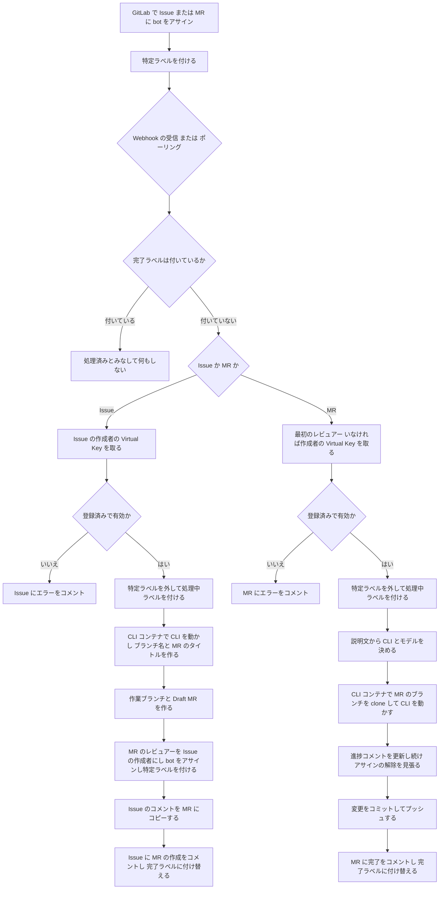
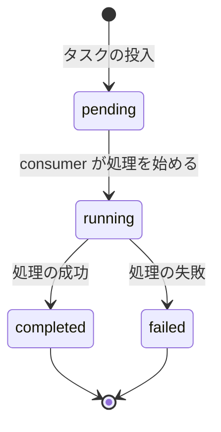
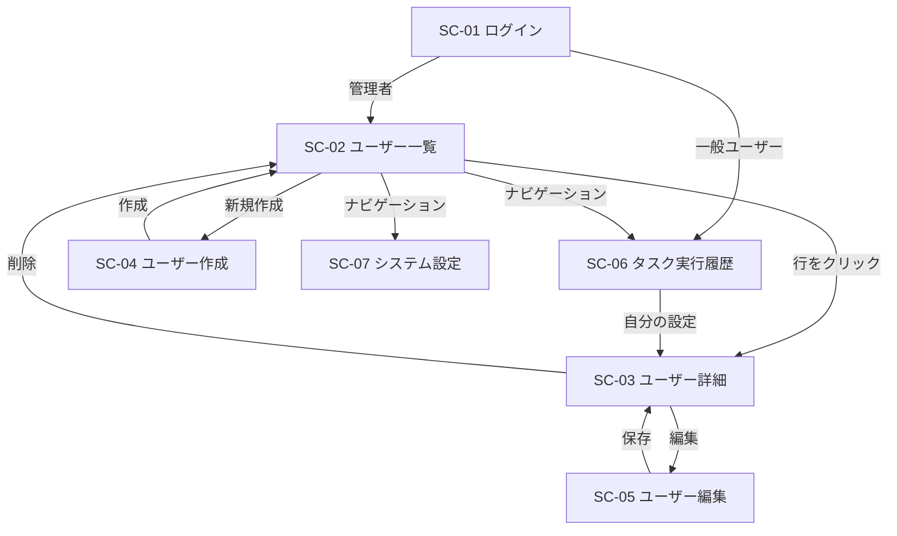

# CodingAgentAutomata 要件定義書

**システム名**: CodingAgentAutomata

この要件定義書は、2026-11-01 に既存のコード（コミット `3a275d0`）から逆引きで書き起こし、同日に Zscaler 環境対応の変更要件（`.history/20261101-zscaler-support/change_requirements.md`）を反映したもの。コードの現状の動作を書いている。既存の文書との食い違いと不具合の可能性は `.history/BACKLOG.md` に記録している。

---

## 1. 目的・前提

### 1.1 システムの目的

GitLab の Issue と Merge Request（以下、MR）に、bot のアサインと特定ラベルの付与を合図として、CLI のコーディングエージェント（以下、CLI エージェント）をコンテナの中で自動で起動し、コードの実装・テスト・コミットを自動で行う。使う CLI エージェントは CLI アダプタ設定で切り替え、特定の CLI エージェントに依存しない。各処理に使う LLM の費用は、LiteLLM の Virtual Key で利用者ごとに分けて管理する。

### 1.2 用語集

| 用語 | 業務上の意味 | 本案件での使用範囲 | 同義語/類義語 |
|---|---|---|---|
| bot | 本システムが操作に使う GitLab のアカウント。Personal Access Token（PAT）で認証する | 全体 | ボット |
| bot アサイン | GitLab の Issue／MR のアサイニーに bot を指定する操作 | Issue 処理、MR 処理 | — |
| 特定ラベル | bot の処理対象を示す GitLab のラベル。既定は `coding agent` | Issue 処理、MR 処理 | トリガーラベル |
| 処理中ラベル | 処理中を示すラベル。既定は `coding agent processing` | Issue 処理、MR 処理 | — |
| 完了ラベル | 処理の完了を示すラベル。既定は `coding agent done` | Issue 処理、MR 処理 | — |
| Issue 処理 | 特定ラベル付きの Issue から、作業ブランチと Draft MR を自動で作る処理（F-3） | consumer | Issue→MR 変換 |
| MR 処理 | 特定ラベル付きの MR の説明文の指示に従い、CLI でコード作業を自動で行う処理（F-4） | consumer | — |
| LiteLLM Proxy | 複数の LLM を 1 つの入口で提供するプロキシ | CLI、backend | — |
| Virtual Key | LiteLLM Proxy が出す利用者ごとの API キー。費用の追跡と按分に使う | 全体 | LLM キー |
| CLI エージェント | 本システムが使う CLI のコーディングエージェントの総称（Claude Code、opencode など） | CLI コンテナ | — |
| CLI エージェント ID | CLI エージェントを識別する文字列。管理者が CLI アダプタ設定で決める | 全体 | cli_id |
| CLI アダプタ設定 | CLI エージェント ID ごとの、コンテナイメージ・起動コマンドのテンプレート・CLI への情報の渡し方の設定 | consumer、管理画面 | — |
| Claude Code | Anthropic の CLI エージェント。CLI エージェント ID は `claude` | 組み込みのアダプタ | — |
| opencode | OSS の CLI エージェント。CLI エージェント ID は `opencode` | 組み込みのアダプタ | — |
| CLI コンテナ | consumer が Docker で起動する CLI 専用の単発のコンテナ。中で Docker デーモンを動かせる | F-3、F-4 | cli-exec コンテナ |
| producer | GitLab の Issue／MR を見つけてタスクをキューに入れる部品 | 全体 | — |
| consumer | キューのタスクを受け取り、CLI コンテナで Issue 処理と MR 処理を行う部品 | 全体 | — |
| Webhook | GitLab が出来事のたびに本システムへ HTTP で知らせる仕組み（Group Webhook を使う） | producer | — |
| ポーリング | 本システムが GitLab の API を一定間隔で呼んで Issue／MR を見つける仕組み | producer | — |
| username | GitLab のユーザー名。本システムのユーザーの識別子にも同じ値を使う | 全体 | — |
| タスク | 1 件の Issue 処理または MR 処理の実行単位。待機中・実行中・完了・失敗の状態を持つ | producer、consumer、管理画面 | — |
| エージェント指定 | MR の説明文の `agent:` の行で、使う CLI エージェントとモデルを上書きする書き方 | MR 処理 | — |
| 進捗コメント | MR 処理の間、CLI の出力を一定間隔で書き換え続ける MR の 1 件のコメント | MR 処理 | — |
| テスト環境 | GitLab CE、LiteLLM Proxy、モック LLM を含め、本システムの動作を確かめるために作る環境 | 開発 | — |
| モック LLM | 実際の LLM の代わりに決まった応答を返すテスト用のサーバー | テスト環境 | — |
| Zscaler | 社内のネットワークで通信を検査するサービス。暗号化された通信を一度解き、自前のルート証明書で署名し直した証明書を返す | 社内の Linux サーバーから外へ出るすべての通信 | SSL 検査、TLS 検査 |
| Zscaler の証明書 | Zscaler が署名し直しに使うルート証明書（必要に応じて中間証明書を含む）。PEM 形式のファイルで管理者が受け取る | 本システムのすべての部品が信頼する証明書 | 社内の認証局の証明書 |
| 証明書の束 | Zscaler の証明書と、公開の認証局の証明書をまとめたもの | 各部品が通信を検証するときに使う信頼先 | CA バンドル |
| Zscaler 設定 | Zscaler 環境で動かすための設定のまとまり。有効・無効のスイッチ、プロキシの宛先、社内の除外宛先からなる | `.env` に書く | なし |
| プロキシの宛先 | 外へ出る通信を送る Zscaler のプロキシのホスト名とポート | Zscaler 設定の一部 | プロキシ URL |
| 除外宛先 | プロキシを経由させない宛先。本システムの部品どうしの名前と、社内のシステム（社内の GitLab、社内の LLM のプロキシなど） | Zscaler 設定が有効なときのすべての部品 | NO_PROXY |
| 使用前の接続確認 | ビルドと起動の前に、プロキシの宛先を経由して外部の HTTPS につなぎ、証明書の束で証明書を検証できるかを確かめる処理 | Zscaler 設定が有効なとき | なし |
| 模擬プロキシ | Zscaler の役をするテスト用のプロキシ。明示型で通信を受け、自前の認証局で署名し直した証明書を返す | テスト環境のみ | Zscaler の模擬 |
| ローカル専用のイメージ名 | 外部のレジストリの名前（ghcr.io など）を含まない、手元でだけ使うコンテナイメージ名 | docker compose がビルドするイメージ | なし |

### 1.3 システムの形態

- GUI: Web 管理画面（ユーザー管理、タスク実行履歴、システム設定）
- Web API: 管理画面用の API、GitLab からの Webhook の受け口
- バッチ: ポーリング、キューのタスクの処理
- CUI: 初期セットアップ、CLI イメージのビルド、テスト環境の構築

### 1.4 前提（Zscaler 環境）

- 社内の Zscaler は明示型のプロキシである。外へ出る通信は、宛先（ホスト名とポート）を指定したプロキシを経由する。
- Zscaler のプロキシは ID とパスワードによる認証を求めない。
- Zscaler は外部連携として扱わない。Zscaler との実接続での事前調査は行わず、Zscaler の振る舞い（証明書の差し替え）は模擬のプロキシで再現して確かめる。
- CLI コンテナの中で CLI エージェントが起動するコンテナとビルド（対象リポジトリのテストなど）には、本システムはプロキシの宛先と除外宛先だけを渡し、証明書は差し込まない。CLI エージェントへの指示によって、対象リポジトリ自身が証明書と宛先を扱えるようにする。
- Playwright の Firefox は、起動のたびに新しい設定で立ち上がり、追加の証明書を信頼させる方法が無い。証明書のエラーを無視する以外に手段が無く、証明書の検証を無効にしない方針と両立しないため、CLI コンテナのブラウザの対象から外す。

### 1-1. 技術制約

| 制約項目 | 内容 | 出どころ（誰がいつ答えたか） |
|---|---|---|
| 既存コードベース | Python 3.12（FastAPI、SQLAlchemy、aiohttp、python-gitlab、pika、Docker SDK）、TypeScript（Vue 3、Vuetify 3）、PostgreSQL 16、RabbitMQ 3.13、docker compose | コード（2026-11-01） |
| 配備先 | 社内の Linux サーバー（Docker Engine）。ユーザーの選択（理由: 常時gitlabのissueを監視して自動的にコーディングを進めるため） | ユーザー、2026-11-01 |
| チームの技術 | 特に無い（今の Python・TypeScript・Vue・Docker を引き継ぐ） | ユーザー、2026-11-01 |
| ライセンスとコスト | 特に無い（有償ソフトは使わない） | ユーザー、2026-11-01 |
| 性能と規模の目安 | 第 5 章のとおり | 既存の要件定義書 |

---

## 2. 業務

| RQ-BZ-ID | 業務名 | 業務の範囲 | 担当者 |
|---|---|---|---|
| `RQ-BZ-ISSUE-TO-MR` | Issue→MR 変換処理 | bot アサインと特定ラベルの付いた Issue から、作業ブランチと Draft MR を作る | GitLab の開発者、bot |
| `RQ-BZ-MR-IMPLEMENTATION` | MR コード実装処理 | bot アサインと特定ラベルの付いた MR の説明文の指示に従い、CLI でコードを変えてプッシュする | GitLab の開発者、bot |
| `RQ-BZ-USER-KEY-MANAGEMENT` | ユーザー・Virtual Key 管理 | 開発者ごとの GitLab ユーザー名、Virtual Key、CLI の設定、プロンプトのテンプレート、CLI アダプタを Web 管理画面で管理する | システム管理者、開発者 |
| `RQ-BZ-SYSTEM-BUILD-OPERATION` | 本システムの構築・運用 | 社内の Linux サーバーの準備と Zscaler 設定、本システムの起動、初期セットアップ、CLI イメージのビルド、テスト環境の構築と動作確認、イメージの公開 | システム管理者、本システムの開発者 |
| `RQ-BZ-ZSCALER-COMPAT-TEST` | Zscaler 環境での動作確認 | 社外の開発環境で、模擬プロキシを使って本システムの構築と処理を確かめる | 本システムの開発者 |

### 2-1. 業務の問題

| 問題 | 対象業務（RQ-BZ） | あるべき姿 | 現状 | ギャップ（KPI） | 業務影響 |
|---|---|---|---|---|---|
| コード実装の手作業の工数が大きく、リードタイムが長い | `RQ-BZ-MR-IMPLEMENTATION` | MR の指示から実装・テスト・プッシュまでが自動で終わる | 開発者が手で実装する | MR 処理の自動完了率（目標 70% 以上） | 開発者が設計やレビューに専念できない |
| 複数の開発者が同じ LLM の API を使うと、費用の帰属が分からない | `RQ-BZ-USER-KEY-MANAGEMENT` | 利用者ごとに LLM の費用を追える | 費用が混ざる | Virtual Key 別の費用の追跡率（目標 100%） | 費用を管理できない |
| Issue からブランチと MR を作るまでに手作業がある | `RQ-BZ-ISSUE-TO-MR` | Issue に bot を付けるだけでブランチと MR ができる | 開発者が手で作る | Issue→MR の自動変換率（目標 100%） | 実装に着手するまでに時間がかかる |
| 変更のたびに手で動作確認をすると時間がかかり、確認漏れが出る | `RQ-BZ-SYSTEM-BUILD-OPERATION` | 実際の LLM の API キー無しで、社外でも本システムの動作を自動で確かめられる | GitLab や LLM を用意しないと確かめられない | 自動で確かめられる利用シナリオの割合（目標 100%） | 不具合に気づくのが遅れる |
| 社内の Zscaler 環境では本システムを構築も利用もできない | `RQ-BZ-SYSTEM-BUILD-OPERATION` | Zscaler の配下でも、本システムを構築でき、Issue→MR 変換と MR 処理が社外と同じように完了する | Zscaler が差し替えた証明書を各部品が信頼できず、ビルド中のパッケージ取得と、実行時の GitLab API・LLM・git clone の通信が失敗する | Zscaler 環境でのビルドと起動の成功率 0%（目標 100%）。Zscaler 環境での Issue→MR 変換と MR 処理の完了率 0%（目標は社外と同じ水準） | 社内の開発者が本システムによる自動化を使えない |
| 社外の開発環境では Zscaler 環境での動作を確かめられない | `RQ-BZ-ZSCALER-COMPAT-TEST` | 社内へ持ち込む前に、Zscaler 環境で起きる失敗を社外で再現して確かめられる | 開発環境は Zscaler の配下に無く、証明書の差し替えもプロキシの経由も起きない | 社外で確かめられる Zscaler 環境の失敗の種類 0 件（目標: 証明書の信頼、除外宛先、プロキシの経由のすべて） | 社内で初めて動かすときまで不具合が分からない |
| 社内用のイメージが社外へ出るおそれがある | `RQ-BZ-SYSTEM-BUILD-OPERATION` | Zscaler の証明書を含むイメージは手元でだけ使われる | docker compose のイメージ名が ghcr.io の名前で、誤って push すると社内用のイメージが公開される | 誤って公開できる経路 1 つ（目標 0） | 社内の証明書を含むイメージが公開される |

### 2-2. 業務課題一覧

| RQ-BK-ID | 業務課題（取り組むこと） | 解決する問題（2-1） | 解決後の状態（KPI の目標値） | 対象業務（RQ-BZ） |
|---|---|---|---|---|
| `RQ-BK-MR-AUTO-IMPLEMENTATION` | MR の説明文を指示として CLI を自動で起動し、コード変更・テスト・プッシュを行う | コード実装の手作業の工数 | MR 処理の自動完了率 70% 以上 | `RQ-BZ-MR-IMPLEMENTATION` |
| `RQ-BK-LLM-COST-ALLOCATION` | 利用者ごとに Virtual Key を登録し、CLI の実行時にその利用者のキーを渡す | 費用の帰属が分からない | Virtual Key 別の費用の追跡率 100% | `RQ-BZ-USER-KEY-MANAGEMENT` |
| `RQ-BK-ISSUE-TO-MR-AUTOMATION` | Issue から CLI でブランチ名と MR のタイトルを作り、ブランチと MR を自動で作る | Issue から MR までの手作業 | Issue→MR の自動変換率 100% | `RQ-BZ-ISSUE-TO-MR` |
| `RQ-BK-AUTOMATED-VERIFICATION` | 本システムの動作を、実際の LLM の API キー無しで、社外でも自動で確かめられるようにする | 手での動作確認の時間と確認漏れ | 第 7 章の利用シナリオをすべて自動で実行できる | `RQ-BZ-SYSTEM-BUILD-OPERATION` |
| `RQ-BK-ZSCALER-CERT-TRUST` | 外へ出るすべての通信を Zscaler のプロキシ経由にし、Zscaler の証明書を必ず信頼して検証させる。Zscaler 設定は既定で必須とし、明示したときだけ外せる | 社内の Zscaler 環境では本システムを構築も利用もできない | Zscaler 環境でのビルドと起動の成功率 100%。Issue→MR 変換と MR 処理の完了率が社外と同じ水準 | `RQ-BZ-SYSTEM-BUILD-OPERATION` |
| `RQ-BK-ZSCALER-MOCK-VERIFICATION` | Zscaler の役をする模擬プロキシを用意し、社外で Zscaler 環境での動作を確かめられるようにする | 社外の開発環境では Zscaler 環境での動作を確かめられない | 証明書の信頼、除外宛先、プロキシの経由の失敗を、社外ですべて再現して確かめられる | `RQ-BZ-ZSCALER-COMPAT-TEST` |
| `RQ-BK-INTERNAL-IMAGE-CONTAINMENT` | Zscaler の証明書を含むイメージを社外のレジストリへ出さない | 社内用のイメージが社外へ出るおそれがある | 誤って公開できる経路 0 | `RQ-BZ-SYSTEM-BUILD-OPERATION` |

### 2-3. 見込み経営効果

| RQ-EF-ID | 効果の種類 | 内容 | 見込み（金額・時間などと算定根拠） | 対応業務課題ID（RQ-BK-*） |
|---|---|---|---|---|
| `RQ-EF-SOFT-SAVING-MANUAL-IMPLEMENTATION` | Soft Saving | Issue 発生後のブランチ作成・コード実装・テスト実行・コミットの手作業の工数を減らす | 算定しない（数値の根拠が無いため） | `RQ-BK-MR-AUTO-IMPLEMENTATION`、`RQ-BK-ISSUE-TO-MR-AUTOMATION` |
| `RQ-EF-COST-AVOIDANCE-LLM-OVERRUN` | Cost Avoidance | 利用者ごとの費用の追跡で、LLM の費用の超過を早く見つけ、予算の超過を防ぐ | 算定しない（同上） | `RQ-BK-LLM-COST-ALLOCATION` |
| `RQ-EF-TCO-SAVINGS-DEV-PRODUCTIVITY` | TCO Savings | 開発者がレビューや設計に専念でき、開発全体の生産性が上がる | 算定しない（同上） | `RQ-BK-MR-AUTO-IMPLEMENTATION` |
| `RQ-EF-SOFT-SAVING-INHOUSE-DEVELOPERS` | Soft Saving | 既存の効果（Issue 発生後のブランチ作成・コード実装・テスト実行・コミットの手作業工数の削減）が、社内の Zscaler 環境の開発者にも及ぶ | 算定しない（社内で使う人数がまだ決まっていないため） | `RQ-BK-ZSCALER-CERT-TRUST` |

---

## 3. 機能要件

### 3.1 入力データと出力データ

| データ | 種別 | 説明 |
|---|---|---|
| Webhook のペイロード | 外部（GitLab） | Issue／MR の作成・更新のイベントの JSON |
| GitLab API のレスポンス | 外部（GitLab） | ポーリングの Issue／MR の一覧、各詳細、コメント、プロジェクト、ユーザー |
| MR の説明文 | 外部（GitLab の開発者） | CLI への作業の指示。エージェント指定を含むことがある |
| 管理者の入力 | 人手（管理画面） | ユーザー、Virtual Key、デフォルトの CLI とモデル、テンプレート、MCP 設定、CLI アダプタ |
| Zscaler の証明書ファイル | 人手（管理者） | PEM 形式のファイル。プロジェクト直下の決まった場所に置く。ルート証明書と中間証明書を 1 ファイルにまとめてよい |
| ホストの OS の証明書の束 | ホストの OS | 証明書ファイルが無いときに使う。管理者がホストの準備で Zscaler の証明書を入れておく |
| Zscaler 設定 | 人手（管理者） | `.env` に書く。有効・無効のスイッチ、プロキシの宛先、社内の除外宛先 |

| データ | 出力先 | 説明 |
|---|---|---|
| 作業ブランチ | GitLab | Issue 処理で CLI が作ったブランチ名で、`main` から作る |
| Draft MR | GitLab | Issue 処理で CLI が作ったタイトル。レビュアーは Issue の作成者、アサインは bot、特定ラベル付き |
| GitLab へのコメント | GitLab | 3-1 のとおり |
| コミットとプッシュ | GitLab | MR 処理で CLI が行ったコードの変更 |
| ラベルの更新 | GitLab | 処理の状態に応じたラベルの付け替え |

### 3.2 ユーザー利用フローと業務フローの対応

利用フローは 2 章の業務フローのとおり（管理者が SC-04 でユーザーを登録してから、開発者が Issue に bot とラベルを付ける）。

| 業務 | 使う機能 |
|---|---|
| Issue→MR 変換処理 | Webhook の受信、ポーリング、タスクの投入、Issue→MR 変換、CLI 実行環境の管理、CLI アダプタの解決、プロンプトの生成、MCP 設定の組み立て、CLI のタイムアウト |
| MR コード実装処理 | Webhook の受信、ポーリング、タスクの投入、MR 処理、エージェント指定、CLI 実行環境の管理、CLI アダプタの解決、プロンプトの生成、MCP 設定の組み立て、進捗報告、アサイン解除の監視、CLI のタイムアウト、CLI ログのマスク、TTY 入力待機検知 |
| ユーザー・Virtual Key 管理 | ログイン、権限の制御、ユーザー管理、Virtual Key の管理、LLM キーの検証、モデル候補の取得、CLI アダプタ管理、システム設定の管理、タスク実行履歴 |
| 本システムの構築・運用 | 証明書の束の決定、除外宛先の組み立て、ビルド時・実行時の Zscaler 設定の適用、CLI コンテナへの Zscaler 設定の受け渡し、CLI コンテナでの Playwright の標準のブラウザの起動、CLI コンテナのブラウザへの Zscaler 設定の適用、CLI エージェントへの Zscaler の指示、セットアップ用スクリプトのホストでの Zscaler 設定の適用、イメージ名の分離、DB の自動移行、初期セットアップ、CLI イメージのビルド、consumer の停止の待ち合わせ、テスト環境の構築、モック LLM、CLI コンテナの起動時間の計測、イメージの公開、設計とコードの対応の確認 |
| Zscaler 環境での動作確認 | 模擬プロキシ、模擬プロキシ付きのテスト環境セットアップのコマンド、および構築・運用の機能のすべて |

### 3.3 機能一覧

| RQ-ID | カテゴリ | 機能名 | 内容（現状の動作） | 対応業務課題ID（RQ-BK-*） | この機能が無いと何が困るか |
|---|---|---|---|---|---|
| `RQ-FT-RECEIVE-WEBHOOK` | 外部連携 | Webhook の受信 | `POST /webhook` で GitLab の Issue と MR のイベントを受ける。トークンを確かめ、本文が壊れていても 200 を返す | `RQ-BK-MR-AUTO-IMPLEMENTATION`、`RQ-BK-ISSUE-TO-MR-AUTOMATION` | 出来事をすぐに拾えず、処理が遅れる |
| `RQ-FT-POLL-GITLAB` | 業務機能 | ポーリング | 一定間隔（既定 30 秒）で、全プロジェクトから bot にアサインされ特定ラベルの付いた open の Issue と MR を取る | `RQ-BK-MR-AUTO-IMPLEMENTATION`、`RQ-BK-ISSUE-TO-MR-AUTOMATION` | Webhook が届かないときに処理対象を拾えない |
| `RQ-FT-SUPPRESS-DUPLICATE-WEBHOOK` | 外部連携 | Webhook の重複受信の抑止 | `X-Idempotency-Key` の値を最大 10,000 件メモリに覚え、同じ値の再送は処理しない（GitLab の実際のヘッダー名と違うため、現状は効かない） | `RQ-BK-MR-AUTO-IMPLEMENTATION`、`RQ-BK-ISSUE-TO-MR-AUTOMATION` | 同じ出来事の再送で余計な判定が走る |
| `RQ-FT-ENQUEUE-TASK` | 業務機能 | タスクの投入 | 処理対象と判定したら、tasks に待機中の行を作り、キューにメッセージを送る | `RQ-BK-MR-AUTO-IMPLEMENTATION`、`RQ-BK-ISSUE-TO-MR-AUTOMATION` | consumer に処理を渡せない |
| `RQ-FT-CONVERT-ISSUE-TO-MR` | 業務機能 | Issue→MR 変換（F-3） | Issue を材料に CLI を 1 回実行してブランチ名と MR のタイトルを得て、`main` からブランチを作り、Draft MR を作り、Issue のコメントを MR にコピーし、完了のコメントとラベルの付け替えを行う。Issue は閉じない | `RQ-BK-ISSUE-TO-MR-AUTOMATION` | Issue からブランチと MR を手で作り続けることになる |
| `RQ-FT-PROCESS-MR` | 業務機能 | MR 処理（F-4） | MR のブランチを CLI コンテナに clone し、説明文の指示で CLI を動かし、プッシュする。開始と完了のコメントとラベルの付け替えを行う | `RQ-BK-MR-AUTO-IMPLEMENTATION` | MR の指示を手で実装することになる |
| `RQ-FT-OVERRIDE-CLI-MODEL` | 業務機能 | エージェント指定 | MR の説明文の `agent:` の行に書いた CLI エージェントとモデルを、その MR 処理に使う | `RQ-BK-MR-AUTO-IMPLEMENTATION` | MR ごとに CLI やモデルを変えられない |
| `RQ-FT-RUN-CLI-CONTAINER` | 業務機能 | CLI 実行環境の管理（F-5） | CLI ごとのイメージで、特権の単発コンテナを consumer と同じネットワークで起動し、プロンプトと起動コマンドをファイルで渡し、終わったら破棄する。consumer の起動時に各イメージのウォームアップを行う | `RQ-BK-MR-AUTO-IMPLEMENTATION`、`RQ-BK-ISSUE-TO-MR-AUTOMATION` | CLI をホストから隔てて動かせない |
| `RQ-FT-RESOLVE-CLI-ADAPTER` | 業務機能 | CLI アダプタの解決 | CLI アダプタ設定から、CLI に渡す環境変数（Virtual Key、LLM の URL、モデル、MCP 設定）と起動コマンドを組み立てる | `RQ-BK-MR-AUTO-IMPLEMENTATION`、`RQ-BK-ISSUE-TO-MR-AUTOMATION`、`RQ-BK-LLM-COST-ALLOCATION` | CLI エージェントごとの渡し方の違いをコアの処理で扱うことになる |
| `RQ-FT-BUILD-PROMPT` | 業務機能 | プロンプトの生成 | F-3・F-4 のテンプレート（F-4 はユーザー個別のものを優先）の変数を展開する。F-4 で必須の情報がテンプレートに無ければ末尾に足す | `RQ-BK-MR-AUTO-IMPLEMENTATION`、`RQ-BK-ISSUE-TO-MR-AUTOMATION` | CLI への指示を作れない |
| `RQ-FT-BUILD-MCP-CONFIG` | 業務機能 | MCP 設定の組み立て | システムの MCP 設定（ユーザーが有効にしている場合）とユーザー個別の MCP 設定をまとめて CLI に渡す（F-3 と F-4 で形が違う） | `RQ-BK-MR-AUTO-IMPLEMENTATION`、`RQ-BK-ISSUE-TO-MR-AUTOMATION` | CLI が外部のツールを使えない |
| `RQ-FT-REPORT-PROGRESS` | 業務機能 | 進捗報告（F-8） | MR 処理の間、CLI の出力を溜め、一定間隔（既定 60 秒）で MR の 1 件のコメントを作成・更新する | `RQ-BK-MR-AUTO-IMPLEMENTATION` | 実行状況と成否が開発者に見えない |
| `RQ-FT-MONITOR-BOT-ASSIGNMENT` | 業務機能 | アサイン解除の監視 | MR 処理の間、進捗と同じ間隔で MR のアサインを確かめ、bot が外れたら CLI を止めてコメントし、失敗にする | `RQ-BK-MR-AUTO-IMPLEMENTATION` | 開発者が処理を途中で止められない |
| `RQ-FT-ENFORCE-CLI-TIMEOUT` | 業務機能 | CLI のタイムアウト | CLI の実行が上限（既定 3 時間）を超えたら、止めてコメントし、失敗にする | `RQ-BK-MR-AUTO-IMPLEMENTATION`、`RQ-BK-ISSUE-TO-MR-AUTOMATION` | CLI が止まらないとタスクが終わらない |
| `RQ-FT-MASK-CLI-LOG` | 共通 | CLI ログのマスク | URL に埋め込まれたトークンを `****` に置き換えてからログを保存する（F-4 のみ） | `RQ-BK-MR-AUTO-IMPLEMENTATION` | PAT がタスクの履歴に残る |
| `RQ-FT-DETECT-TTY-WAIT` | 業務機能 | TTY 入力待機検知（F-11） | eBPF と Tracee で CLI コンテナの端末からの読み込みを検知する部品と、eBPF の使える条件の判定の部品がある。現状はタスクの処理に組み込まれていない | `RQ-BK-MR-AUTO-IMPLEMENTATION` | CLI が入力待ちで止まったときに気づけない |
| `RQ-FT-GRACEFUL-SHUTDOWN` | 運用 | consumer の停止の待ち合わせ | 停止の合図を受けたら新しいタスクを受け取らず、処理中のタスクが終わってから止まる。停止中は GitLab へのコメントとラベルの変更を省く | `RQ-BK-MR-AUTO-IMPLEMENTATION`、`RQ-BK-ISSUE-TO-MR-AUTOMATION` | 更新のたびに処理中のタスクが壊れる |
| `RQ-FT-AUTHENTICATE-USER` | 共通 | ログイン | ユーザー名とパスワードで認証し、24 時間有効の JWT を出す | `RQ-BK-LLM-COST-ALLOCATION` | 管理画面を誰でも使えてしまう |
| `RQ-FT-AUTHORIZE-BY-ROLE` | 共通 | 権限の制御 | 管理者は全機能・全ユーザー、一般ユーザーは自分の情報と自分のタスクだけを扱える。無効化されたユーザーは使えない | `RQ-BK-LLM-COST-ALLOCATION` | 他人のキーや設定を見たり変えたりできてしまう |
| `RQ-FT-MANAGE-USERS` | マスタ管理 | ユーザー管理（F-6） | ユーザーの一覧（前方一致の検索、20 件ずつ）・作成・参照・更新（管理者用と本人用）・削除 | `RQ-BK-LLM-COST-ALLOCATION` | GitLab のユーザーと Virtual Key を結びつけられない |
| `RQ-FT-ENCRYPT-VIRTUAL-KEY` | マスタ管理 | Virtual Key の管理（F-7） | Virtual Key を AES-256-GCM で暗号化して保存し、使う直前だけ復号する。画面には末尾 4 文字だけを出す | `RQ-BK-LLM-COST-ALLOCATION` | キーが漏れる |
| `RQ-FT-VALIDATE-LLM-KEY` | マスタ管理 | LLM キーの検証（F-13） | 管理者が Virtual Key を更新するとき、LiteLLM に問い合わせて有効か確かめ、無効なら保存しない（LiteLLM に接続できないときは有効とみなす） | `RQ-BK-LLM-COST-ALLOCATION` | 無効なキーが保存され、CLI の実行時に失敗する |
| `RQ-FT-SUGGEST-MODEL-CANDIDATES` | マスタ管理 | モデル候補の取得 | 対象ユーザーの Virtual Key で LiteLLM のモデル一覧を取り、ユーザー編集画面の候補にする。取れなければ空にする | `RQ-BK-LLM-COST-ALLOCATION` | 使えるモデル名を調べて手で入れることになる |
| `RQ-FT-MANAGE-CLI-ADAPTERS` | マスタ管理 | CLI アダプタ管理 | CLI アダプタ設定の一覧・追加・更新・削除 | `RQ-BK-MR-AUTO-IMPLEMENTATION`、`RQ-BK-ISSUE-TO-MR-AUTOMATION` | CLI エージェントを追加・変更できない |
| `RQ-FT-MANAGE-SYSTEM-SETTINGS` | マスタ管理 | システム設定の管理 | F-3・F-4 のテンプレートとシステムの MCP 設定の参照と更新 | `RQ-BK-MR-AUTO-IMPLEMENTATION`、`RQ-BK-ISSUE-TO-MR-AUTOMATION` | CLI への指示を運用で直せない |
| `RQ-FT-LIST-TASK-HISTORY` | 運用 | タスク実行履歴 | タスクの一覧（ユーザー名・状態・種別で絞り込み、新しい順に 20 件ずつ） | `RQ-BK-LLM-COST-ALLOCATION`、`RQ-BK-MR-AUTO-IMPLEMENTATION` | 処理の結果と費用の使い手を確かめられない |
| `RQ-FT-MIGRATE-DB-ON-STARTUP` | 運用 | DB の自動移行 | backend の起動時に DB の構造を最新にする。失敗したら起動しない | `RQ-BK-LLM-COST-ALLOCATION` | DB の構造の更新を手で行うことになる |
| `RQ-FT-SETUP-INITIAL-DATA` | 運用 | 初期セットアップ | 組み込みの CLI アダプタ（claude・opencode）の登録と同期、F-3・F-4 のテンプレートの投入（既にあれば上書きしない）、最初の管理者の作成 | `RQ-BK-LLM-COST-ALLOCATION`、`RQ-BK-MR-AUTO-IMPLEMENTATION` | 初回の起動のあと、何も使えない |
| `RQ-FT-BUILD-CLI-IMAGES` | 運用 | CLI イメージのビルド | Claude Code 用と opencode 用の CLI コンテナのイメージを作る | `RQ-BK-MR-AUTO-IMPLEMENTATION`、`RQ-BK-ISSUE-TO-MR-AUTOMATION` | CLI コンテナを起動できない |
| `RQ-FT-SETUP-TEST-ENVIRONMENT` | 運用 | テスト環境の構築 | テスト環境を一括で作る（サービスの起動、GitLab の初期化、bot・グループ・プロジェクト・ラベル・Group Webhook・テストユーザーの準備、Virtual Key の発行、管理画面のユーザーの登録）。指定すれば E2E を実行する | `RQ-BK-AUTOMATED-VERIFICATION` | 動作確認のたびに環境を手で作ることになる |
| `RQ-FT-PROVIDE-MOCK-LLM` | 運用 | モック LLM | OpenAI 互換・Anthropic 互換の LLM の API と、LiteLLM のキー管理の API の真似をする | `RQ-BK-AUTOMATED-VERIFICATION` | 実際の LLM の API キーと費用が無いと確かめられない |
| `RQ-FT-MEASURE-CLI-CONTAINER-STARTUP` | 運用 | CLI コンテナの起動時間の計測 | 特権の CLI コンテナの起動の各段階の時間と、ウォームアップの効果を測る（開発用の道具） | `RQ-BK-AUTOMATED-VERIFICATION` | 起動の遅れの原因を調べられない |
| `RQ-FT-CHECK-TRACEABILITY` | 運用 | 設計とコードの対応の確認 | 詳細設計書・対応表（`docs/trace_map.md`）・コードを突き合わせ、壊れた参照があればコミットを止め、未登録の要素を知らせる。実装の完了に必要なもの（compose・E2E・README・対応表）がそろっているかも確かめる | `RQ-BK-AUTOMATED-VERIFICATION` | 設計とコードがずれても気づけない |
| `RQ-FT-PUBLISH-COMPONENT-IMAGES` | 運用 | イメージの公開 | main などへの push で、backend・frontend・producer・consumer・mock-llm のイメージを ghcr.io に作って公開する | `RQ-BK-AUTOMATED-VERIFICATION` | 変更のたびにビルドが通るかを確かめられず、イメージも配れない |
| `RQ-FT-RESOLVE-CERT-BUNDLE` | 共通 | 証明書の束の決定 | Zscaler 設定が有効なとき、プロジェクト直下の決まった場所の証明書ファイルを公開の認証局の証明書と合わせて証明書の束にする。ファイルが無ければ、ホストの OS の証明書の束を使う | `RQ-BK-ZSCALER-CERT-TRUST` | 各部品が信頼する証明書が決まらず、Zscaler の証明書を信頼できない |
| `RQ-FT-BUILD-NO-PROXY-LIST` | 共通 | 除外宛先の組み立て | Zscaler 設定が有効なとき、本システムの部品の名前（`localhost`・`127.0.0.1` と、docker compose のサービス名のすべて）を自動で除外宛先に入れ、管理者が書いた社内の除外宛先を足す | `RQ-BK-ZSCALER-CERT-TRUST` | ユーザーの選択（理由: 管理者が部品を書き漏らす可能性があるため） |
| `RQ-FT-APPLY-ZSCALER-SETTINGS-BUILD` | 業務機能 | ビルド時の Zscaler 設定の適用 | Zscaler 設定が有効なとき、本システムのイメージ（backend、producer、consumer、frontend のビルド段、CLI コンテナ 2 種）のビルドで、外へ出る最初の処理より前に証明書の束をイメージの OS の信頼先に入れ、ビルド中の通信をプロキシの宛先経由にする。証明書の束はビルド後のイメージにも残る（frontend の配信段は外へ出ないので入れない） | `RQ-BK-ZSCALER-CERT-TRUST` | ビルド中のパッケージ取得が証明書の検証で失敗し、イメージを作れない |
| `RQ-FT-APPLY-ZSCALER-SETTINGS-RUNTIME` | 業務機能 | 実行時の Zscaler 設定の適用 | Zscaler 設定が有効なとき、外へ出る部品（backend、producer、consumer、CLI コンテナ 2 種、実 LLM モードの LiteLLM Proxy、テスト用の Playwright の実行コンテナ）が、使っている通信の仕組みごとに信頼先として証明書の束を使い、プロキシの宛先と除外宛先に従って通信する。ビルド済みのイメージをそのまま使う部品（LiteLLM Proxy、Playwright の実行コンテナ）には、証明書の束を読み取り専用で渡す | `RQ-BK-ZSCALER-CERT-TRUST` | 実行時の GitLab API・LLM・git clone の通信が失敗し、Issue→MR 変換と MR 処理が完了しない |
| `RQ-FT-PASS-ZSCALER-SETTINGS-CLI-CONTAINER` | 業務機能 | CLI コンテナへの Zscaler 設定の受け渡し | Zscaler 設定が有効なとき、consumer は CLI コンテナを起動するたびに、プロキシの宛先と除外宛先を環境変数で渡す。CLI コンテナの中の Docker デーモンもプロキシの宛先を経由してイメージを取得する。CLI コンテナの中で起動するコンテナとビルドには、プロキシの宛先と除外宛先を自動で渡す。この受け渡しは CLI アダプタ設定によらず、すべての CLI エージェントに同じように行う | `RQ-BK-ZSCALER-CERT-TRUST` | CLI エージェントが LLM と GitLab に接続できず、対象リポジトリのテストも外へ出られない |
| `RQ-FT-RUN-STANDARD-BROWSERS-CLI-CONTAINER` | 業務機能 | CLI コンテナでの Playwright の標準のブラウザの起動 | CLI コンテナ 2 種の土台を、Playwright の標準のブラウザ（Chromium 系と WebKit）を Playwright の標準の手順で取得して起動できる Linux にする。既存の CLI コンテナの機能（中の Docker デーモン、Python と uv、Node.js と npm、Playwright、CLI エージェント、追加環境のビルド時埋め込み、TTY 入力待機検知、起動のウォームアップ）は変えない | `RQ-BK-ZSCALER-CERT-TRUST` | ユーザーの選択（理由: 開発するシステムのテストで、Playwright の標準のブラウザの版をそのまま使う必要がある） |
| `RQ-FT-APPLY-ZSCALER-SETTINGS-CLI-BROWSER` | 業務機能 | CLI コンテナのブラウザへの Zscaler 設定の適用 | Zscaler 設定が有効なとき、CLI コンテナの中で Playwright が起動する標準のブラウザ（Chromium 系と WebKit）が、CLI を実行する利用者のもとで Zscaler の証明書を信頼し、プロキシの宛先と除外宛先に従って通信する。ブラウザが OS の証明書の束を見ない場合（Chromium 系）は、ブラウザが使う信頼先に Zscaler の証明書を入れる | `RQ-BK-ZSCALER-CERT-TRUST` | ユーザーの選択（理由: 社内で使うブラウザは基本的にzscalerを設定してあるので、同じ環境である必要がある） |
| `RQ-FT-INSTRUCT-CLI-ZSCALER` | 業務機能 | CLI エージェントへの Zscaler の指示 | Zscaler 設定が有効なとき、consumer は F-3 と F-4 のプロンプトの末尾に決まった文を足す。文の内容は、Zscaler の配下であること、外への通信はプロキシの宛先を経由すること、CLI コンテナ内の証明書の束の場所、開発するシステムの Dockerfile と docker compose の設定に証明書と宛先の扱いを組み込むこと、開発するシステムの部品どうしの通信を除外宛先に入れること、証明書の検証を無効にしないこと、である。CLI コンテナの決まった場所に証明書の束を置く。Zscaler 設定が無効なときは文を足さない。テンプレートの編集状況（システム設定、ユーザー個別の F-4 テンプレート）によらずに足す | `RQ-BK-ZSCALER-CERT-TRUST` | 開発したシステムが Zscaler の配下で動かず、対象リポジトリのテストも社内で失敗する |
| `RQ-FT-APPLY-ZSCALER-SETTINGS-HOST-SCRIPT` | 運用 | セットアップ用スクリプトのホストでの Zscaler 設定の適用 | Zscaler 設定が有効なとき、テスト環境セットアップのスクリプトがホストの Python で行うパッケージの取得に、証明書の束とプロキシの宛先を渡す。ホストの設定は変えない | `RQ-BK-ZSCALER-CERT-TRUST` | 社内の Linux サーバーでテスト環境のセットアップが途中で失敗する |
| `RQ-FT-RUN-ZSCALER-MOCK-PROXY` | 業務機能 | 模擬プロキシ | テスト環境でだけ起動する。明示型のプロキシとして通信を受け、宛先の証明書を、自前の認証局で署名し直した証明書に差し替えて返す。自前の認証局の証明書を、Zscaler の証明書の代わりとして取り出せる。自前の認証局を信頼していない通信は、証明書の検証で失敗する | `RQ-BK-ZSCALER-MOCK-VERIFICATION` | 社外では証明書の差し替えとプロキシの経由が起きず、Zscaler 環境の失敗を再現できない |
| `RQ-FT-SEPARATE-PUBLISHED-IMAGE-NAMES` | 運用 | イメージ名の分離 | docker compose がビルドするイメージは、Zscaler 設定の有効・無効によらず、常にローカル専用のイメージ名にする。ghcr.io のイメージ名は GitHub Actions のビルドだけが使い、GitHub Actions は Zscaler 設定を無効にしてビルドする | `RQ-BK-INTERNAL-IMAGE-CONTAINMENT` | Zscaler の証明書を含むイメージを誤って ghcr.io へ push できてしまう |

### 3-1. 帳票・出力ファイル

| RQ-ID | 帳票・出力名 | 形式 | 出力項目 | 出力のきっかけ | 対応業務課題ID（RQ-BK-*） |
|---|---|---|---|---|---|
| `RQ-UI-GITLAB-COMMENTS` | GitLab へのコメント | GitLab の Markdown | 処理の開始、進捗（直近の出力と全体のログ）、完了（コミットが無いときの注意を含む）、エラー（Task ID と原因）、タイムアウト、強制終了、Issue からのコピー、Draft MR の作成の知らせ | F-3・F-4 の各段階 | `RQ-BK-MR-AUTO-IMPLEMENTATION`、`RQ-BK-ISSUE-TO-MR-AUTOMATION` |

### 3-2. 業務ルール

| RQ-ID | ルール名 | 内容（条件と結果） | 違反時・エラー時の業務上の扱い | 対応業務課題ID（RQ-BK-*） |
|---|---|---|---|---|
| `RQ-FT-JUDGE-TARGET-EVENT` | 処理対象の判定 | bot にアサインされ、特定ラベルがあり、完了ラベルが無い Issue／MR だけを処理する | 処理しない（何も記録しない） | `RQ-BK-MR-AUTO-IMPLEMENTATION`、`RQ-BK-ISSUE-TO-MR-AUTOMATION` |
| `RQ-FT-PREVENT-DUPLICATE-TASK` | 重複処理の防止（F-10） | 同じプロジェクト・IID・種別で、待機中か実行中のタスクがあれば、新しいタスクを作らない。DB の制約でも守る。F-4 は、受け取ったタスクがすでに完了か失敗なら何もしない | 投入しない | `RQ-BK-MR-AUTO-IMPLEMENTATION`、`RQ-BK-ISSUE-TO-MR-AUTOMATION` |
| `RQ-FT-DETERMINE-TASK-USER` | タスクの対象ユーザーの決定 | Issue は作成者。MR は最初のレビュアー、いなければ作成者 | — | `RQ-BK-LLM-COST-ALLOCATION` |
| `RQ-FT-REJECT-UNREGISTERED-USER` | 未登録・無効ユーザーの拒否 | 対象ユーザーが未登録か無効化されていれば処理しない | Issue／MR にエラーをコメントし、タスクを失敗にする | `RQ-BK-LLM-COST-ALLOCATION` |
| `RQ-FT-TRANSITION-LABELS` | ラベルの付け替え | 処理を始めるとき特定ラベルを外して処理中ラベルを付ける。成功したら処理中ラベルを外して完了ラベルを付ける。失敗したら処理中ラベルだけを外す | — | `RQ-BK-MR-AUTO-IMPLEMENTATION`、`RQ-BK-ISSUE-TO-MR-AUTOMATION` |
| `RQ-FT-JUDGE-MR-COMPLETION` | MR 処理の成否の判定 | CLI の終了コードが 0 以外なら失敗。0 でも、CLI が「何もしない」の定型句を出し、コミットも未コミットの変更も無ければ失敗。コミットが無いだけなら完了にして注意を書く | 失敗としてコメントする | `RQ-BK-MR-AUTO-IMPLEMENTATION` |
| `RQ-FT-VALIDATE-USER-INPUT` | ユーザーの入力チェック | ユーザー名とメールは重複させない。ロールは admin か user。本人がパスワードを変えるときは現在のパスワードが要る | 画面にエラーを出して保存しない | `RQ-BK-LLM-COST-ALLOCATION` |
| `RQ-FT-RESTRICT-ADAPTER-DELETE` | CLI アダプタの削除の制限 | 組み込みのアダプタと、ユーザーのデフォルト CLI として使われているアダプタは削除できない。CLI ID は重複させない | 画面にエラーを出して削除しない | `RQ-BK-MR-AUTO-IMPLEMENTATION`、`RQ-BK-ISSUE-TO-MR-AUTOMATION` |
| `RQ-FT-PROTECT-GITLAB-PAT` | PAT の扱い | GitLab の PAT は環境変数だけで持ち、DB に保存せず、CLI コンテナの環境変数にも渡さない。F-4 の clone の URL にだけ埋め込む | — | `RQ-BK-MR-AUTO-IMPLEMENTATION` |
| `RQ-FT-REQUIRE-ZSCALER-SETTINGS` | Zscaler 設定の必須チェック | Zscaler 設定のスイッチが有効（書いていない場合を含む）なとき、証明書の束（証明書ファイルまたはホストの OS の束）とプロキシの宛先の両方が揃っていなければならない。スイッチを明示的に無効にしたときだけ、証明書と宛先の両方を使わない | ビルドと起動を始めずに止め、足りない項目の名前と、スイッチで外す方法を標準エラーに表示する | `RQ-BK-ZSCALER-CERT-TRUST` |
| `RQ-FT-VERIFY-ZSCALER-TRUST-BEFORE-USE` | 使用前の接続確認 | Zscaler 設定が有効なとき、ビルドと起動の前に、プロキシの宛先を経由して外部の HTTPS（パッケージの取得先）につなぎ、証明書の束で証明書を検証できることを確かめる | 検証に失敗したら、ビルドと起動を始めずに止め、失敗の原因（プロキシに接続できない、証明書を検証できない）を標準エラーに表示する | `RQ-BK-ZSCALER-CERT-TRUST` |

### 3-3. 外部連携

| RQ-ID | 連携先 | 方向 | やり取りするデータ | タイミング | 対応業務課題ID（RQ-BK-*） |
|---|---|---|---|---|---|
| `RQ-EX-GITLAB-REST-API` | GitLab | 取得・送信 | Issue・MR・コメント・ラベル・ブランチ・プロジェクト・ユーザー。CLI コンテナからの git の clone と push | ポーリング、F-3・F-4 の各段階 | `RQ-BK-MR-AUTO-IMPLEMENTATION`、`RQ-BK-ISSUE-TO-MR-AUTOMATION` |
| `RQ-EX-GITLAB-WEBHOOK` | GitLab | 受信 | Issue と MR のイベント（Group Webhook） | 出来事のたび | `RQ-BK-MR-AUTO-IMPLEMENTATION`、`RQ-BK-ISSUE-TO-MR-AUTOMATION` |
| `RQ-EX-LITELLM-PROXY` | LiteLLM Proxy | 送信 | CLI の LLM の呼び出し（Virtual Key で認証）、Virtual Key の検証とモデル一覧の取得 | CLI の実行中、ユーザーの更新時と編集画面の表示時 | `RQ-BK-LLM-COST-ALLOCATION`、`RQ-BK-MR-AUTO-IMPLEMENTATION` |

RabbitMQ は外部連携先ではなく、本システムの中のキューとして扱う。

### 3.4 Web API と CUI

| RQ-ID | 名前 | 用途・仕様 | 利用者 | 対応業務課題ID（RQ-BK-*） |
|---|---|---|---|---|
| `RQ-UI-AUTH-API` | 認証 API | `POST /api/auth/login`。ログインして JWT を得る | 管理画面 | `RQ-BK-LLM-COST-ALLOCATION` |
| `RQ-UI-USER-API` | ユーザー API | 一覧・作成・取得・管理者による更新・本人による更新・削除・モデル候補の取得 | 管理画面 | `RQ-BK-LLM-COST-ALLOCATION` |
| `RQ-UI-TASK-API` | タスク API | `GET /api/tasks`。タスク実行履歴 | 管理画面 | `RQ-BK-LLM-COST-ALLOCATION`、`RQ-BK-MR-AUTO-IMPLEMENTATION` |
| `RQ-UI-CLI-ADAPTER-API` | CLI アダプタ API | 一覧・追加・更新・削除（管理者のみ） | 管理画面 | `RQ-BK-MR-AUTO-IMPLEMENTATION`、`RQ-BK-ISSUE-TO-MR-AUTOMATION` |
| `RQ-UI-SETTINGS-API` | システム設定 API | 取得・更新（管理者のみ） | 管理画面 | `RQ-BK-MR-AUTO-IMPLEMENTATION`、`RQ-BK-ISSUE-TO-MR-AUTOMATION` |
| `RQ-UI-WEBHOOK-API` | Webhook の受け口 | `POST /webhook`。GitLab のイベントの受信 | GitLab | `RQ-BK-MR-AUTO-IMPLEMENTATION`、`RQ-BK-ISSUE-TO-MR-AUTOMATION` |
| `RQ-UI-HEALTH-API` | 死活確認 | backend と producer の `GET /health` | 運用 | `RQ-BK-MR-AUTO-IMPLEMENTATION` |
| `RQ-UI-SETUP-CMD` | 初期セットアップのコマンド | `./scripts/setup.sh`。引数は管理者のユーザー名・メール・パスワード・Virtual Key・デフォルト CLI・デフォルトモデル（省略すると対話で入力）。標準出力に進捗を出す。成功で 0、失敗で 1（引数の誤りは 2） | システム管理者 | `RQ-BK-LLM-COST-ALLOCATION`、`RQ-BK-MR-AUTO-IMPLEMENTATION` |
| `RQ-UI-BUILD-CLI-EXEC-CMD` | CLI イメージのビルドのコマンド | `./scripts/build_cli_exec.sh`。引数なし。失敗すると 0 以外 | システム管理者 | `RQ-BK-MR-AUTO-IMPLEMENTATION` |
| `RQ-UI-TEST-SETUP-CMD` | テスト環境の構築のコマンド | `./scripts/test_setup.sh [--real] [--run-tests]`。`--real` は実 LLM モード、`--run-tests` は構築後に E2E を実行する。`.env` が無ければ見本から作る。各段階の進捗を標準出力に出し、失敗したら原因を出して 1 で終わる | 本システムの開発者 | `RQ-BK-AUTOMATED-VERIFICATION` |
| `RQ-UI-ENV-SETTINGS` | 環境変数の設定 | すべての設定は環境変数（`.env`）で受け取る。一覧は詳細設計書の第 9 章 | システム管理者 | `RQ-BK-MR-AUTO-IMPLEMENTATION`、`RQ-BK-LLM-COST-ALLOCATION` |
| `RQ-UI-ZSCALER-ENV-SETTINGS` | `.env` の Zscaler 設定 | 次の 3 項目を `.env` に書く。① 有効・無効のスイッチ（`ZSCALER_ENABLED`。`true` か `false`。書いていない場合は `true` とみなす）。② プロキシの宛先（`ZSCALER_PROXY_URL`。`http://ホスト名:ポート` の形）。③ 社内の除外宛先（`ZSCALER_NO_PROXY_EXTRA`。カンマ区切りのホスト名・ドメイン・IP アドレス。空でよい）。スイッチが `false` のときは、②③と証明書を使わない | システム管理者 | `RQ-BK-ZSCALER-CERT-TRUST` |
| `RQ-UI-TEST-SETUP-ZSCALER-MOCK-OPTION` | テスト環境セットアップの `--zscaler-mock` オプション | コマンドは `./scripts/test_setup.sh --zscaler-mock`。既存の `--real`・`--run-tests` と組み合わせられる。動作: ① 模擬プロキシを起動する。② 模擬プロキシの認証局の証明書を Zscaler の証明書の代わりに使い、プロキシの宛先を模擬プロキシに向ける。③ 使用前の接続確認、ビルド、起動、セットアップを行う。④ `--run-tests` があれば E2E を実行する。プロジェクト直下に置いた本物の証明書ファイルと `.env` の Zscaler 設定は書き換えず、模擬の値はファイルに書かずに、このコマンドが起動する環境にだけ渡す。出力: 各ステップの進捗を標準出力に出す。失敗したら、原因（接続確認の失敗、足りない設定の名前など）を標準エラーに出す。終了コード: 成功は 0、失敗は 1 | 本システムの開発者 | `RQ-BK-ZSCALER-MOCK-VERIFICATION` |

### 3.5 CLI コンテナの仕様

- **イメージ**: Docker デーモンを内包した本システム専用のイメージ。Python と uv、Node.js と npm、Playwright（npm）を標準で入れる。Rust・Go・Ruby などは、イメージのビルド時に渡す追加環境の構築コマンドで足せる。CLI エージェントごとに別のイメージにする。
- **CLI エージェントの抽象化**: コアの処理（タスクの受信、CLI コンテナの起動、完了・失敗の検知）は CLI エージェントに依存しない。CLI エージェントの追加は、専用のイメージと CLI アダプタ設定の定義だけで行う。
- **ライフサイクル**: 名前は `cli-exec-{cli_id}-{task_uuid}`。F-4 だけ、PAT を埋め込んだ URL でリポジトリを clone して MR のブランチに切り替える。タイムアウトは `CLI_EXEC_TIMEOUT_SEC`（既定 10800 秒）。終わったら（成功・失敗・タイムアウト・アサイン解除のいずれでも）コンテナを止めて破棄する。F-4 のスクリプトは終了時に `git push` を試みる（失敗は無視）。
- **CLI への情報の渡し方**: 渡す情報は llm_api_key（Virtual Key）、llm_base_url（LiteLLM Proxy の URL）、model、mcp_config。プロンプトは `/tmp/prompt.txt` のファイルで渡す。各 CLI への渡し方は CLI アダプタ設定の `env_mappings`・`config_content_env`・`start_command_template`（変数 `{model}`・`{mcp_config}`）で決める。
- **組み込みのアダプタ**:

| 項目 | Claude Code | opencode |
|---|---|---|
| cli_id | `claude` | `opencode` |
| container_image | `coding-agent-cli-exec-claude:latest` | `coding-agent-cli-exec-opencode:latest` |
| 起動コマンドのテンプレート | `cat /tmp/prompt.txt \| claude -p --verbose --include-partial-messages --include-hook-events --output-format stream-json --dangerously-skip-permissions --model {model} --mcp-config '{mcp_config}'` | `cat /tmp/prompt.txt \| opencode run - --model {model}` |
| llm_api_key | 環境変数 `ANTHROPIC_API_KEY` | 環境変数 `OPENAI_API_KEY` |
| llm_base_url | 環境変数 `ANTHROPIC_BASE_URL` | `OPENCODE_CONFIG_CONTENT` の JSON の `provider.<プロバイダー>.options.baseURL` |
| MCP 設定 | `--mcp-config` に展開 | `OPENCODE_CONFIG_CONTENT` の JSON の `mcp` |

---

## 4. データ

### 4-1. データ要件一覧

| RQ-ID | 種別 | 内容 | 対応業務課題ID（RQ-BK-*） | この要件が無いと何が困るか |
|---|---|---|---|---|
| `RQ-DT-POSTGRESQL-STORE` | DB の必要性 | 本体のデータは PostgreSQL に保存する（ユーザー・アダプタ・タスク・設定の参照関係と、重複防止の制約が要るため）。初期件数はユーザーとアダプタが数件、タスクは利用に応じて増える。検索はユーザー名・状態・種別による絞り込みだけ。外部 DB との連携は無い | `RQ-BK-LLM-COST-ALLOCATION` | 設定と履歴を残せない |
| `RQ-DT-TASK-MESSAGE` | 内部データ | キューのメッセージは task_uuid、task_type、gitlab_project_id、source_iid、username の JSON。キューとメッセージは永続化する | `RQ-BK-MR-AUTO-IMPLEMENTATION`、`RQ-BK-ISSUE-TO-MR-AUTOMATION` | 再起動でタスクが消える |
| `RQ-DT-ZSCALER-CERT-FILE` | 内部データ（ファイル） | Zscaler の証明書ファイルは、プロジェクト直下の決まった場所に置き、git の管理外とする。保持期間は、管理者が置き換えるか削除するまで。DB には保存しない | `RQ-BK-ZSCALER-CERT-TRUST` | 証明書が git に入り、社外のリポジトリへ公開される |
| `RQ-DT-ZSCALER-SETTINGS-ENV` | 内部データ（設定） | Zscaler 設定は `.env` にだけ保存し、DB には保存しない。プロキシの宛先は秘密の情報を含まない | `RQ-BK-ZSCALER-CERT-TRUST` | 設定の置き場所が定まらず、部品ごとに設定がずれる |

データの保持期間の定めは無い（タスクとその実行ログは削除せずに残す。容量が問題になったら運用で消す）。外部データは GitLab から都度取得し、保存しない。

### 4-2. 業務エンティティとデータ項目

| RQ-ID | カテゴリ | 業務エンティティ名 | 対応業務課題ID（RQ-BK-*） | この業務エンティティが無いと何が困るか |
|---|---|---|---|---|
| `RQ-DT-USER-ENTITY` | マスタ | ユーザー | `RQ-BK-LLM-COST-ALLOCATION` | 利用者とキーを結びつけられない |
| `RQ-DT-CLI-ADAPTER-ENTITY` | マスタ | CLI アダプタ設定 | `RQ-BK-MR-AUTO-IMPLEMENTATION`、`RQ-BK-ISSUE-TO-MR-AUTOMATION` | CLI エージェントを切り替えられない |
| `RQ-DT-TASK-ENTITY` | トランザクション | タスク | `RQ-BK-MR-AUTO-IMPLEMENTATION`、`RQ-BK-ISSUE-TO-MR-AUTOMATION` | 処理の状態と結果を残せない |
| `RQ-DT-SYSTEM-SETTINGS-ENTITY` | マスタ | システム設定 | `RQ-BK-MR-AUTO-IMPLEMENTATION`、`RQ-BK-ISSUE-TO-MR-AUTOMATION` | テンプレートと MCP 設定を持てない |

| エンティティ名 | 項目名 | 業務上の意味 | 必須 | 形式・桁 | 値の範囲・制約 | 例 |
|---|---|---|---|---|---|---|
| ユーザー | username | GitLab のユーザー名（主キー） | ○ | 文字列 255 以内 | 一意 | `testuser-claude` |
| ユーザー | email | メールアドレス | ○ | メール形式 255 以内 | 一意 | `dev@example.com` |
| ユーザー | virtual_key | Virtual Key（暗号化して保存） | ○ | バイト列 | — | — |
| ユーザー | default_cli | デフォルトの CLI エージェント ID | ○ | 文字列 255 以内 | CLI アダプタ設定に存在すること | `claude` |
| ユーザー | default_model | デフォルトのモデル名 | ○ | 文字列 255 以内 | — | `claude-opus-5-5` |
| ユーザー | role | 権限ロール | ○ | 文字列 | `admin` か `user` | `user` |
| ユーザー | is_active | 有効・無効 | ○ | 真偽 | 既定は有効 | true |
| ユーザー | password | 管理画面のパスワード（bcrypt で保存） | ○ | 文字列（画面では 8 文字以上） | — | — |
| ユーザー | system_mcp_enabled | システムの MCP 設定を使うか | ○ | 真偽 | 既定は使う | true |
| ユーザー | user_mcp_config | ユーザー個別の MCP 設定 | — | JSON | — | — |
| ユーザー | f4_prompt_template | ユーザー個別の F-4 のテンプレート | — | 文字列 | 設定されていればシステムのものより優先 | — |
| ユーザー | created_at・updated_at | 登録日時・最終更新日時 | ○ | 日時 | — | — |
| CLI アダプタ設定 | cli_id | CLI エージェント ID（主キー） | ○ | 文字列 255 以内 | 一意 | `opencode` |
| CLI アダプタ設定 | container_image | コンテナイメージ | ○ | 文字列 512 以内 | — | `coding-agent-cli-exec-claude:latest` |
| CLI アダプタ設定 | start_command_template | 起動コマンドのテンプレート | ○ | 文字列 | 変数 `{model}`・`{mcp_config}` | — |
| CLI アダプタ設定 | env_mappings | 情報名から環境変数名への対応 | ○ | JSON | — | `{"llm_api_key": "ANTHROPIC_API_KEY"}` |
| CLI アダプタ設定 | config_content_env | 設定の JSON を渡す環境変数名 | — | 文字列 255 以内 | — | `OPENCODE_CONFIG_CONTENT` |
| CLI アダプタ設定 | is_builtin | 組み込みか | ○ | 真偽 | 組み込みは削除できない | true |
| CLI アダプタ設定 | created_at・updated_at | 登録日時・最終更新日時 | ○ | 日時 | — | — |
| タスク | task_uuid | タスクの識別子（主キー） | ○ | UUID | — | — |
| タスク | task_type | 種別 | ○ | 文字列 | `issue` か `merge_request` | `issue` |
| タスク | gitlab_project_id・source_iid | GitLab のプロジェクト ID と Issue／MR の IID | ○ | 整数 | — | 12・34 |
| タスク | username | 対象ユーザー | ○ | 文字列 | ユーザーに存在すること | — |
| タスク | status | 状態 | ○ | 文字列 | `pending`・`running`・`completed`・`failed` | `running` |
| タスク | cli_type・model | 使った CLI とモデル（F-4 だけ記録） | — | 文字列 | cli_type は CLI アダプタ設定に存在すること | — |
| タスク | cli_log・error_message | CLI の出力、失敗の内容 | — | 文字列 | — | — |
| タスク | created_at・started_at・completed_at | 作成・開始・完了の日時 | 作成のみ ○ | 日時 | — | — |
| システム設定 | key | 設定のキー（主キー） | ○ | 文字列 255 以内 | `f3_prompt_template`・`f4_prompt_template`・`system_mcp_config` | — |
| システム設定 | value | 設定の値 | ○ | 文字列（MCP 設定は JSON の文字列） | — | — |
| システム設定 | updated_at | 最終更新日時 | ○ | 日時 | — | — |

### 4-3. CRUD テーブル

| エンティティ名 | Create | Read（一覧） | Read（詳細） | 検索 | Update | Delete | 備考 |
|---|---|---|---|---|---|---|---|
| ユーザー | ○ | ○ | ○ | ○ | ○ | ○ | 作成・一覧・削除は管理者。参照と更新は管理者か本人（本人はロール・有効・Virtual Key を変えられない）。検索はユーザー名の前方一致 |
| CLI アダプタ設定 | ○ | ○ | × | × | ○ | △ | 管理者のみ。組み込みと使用中のものは削除できない |
| タスク | ○ | ○ | × | ○ | ○ | × | 作成と更新は producer・consumer が自動で行う。検索はユーザー名・状態・種別。同じ Issue／MR の待機中・実行中のタスクは DB の制約で 1 件に限る（同時の投入の排他） |
| システム設定 | ○ | △ | × | △ | ○ | × | 作成は初期セットアップ。読み取りは一括取得のみ。検索はキー単位 |

### 4-4. 状態遷移

| RQ-ID | エンティティ名 | 遷移前の状態 | きっかけ（操作・条件） | 遷移後の状態 | 対応業務課題ID（RQ-BK-*） |
|---|---|---|---|---|---|
| `RQ-DT-TASK-CREATE-PENDING` | タスク | なし | producer が処理対象と判定して投入する | pending | `RQ-BK-MR-AUTO-IMPLEMENTATION`、`RQ-BK-ISSUE-TO-MR-AUTOMATION` |
| `RQ-DT-TASK-PENDING-TO-RUNNING` | タスク | pending | consumer が処理を始める | running | `RQ-BK-MR-AUTO-IMPLEMENTATION`、`RQ-BK-ISSUE-TO-MR-AUTOMATION` |
| `RQ-DT-TASK-RUNNING-TO-COMPLETED` | タスク | running | 処理の成功。F-4 では、CLI の待機を終えた後に停止の合図を受けた場合も含む | completed | `RQ-BK-MR-AUTO-IMPLEMENTATION`、`RQ-BK-ISSUE-TO-MR-AUTOMATION` |
| `RQ-DT-TASK-RUNNING-TO-FAILED` | タスク | running | 未登録・無効のユーザー、エラー、タイムアウト、アサイン解除、成否の判定での失敗 | failed | `RQ-BK-MR-AUTO-IMPLEMENTATION`、`RQ-BK-ISSUE-TO-MR-AUTOMATION` |
| `RQ-DT-USER-ACTIVATION` | ユーザー | 有効 または 無効 | 管理者が切り替える | 無効 または 有効 | `RQ-BK-LLM-COST-ALLOCATION` |

### 4-5. 画面一覧

| RQ-ID | 画面名 | 対応する CRUD 操作（エンティティ名:操作種別） | 主な機能・目的 | 対応業務課題ID（RQ-BK-*） |
|---|---|---|---|---|
| `RQ-UI-LOGIN-SCREEN` | SC-01 ログイン（`/login`） | — | ユーザー名とパスワードでログインする。管理者は SC-02、一般ユーザーは SC-06 へ移る | `RQ-BK-LLM-COST-ALLOCATION` |
| `RQ-UI-USER-LIST-SCREEN` | SC-02 ユーザー一覧（`/users`） | ユーザー:一覧・検索 | 検索とページ移動、詳細と作成への移動（管理者のみ） | `RQ-BK-LLM-COST-ALLOCATION` |
| `RQ-UI-USER-DETAIL-SCREEN` | SC-03 ユーザー詳細（`/users/:username`） | ユーザー:詳細・削除 | 参照、編集への移動、削除（管理者） | `RQ-BK-LLM-COST-ALLOCATION` |
| `RQ-UI-USER-CREATE-SCREEN` | SC-04 ユーザー作成（`/users/new`） | ユーザー:作成 | 作成（管理者のみ） | `RQ-BK-LLM-COST-ALLOCATION` |
| `RQ-UI-USER-EDIT-SCREEN` | SC-05 ユーザー編集（`/users/:username/edit`） | ユーザー:更新 | 更新（管理者用と本人用）、モデル候補の表示 | `RQ-BK-LLM-COST-ALLOCATION` |
| `RQ-UI-TASK-HISTORY-SCREEN` | SC-06 タスク実行履歴（`/tasks`） | タスク:一覧・検索 | 絞り込みとページ移動 | `RQ-BK-LLM-COST-ALLOCATION`、`RQ-BK-MR-AUTO-IMPLEMENTATION` |
| `RQ-UI-SYSTEM-SETTINGS-SCREEN` | SC-07 システム設定（`/settings`） | システム設定:一覧・更新、CLI アダプタ設定:一覧・作成・更新・削除 | テンプレート、CLI アダプタ、MCP 設定の管理（管理者のみ） | `RQ-BK-MR-AUTO-IMPLEMENTATION`、`RQ-BK-ISSUE-TO-MR-AUTOMATION` |

画面ごとの要素・入力・表示・エラーの見え方は、詳細設計書の 4-1-1 に書く。

---

## 5. 非機能要件

| RQ-ID | カテゴリ | 非機能要件名 | 対応業務課題ID（RQ-BK-*） | この非機能要件が無いと何が困るか |
|---|---|---|---|---|
| `RQ-NF-INTERNAL-NETWORK-ONLY` | 利用者とアクセス経路 | 社員だけが、社内のネットワークの中からだけ使う | `RQ-BK-LLM-COST-ALLOCATION` | 外から管理画面や Webhook の受け口に届いてしまう |
| `RQ-NF-WEBHOOK-ENQUEUE-3S` | 性能 | Webhook の受信からキューへの投入まで 3 秒以内 | `RQ-BK-ISSUE-TO-MR-AUTOMATION` | GitLab の Webhook が時間切れになる |
| `RQ-NF-SCREEN-TRANSITION-2S` | 性能 | 管理画面の画面遷移 2 秒以内 | `RQ-BK-LLM-COST-ALLOCATION` | 管理の作業が遅くなる |
| `RQ-NF-ISSUE-TO-MR-5MIN` | 性能 | Issue→MR 変換の全体 5 分以内 | `RQ-BK-ISSUE-TO-MR-AUTOMATION` | 着手が遅れる |
| `RQ-NF-CLI-START-3MIN` | 性能 | CLI コンテナの起動から CLI が処理を始めるまで 3 分以内 | `RQ-BK-MR-AUTO-IMPLEMENTATION` | 待ち時間が長くなる |
| `RQ-NF-CONCURRENT-TASKS` | 利用人数 | 同時に処理するタスク 5〜10（consumer の台数で決める）。管理画面の同時接続 10 ユーザー以下 | `RQ-BK-MR-AUTO-IMPLEMENTATION` | 処理が詰まる |
| `RQ-NF-SECRET-PROTECTION` | セキュリティ | Virtual Key は AES-256-GCM で暗号化し、使う直前だけ復号する。パスワードは bcrypt（コスト 12）。Webhook はトークンで検証する。管理画面は JWT（HS256、24 時間）で認証する。権限は画面・機能・データの単位で、ロールは admin と user の 2 つ。権限の例外の運用は無い | `RQ-BK-LLM-COST-ALLOCATION` | 秘密の情報が漏れる |
| `RQ-NF-DIND-TRUSTED-USERS` | セキュリティ | CLI コンテナは特権で動くので、信頼できる GitLab のユーザーだけに使わせる | `RQ-BK-MR-AUTO-IMPLEMENTATION` | ホストに影響する |
| `RQ-NF-TLS-VERIFICATION-ALWAYS-ON` | セキュリティ | 証明書の検証を無効にしない: 本システムのすべての部品と、模擬プロキシを使うテストで、通信の証明書の検証を無効にする設定を使わない | `RQ-BK-ZSCALER-CERT-TRUST`、`RQ-BK-ZSCALER-MOCK-VERIFICATION` | Zscaler の証明書を信頼しないまま通信が通り、なりすましを見抜けなくなる。テストで信頼の不具合が隠れる |
| `RQ-NF-EXISTING-ENV-MIGRATION` | 移行性 | 既存の `.env` の移行: 既存の `.env` には Zscaler 設定が無く、スイッチは有効とみなされる。社外で動かしている既存の環境は、スイッチを無効にする 1 行を `.env` に書き足す。移すデータは無い | `RQ-BK-ZSCALER-CERT-TRUST` | 既存の社外の環境が、変更の取り込み後にビルドと起動で止まる |
| `RQ-NF-CLI-EXTRA-SETUP-MIGRATION` | 移行性 | CLI コンテナの追加環境のコマンドの移行: CLI コンテナの土台の Linux が変わるため、イメージのビルド時に渡す追加環境の構築コマンドは、新しい土台のパッケージ管理の書き方で書く。README の例も新しい書き方にする。CLI アダプタ設定のイメージ名は変えないので、DB のデータの移行は無い | `RQ-BK-ZSCALER-CERT-TRUST` | 旧い土台の書き方の追加環境のコマンドを渡すと、CLI コンテナのビルドが失敗する |

可用性の要求は無い（止まったら自動で再起動し、それでも駄目なら手で直す）。データの移行は無い（設定の移行は上の表のとおり）。認証は管理画面のパスワード認証だけで、SSO は使わない。監査証跡の改ざん防止は要らない。

---

## 6. 運用要件

| RQ-ID | 種別 | 内容 | 対応業務課題ID（RQ-BK-*） | この要件が無いと何が困るか |
|---|---|---|---|---|
| `RQ-OP-HEALTH-MONITORING` | 監視 | backend と producer の `/health`、PostgreSQL の死活確認、全コンテナの自動再起動。ダウンしたら自動再起動で復旧する | `RQ-BK-MR-AUTO-IMPLEMENTATION` | 止まったことに気づけず、復旧しない |
| `RQ-OP-TASK-LOG-STORE` | ログ | CLI の出力とエラーの内容をタスクに保存する。アプリケーションのログ（INFO・WARN・ERROR）は標準出力に出す | `RQ-BK-MR-AUTO-IMPLEMENTATION` | 失敗の原因を追えない |
| `RQ-OP-ZSCALER-SETUP-PROCEDURE` | 構築手順 | README に Zscaler 環境の構築手順を書く。内容: ① ホスト（社内の Linux サーバー）の準備として、ホストの OS の信頼先への Zscaler の証明書の追加と、Docker デーモンへのプロキシの宛先の設定（管理者が sudo で一度だけ行う）。② 証明書ファイルの置き方。③ `.env` の Zscaler 設定の書き方。④ 社外でスイッチを無効にする方法。⑤ 模擬プロキシ付きのテスト環境セットアップの使い方 | `RQ-BK-ZSCALER-CERT-TRUST`、`RQ-BK-ZSCALER-MOCK-VERIFICATION` | 配備先は社内の Linux サーバー（ユーザーの選択（理由: 常時gitlabのissueを監視して自動的にコーディングを進めるため））で、ホストの準備をしないと Docker がイメージを取得できない。管理者が手順を調べ直す必要がある |

監査ログは要らない。バックアップは要件としては持たない（PostgreSQL のボリュームの退避は運用に任せる）。

---

## 7. テスト用利用シナリオ

既存の E2E をシナリオとして書き起こした（名前どおりの内容を確かめていないものは `.history/BACKLOG.md` に記録した）。

| RQ-ID | テスト目的 | 前提条件 | テスト手順 | 期待される結果 | 対応業務課題ID（RQ-BK-*） |
|---|---|---|---|---|---|
| `RQ-TS-VERIFY-LOGIN-AND-ACCESS` | ログインとロールごとの画面の制限 | テスト環境 | 管理者と一般ユーザーでログインし、管理者専用の画面と他人の画面を開き、ログアウトする | 管理者は SC-02、一般ユーザーは SC-06 へ移る。一般ユーザーは管理者専用と他人の画面に留まれない。誤ったパスワードでエラーが出る。ログアウトで SC-01 に戻る | `RQ-BK-LLM-COST-ALLOCATION`、`RQ-BK-AUTOMATED-VERIFICATION` |
| `RQ-TS-VERIFY-USER-MANAGEMENT` | ユーザー管理 | 管理者でログイン | 作成、Virtual Key とモデルの更新、本人による参照とメールの変更、重複メールでの作成、削除 | それぞれ成功し、重複メールは拒否される | `RQ-BK-LLM-COST-ALLOCATION`、`RQ-BK-AUTOMATED-VERIFICATION` |
| `RQ-TS-VERIFY-TASK-HISTORY` | タスク実行履歴とナビゲーション | テスト環境 | 管理者と一般ユーザーで履歴を開く | 一覧と絞り込みが出る。一般ユーザーのユーザー名は自分で固定。ナビゲーションの項目がロールで変わる | `RQ-BK-LLM-COST-ALLOCATION`、`RQ-BK-AUTOMATED-VERIFICATION` |
| `RQ-TS-VERIFY-WEBHOOK-RECEIVE` | Webhook の受信 | producer が起動 | 正しいトークンと誤ったトークン、不正な本文、複数プロジェクトで送る | 正しいトークンは 3 秒以内に 200、誤ったトークンは 403、不正な本文も 200 | `RQ-BK-ISSUE-TO-MR-AUTOMATION`、`RQ-BK-AUTOMATED-VERIFICATION` |
| `RQ-TS-VERIFY-LLM-SETTINGS` | LLM キーとモデルの設定 | テストユーザー | キーの保存、モデル候補の表示、候補が無いときの手入力 | 保存の可否が画面に出る。手入力で保存できる | `RQ-BK-LLM-COST-ALLOCATION`、`RQ-BK-AUTOMATED-VERIFICATION` |
| `RQ-TS-VERIFY-PROMPT-TEMPLATES` | テンプレートの保存 | 管理者 | システムとユーザー個別の F-4 テンプレートを保存して読み戻す。設定画面の表示を確かめる | 保存した内容が返り、画面に表示される | `RQ-BK-MR-AUTO-IMPLEMENTATION`、`RQ-BK-AUTOMATED-VERIFICATION` |
| `RQ-TS-VERIFY-TTY-DETECTION` | TTY 入力待機検知の記録 | テスト環境 | タスク一覧の失敗の内容を確かめる | TTY 検知の失敗があれば、その記録が正しい。eBPF の条件の不足による失敗が無い | `RQ-BK-MR-AUTO-IMPLEMENTATION`、`RQ-BK-AUTOMATED-VERIFICATION` |
| `RQ-TS-VERIFY-ISSUE-TO-MR` | Issue→MR 変換 | テスト用の GitLab | Issue に bot とラベルを付ける（Webhook とポーリング） | Draft MR ができ、bot とラベルが付き、Issue にコメントが付く | `RQ-BK-ISSUE-TO-MR-AUTOMATION`、`RQ-BK-AUTOMATED-VERIFICATION` |
| `RQ-TS-VERIFY-NON-TARGET-EVENTS` | 処理対象でない出来事 | テスト用の GitLab | bot だけ、ラベルだけ、未登録や無効のユーザー | タスクが作られない | `RQ-BK-ISSUE-TO-MR-AUTOMATION`、`RQ-BK-LLM-COST-ALLOCATION`、`RQ-BK-AUTOMATED-VERIFICATION` |
| `RQ-TS-VERIFY-NO-DUPLICATE-PROCESSING` | 重複処理の防止 | テスト用の GitLab | Webhook とポーリングの両方で同じ Issue を拾わせる | タスクは 1 件 | `RQ-BK-ISSUE-TO-MR-AUTOMATION`、`RQ-BK-AUTOMATED-VERIFICATION` |
| `RQ-TS-VERIFY-MR-PROGRESS-REPORT` | MR 処理と進捗報告 | Draft MR がある | MR に指示を書いて処理させる | 進捗コメントと完了コメントが付く | `RQ-BK-MR-AUTO-IMPLEMENTATION`、`RQ-BK-AUTOMATED-VERIFICATION` |
| `RQ-TS-VERIFY-BOT-UNASSIGN-STOP` | アサイン解除での停止 | MR 処理の実行中 | bot のアサインを外す | タスクが失敗になり、強制終了のコメントが付く | `RQ-BK-MR-AUTO-IMPLEMENTATION`、`RQ-BK-AUTOMATED-VERIFICATION` |
| `RQ-TS-VERIFY-OPENCODE-CLI` | opencode での処理 | opencode のテストユーザー | Issue→MR 変換と MR 処理 | どちらも完了する | `RQ-BK-MR-AUTO-IMPLEMENTATION`、`RQ-BK-ISSUE-TO-MR-AUTOMATION`、`RQ-BK-AUTOMATED-VERIFICATION` |
| `RQ-TS-VERIFY-DOCKER-COMPOSE-IN-CLI` | CLI コンテナの中での docker compose | 実 LLM モード | Claude Code と opencode に docker compose を使う指示を出す | 「Hello from Docker!」のコメントと `docker-compose.yml` の差分ができる | `RQ-BK-MR-AUTO-IMPLEMENTATION`、`RQ-BK-AUTOMATED-VERIFICATION` |
| `RQ-TS-VERIFY-BUILD-VIA-ZSCALER-MOCK` | 模擬プロキシ経由で本システムのイメージをすべてビルドできることを確かめる | 社外の開発環境。証明書ファイルは置いていない | `./scripts/test_setup.sh --zscaler-mock` を実行する | 使用前の接続確認が成功し、本システムのイメージ（backend、producer、consumer、frontend、CLI コンテナ 2 種）のビルドが模擬プロキシ経由で成功し、終了コードが 0 になる | `RQ-BK-ZSCALER-MOCK-VERIFICATION`、`RQ-BK-ZSCALER-CERT-TRUST` |
| `RQ-TS-VERIFY-RUNTIME-HTTPS-VIA-ZSCALER-MOCK` | 実行中の各部品から、模擬プロキシ経由で外部の HTTPS に証明書を検証してつなげることを確かめる | 模擬プロキシ付きのセットアップが完了している | backend、producer、consumer と、CLI コンテナ 2 種の中から、外部の HTTPS（パッケージの取得先と LLM の API）へ、各部品が実際に使う通信の仕組みでつなぐ | すべての接続が模擬プロキシを経由し、証明書の検証が成功する | `RQ-BK-ZSCALER-MOCK-VERIFICATION`、`RQ-BK-ZSCALER-CERT-TRUST` |
| `RQ-TS-VERIFY-UNTRUSTED-CERT-STOPS` | 模擬プロキシが実際に証明書を差し替えていることと、使用前の接続確認が失敗を止めることを確かめる | 模擬プロキシが起動している | 模擬プロキシの認証局の証明書を含まない証明書の束を使い、プロキシの宛先を模擬プロキシに向けてビルドを始める | 使用前の接続確認が証明書を検証できずに失敗し、ビルドを始めずに止まり、原因が標準エラーに表示され、終了コードが 1 になる | `RQ-BK-ZSCALER-MOCK-VERIFICATION`、`RQ-BK-ZSCALER-CERT-TRUST` |
| `RQ-TS-VERIFY-MISSING-SETTINGS-STOP` | Zscaler 設定が欠けているときに止まることを確かめる | スイッチが有効、または書いていない | プロキシの宛先を空にしてビルドを始める | ビルドを始めずに止まり、足りない項目の名前とスイッチで外す方法が標準エラーに表示され、終了コードが 1 になる | `RQ-BK-ZSCALER-CERT-TRUST` |
| `RQ-TS-VERIFY-DISABLED-SWITCH` | スイッチを無効にすると証明書と宛先なしで動くことを確かめる | 社外の開発環境。スイッチを無効にしている | `./scripts/test_setup.sh --run-tests` を実行する | 証明書と宛先を使わずにビルド、起動、既存の E2E が成功し、CLI エージェントのプロンプトに Zscaler の指示文が足されない | `RQ-BK-ZSCALER-CERT-TRUST` |
| `RQ-TS-VERIFY-OS-BUNDLE-FALLBACK` | 証明書ファイルが無いときに、ホストの OS の証明書の束を使うことを確かめる | 証明書ファイルを置いていない。OS の束として扱う束に、模擬プロキシの認証局の証明書が入っている | 証明書の束の決定と使用前の接続確認を実行する | ホストの OS の束が証明書の束として選ばれ、使用前の接続確認が成功する | `RQ-BK-ZSCALER-CERT-TRUST` |
| `RQ-TS-VERIFY-MOCK-LLM-E2E-WITH-ZSCALER` | Zscaler 設定が有効でも、本システムの部品どうしの通信が壊れないことを確かめる | 社外の開発環境 | `./scripts/test_setup.sh --zscaler-mock --run-tests` を実行する | 既存のモック LLM モードの E2E がすべて成功する。本システムの部品どうしの通信は模擬プロキシを経由しない | `RQ-BK-ZSCALER-MOCK-VERIFICATION`、`RQ-BK-ZSCALER-CERT-TRUST` |
| `RQ-TS-VERIFY-REAL-LLM-E2E-VIA-MOCK` | 実際の LLM を使った Issue→MR 変換と MR 処理が、模擬プロキシ経由で最後まで完了することを確かめる | 社外の開発環境。実 LLM モードの API キーを `.env` に設定している | `./scripts/test_setup.sh --zscaler-mock --real --run-tests` を実行する | 実 LLM モードの E2E がすべて成功し、LiteLLM Proxy から LLM の API への通信が模擬プロキシを経由する。ユーザーの選択（理由: 本番環境でも構築、運用できる様にする必要がある） | `RQ-BK-ZSCALER-MOCK-VERIFICATION`、`RQ-BK-ZSCALER-CERT-TRUST` |
| `RQ-TS-VERIFY-CLI-ZSCALER-INSTRUCTION` | CLI エージェントへの Zscaler の指示文と、CLI コンテナの中への宛先の受け渡しを確かめる | 模擬プロキシ付きのセットアップが完了している | システム設定のテンプレートとユーザー個別の F-4 テンプレートの両方から F-3 と F-4 のプロンプトを作って確かめる。CLI コンテナ 2 種の決まった場所の証明書と証明書の束、CLI コンテナの中で起動したコンテナの環境変数を確かめる | どのテンプレートでもプロンプトの末尾に Zscaler の指示文が足され、CLI コンテナの決まった場所に証明書の束があり、CLI コンテナの中で起動したコンテナにプロキシの宛先と除外宛先が渡っている | `RQ-BK-ZSCALER-CERT-TRUST` |
| `RQ-TS-VERIFY-CLI-BROWSER-TRUST` | CLI コンテナのブラウザが、模擬プロキシ経由で外部のサイトを証明書を検証して開けることを確かめる | 模擬プロキシ付きのセットアップが完了している | CLI コンテナ 2 種それぞれで、CLI を実行する利用者として Playwright の標準の Chromium と WebKit を起動し、証明書のエラーを無視する設定を使わずに外部の HTTPS のサイトを開く | どちらのブラウザでも証明書のエラーが出ずにページが開き、通信が模擬プロキシを経由する | `RQ-BK-ZSCALER-MOCK-VERIFICATION`、`RQ-BK-ZSCALER-CERT-TRUST` |
| `RQ-TS-VERIFY-CLI-STANDARD-BROWSERS` | CLI コンテナで Playwright の標準のブラウザが起動し、既存の CLI コンテナの機能が変わらないことを確かめる | Zscaler 設定を無効にした社外の開発環境 | CLI コンテナ 2 種それぞれで、CLI を実行する利用者として Playwright の標準の手順で Chromium と WebKit を取得して起動し、ページを開く。続けて `./scripts/test_setup.sh --run-tests` で既存の E2E（TTY 入力待機検知を含む）を実行する | 両方のブラウザが起動してページを開け、既存の E2E がすべて成功する | `RQ-BK-ZSCALER-CERT-TRUST` |
| `RQ-TS-VERIFY-REAL-SETTINGS-UNCHANGED` | 模擬プロキシ付きのセットアップが本物の設定を書き換えないことを確かめる | 証明書ファイルと `.env` の Zscaler 設定に本物の値を書いている | `./scripts/test_setup.sh --zscaler-mock` を実行し、実行前後の証明書ファイルと `.env` を比べる | 証明書ファイルと `.env` の Zscaler 設定が実行前と同じである | `RQ-BK-ZSCALER-MOCK-VERIFICATION` |
| `RQ-TS-VERIFY-LOCAL-IMAGE-NAMES` | docker compose がビルドするイメージがローカル専用の名前であることを確かめる | なし | docker compose でビルドし、作られたイメージの名前の一覧を見る | どのイメージ名にも外部のレジストリの名前（ghcr.io など）が含まれない | `RQ-BK-INTERNAL-IMAGE-CONTAINMENT` |

---

## 8. 業務課題と要件の対応表

| RQ-BK-ID | 対応する要件 |
|---|---|
| `RQ-BK-MR-AUTO-IMPLEMENTATION` | `RQ-EF-SOFT-SAVING-MANUAL-IMPLEMENTATION`、`RQ-EF-TCO-SAVINGS-DEV-PRODUCTIVITY`、`RQ-FT-RECEIVE-WEBHOOK`、`RQ-FT-POLL-GITLAB`、`RQ-FT-SUPPRESS-DUPLICATE-WEBHOOK`、`RQ-FT-ENQUEUE-TASK`、`RQ-FT-PROCESS-MR`、`RQ-FT-OVERRIDE-CLI-MODEL`、`RQ-FT-RUN-CLI-CONTAINER`、`RQ-FT-RESOLVE-CLI-ADAPTER`、`RQ-FT-BUILD-PROMPT`、`RQ-FT-BUILD-MCP-CONFIG`、`RQ-FT-REPORT-PROGRESS`、`RQ-FT-MONITOR-BOT-ASSIGNMENT`、`RQ-FT-ENFORCE-CLI-TIMEOUT`、`RQ-FT-MASK-CLI-LOG`、`RQ-FT-DETECT-TTY-WAIT`、`RQ-FT-GRACEFUL-SHUTDOWN`、`RQ-FT-MANAGE-CLI-ADAPTERS`、`RQ-FT-MANAGE-SYSTEM-SETTINGS`、`RQ-FT-LIST-TASK-HISTORY`、`RQ-FT-SETUP-INITIAL-DATA`、`RQ-FT-BUILD-CLI-IMAGES`、`RQ-FT-JUDGE-TARGET-EVENT`、`RQ-FT-PREVENT-DUPLICATE-TASK`、`RQ-FT-TRANSITION-LABELS`、`RQ-FT-JUDGE-MR-COMPLETION`、`RQ-FT-RESTRICT-ADAPTER-DELETE`、`RQ-FT-PROTECT-GITLAB-PAT`、`RQ-UI-GITLAB-COMMENTS`、`RQ-EX-GITLAB-REST-API`、`RQ-EX-GITLAB-WEBHOOK`、`RQ-EX-LITELLM-PROXY`、`RQ-UI-TASK-API`、`RQ-UI-CLI-ADAPTER-API`、`RQ-UI-SETTINGS-API`、`RQ-UI-WEBHOOK-API`、`RQ-UI-HEALTH-API`、`RQ-UI-SETUP-CMD`、`RQ-UI-BUILD-CLI-EXEC-CMD`、`RQ-UI-ENV-SETTINGS`、`RQ-DT-TASK-MESSAGE`、`RQ-DT-CLI-ADAPTER-ENTITY`、`RQ-DT-TASK-ENTITY`、`RQ-DT-SYSTEM-SETTINGS-ENTITY`、`RQ-DT-TASK-CREATE-PENDING`、`RQ-DT-TASK-PENDING-TO-RUNNING`、`RQ-DT-TASK-RUNNING-TO-COMPLETED`、`RQ-DT-TASK-RUNNING-TO-FAILED`、`RQ-UI-TASK-HISTORY-SCREEN`、`RQ-UI-SYSTEM-SETTINGS-SCREEN`、`RQ-NF-CLI-START-3MIN`、`RQ-NF-CONCURRENT-TASKS`、`RQ-NF-DIND-TRUSTED-USERS`、`RQ-OP-HEALTH-MONITORING`、`RQ-OP-TASK-LOG-STORE`、`RQ-TS-VERIFY-PROMPT-TEMPLATES`、`RQ-TS-VERIFY-TTY-DETECTION`、`RQ-TS-VERIFY-MR-PROGRESS-REPORT`、`RQ-TS-VERIFY-BOT-UNASSIGN-STOP`、`RQ-TS-VERIFY-OPENCODE-CLI`、`RQ-TS-VERIFY-DOCKER-COMPOSE-IN-CLI` |
| `RQ-BK-LLM-COST-ALLOCATION` | `RQ-EF-COST-AVOIDANCE-LLM-OVERRUN`、`RQ-FT-RESOLVE-CLI-ADAPTER`、`RQ-FT-AUTHENTICATE-USER`、`RQ-FT-AUTHORIZE-BY-ROLE`、`RQ-FT-MANAGE-USERS`、`RQ-FT-ENCRYPT-VIRTUAL-KEY`、`RQ-FT-VALIDATE-LLM-KEY`、`RQ-FT-SUGGEST-MODEL-CANDIDATES`、`RQ-FT-LIST-TASK-HISTORY`、`RQ-FT-MIGRATE-DB-ON-STARTUP`、`RQ-FT-SETUP-INITIAL-DATA`、`RQ-FT-DETERMINE-TASK-USER`、`RQ-FT-REJECT-UNREGISTERED-USER`、`RQ-FT-VALIDATE-USER-INPUT`、`RQ-EX-LITELLM-PROXY`、`RQ-UI-AUTH-API`、`RQ-UI-USER-API`、`RQ-UI-TASK-API`、`RQ-UI-SETUP-CMD`、`RQ-UI-ENV-SETTINGS`、`RQ-DT-POSTGRESQL-STORE`、`RQ-DT-USER-ENTITY`、`RQ-DT-USER-ACTIVATION`、`RQ-UI-LOGIN-SCREEN`、`RQ-UI-USER-LIST-SCREEN`、`RQ-UI-USER-DETAIL-SCREEN`、`RQ-UI-USER-CREATE-SCREEN`、`RQ-UI-USER-EDIT-SCREEN`、`RQ-UI-TASK-HISTORY-SCREEN`、`RQ-NF-INTERNAL-NETWORK-ONLY`、`RQ-NF-SCREEN-TRANSITION-2S`、`RQ-NF-SECRET-PROTECTION`、`RQ-TS-VERIFY-LOGIN-AND-ACCESS`、`RQ-TS-VERIFY-USER-MANAGEMENT`、`RQ-TS-VERIFY-TASK-HISTORY`、`RQ-TS-VERIFY-LLM-SETTINGS`、`RQ-TS-VERIFY-NON-TARGET-EVENTS` |
| `RQ-BK-ISSUE-TO-MR-AUTOMATION` | `RQ-EF-SOFT-SAVING-MANUAL-IMPLEMENTATION`、`RQ-FT-RECEIVE-WEBHOOK`、`RQ-FT-POLL-GITLAB`、`RQ-FT-SUPPRESS-DUPLICATE-WEBHOOK`、`RQ-FT-ENQUEUE-TASK`、`RQ-FT-CONVERT-ISSUE-TO-MR`、`RQ-FT-RUN-CLI-CONTAINER`、`RQ-FT-RESOLVE-CLI-ADAPTER`、`RQ-FT-BUILD-PROMPT`、`RQ-FT-BUILD-MCP-CONFIG`、`RQ-FT-ENFORCE-CLI-TIMEOUT`、`RQ-FT-GRACEFUL-SHUTDOWN`、`RQ-FT-MANAGE-CLI-ADAPTERS`、`RQ-FT-MANAGE-SYSTEM-SETTINGS`、`RQ-FT-BUILD-CLI-IMAGES`、`RQ-FT-JUDGE-TARGET-EVENT`、`RQ-FT-PREVENT-DUPLICATE-TASK`、`RQ-FT-TRANSITION-LABELS`、`RQ-FT-RESTRICT-ADAPTER-DELETE`、`RQ-UI-GITLAB-COMMENTS`、`RQ-EX-GITLAB-REST-API`、`RQ-EX-GITLAB-WEBHOOK`、`RQ-UI-CLI-ADAPTER-API`、`RQ-UI-SETTINGS-API`、`RQ-UI-WEBHOOK-API`、`RQ-DT-TASK-MESSAGE`、`RQ-DT-CLI-ADAPTER-ENTITY`、`RQ-DT-TASK-ENTITY`、`RQ-DT-SYSTEM-SETTINGS-ENTITY`、`RQ-DT-TASK-CREATE-PENDING`、`RQ-DT-TASK-PENDING-TO-RUNNING`、`RQ-DT-TASK-RUNNING-TO-COMPLETED`、`RQ-DT-TASK-RUNNING-TO-FAILED`、`RQ-UI-SYSTEM-SETTINGS-SCREEN`、`RQ-NF-WEBHOOK-ENQUEUE-3S`、`RQ-NF-ISSUE-TO-MR-5MIN`、`RQ-TS-VERIFY-WEBHOOK-RECEIVE`、`RQ-TS-VERIFY-ISSUE-TO-MR`、`RQ-TS-VERIFY-NON-TARGET-EVENTS`、`RQ-TS-VERIFY-NO-DUPLICATE-PROCESSING`、`RQ-TS-VERIFY-OPENCODE-CLI` |
| `RQ-BK-AUTOMATED-VERIFICATION` | `RQ-FT-SETUP-TEST-ENVIRONMENT`、`RQ-FT-PROVIDE-MOCK-LLM`、`RQ-FT-MEASURE-CLI-CONTAINER-STARTUP`、`RQ-FT-PUBLISH-COMPONENT-IMAGES`、`RQ-FT-CHECK-TRACEABILITY`、`RQ-UI-TEST-SETUP-CMD`、`RQ-TS-VERIFY-LOGIN-AND-ACCESS`、`RQ-TS-VERIFY-USER-MANAGEMENT`、`RQ-TS-VERIFY-TASK-HISTORY`、`RQ-TS-VERIFY-WEBHOOK-RECEIVE`、`RQ-TS-VERIFY-LLM-SETTINGS`、`RQ-TS-VERIFY-PROMPT-TEMPLATES`、`RQ-TS-VERIFY-TTY-DETECTION`、`RQ-TS-VERIFY-ISSUE-TO-MR`、`RQ-TS-VERIFY-NON-TARGET-EVENTS`、`RQ-TS-VERIFY-NO-DUPLICATE-PROCESSING`、`RQ-TS-VERIFY-MR-PROGRESS-REPORT`、`RQ-TS-VERIFY-BOT-UNASSIGN-STOP`、`RQ-TS-VERIFY-OPENCODE-CLI`、`RQ-TS-VERIFY-DOCKER-COMPOSE-IN-CLI` |
| `RQ-BK-ZSCALER-CERT-TRUST` | `RQ-EF-SOFT-SAVING-INHOUSE-DEVELOPERS`、`RQ-UI-ZSCALER-ENV-SETTINGS`、`RQ-FT-RESOLVE-CERT-BUNDLE`、`RQ-FT-BUILD-NO-PROXY-LIST`、`RQ-FT-APPLY-ZSCALER-SETTINGS-BUILD`、`RQ-FT-APPLY-ZSCALER-SETTINGS-RUNTIME`、`RQ-FT-PASS-ZSCALER-SETTINGS-CLI-CONTAINER`、`RQ-FT-RUN-STANDARD-BROWSERS-CLI-CONTAINER`、`RQ-FT-APPLY-ZSCALER-SETTINGS-CLI-BROWSER`、`RQ-FT-INSTRUCT-CLI-ZSCALER`、`RQ-FT-APPLY-ZSCALER-SETTINGS-HOST-SCRIPT`、`RQ-FT-REQUIRE-ZSCALER-SETTINGS`、`RQ-FT-VERIFY-ZSCALER-TRUST-BEFORE-USE`、`RQ-DT-ZSCALER-CERT-FILE`、`RQ-DT-ZSCALER-SETTINGS-ENV`、`RQ-NF-TLS-VERIFICATION-ALWAYS-ON`、`RQ-NF-EXISTING-ENV-MIGRATION`、`RQ-NF-CLI-EXTRA-SETUP-MIGRATION`、`RQ-OP-ZSCALER-SETUP-PROCEDURE`、`RQ-TS-VERIFY-BUILD-VIA-ZSCALER-MOCK`、`RQ-TS-VERIFY-RUNTIME-HTTPS-VIA-ZSCALER-MOCK`、`RQ-TS-VERIFY-UNTRUSTED-CERT-STOPS`、`RQ-TS-VERIFY-MISSING-SETTINGS-STOP`、`RQ-TS-VERIFY-DISABLED-SWITCH`、`RQ-TS-VERIFY-OS-BUNDLE-FALLBACK`、`RQ-TS-VERIFY-MOCK-LLM-E2E-WITH-ZSCALER`、`RQ-TS-VERIFY-REAL-LLM-E2E-VIA-MOCK`、`RQ-TS-VERIFY-CLI-ZSCALER-INSTRUCTION`、`RQ-TS-VERIFY-CLI-BROWSER-TRUST`、`RQ-TS-VERIFY-CLI-STANDARD-BROWSERS` |
| `RQ-BK-ZSCALER-MOCK-VERIFICATION` | `RQ-UI-TEST-SETUP-ZSCALER-MOCK-OPTION`、`RQ-FT-RUN-ZSCALER-MOCK-PROXY`、`RQ-NF-TLS-VERIFICATION-ALWAYS-ON`、`RQ-OP-ZSCALER-SETUP-PROCEDURE`、`RQ-TS-VERIFY-BUILD-VIA-ZSCALER-MOCK`、`RQ-TS-VERIFY-RUNTIME-HTTPS-VIA-ZSCALER-MOCK`、`RQ-TS-VERIFY-UNTRUSTED-CERT-STOPS`、`RQ-TS-VERIFY-MOCK-LLM-E2E-WITH-ZSCALER`、`RQ-TS-VERIFY-REAL-LLM-E2E-VIA-MOCK`、`RQ-TS-VERIFY-CLI-BROWSER-TRUST`、`RQ-TS-VERIFY-REAL-SETTINGS-UNCHANGED` |
| `RQ-BK-INTERNAL-IMAGE-CONTAINMENT` | `RQ-FT-SEPARATE-PUBLISHED-IMAGE-NAMES`、`RQ-TS-VERIFY-LOCAL-IMAGE-NAMES` |
