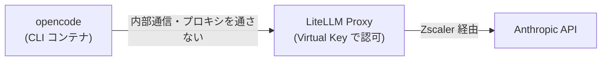

# 外部連携の事前確認: LiteLLM（opencode から Claude のモデルを呼ぶ）

作成日: 2026-11-02
対象の変更要求: opencode で Claude のモデルを使えるようにする

## 1. 連携先の概要

- 連携先は LiteLLM Proxy。本システムの CLI コンテナ（opencode）は、LLM を LiteLLM 経由でだけ呼ぶ。LiteLLM がその先の Anthropic API に転送する。
- LiteLLM はすでに Claude Code と opencode（OpenAI のモデル）の連携先として使っている。今回変わるのは、opencode から LiteLLM への呼び方だけ。

opencode から LiteLLM への呼び方は 2 通りある。

| 呼び方 | opencode のプロバイダ | LiteLLM の入口 | 宛先（baseURL） | キーの渡し方 |
|---|---|---|---|---|
| ① Anthropic の形式 | 組み込みの `anthropic` | `POST /v1/messages` | `http://litellm:4000/v1`（末尾の `/v1` が必須） | 環境変数 `ANTHROPIC_API_KEY`（`x-api-key` ヘッダーで送られる） |
| ② OpenAI 互換の形式 | 独自のプロバイダ（`npm: @ai-sdk/openai-compatible`）。モデルの一覧を設定に書く | `POST /v1/chat/completions` | `http://litellm:4000/v1` | 設定の `options.apiKey`（`Authorization: Bearer` で送られる） |

## 2. 接続できるかの判定

**接続できる。** ①も②も、本物の Anthropic まで 1 往復できた（8 章）。

- 接続経路: opencode から LiteLLM へは内部の通信で、`NO_PROXY` に `litellm` が入っているのでプロキシを通らない。LiteLLM から Anthropic へは Zscaler を経由する。Zscaler 越しの経路は、Zscaler 対応（PR #10）の実 LLM のシナリオで Claude Code を使って確かめてある。
- 認可の手続き: 新しく要るものはない。既存の Virtual Key と Anthropic の API キーを使う。

## 3. 認証方式

- opencode から LiteLLM へ: LiteLLM の Virtual Key（API キーの方式）。①でも②でも LiteLLM に受け付けられた。
- LiteLLM から Anthropic へ: Anthropic の API キー（LiteLLM の設定 `litellm/config-real.yml` の `os.environ/ANTHROPIC_API_KEY`）。
- トークンの更新や失効: 既存の Virtual Key の運用と同じで、変更はない。
- 接続元の制約: Zscaler 配下の環境では、LiteLLM の外向きの通信が Zscaler の証明書の束を信頼する必要がある（PR #10 で対応済み）。

## 4. 主な制限

| 制限 | 内容 |
|---|---|
| レート制限 | 本システムでは、Virtual Key ごとの呼び出し回数の制限を設けていない。Anthropic 側の上限は契約（組織の利用枠）による |
| タイムアウト | CLI の実行全体の上限は既存の `CLI_EXEC_TIMEOUT_SEC`（既定 10800 秒）のまま |
| 利用料 | opencode は 1 回の呼び出しで長い指示文を送るうえ、会話のタイトルを作るために「小さいモデル」を別に呼ぶ（下記） |
| 小さいモデル | `anthropic` プロバイダの既定の小さいモデルは `claude-haiku-5-5` で、今の LiteLLM の設定には無い。設定の `small_model` で、呼ぶモデルを指定できる |
| 起動時の外への通信 | opencode は起動のたびに models.dev からモデルの一覧を取りに行く（`OPENCODE_DISABLE_MODELS_FETCH` で止められる）。既存の OpenAI の経路でも起きていて、Zscaler 対応で通るようになっている |
| 模擬の LLM | テスト用の LiteLLM（`litellm/config.yml`）は Claude のモデルを OpenAI 形式の模擬に転送する。①では opencode が送る `reasoning.effort` を LiteLLM が拒否し、エラーになる |
| 法務・ライセンス | 新たな制約はない（既存の Anthropic の利用と同じ） |

## 5. 後続の isdd-external-research で調べる範囲

- 本番で使うモデル（`claude-opus-5-5` など）で、①が `reasoning.effort` などの設定項目を含めて通るか。今回の本物のテストは Haiku 4.5 で行った。
- ①と②で、プロンプトのキャッシュなど Anthropic 固有の機能が効くか（②は LiteLLM が OpenAI の形式から変換する）。
- テスト用の LiteLLM（模擬）で①を通すための設定（`drop_params` など）。
- 小さいモデルの扱い（`small_model` を指定するか、LiteLLM に Haiku を足すか）。
- 既存の OpenAI の経路（`provider.openai.options.baseURL` が `/v1` なし）を `/v1` 付きに揃えて問題ないか。

調査は公開の資料と実際の接続で進める。連携先のデータベースのスキーマ取得は要らない。`.env.example` には `ANTHROPIC_API_KEY` がすでにある。

## 6. 要件定義に進んでよいかの判定

**進んでよい。** 接続でき、認証は既存のもので足り、実現を妨げる制限は見つからなかった。要件定義では、次を制約として扱う。

- opencode から LLM を呼ぶ経路は LiteLLM 経由に限る（Virtual Key で利用者を管理するため）。
- 宛先の末尾に `/v1` を付ける必要がある。
- 小さいモデルの呼び出しが起きる。

## 7. 必要な環境変数（値は書かない）

| 環境変数 | 使う場所 | 用途 |
|---|---|---|
| `ANTHROPIC_API_KEY` | LiteLLM（実 API モード） | Anthropic への転送 |
| `ANTHROPIC_API_KEY` | opencode の CLI コンテナ（①の場合） | LiteLLM の Virtual Key を opencode に渡す |
| `OPENCODE_CONFIG_CONTENT` | opencode の CLI コンテナ | プロバイダ、宛先、小さいモデルの設定 |
| `LITELLM_PROXY_URL` | consumer | LiteLLM の宛先 |
| `LITELLM_MASTER_KEY` | LiteLLM・テスト環境 | 管理用のキー |

## 8. 実接続テストの結果

| 日時 | 対象 | 呼び方 | 結果 | 確認方法 |
|---|---|---|---|---|
| 2026-11-02 21:35 JST | 模擬の LiteLLM（`litellm/config.yml`） | ① | LiteLLM まで届いたが、模擬が `reasoning.effort` に応じずエラー | opencode 1.19.5 のコンテナから `opencode run` |
| 2026-11-02 21:35 JST | 模擬の LiteLLM | ② | エラーなしで最後まで動いた | 同上 |
| 2026-11-02 21:47 JST | 本物の Anthropic（使い捨ての LiteLLM。`litellm/config-real.yml`、データベースなし、マスターキーで認可。モデル `claude-haiku-4-5-20251001`） | ① | 成功。指定した文言（`PRECHECK-OK`）が返り、LiteLLM の `POST /v1/messages` が 2 回とも 200 | opencode の出力と LiteLLM の記録 |
| 同上 | 同上 | ② | 成功。同じ文言が返り、`POST /v1/chat/completions` が 2 回とも 200 | 同上 |

- 2 回ずつの呼び出しは、会話のタイトルを作る呼び出し（小さいモデル）と本体の呼び出し。
- 本物のテストは Zscaler の配下ではない端末で行った。Virtual Key ではなくマスターキーで認可した。
- 使い捨ての LiteLLM のコンテナは、テストの後に削除した。

## 9. 取得できるスキーマ（エンティティ一覧）

LLM の API なので、業務データのスキーマは無い。扱う対象は次のとおり。

- モデル: LiteLLM の `model_name`。Claude の系統は `claude-haiku-4-5-20251001`、`claude-opus-5-5`、`anthropic/claude-opus-5-5`（`litellm/config-real.yml`）。一覧は `GET /v1/models` で取れる。
- メッセージ: ①は Anthropic Messages API の形、②は OpenAI Chat Completions の形。

## 参考

- [OpenCode: Providers](https://opencode.ai/docs/providers)
- [OpenCode: Network](https://opencode.ai/docs/network)
- [LiteLLM: OpenCode Quickstart](https://docs.litellm.ai/docs/tutorials/opencode_integration)
