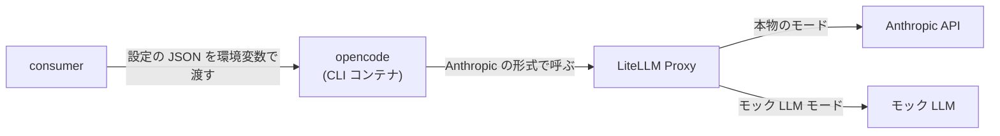

# 外部連携の調査レポート: LiteLLM Proxy（opencode から Claude のモデルを呼ぶ）

調査日: 2026-11-02
入力: `.history/20261102-opencode-claude-model/change_requirements.md`、`external/litellm/docs/precheck_report.md`

## 1. システム概要

- 連携先は LiteLLM Proxy（OSS）。複数の LLM を 1 つの入口で提供し、利用者ごとの Virtual Key で認可と費用の追跡を行う。本システムでは、LiteLLM Proxy の先を Anthropic API（と OpenAI API）にしている。
- API の種類: REST（HTTP と JSON。応答は SSE のストリーミング）。
- 今回の変更では、本システムのコードは LiteLLM Proxy を直接呼ばない。呼ぶのは CLI コンテナの中の opencode で、本システム（consumer）は opencode に渡す設定を組み立てるだけである。
- 公式の資料:
  - [OpenCode: Providers](https://opencode.ai/docs/providers)
  - [OpenCode: Network](https://opencode.ai/docs/network)
  - [LiteLLM: OpenCode Quickstart](https://docs.litellm.ai/docs/tutorials/opencode_integration)

## 2. 認証・接続情報

- 認証方式: LiteLLM Proxy の Virtual Key（API キー）。opencode の Anthropic 用の呼び方では、`x-api-key` のヘッダーで送られる。LiteLLM Proxy はこれを受け付ける（本物で確認済み）。
- キーの渡し方: opencode に渡す設定の JSON の `provider.anthropic.options.apiKey` に入れる。環境変数 `ANTHROPIC_API_KEY` は使わなくてよい（確認済み）。これにより、既存の CLI アダプタ設定（キーを `OPENAI_API_KEY` で渡す）を書き換えずに済む。
- ベース URL: LiteLLM Proxy の URL の末尾に `/v1` を付ける（例: `http://litellm:4000/v1`）。opencode は、その後ろに `/messages` を付けて呼ぶ。`/v1` が無いと 404 になる。
- 必要な環境変数（値は `.env` にだけ書く。一覧は `external/litellm/.env.example`）

| 環境変数 | 使う場所 | 用途 |
|---|---|---|
| `LITELLM_PROXY_URL` | consumer | LiteLLM Proxy の URL。opencode に渡すときに末尾へ `/v1` を付ける |
| `ANTHROPIC_API_KEY` | LiteLLM Proxy（本物のモード） | Anthropic への転送 |
| `LITELLM_MASTER_KEY` | LiteLLM Proxy・テスト環境 | 管理用のキー。Virtual Key の発行に使う |
| `OPENCODE_CONFIG_CONTENT` | opencode の CLI コンテナ | consumer が組み立てる設定の JSON |

## 3. オペレーション一覧

| オペレーション名 | エンドポイント | メソッド | 主要パラメータ | レスポンス概要 |
|---|---|---|---|---|
| Claude のモデルの呼び出し（opencode から） | `/v1/messages` | POST | `model`（LiteLLM の model_name。例: `claude-opus-5-5`）、`system`、`messages`、`tools`、`stream`、キャッシュの指定、推論の強さの指定 | Anthropic Messages API の形の SSE。使ったトークン数（キャッシュの書き込み・読み出しを含む） |
| モデルの一覧（既存。モデル候補の取得で使う） | `/models` | GET | なし（Virtual Key で認可） | モデル ID の一覧。`anthropic/claude-opus-5-5` と `claude-opus-5-5` の両方が出る |

opencode は 1 回の実行で、タイトル用のモデルの呼び出しと本体の呼び出しの少なくとも 2 回、`/v1/messages` を呼ぶ。

## 4. 連携先のデータ構造

連携先は DB 系ではない。扱うエンティティと、本システム（opencode を含む）からの操作は次のとおり。

| エンティティ名 | Create | Read（一覧） | Read（詳細） | 検索 | Update | Delete | 備考 |
|---|---|---|---|---|---|---|---|
| メッセージ（LLM の呼び出し） | ○ | × | × | × | × | × | 呼び出しのたびに作る。保存しない |
| モデル | × | ○ | × | × | × | × | 既存のモデル候補の取得で読む |
| Virtual Key | △ | × | × | × | × | × | テスト環境の構築のときだけ発行する（既存） |

## 5. 制限事項

| 項目 | 内容 |
|---|---|
| レート制限 | 本システムは Virtual Key ごとの制限を設けていない。Anthropic 側の上限は契約による |
| ページネーション | 無い |
| タイムアウト | CLI の実行全体の上限 `CLI_EXEC_TIMEOUT_SEC`（既定 10800 秒）のまま。個々の呼び出しの上限は opencode に任せる |
| タイトル用のモデル | opencode の Anthropic 用の既定は `claude-haiku-5-5` で、LiteLLM Proxy に無いことがある。設定の `small_model` に本体と同じモデルを入れれば、そのモデルが使われる（確認済み） |
| 推論の強さの指定 | opencode は上位のモデル（Opus など）に推論の強さ（`reasoning.effort`）を送る。本物の Anthropic は受け付ける（Opus 5.5 で確認済み）。モック LLM は応じないので、モック LLM モードでは LiteLLM Proxy の `drop_params` で捨てる |
| プロンプトのキャッシュ | 効く。Opus 5.5 で、1 回目に 10,467 トークンを書き込み、2 回目に同じ量を読み出した |
| 起動時の外への通信 | opencode は起動のたびに models.dev からモデルの一覧を取る。既存の OpenAI の経路と同じで、Zscaler 対応で通る |
| OpenAI の経路のタイトル用のモデル（範囲外） | 既存の OpenAI の経路では、タイトル用のモデル `gpt-5.4-nano-flex` が LiteLLM Proxy に無く、400 になってから opencode が呼び直す。処理は完了する。`.history/IDEAS.md` に記録した |

## 6. モックの説明

- 方式: ローカルの HTTP サーバー方式（既存のモック LLM）。モック LLM モードでは、テスト用の LiteLLM Proxy が Claude のモデル名を含むすべてのモデルをモック LLM に転送する。opencode は本物のモードと同じく LiteLLM Proxy の `/v1/messages` を呼び、LiteLLM Proxy がモック LLM の OpenAI 互換の入口へ変換して転送する。
- 選んだ理由: 既存のモック LLM が、opencode と Claude Code の通し確認ですでに使われていて、状態を持つ処理（Issue→MR 変換、MR 処理）の流れを再現できるため。
- 今回要る手直し: テスト用の LiteLLM Proxy の設定で、モック LLM が応じない設定項目（推論の強さなど）を捨てる（`drop_params` を有効にする）。この設定で、opencode の Anthropic 用の呼び方が最後まで通ることを確かめた。
- 正本の場所: モック LLM は `mock-llm/`、テスト用の LiteLLM Proxy の設定は `litellm/config.yml` が正本である（docker compose・CI・イメージの公開がこの場所を前提にしているため）。`external/litellm/mock/` には、この 2 つへのシンボリックリンクを置き、git で管理する。
- 使い方: テスト環境の構築（`./scripts/test_setup.sh`）でモック LLM と LiteLLM Proxy が起動する。利用者は何もしなくてよい。

## 7. 既存ライブラリの選定結果

本システムのコードは LiteLLM Proxy を直接呼ばないので、連携ライブラリ（`external/litellm/src/`）は作らない。選定したのは、opencode が Claude を呼ぶときに使う部品である。どちらも opencode 1.19.5 に同梱されていて、新たに入れるものは無い。

| 評価項目 | 組み込みの Anthropic 用（`@ai-sdk/anthropic`） | OpenAI 互換（`@ai-sdk/openai-compatible`） |
|---|---|---|
| メンテナンス状況 | Vercel AI SDK の一部で、opencode と一緒に更新される | 同じ |
| 利用実績 | opencode で Claude を使うときの標準 | LiteLLM の公式の手順で使われている |
| ライセンス | Apache-2.0（AI SDK）。opencode に同梱 | 同じ |
| 対象 API のカバレッジ | Anthropic Messages API をそのまま使う。推論の強さ・キャッシュ・モデルの情報（扱える文の長さなど）を opencode が持っている | LiteLLM が OpenAI の形式から変換する。使うモデルを設定に並べる必要があり、モデルの情報を opencode が知らない |
| 認証方式サポート | `x-api-key`。本物で確認済み | `Authorization: Bearer`。本物で確認済み |
| 型定義の有無 | 該当しない（コードからは使わず、設定で使う） | 同じ |
| テスタビリティ | モック LLM モードでは LiteLLM Proxy の `drop_params` が要る | 今のモック LLM のままで通る |

- 推奨と理由: 組み込みの Anthropic 用。利用者が書く `anthropic/…` という名前のまま opencode の標準の呼び方になり、モデルの情報も opencode が正しく扱える。
- 不採用の理由（OpenAI 互換）: モデルの一覧を consumer が組み立てる必要があり、会話が長くなったときの要約の判断に、モデルの情報が使われない。
- リスク評価
  - 運用: モック LLM モードの LiteLLM Proxy に設定が 1 つ増える。
  - 法務: 新たな制約は無い。
  - 保守: opencode の更新で、Anthropic 用の呼び方の既定（タイトル用のモデルなど）が変わる可能性がある。`small_model` を明示しているので、タイトル用のモデルの変化には影響されない。
- ユーザーの最終決定: 組み込みの Anthropic 用を採用する（2026-11-02）。連携ライブラリは作らない（2026-11-02）。

試した結果（2026-11-02、本物の Anthropic、使い捨ての LiteLLM Proxy）

| モデル | 呼び方 | 結果 | キャッシュ（1 回目の書き込み → 2 回目の読み出し） |
|---|---|---|---|
| Opus 5.5 | Anthropic 用 | 2 回とも成功 | 10,467 → 10,467 トークン |
| Haiku 4.5 | Anthropic 用 | 2 回とも成功 | 7,908 → 7,908 トークン |
| Haiku 4.5 | OpenAI 互換 | 2 回とも成功 | 書き込みは報告されず → 7,689 トークン |

## 8. E2E の 2 モード運用

- モック LLM モード: `./scripts/test_setup.sh --run-tests`。テスト用の LiteLLM Proxy（`litellm/config.yml`）がモック LLM に転送する。費用はかからない。実装時と CI では、このモードで全件通ることをゴールにする。
- 実 LLM モード: `./scripts/test_setup.sh --real --run-tests`。LiteLLM Proxy（`litellm/config-real.yml`）が本物の Anthropic に転送する。手動での実行だけを必須にする。Anthropic の API キーだけで、opencode で Claude のモデルを指定したシナリオを流せる。
- 切り替えは、テスト環境の構築のコマンドの `--real` で行う（docker compose のプロファイル `test` と `test-real` が切り替わる）。Zscaler の模擬プロキシ（`--zscaler-mock`）とも組み合わせられる。
- モックはシンボリックリンク（`external/litellm/mock/`）で参照し、リンクも git で管理する。テスト環境を作るスクリプトは既存の bash と Python のまま。

## 追補（2026-11-03）: 本番のモデル名（プロバイダ名なし）

入力: `.history/20261103-opencode-model-name-rule/change_requirements.md`

| 確かめたこと | 結果 | 確かめ方 |
|---|---|---|
| 本番の LiteLLM Proxy のモデル名 | プロバイダ名が付かない。Claude のモデル名はすべて `claude-` で始まる | ユーザーへの確認（2026-11-03） |
| opencode に `/` の無い名前を渡したとき | `ProviderModelNotFoundError: Model not found: gpt-4o-mini/.`。opencode は `/` の無い名前をプロバイダ名と読む。Claude の名前でも同じ | テスト環境の LiteLLM Proxy（モック）に向けて opencode 1.19.5 で実行 |
| opencode に「プロバイダ/モデル」の形で渡したとき | `anthropic/claude-…` は Anthropic の形式、`openai/…` は OpenAI の形式で呼び、LiteLLM Proxy には `/` の後ろのモデル名が届く | 2026-11-02 の調査（本物とモック） |
| テスト環境の LiteLLM Proxy のモデル名 | モック用・本物用のどちらの設定にも、プロバイダ名の無い `claude-haiku-4-5-20251001`・`claude-opus-5-5`・`gpt-4o-mini` などがある | `litellm/config.yml`・`config-real.yml` |

このため、本システムは opencode に渡す前に、モデル名を常に「プロバイダ/モデル」の形にする必要がある。LiteLLM Proxy に届く名前は `/` の後ろなので、本番の名前（プロバイダ名なし）と一致する。
